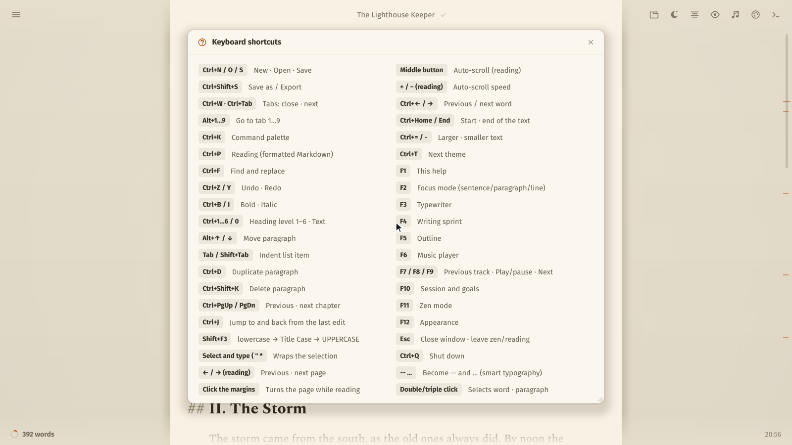
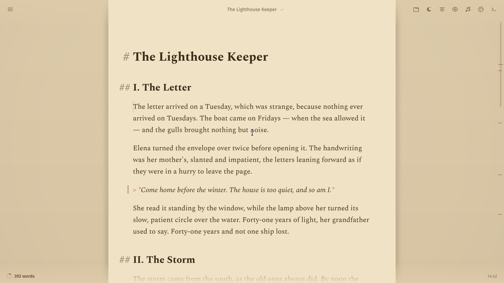

<!-- Generated by tools/readmes.pl from README.md and docs/i18n/README.de.po — edit the .po, not this file. -->
<div align="center">

<a id="folioos--the-distraction-free-writing-os-that-boots-from-a-usb-stick"></a>

# FolioOS — das ablenkungsfreie Schreibsystem, das direkt vom USB-Stick startet

**Mach aus jedem alten Laptop eine reine Schreibmaschine.**<br>
Kein Windows. Kein Linux. Kein Internet. Keine Benachrichtigungen. Nur du und der Text.

[](https://github.com/alantaru/FolioOS/actions/workflows/build.yml)
[](https://github.com/alantaru/FolioOS/releases/latest)
[](LICENSE)
[](#hardware-compatibility)
[](#13-15-languages-and-counting)
[](docs/TRANSLATING.md)

[**⬇ Herunterladen**](https://github.com/alantaru/FolioOS/releases/latest) ·
[Installieren](#install-in-3-minutes) ·
[Rundgang](#a-tour-of-folioos) ·
[Sprachen](#13-15-languages-and-counting) ·
[FAQ](#faq) ·
[Kompilieren](#build-from-source) ·
[Mitmachen](CONTRIBUTING.md)

<!-- languages -->
<sub>[English](README.md) · [Español](README.es.md) · [Français](README.fr.md) · **Deutsch** · [Italiano](README.it.md) · [Português (Brasil)](README.pt-BR.md) · [Português (Portugal)](README.pt-PT.md) · [Nederlands](README.nl.md) · [Polski](README.pl.md) · [Türkçe](README.tr.md) · [Русский](README.ru.md) · [Українська](README.uk.md) · [简体中文](README.zh-CN.md) · [日本語](README.ja.md) · [한국어](README.ko.md)</sub>
<!-- /languages -->


</div>

FolioOS ist eine **bootfähige Schreibumgebung**: ein winziges Betriebssystem, das genau eine Sache tut — dich
schreiben lassen. Steck den USB-Stick in fast jeden PC aus dem letzten Jahrzehnt, starte davon, und nach
wenigen Sekunden bist du in einem bildschirmfüllenden, schön gesetzten Markdown-Editor, genau dort, wo du
zuletzt aufgehört hast. Kein Browser, keine E-Mail, kein App-Store und kein WLAN, die dich ablenken.

Deine Texte werden als **einfache Markdown-Dateien auf einem gewöhnlichen FAT32-Stick** gespeichert, sodass
sich derselbe Stick unter Windows, macOS und Linux öffnen lässt. Exportiere nach Word, LibreOffice, EPUB,
HTML oder RTF, wann immer du etwas teilen willst.

<a id="who-is-it-for"></a>

## Für wen ist es?

- **Romanautoren, Journalisten, Studierende und Blogger**, die ein *Writerdeck* — ein reines,
  ablenkungsfreies Schreibgerät — wollen, ohne neue Hardware zu kaufen.
- **NaNoWriMo-Teilnehmer** und alle, die Schreibsprints mit Zeitlimit oder Morgenseiten schreiben.
- **Alle mit einem alten Laptop in der Schublade**: FolioOS gibt ihm ein zweites Leben – direkt vom
  USB-Stick oder auf seiner Festplatte installiert, allein oder neben dem System, das schon darauf ist.
- **Schulen und Bibliotheken**, die einen einfachen Offline-Schreibplatz brauchen.
- **Datenschutzbewusste Autoren**: kein Netzwerk, keine Telemetrie, keine Cloud.

<a id="install-in-3-minutes"></a>

## In 3 Minuten installiert

1. **Lade** [`FolioOS.zip`](https://github.com/alantaru/FolioOS/releases/latest) aus der neuesten Version herunter.
2. **Entpacke es ins Hauptverzeichnis eines FAT32-formatierten USB-Sticks.** Die meisten Sticks bis 32 GB
   sind das schon. Dateien auf dem Stick bleiben erhalten. ([So formatierst du in FAT32](docs/INSTALL.txt))
3. **Starte den PC neu und öffne das Bootmenü** — meist **F12** (Dell, Lenovo), **F9** (HP), **F8** (Asus)
   oder **Esc/F11** — und wähle den **UEFI**-Eintrag des Sticks. Fehlt er, schalte *Secure Boot* im
   Firmware-Setup aus.

<details>
<summary><b>Andere Installationswege</b></summary>

- **Disk-Image:** `FolioOS-disk-image.zip` enthält ein fertiges 256-MB-Image für
  [Rufus](https://rufus.ie) (DD-Modus), [balenaEtcher](https://etcher.balena.io) oder `dd`. Empfohlen bleibt
  das Entpacken von `FolioOS.zip`: Der Rest des Sticks bleibt frei für deine Dateien.
- **Aus dem Quellcode unter Windows:** `.\build.ps1`, dann `.\flash_usb.ps1 -DriveLetter E:` (installiert oder
  aktualisiert einen Stick, ohne etwas zu löschen).
- **PCs ohne UEFI (nur BIOS/Legacy):** starte einmal unter Windows als Administrator
  `FOLIO\TOOLS\biosboot.exe E:` (`E:` ist der Stick). Es schreibt nur den BIOS-Startcode: Keine Datei wird
  angefasst, der Stick bleibt ein gewöhnlicher FAT32-Stick, und der UEFI-Start funktioniert weiter. Aus dem
  Quellcode: `.\flash_usb.ps1 -DriveLetter E: -Bios`.
- **Alles dabei:** `FolioOS.zip` bringt bereits 11 freie Schriften zum Schreiben und Lesen sowie die
  Schriften für Chinesisch, Japanisch und Koreanisch mit — jede Sprache funktioniert sofort.

</details>

> **Ohne Neustart ausprobieren:** `folio_sim.exe` führt denselben Code in einem Windows-Fenster aus, und
> `efi_host.exe` startet das echte UEFI-Programm — siehe [Aus dem Quellcode bauen](#build-from-source).

---

<a id="a-tour-of-folioos"></a>

## Ein Rundgang durch FolioOS

<a id="1-start-up"></a>

### 1. Start


FolioOS startet direkt aus der Firmware. Der Startbildschirm erscheint, während die Schriften laden, und
jede Taste überspringt ihn — du kannst sofort losschreiben. Seine Dauer (1–60 s) ist einstellbar, oder du
schaltest ihn ab.

Beim allerersten Start folgt FolioOS der Sprache des Firmware-Setups deines PCs und öffnet einen kurzen
Willkommenstext. Danach öffnet es immer **dein letztes Dokument genau in der Zeile, in der du warst** —
selbst wenn du im Lesemodus warst.

<br clear="right">

<a id="2-the-writing-screen"></a>

### 2. Die Schreibansicht


Die Seite ist alles, was es gibt. Die obere und untere Leiste **verschwinden, sobald du tippst**, und kommen
zurück, wenn du die Maus bewegst. Markdown wird live dargestellt — `#`-Überschriften, `**fett**`, `*kursiv*`,
`> Zitate`, Listen und `- [ ]`-Aufgaben —, während die Auszeichnung sichtbar und bearbeitbar bleibt. Die
schmale Leiste rechts zeigt, wo du bist, und markiert jedes Kapitel.

- **Intelligente Typografie:** `--` wird zum Gedankenstrich, `...` zur Auslassung, und gerade
  Anführungszeichen werden zu den richtigen typografischen *deiner Sprache* („ “ im Deutschen, “ ” im
  Englischen, « » im Französischen, 「 」 im Japanischen).
- **Papier oder Vollbild:** Schreib auf einem Blatt Papier auf dem Schreibtisch oder über den ganzen
  Bildschirm; wähle die Spaltenbreite (schmal, mittel, breit, extra).
- Rückgängig/Wiederholen, wortweise Navigation, Absätze mit **Alt+↑/↓** verschieben, Absätze duplizieren
  oder löschen, Groß-/Kleinschreibung mit **Umschalt+F3** wechseln, eine Auswahl in `( " * _` einschließen
  und mit **Strg+J** zur letzten Änderung springen.

<a id="3-focus-mode-and-zen-mode"></a>

### 3. Fokusmodus und Zen-Modus

<div align="center">


</div>

**F2** blendet alles außer dem Satz, Absatz oder der Zeile ab, an der du schreibst. **F3** ist der
*Schreibmaschinenmodus*: Die aktuelle Zeile bleibt in der Bildschirmmitte. **F11** ist der *Zen-Modus*:
keine Leisten, bis du den oberen Rand berührst. Der **Hemingway-Modus** schaltet das Löschen ab, damit du
vorwärts schreibst.

<a id="4-reading-mode"></a>

### 4. Lesemodus


**Strg+P** verwandelt dein Markdown in eine gesetzte Seite, wie ein Buch. Blättere mit den Pfeiltasten, der
Leertaste oder einem Klick auf die Ränder. Die untere Leiste zeigt, wie viel du gelesen hast und wie lange
Kapitel und Gesamttext noch dauern; das **automatische Scrollen** bewegt den Text in deinem Lesetempo (in
Wörtern pro Minute): **Eingabe** oder die mittlere Maustaste startet es, **+** und **−** ändern das Tempo.
**Esc** führt zurück zum Schreiben *an den Absatz, den du gerade gelesen hast*.

<a id="5-chapters-and-outline"></a>

### 5. Kapitel und Gliederung


Jede `#`-Überschrift ist ein Kapitel. **F5** öffnet die Gliederung, um überallhin zu springen;
**Strg+Bild↑/Bild↓** wechselt beim Schreiben wie beim Lesen zwischen Kapiteln. Lange Manuskripte bleiben so
leicht zu durchqueren — und der EPUB-Export macht aus diesen Kapiteln ein echtes E-Book-Inhaltsverzeichnis.

<br clear="right">

<a id="6-find-and-replace"></a>

### 6. Suchen und Ersetzen


**Strg+F** hebt jeden Treffer hervor, zählt sie und ersetzt einen oder alle.

<a id="7-files-open-save-and-export"></a>

### 7. Dateien: öffnen, speichern und exportieren

<div align="center">


</div>

**Strg+O** öffnet einen echten Dateimanager: alle Laufwerke, die die Firmware anbietet, Ordner, Anlegen,
Umbenennen und Löschen. **Strg+Umschalt+S** speichert unter anderem Namen oder **exportiert nach DOCX, ODT,
EPUB, HTML, RTF oder TXT** — ein Klick auf das Format. Alles andere geschieht automatisch:

- **Automatisches Speichern** (standardmäßig alle 20 Sekunden) mit **atomarem Schreiben**: Ein Stromausfall
  hinterlässt nie eine halbe Datei.
- **Automatische Versionen:** Die vorherige Fassung jeder gespeicherten Datei landet in `FOLIO/VERSIONS` (die
  letzten 30 je Dokument bleiben erhalten).
- **Entwurfswiederherstellung** für Text, der nie einen Namen bekommen hat.

**LaTeX-Quelltexte** (`.tex`, `.bib`, `.sty`, `.cls`) öffnen sich als reiner Quelltext in einer
nichtproportionalen Schrift, mit zeilenweiser Hervorhebung von Befehlen, Klammern, `%`-Kommentaren und
Formeln im Text, echten Tabstopps und `{`, `[` und `$`, die sich selbst schließen. Weder
Markdown-Formatierung noch typografische Anführungszeichen verändern den Quelltext, und die Datei behält
ihre Zeilenenden (CRLF bleibt CRLF). FolioOS kompiliert kein LaTeX: Lesemodus und Export gelten für
Markdown-Dokumente.

### 8. Tabs (optional)


Lieber mehrere Dokumente gleichzeitig? Schalte die Tabs mit dem ersten Symbol oben rechts ein. **Strg+N**
öffnet einen Tab, **Strg+W** schließt ihn, **Strg+Tab** oder **Alt+1…9** wechseln. Tabs — auch unbenannte —
kommen nach einem Neustart zurück. Ausgeschaltet bleibt FolioOS eine ruhige Schreibmaschine für ein Dokument
nach dem anderen.

<a id="9-goals-sprints-and-statistics"></a>

### 9. Ziele, Sprints und Statistik


**F10** zeigt dein tägliches Wortziel, die Wörter in diesem Dokument und dieser Sitzung, die Lesezeit und
dein Schreibtempo. **F4** startet einen zeitlich begrenzten **Schreibsprint** (15–60 Minuten), der mit einer
sanften Glocke endet. Heute geschriebene Wörter werden über Dokumente und Neustarts hinweg gezählt.

<br clear="right">

<a id="10-command-palette-and-shortcuts"></a>

### 10. Befehlspalette und Tastenkürzel


**Strg+K** findet jeden Befehl mit ein paar Buchstaben — in deiner Sprache. **F1** listet alle Tastenkürzel auf:



<a id="no-mouse-needed"></a>

#### Keine Maus nötig

Alles in FolioOS funktioniert nur mit der Tastatur, und Maus und Touchpad lassen sich ganz abschalten
(*Einstellungen › System › Maus und Touchpad verwenden*, **Strg+K › Maus** oder `use_mouse=0` in
`CONFIG.INI`) — praktisch bei Laptops, deren Touchpad den Cursor springen lässt.

| Tasten | Was sie tun |
|---|---|
| Tastenkürzel eines Fensters (F12, F5, F6, F10, Strg+O…) | Öffnet es mit der Tastatur darin |
| **Tab** / **Umschalt+Tab**, **↑ ↓** | Wechseln zwischen Schaltflächen, Schaltern, Reglern und Listen eines Fensters |
| **Eingabe** oder **Leertaste** | Lösen die hervorgehobene Schaltfläche, den Schalter oder den Eintrag aus |
| **← →** | Stellen den hervorgehobenen Regler, die Option oder den Wert ein |
| **Esc** | Schließt das Fenster und kehrt zum Text zurück; ist nichts offen, zeigt es die ausgeblendeten Leisten |
| **Strg+F6** | Bringt die Tastatur zwischen dem Text und den offenen Fenstern hin und her |
| **Alt+M** | Menü mit den zuletzt geöffneten Dokumenten (auch in Strg+K) |
| **Alt+F7** / **Alt+F8** | Fenster mit den Pfeiltasten verschieben / Größe ändern (Umschalt = kleine Schritte); Eingabe bestätigt, Esc macht es rückgängig |

Eine Hervorhebung zeigt, welches Element die Tastatur hat; sie erscheint erst, wenn du die Tasten benutzt,
für Mausnutzer ändert sich also nichts. Buchstaben, die du in einem Seitenfenster (Gliederung, Musik,
Einstellungen) tippst, landen direkt wieder in deinem Text.

<a id="11-themes-and-typography"></a>

### 11. Themes und Typografie


**F12** öffnet die Darstellungseinstellungen: **20 von Hand abgestimmte Themes**, Textschrift, Größe,
Zeilenabstand, Absatzabstand und Einzug der ersten Zeile. Der Text wird von FolioOS’ eigener
TrueType-Engine mit echtem Kerning und Kantenglättung gezeichnet — scharf von kleinen Netbook-Bildschirmen
bis 4K.

<div align="center">




</div>


**Gestalte dein eigenes:** Im Theme-Editor wählst du jede der 16 Farben (oder übernimmst sie aus einem
mitgelieferten Theme), eine Schrift für den Text und eine für die Oberfläche, und siehst das Ergebnis
sofort. Themes sind kleine `.INI`-Textdateien in `FOLIO/THEMES` — leicht zu teilen. Leg eine beliebige
`.ttf`-Schrift in `FOLIO/FONTS`, um sie zu nutzen; FolioOS bringt bereits Literata, Lora, EB Garamond,
iA Writer Quattro/Duo/Mono, Special Elite und mehr mit.

<br clear="right">

<a id="12-music-while-you-write"></a>

### 12. Musik beim Schreiben

**F6** öffnet einen kleinen MP3-Player für die Dateien im Ordner `MUSIC` des Sticks (Intel HD Audio und
AC'97). **F7/F8/F9** steuern ihn, ohne die Seite zu verlassen.

<a id="13-15-languages-and-counting"></a>

### 13. 15 Sprachen und es werden mehr

<div align="center">


</div>

**English, Español, Français, Deutsch, Italiano, Português (Brasil), Português (Portugal), Nederlands,
Polski, Türkçe, Русский, Українська, 简体中文, 日本語, 한국어.**


Nichts Sprachliches ist fest im Code verankert. Jede Übersetzung ist eine standardmäßige
**gettext-`.po`-Datei** in `FOLIO/LANGUAGES`, die auch ihre Pluralregeln, Anführungszeichen, das
Datumsformat, das Dezimaltrennzeichen, die Standardtastatur und die Schriften festlegt — **eine Sprache
hinzuzufügen heißt, eine Datei auf den Stick zu legen**. Auch Tastaturbelegungen sind Textdateien: US,
US-International, UK, ABNT2, Portugal, Spanien, Lateinamerika, französisches AZERTY, deutsches QWERTZ,
Italienisch, Polnisch, türkisches Q, Russisch, Ukrainisch, Koreanisch (Hangul-Eingabe mit 2 Sätzen) und
Japanisch (Eingabe Romaji → Kana).

Du willst FolioOS in deiner Sprache? Lies **[docs/TRANSLATING.md](docs/TRANSLATING.md)** — es funktioniert
mit Poedit, Weblate, Crowdin oder jedem Texteditor.

<br clear="right">

<a id="14-your-files-on-any-computer"></a>

### 14. Deine Dateien, auf jedem Computer

```
USB-Stick (FAT32)
├── DOCUMENTS/          deine .md- und .txt-Dateien und die Exporte (.docx .odt .epub .html .rtf)
├── MUSIC/              deine .mp3-Dateien
├── FOLIO/
│   ├── CONFIG.INI      Einstellungen — einfacher Text, von Hand bearbeitbar
│   ├── FONTS/          .ttf-Schriften (füge eigene hinzu)
│   ├── THEMES/         deine Themes (.INI)
│   ├── LANGUAGES/      Übersetzungen (.po)
│   ├── KEYBOARDS/      Tastaturbelegungen (.txt)
│   ├── VERSIONS/       automatische frühere Versionen gespeicherter Dateien
│   └── BACKUP/         Partitionstabellen, die der Installer sichert, bevor er etwas schreibt
└── EFI/BOOT/           FolioOS selbst (BOOTX64.EFI, BOOTIA32.EFI, BOOTAA64.EFI)
```

Keine Datenbank, keine versteckte Partition, kein proprietäres Format. Nimm den Stick an irgendeinen
Computer, und deine Texte sind da.

<a id="15-install-it-on-the-computer-beta"></a>

### 15. Auf dem Computer installieren (Beta)

Der USB-Stick reicht, aber FolioOS kann auch auf der Festplatte des Computers wohnen, sodass der Laptop direkt
in dein Schreiben startet. Öffne **Strg+K › FolioOS auf diesem Computer installieren** (oder *Einstellungen › System*):

- **Als einziges System**, auf einem leeren Datenträger oder einem, den du löschen willst – du bestätigst mit
  einem eingetippten Wort.
- **Neben Windows oder Linux**, im freien Speicher, ohne die anderen Partitionen anzurühren. Jeder Start zeigt
  einige Sekunden lang *Drücke eine beliebige Taste, um zu schreiben* und startet dann wie gewohnt das andere
  System; Windows wird von der Firmware selbst gestartet, so wie immer.
- **Kein freier Speicher?** FolioOS kann eine NTFS-, FAT32- oder exFAT-Partition verkleinern, ohne Daten zu
  verschieben. Was nicht sicher ist, lehnt es ab – Windows im Ruhezustand oder mit Schnellstart, ein Volume,
  das `chkdsk` braucht, BitLocker ohne Wiederherstellungsschlüssel, LUKS, LVM, Apple-Volumes – und erklärt,
  was stattdessen zu tun ist. ext4 wird nie in der Größe geändert: Schaffe unter Linux Platz (GParted) und
  starte den Installer erneut.
- Bevor irgendetwas geschrieben wird, wird die Partitionstabelle (die ersten und letzten Sektoren des
  Datenträgers) in `FOLIO/BACKUP` auf dem Laufwerk gesichert, von dem FolioOS gestartet wurde – normalerweise
  dem USB-Stick. Deine Texte können auf dem Computer, auf dem USB-Stick oder auf beiden liegen.
- **Aktualisieren** von einem neueren USB-Stick: Nur die Dateien von FolioOS selbst werden ersetzt; deine
  Texte und die Partitionen bleiben, wie sie sind.
- **Deinstallieren**: Deine Texte können vorher auf das Laufwerk kopiert werden, von dem FolioOS gestartet
  wurde. Hat der Installer eine Partition verkleinert, um Platz zu schaffen, wächst sie wieder auf ihre frühere
  Größe, sofern der Platz dahinter noch frei ist; sonst wird der Platz frei. Muss diese Partition wieder wachsen und ist
  Windows im Ruhezustand (oder nutzt den Schnellstart), bittet FolioOS dich, es zuerst vollständig herunterzufahren, und ändert nichts.
- *Einstellungen › System › Datenträger und Partitionen* ist eine kleine Partitionsverwaltung: FAT32-Partition
  anlegen, formatieren, NTFS/FAT32/exFAT verkleinern oder vergrößern, löschen.
- Die 4.4 Beta ist eine Vorabversion: Lade sie von
  [ihrer Release-Seite](https://github.com/alantaru/FolioOS/releases/tag/v4.4.1-beta) herunter, nicht über „latest“.

Funktioniert auf UEFI-PCs und auf PCs mit reinem BIOS. **Das ist eine Beta:** Sie besteht alle Tests auf
emulierten Maschinen, mit Datenträgern von Windows und von Linux, lief aber noch nicht auf echter Hardware –
mach vorher ein Backup oder nimm einen freien Datenträger.

---

<a id="how-folioos-compares"></a>

## FolioOS im Vergleich

| | FolioOS | Eigene Geräte (Freewrite, AlphaSmart, Pomera) | Schreib-Apps (iA Writer, Scrivener, Fokusmodi) |
|---|:---:|:---:|:---:|
| Kosten | **Kostenlos** | Hunderte Dollar | Kostenlos bis kostenpflichtig |
| Hardware | Jeder UEFI-PC, den du schon hast | Ein neues Gerät | Dein gewohnter Computer |
| Ablenkungen in Reichweite | **Keine** — kein Betriebssystem, kein Netzwerk | Keine | Ein Alt+Tab entfernt |
| Dateiformat | Einfaches Markdown auf FAT32 | Gerätespezifische Synchronisierung/Export | Unterschiedlich |
| Bildschirm und Typografie | Großer Bildschirm, TrueType, Themes | Kleines E-Ink- oder LCD-Display | Hervorragend |
| Funktioniert offline | **Immer** | Meistens | Ja |
| Open Source | **Ja (GPL-3.0)** | Nein | Meistens nicht |

<a id="hardware-compatibility"></a>

## Hardware-Kompatibilität

| | |
|---|---|
| **Firmware** | UEFI 2.x — 64 Bit (`BOOTX64.EFI`), 32 Bit (`BOOTIA32.EFI`, Atom-Tablets und Netbooks) oder ARM64 (`BOOTAA64.EFI`: Raspberry Pi 3/4/5 mit der UEFI-Firmware der Community, ARM-Laptops). **PCs nur mit BIOS** (Legacy/CSM) starten über FolioOS’ eigene BIOS-Brücke, nachdem einmal `FOLIO\TOOLS\biosboot.exe` gelaufen ist. Secure Boot muss ausgeschaltet sein. |
| **Anzeige** | Jeder UEFI-GOP-Framebuffer (RGB, BGR, Bitmaske, nur Blt) oder älteres UGA; VESA/VBE auf BIOS-PCs. Native Auflösung, automatische HiDPI-Skalierung, Hochkant-Bildschirme werden automatisch gedreht. Wenn der einzige Modus 4:3 ist und ein Breitbildschirm ihn streckt, behält *Einstellungen › System › Anzeige und Zeiger* die Proportionen bei (Monitor, 16:9, 16:10 oder 4:3). |
| **Eingabe** | Tastatur über die Firmware (auf BIOS-PCs direkt über PS/2). Maus, Touchpad, Grafiktablett und Touchscreen über die Firmware — und wenn die Firmware keinen Treiber dafür hat, über FolioOS’ eigene USB-HID- und PS/2-Treiber. |
| **Ton** | Intel HD Audio und AC'97 (nur für den Musikplayer nötig). |
| **Datenträger (Installer, Beta)** | SATA-, NVMe-, IDE- und USB-Datenträger mit 512-Byte-Sektoren, GPT oder MBR. NTFS, FAT32 und exFAT lassen sich verkleinern und wieder vergrößern, ohne Daten zu verschieben; BitLocker, LUKS, LVM, APFS/HFS+ und ext4 werden nie in der Größe geändert. |
| **Nicht unterstützt** | Secure Boot (vorerst), Macs mit Apple Silicon. WLAN und Bluetooth sind bewusst weggelassen. |
| **Getestet auf** | 20 emulierte Maschinen bei jeder Version: UEFI x64, IA32 und ARM64 sowie reine BIOS-PCs, die von USB und IDE starten; 8 Grafikkarten, PS/2- und USB-Mäuse, USB-Tablet, HD Audio und AC'97; FolioOS auf SATA- und IDE-Datenträgern installiert, Dual-Boot neben Windows (UEFI) und einem anderen System (BIOS), Verkleinern eines von Windows erstellten NTFS und Proportionen beibehalten. Bei jeder werden Bild, Tastatur, Maus, Ton, Speichern und die Integrität des Dateisystems geprüft. |

Jeder Start schreibt `FOLIO/DIAGNOSTICS.TXT` mit dem, was FolioOS gefunden hat. Teile deine Datei in einem
[Hardware-Bericht](https://github.com/alantaru/FolioOS/issues/new/choose) — selbst „läuft einfach“ hilft
anderen Schreibenden bei der Wahl eines Laptops.

<a id="faq"></a>

## Häufige Fragen

<details>
<summary><b>Löscht es meinen Computer oder meinen USB-Stick?</b></summary>

Nein. Vom USB-Stick aus schreibt FolioOS nur dann auf die interne Festplatte, wenn du es darum bittest: Einen
Text auf einem ihrer Volumes zu speichern, schreibt diese Datei, und nur der Installer und *Datenträger und
Partitionen* ändern Partitionen – und selbst dann ändert sich keine Partition, bevor du bestätigst und die
Partitionstabelle auf dem Laufwerk gesichert ist, von dem FolioOS gestartet wurde (deine offenen Texte werden
vorher dort gespeichert, wo sie liegen). Die Installation auf dem
Stick fügt nur Dateien hinzu – was schon darauf ist, bleibt. Zieh den Stick ab, und der PC startet wieder sein
gewohntes System.
</details>

<details>
<summary><b>Kann ich es auf dem Laptop installieren, neben Windows oder Linux?</b></summary>

Ja, seit 4.4 (Beta): **Strg+K › FolioOS auf diesem Computer installieren**. Es nutzt freien Speicher oder
verkleinert eine NTFS-, FAT32- oder exFAT-Partition, ohne Daten zu verschieben, und bei jedem Start wählst du
FolioOS oder das andere System. Beim Deinstallieren wächst die Partition, die der Installer verkleinert hat, wieder, wenn der Platz dahinter noch frei ist (sonst wird der Platz frei). Siehe [Auf dem Computer installieren](#15-install-it-on-the-computer-beta).
</details>

<details>
<summary><b>Sind meine Texte sicher, wenn der Akku leer wird?</b></summary>

Speichervorgänge sind atomar (die Datei wird vollständig geschrieben, bevor sie die alte ersetzt), das
automatische Speichern läuft standardmäßig alle 20 Sekunden, unbenannter Text hat einen
Wiederherstellungsentwurf, und jede gespeicherte Datei behält ihre früheren Versionen in `FOLIO/VERSIONS`.
</details>

<details>
<summary><b>Kann ich meine Dateien auch auf meinem normalen Computer bearbeiten?</b></summary>

Ja. Es sind einfache `.md`-Dateien in `DOCUMENTS` auf einem FAT32-Stick. Öffne sie in Obsidian, Typora,
VS Code, dem Editor, TextEdit oder einem beliebigen Markdown-Editor, steck den Stick dann wieder ein und
schreib in FolioOS weiter.
</details>

<details>
<summary><b>Kann ich LaTeX schreiben?</b></summary>

Ja. FolioOS bearbeitet die Quelldateien `.tex`, `.bib`, `.sty` und `.cls` mit Hervorhebung, in einer
nichtproportionalen Schrift und genau so, wie du tippst (ohne typografische Anführungszeichen oder
Markdown). Kompiliert wird nicht: Erzeuge das PDF auf einem Computer mit einer TeX-Distribution oder lade
die Dateien in einen Online-LaTeX-Editor hoch.
</details>

<details>
<summary><b>Warum zeigt mein PC den USB-Stick nicht im Bootmenü?</b></summary>

Prüfe, dass der Stick FAT32 ist, dass du den Eintrag gewählt hast, der mit „UEFI“ beginnt, und dass Secure
Boot im Firmware-Setup ausgeschaltet ist. Ältere PCs, die nur im BIOS/Legacy-Modus starten, brauchen einmal
den BIOS-Startcode: Starte unter Windows als Administrator `FOLIO\TOOLS\biosboot.exe E:`, dann erscheint der
Stick als gewöhnliches USB-Laufwerk.
</details>

<details>
<summary><b>Funktioniert es auf einem Mac?</b></summary>

Intel-Macs können von UEFI-Laufwerken starten (beim Einschalten <kbd>Option</kbd> gedrückt halten), wurden
aber noch nicht getestet — Berichte sind willkommen. Macs mit Apple Silicon werden nicht unterstützt.
</details>

<details>
<summary><b>Kann ich auf Chinesisch, Japanisch oder Koreanisch schreiben?</b></summary>

**Koreanisch und Japanisch, ja.** Wähle unter *Einstellungen › System* die Tastatur *한국어 (두벌식)* oder
*日本語 (ローマ字かな)*: Koreanisch nutzt die übliche Belegung mit 2 Sätzen und setzt die Silben beim Tippen
zusammen (Rücktaste entfernt jeweils ein Jamo); Japanisch wandelt Romaji in Hiragana oder Katakana um
(`nihongo` → にほんご). **Strg+Leertaste** schaltet zwischen der Eingabemethode und lateinischen Buchstaben
um. Die Schriften gehören zu FolioOS, und die passende lädt von selbst, sobald der Text diese Schriften
enthält. Die Kanji-Umwandlung und chinesisches Pinyin brauchen Wörterbücher und stehen noch auf der
Roadmap. Lateinische, griechische und kyrillische Schrift tippst du mit den mitgelieferten Belegungen.
</details>

<details>
<summary><b>Kann ich es ohne Maus benutzen?</b></summary>

Ja. Jedes Fenster, jede Schaltfläche und jede Einstellung ist per Tastatur erreichbar (Tab, Pfeiltasten,
Eingabe, Leertaste, Esc), und unter *Einstellungen › System* lassen sich Maus und Touchpad ganz abschalten.
Siehe [Keine Maus nötig](#no-mouse-needed).
</details>

<details>
<summary><b>Gibt es Rechtschreibprüfung, Internet oder Cloud-Synchronisierung?</b></summary>

Kein Internet und keine Synchronisierung, ganz bewusst — FolioOS ist für den Offline-Betrieb gedacht. Die
Rechtschreibprüfung steht auf der Roadmap. Da die Dateien einfaches Markdown sind, kannst du sie mit allem
synchronisieren, sobald der Stick wieder an einem normalen Computer steckt.
</details>

<a id="build-from-source"></a>

## Aus dem Quellcode bauen

Voraussetzungen: Windows 10/11, PowerShell 5.1+ und `gcc` von [MinGW-w64](https://winlibs.com) (jede aktuelle
x86_64-Version) im `PATH`. Die ARM64- und BIOS-Versionen brauchen außerdem `clang` von [LLVM](https://llvm.org)
und `nasm`, das Hardware-Labor braucht [QEMU](https://www.qemu.org) — alle drei lassen sich mit `winget`
installieren.

```powershell
git clone https://github.com/alantaru/FolioOS.git
cd FolioOS
.\build.ps1                                  # UEFI x64 + IA32 + ARM64, BIOS, Simulator, Pakete — und die Testsuite
.\tools\qemu-lab.ps1                         # die echten Programme auf 20 emulierten Maschinen starten und jede prüfen
.\build\folio_sim.exe                        # FolioOS in einem Fenster starten
.\build\efi_host.exe build\efi\BOOTX64.EFI   # das echte UEFI-Programm in einem Fenster starten
.\flash_usb.ps1 -DriveLetter E:              # FAT32-Stick installieren/aktualisieren, Dateien bleiben
.\build.ps1 -Image -ImageMB 256              # optional: Disk-Image für Rufus / Etcher / dd
.\tools\fetch-cjk-fonts.ps1                  # lädt die CJK-Schriften einmal herunter (build.ps1 ruft es bei Bedarf auf)
.\tools\showcase.ps1                         # die Bildschirmfotos dieses README neu erzeugen
```

Die Testsuite steuert den Simulator und das echte `BOOTX64.EFI` (in einem kleinen UEFI-Host) mit
geskripteten Tastendrücken und Mausereignissen, macht Bildschirmfotos und prüft jeden Export (ZIP + XML),
jede Übersetzung (mit einer Negativkontrolle für den Prüfer), sechs Framebuffer-Formate und den FAT32-Treiber
der BIOS-Brücke (Tausende zufälliger Operationen, Byte für Byte geprüft).
Der Installer und die Partitionsverwaltung laufen auf Datenträgerabbildern, die Windows und Linux erstellt haben, und
die Ergebnisse prüfen `chkdsk` von Windows und `fsck` von Linux (`tools/ntfs-shrink-check.ps1`, `tools/linux-run.ps1`).

### macOS-Simulator

Auf einem Mac kannst du den Simulator nativ bauen und starten (AppKit, Retina, Cmd funktioniert in
Tastenkürzeln wie Ctrl). Voraussetzungen: die Xcode Command Line Tools (`xcode-select --install`) — nur
`clang`, das vollständige Xcode ist nicht nötig.

```bash
./build_macos.sh                             # Simulator, „FolioOS Simulator.app“ und der Stick-Ordner
./build_macos.sh --test                      # dasselbe, plus die geskripteten Simulator-Tests (ohne Fenster)
./build/macos/folio_sim                      # FolioOS in einem Fenster starten
open "build/macos/FolioOS Simulator.app"     # oder das App-Paket starten
```

Option ist die AltGr-Taste des Mac und tippt daher weiter Zeichen (`@ # | [ ] { }` in vielen
Belegungen): Im Simulator öffnet **Option+M** das Menü (Alt+M), und **Cmd+Option+1…9** wechseln die
Tabs (Alt+1…9).

Das macOS-Skript baut nur den Simulator: Die UEFI-Programme, Pakete, Disk-Images und die Tests, die das
echte `BOOTX64.EFI` in `efi_host` starten, brauchen weiterhin den Windows-Build (`build.ps1`).

<a id="architecture-in-one-picture"></a>

### Die Architektur auf einen Blick

```
src/core/       portabler Kern (freistehendes C, ohne libc): Editor, Markdown, TrueType-Rasterizer,
                UI-Toolkit und Fenstermanager, Exporte, MP3, i18n, Tastaturbelegungen, Themes,
                Partitionstabellen, Prüfen und Ändern der Größe von Dateisystemen, Installer und Startauswahl
src/platform/   uefi/  GOP/UGA-Grafik, Eingabe, FAT-E/A, HD Audio/AC'97, USB-HID- und PS/2-Treiber — auf der Firmware
                bios/  Bootsektoren + BIOS→UEFI-Brücke (VBE, PS/2, eigener FAT32-Treiber) für reine BIOS-PCs
                win32/ Simulator für Entwicklung und automatische Tests
                macos/ Simulator für macOS (AppKit), dieselben geskripteten Tests
tools/          efi_host (startet BOOTX64.EFI unter Windows), i18n-Werkzeug, Disk-Image-Erzeuger, Showcase
assets/         Schriften, Übersetzungen (.po), Tastaturbelegungen, Beispiel-Theme
tests/          geskriptete End-to-End-Tests
```

Ein ~800 KB großes Programm steuert über eine dünne Plattformschicht die ganze Maschine. Details in
[docs/ARCHITECTURE.md](docs/ARCHITECTURE.md).

## Roadmap

FolioOS teilt sich in zwei Ausgaben mit demselben Editor: **FolioOS**, für immer offline, und
**FolioOS Sync**, ein minimales Linux mit WLAN, das deine Texte synchronisiert. Der vollständige Plan steht in
[ROADMAP.md](ROADMAP.md).

- [x] PCs nur mit BIOS (Legacy/CSM) und ARM64 (Raspberry Pi mit UEFI-Firmware, ARM-Laptops)
- [x] Koreanische Eingabe (Hangul mit 2 Sätzen) und japanische Kana-Eingabe (Romaji → Hiragana/Katakana)
- [x] Installation auf der Festplatte des Computers — als einziges System oder neben jedem anderen — mit einer Partitionsverwaltung (4.4 beta)
- [ ] FolioOS Sync: WLAN und Synchronisation mit WebDAV, SFTP, Git, Dropbox, Google Drive, OneDrive und Syncthing
- [ ] Japanische Kanji-Umwandlung und chinesische Pinyin-Eingabe (brauchen Wörterbücher)
- [ ] Textshaping und Schriften von rechts nach links (Arabisch, Hebräisch, Devanagari…)
- [ ] Rechtschreibprüfung mit Hunspell-kompatiblen Wörterbüchern
- [ ] Secure-Boot-Unterstützung (signierter Shim)
- [ ] Linux-Version von Simulator und Werkzeugen (macOS: erledigt)

Stimm ab und mach Vorschläge in den [Discussions](https://github.com/alantaru/FolioOS/discussions).

<a id="contributing"></a>

## Mitmachen

Fehlerberichte, Hardware-Berichte, Übersetzungen, Tastaturbelegungen, Themes, Schriften, Dokumentation und
Code sind alle willkommen — fang mit [CONTRIBUTING.md](CONTRIBUTING.md) an. Bitte halte dich an den
[Verhaltenskodex](CODE_OF_CONDUCT.md); melde Sicherheitsprobleme vertraulich, wie in
[SECURITY.md](SECURITY.md) beschrieben.

Wenn dir FolioOS beim Schreiben hilft, **⭐ gib dem Repository einen Stern** — das hilft anderen
Schreibenden, es zu finden.

<a id="license"></a>

## Lizenz

FolioOS ist freie Software unter der [GNU General Public License v3.0](LICENSE). Die mitgelieferten Schriften
stehen unter der SIL Open Font License; minimp3 unter CC0. Siehe [THIRD_PARTY_NOTICES.md](THIRD_PARTY_NOTICES.md).

<sub>FolioOS · ablenkungsfreie Schreibsoftware · bootfähige USB-Schreibumgebung · Writerdeck ·
Selbstbau-Alternative zu Freewrite / AlphaSmart · digitale Schreibmaschine für alte Laptops ·
Offline-Markdown-Editor · Fokus-Schreib-App · in C geschriebene UEFI-Anwendung · Schreibwerkzeug für Romane
und NaNoWriMo.</sub>
