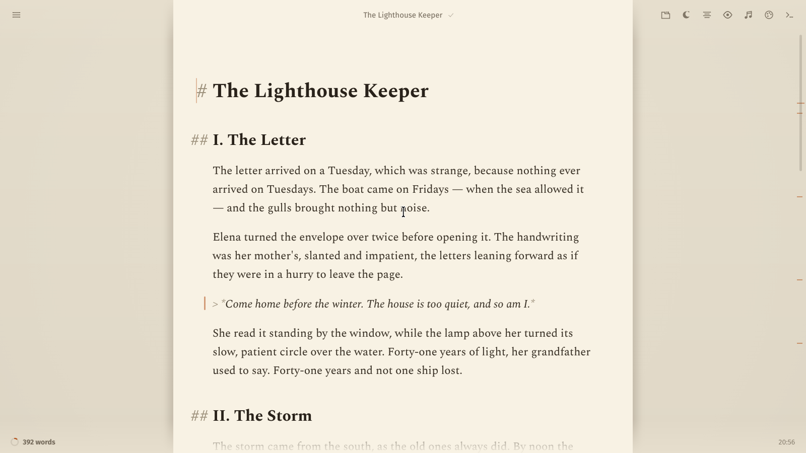

<!-- Generated by tools/readmes.pl from one template; edit the translation there, not here. -->
<div align="center">

# FolioOS

### Eine ablenkungsfreie Schreibmaschine, die direkt vom USB-Stick startet

**Kein Windows. Kein Linux. Kein Internet. Keine Benachrichtigungen. Nur du und der Text.**

[**Herunterladen**](https://github.com/alantaru/FolioOS/releases/latest) · [Übersetzen](docs/TRANSLATING.md) · [Mitmachen](CONTRIBUTING.md) · [Vollständiges README (Englisch)](README.md)

<sub>[English](README.md) · [Español](README.es.md) · [Français](README.fr.md) · **Deutsch** · [Italiano](README.it.md) · [Português (Brasil)](README.pt-BR.md) · [Português (Portugal)](README.pt-PT.md) · [Nederlands](README.nl.md) · [Polski](README.pl.md) · [Türkçe](README.tr.md) · [Русский](README.ru.md) · [Українська](README.uk.md) · [简体中文](README.zh-CN.md) · [日本語](README.ja.md) · [한국어](README.ko.md)</sub>



</div>

FolioOS verwandelt fast jeden x86-PC oder Laptop in eine reine Schreibmaschine: Stick einstecken, starten, schreiben. Deine Texte bleiben gewöhnliche Markdown-Dateien auf einem FAT32-Stick, der sich an jedem Computer öffnen lässt.

## Highlights

- **Sofort konzentriert:** startet in Sekunden mit dem letzten Dokument, genau dort, wo du aufgehört hast.
- **Alter Laptop wird zum Schreibwerkzeug:** läuft auf UEFI-PCs mit 64 und 32 Bit, ohne etwas auf der internen Festplatte zu installieren.
- **Deine Dateien für immer:** `.md` auf FAT32, ohne Datenbank und ohne Cloud.
- **Ohne Maus, wenn du willst:** alles funktioniert nur mit der Tastatur (Tab, Pfeiltasten, Eingabe, Leertaste, Esc, Strg+F6), und Maus und Touchpad lassen sich unter *Einstellungen › System* ganz abschalten.
- **Klein und überprüfbar:** ein ~600 KB großes Programm in freistehendem C, ohne libc und ohne Kernel.
- **Universell:** 15 Sprachen und 14 Tastaturlayouts, alle als Textdateien, die jeder ergänzen kann.

Live-Markdown, Fokusmodus, Schreibmaschinenmodus, Sprints und Ziele, Lesemodus mit automatischem Scrollen, Export nach **DOCX, ODT, EPUB, HTML, RTF und TXT**, automatische Versionen, 20 Themes und Theme-Editor, TrueType-Schriften bis 4K, optionale Tabs und MP3-Player.

## Kurzer Rundgang

| | |
|---|---|
|  **Fokusmodus (F2):** nur der aktuelle Absatz ist hervorgehoben. |  **Lesen (Strg+P):** der Text gesetzt wie ein Buch, mit automatischem Scrollen. |
|  **Exportieren (Strg+Umschalt+S):** DOCX, ODT, EPUB, HTML, RTF, TXT. |  **Themes (F12):** 20 fertige und ein Editor für eigene. |
|  **Befehlspalette (Strg+K):** jeder Befehl mit wenigen Buchstaben. |  **Tabs (optional):** mehrere Dokumente, die nach einem Neustart wiederkommen. |

Den vollständigen Rundgang mit allen Ansichten gibt es im [englischen README](README.md#a-tour-of-folioos).

## In 3 Minuten installiert

1. **Lade** `FolioOS.zip` aus der [neuesten Version](https://github.com/alantaru/FolioOS/releases/latest) herunter.
2. **Entpacke es ins Hauptverzeichnis eines FAT32-USB-Sticks** (bis 32 GB ist er fast immer schon FAT32; was bereits auf dem Stick liegt, bleibt erhalten).
3. **Starte vom Stick:** Bootmenü (F12 Dell/Lenovo · F9 HP · F8 Asus · Esc/F11) und wähle den **UEFI**-Eintrag. Fehlt er, schalte *Secure Boot* aus.

Die Oberfläche folgt der Sprache der Firmware, wenn es eine Übersetzung gibt; ändern kannst du sie jederzeit unter *Einstellungen › System › Sprache*.

Sticks, die mit älteren Versionen eingerichtet wurden, funktionieren weiter wie bisher; nichts wird umbenannt oder verschoben.

## Selbst kompilieren

Windows 10/11 mit `gcc` von [MinGW-w64](https://winlibs.com) im PATH:

```powershell
.\build.ps1                       # baut UEFI x64 + IA32, Simulator und Pakete und führt die Tests aus
.\flash_usb.ps1 -DriveLetter E:   # installiert/aktualisiert einen FAT32-Stick, ohne Dateien zu löschen
```

## Lizenz

Freie Software unter der [GNU GPL v3.0](LICENSE). Schriften unter der SIL Open Font License; minimp3 unter CC0.

---

<sub>Fehler in dieser Übersetzung gefunden? Sie wird von `tools/readmes.pl` erzeugt — Korrekturen sind willkommen.</sub>
