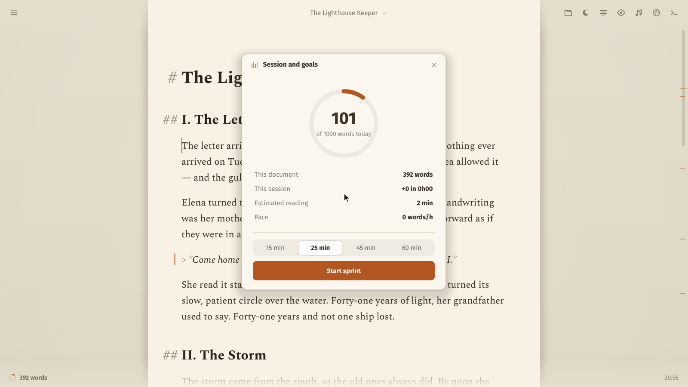
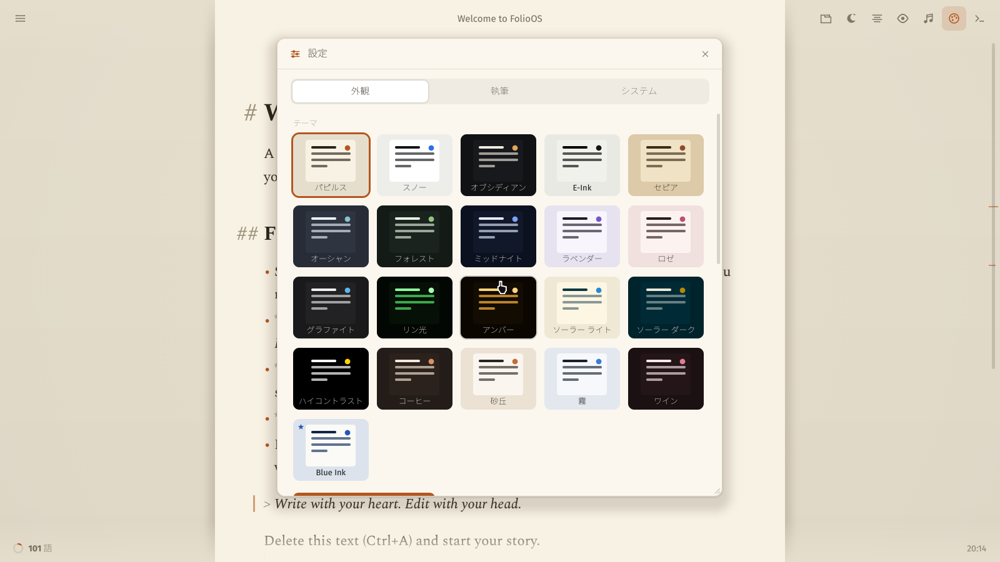

<!-- Generated by tools/readmes.pl from README.md and docs/i18n/README.es.po — edit the .po, not this file. -->
<div align="center">

<a id="folioos--the-distraction-free-writing-os-that-boots-from-a-usb-stick"></a>

# FolioOS — el sistema de escritura sin distracciones que arranca desde un USB

**Convierte cualquier portátil viejo en una máquina de escribir dedicada.**<br>
Sin Windows. Sin Linux. Sin internet. Sin notificaciones. Solo tú y el texto.

[](https://github.com/alantaru/FolioOS/actions/workflows/build.yml)
[](https://github.com/alantaru/FolioOS/releases/latest)
[](LICENSE)
[](#hardware-compatibility)
[](#13-15-languages-and-counting)
[](docs/TRANSLATING.md)

[**⬇ Descargar**](https://github.com/alantaru/FolioOS/releases/latest) ·
[Instalar](#install-in-3-minutes) ·
[Recorrido](#a-tour-of-folioos) ·
[Idiomas](#13-15-languages-and-counting) ·
[Preguntas](#faq) ·
[Compilar](#build-from-source) ·
[Contribuir](CONTRIBUTING.md)

<!-- languages -->
<sub>[English](README.md) · **Español** · [Français](README.fr.md) · [Deutsch](README.de.md) · [Italiano](README.it.md) · [Português (Brasil)](README.pt-BR.md) · [Português (Portugal)](README.pt-PT.md) · [Nederlands](README.nl.md) · [Polski](README.pl.md) · [Türkçe](README.tr.md) · [Русский](README.ru.md) · [Українська](README.uk.md) · [简体中文](README.zh-CN.md) · [日本語](README.ja.md) · [한국어](README.ko.md)</sub>
<!-- /languages -->


</div>

FolioOS es un **entorno de escritura arrancable**: un sistema operativo diminuto que hace una sola cosa —
dejarte escribir. Conecta el USB a casi cualquier PC de la última década, arranca desde él y en segundos
estás en un editor Markdown a pantalla completa y bien maquetado, justo donde lo dejaste la última vez. No
hay navegador, correo, tienda de aplicaciones ni Wi-Fi que te distraigan.

Lo que escribes se guarda como **archivos Markdown normales en un USB FAT32 corriente**, así que el mismo
USB se abre en Windows, macOS y Linux. Exporta a Word, LibreOffice, EPUB, HTML o RTF cuando necesites
compartir.

<a id="who-is-it-for"></a>

## ¿Para quién es?

- **Novelistas, periodistas, estudiantes y blogueros** que quieren un *writerdeck* — un dispositivo dedicado
  a escribir sin distracciones — sin comprar hardware nuevo.
- **Participantes del NaNoWriMo** y quien hace sprints de escritura cronometrados o páginas matutinas.
- **Quien tiene un portátil viejo en un cajón**: FolioOS le da una segunda vida, directamente desde el USB
  o instalado en su disco, solo o junto al sistema que ya tiene.
- **Escuelas y bibliotecas** que necesitan un puesto de escritura sencillo y sin conexión.
- **Escritores que cuidan su privacidad**: sin red, sin telemetría, sin nube.

<a id="install-in-3-minutes"></a>

## Instalar en 3 minutos

1. **Descarga** [`FolioOS.zip`](https://github.com/alantaru/FolioOS/releases/latest) de la última versión.
2. **Descomprímelo en la raíz de un USB formateado en FAT32.** La mayoría de los USB de hasta 32 GB ya lo
   están. Lo que ya haya en el USB se conserva. ([Cómo formatear en FAT32](docs/INSTALL.txt))
3. **Reinicia el PC y abre el menú de arranque** — normalmente **F12** (Dell, Lenovo), **F9** (HP), **F8**
   (Asus) o **Esc/F11** — y elige la entrada **UEFI** del USB. Si no aparece, desactiva el *Secure Boot* en
   la configuración del firmware.

<details>
<summary><b>Otras formas de instalar</b></summary>

- **Imagen de disco:** `FolioOS-disk-image.zip` contiene una imagen lista de 256 MB para
  [Rufus](https://rufus.ie) (modo DD), [balenaEtcher](https://etcher.balena.io) o `dd`. Aun así se recomienda
  descomprimir `FolioOS.zip`: deja el resto del USB libre para tus archivos.
- **Desde el código en Windows:** `.\build.ps1` y luego `.\flash_usb.ps1 -DriveLetter E:` (instala o
  actualiza un USB sin borrar nada).
- **PCs sin UEFI (solo BIOS/Legacy):** ejecuta `FOLIO\TOOLS\biosboot.exe E:` una vez en Windows, como
  administrador (`E:` es el USB). Solo escribe el código de arranque de BIOS: no toca ningún archivo, el USB
  sigue siendo un FAT32 normal y el arranque UEFI sigue funcionando. Desde el código fuente:
  `.\flash_usb.ps1 -DriveLetter E: -Bios`.
- **Todo incluido:** `FolioOS.zip` ya trae 11 fuentes libres para escribir y leer y las fuentes para chino,
  japonés y coreano — todos los idiomas funcionan desde el primer momento.

</details>

> **Pruébalo sin reiniciar:** `folio_sim.exe` ejecuta el mismo código en una ventana de Windows, y
> `efi_host.exe` ejecuta el binario UEFI real — consulta [Compilar desde el código](#build-from-source).

---

<a id="a-tour-of-folioos"></a>

## Un recorrido por FolioOS

<a id="1-start-up"></a>

### 1. Arranque


FolioOS arranca directamente desde el firmware. La pantalla de inicio se muestra mientras cargan las
fuentes, y cualquier tecla la salta — puedes empezar a escribir al instante. Su duración (1–60 s) se puede
configurar, o puedes desactivarla.

En el primerísimo arranque, FolioOS sigue el idioma de la configuración del firmware de tu PC y abre un
breve texto de bienvenida. A partir de ahí, siempre vuelve a abrir **tu último documento en la línea exacta
en la que estabas** — aunque estuvieras en modo lectura.

<br clear="right">

<a id="2-the-writing-screen"></a>

### 2. La pantalla de escritura


La página es todo lo que hay. Las barras de arriba y abajo **desaparecen en cuanto escribes** y vuelven
cuando mueves el ratón. El Markdown se muestra en vivo — títulos con `#`, `**negrita**`, `*cursiva*`,
`> citas`, listas y tareas `- [ ]` — mientras el marcado sigue visible y editable. La barra fina de la
derecha muestra dónde estás y marca cada capítulo.

- **Tipografía inteligente:** `--` se convierte en raya, `...` en puntos suspensivos, y las comillas rectas
  en las comillas tipográficas correctas *para tu idioma* (« » en español y francés, “ ” en inglés, „ “ en
  alemán, 「 」 en japonés).
- **Papel o pantalla completa:** escribe en una hoja de papel sobre un escritorio o en toda la pantalla;
  elige el ancho de la columna (estrecha, media, ancha, extra).
- Deshacer/rehacer, navegación por palabras, mover párrafos con **Alt+↑/↓**, duplicar o borrar párrafos,
  alternar mayúsculas con **Shift+F3**, envolver una selección en `( " * _` y volver a tu última edición con **Ctrl+J**.

<a id="3-focus-mode-and-zen-mode"></a>

### 3. Modo concentración y modo zen

<div align="center">


</div>

**F2** atenúa todo excepto la frase, el párrafo o la línea que estás escribiendo. **F3** es el *modo
máquina de escribir*: la línea actual se queda en el centro de la pantalla. **F11** es el *modo zen*:
ninguna barra hasta que tocas el borde superior. El **modo Hemingway** desactiva el borrado, para que
sigas siempre adelante.

<a id="4-reading-mode"></a>

### 4. Modo lectura


**Ctrl+P** convierte tu Markdown en una página maquetada, como un libro. Pasa las páginas con las flechas,
la barra espaciadora o un clic en los márgenes. La barra inferior muestra cuánto has leído y cuánto falta
para el capítulo y para todo el texto; el **desplazamiento automático** mueve el texto a tu velocidad de
lectura (en palabras por minuto): **Intro** o el botón central del ratón lo inicia, **+** y **−** cambian la
velocidad. **Esc** vuelve a la escritura *en el párrafo que estabas leyendo*.

<a id="5-chapters-and-outline"></a>

### 5. Capítulos y esquema


Cada título con `#` es un capítulo. **F5** abre el esquema para saltar a cualquier parte; **Ctrl+RePág/AvPág**
pasa de un capítulo a otro tanto al escribir como al leer. Los manuscritos largos siguen siendo fáciles de
recorrer — y la exportación EPUB convierte esos capítulos en un índice de libro electrónico de verdad.

<br clear="right">

<a id="6-find-and-replace"></a>

### 6. Buscar y reemplazar


**Ctrl+F** resalta todas las coincidencias, las cuenta y reemplaza una o todas.

<a id="7-files-open-save-and-export"></a>

### 7. Archivos: abrir, guardar y exportar

<div align="center">


</div>

**Ctrl+O** abre un gestor de archivos de verdad: todas las unidades que muestra el firmware, carpetas,
crear, renombrar y eliminar. **Ctrl+Shift+S** guarda con otro nombre o **exporta a DOCX, ODT, EPUB, HTML,
RTF o TXT** — un clic en el formato. Todo lo demás es automático:

- **Guardado automático** (cada 20 segundos por defecto) con **escritura atómica**: un corte de luz nunca
  deja medio archivo.
- **Versiones automáticas:** la copia anterior de cada archivo guardado va a `FOLIO/VERSIONS` (se conservan
  las últimas 30 de cada documento).
- **Recuperación de borradores** para el texto que nunca tuvo nombre.

**Fuentes LaTeX** (`.tex`, `.bib`, `.sty`, `.cls`): se abren como código fuente en una letra monoespaciada,
con resaltado por línea de comandos, llaves, comentarios `%` y matemáticas en línea, tabuladores de
verdad y `{`, `[` y `$` que se cierran solos. Ni el estilo Markdown ni las comillas tipográficas tocan
el código, y el archivo conserva sus finales de línea (CRLF sigue siendo CRLF). FolioOS no compila
LaTeX: el modo lectura y la exportación son para documentos Markdown.

<a id="8-tabs-optional"></a>

### 8. Pestañas (opcional)


¿Prefieres varios documentos a la vez? Activa las pestañas con el primer icono de arriba a la derecha.
**Ctrl+N** abre una pestaña, **Ctrl+W** la cierra, **Ctrl+Tab** o **Alt+1…9** cambian. Las pestañas —
incluso las sin título — vuelven después de reiniciar. Desactivadas, FolioOS sigue siendo una tranquila
máquina de escribir de un documento cada vez.

<a id="9-goals-sprints-and-statistics"></a>

### 9. Metas, sprints y estadísticas



**F10** muestra tu meta diaria de palabras, las palabras de este documento y de esta sesión, el tiempo de
lectura y tu ritmo de escritura. **F4** inicia un **sprint de escritura** cronometrado (15–60 minutos) que
termina con una campanilla suave. Las palabras escritas hoy se cuentan entre documentos y reinicios.

<br clear="right">

<a id="10-command-palette-and-shortcuts"></a>

### 10. Paleta de comandos y atajos


**Ctrl+K** encuentra cualquier comando escribiendo unas pocas letras — en tu idioma. **F1** lista todos los atajos:


<a id="no-mouse-needed"></a>

#### Sin necesidad de ratón

Todo en FolioOS funciona solo con el teclado, y el ratón y el touchpad se pueden desactivar por completo
(*Ajustes › Sistema › Usar el ratón y el touchpad*, **Ctrl+K › Ratón** o `use_mouse=0` en `CONFIG.INI`) —
útil en portátiles con un touchpad que hace saltar el cursor.

| Teclas | Qué hacen |
|---|---|
| Atajo de una ventana (F12, F5, F6, F10, Ctrl+O…) | La abre con el teclado dentro |
| **Tab** / **Shift+Tab**, **↑ ↓** | Recorren los botones, interruptores, controles deslizantes y listas de una ventana |
| **Intro** o **Espacio** | Pulsan el botón, interruptor o elemento resaltado |
| **← →** | Ajustan el control deslizante, la opción o el valor resaltado |
| **Esc** | Cierra la ventana y vuelve al texto; sin nada abierto, muestra las barras ocultas |
| **Ctrl+F6** | Lleva el teclado entre el texto y las ventanas abiertas |
| **Alt+M** | Menú con los documentos recientes (también en Ctrl+K) |
| **Alt+F7** / **Alt+F8** | Mueven / redimensionan la ventana con las flechas (Shift = pasos pequeños); Intro confirma, Esc deshace |

Un resaltado muestra qué control tiene el teclado; solo aparece cuando usas las teclas, así que nada cambia
para quien usa el ratón. Las letras que escribes en una ventana lateral (esquema, música, ajustes) vuelven
directamente a tu texto.

<a id="11-themes-and-typography"></a>

### 11. Temas y tipografía


**F12** abre los ajustes de apariencia: **20 temas ajustados a mano**, la fuente del texto, el tamaño, el
interlineado, el espacio entre párrafos y la sangría de primera línea. El texto lo dibuja el propio motor
TrueType de FolioOS, con kerning real y suavizado, nítido desde las pantallas pequeñas de un netbook hasta 4K.

<div align="center">


</div>


**Crea el tuyo:** el editor de temas te deja elegir cada uno de los 16 colores (o tomarlos de cualquier
tema incluido), una fuente para el texto y otra para la interfaz, y ver el resultado en vivo. Los temas son
pequeños archivos de texto `.INI` en `FOLIO/THEMES` — fáciles de compartir. Copia cualquier fuente `.ttf` en
`FOLIO/FONTS` para usarla; FolioOS ya incluye Literata, Lora, EB Garamond, iA Writer Quattro/Duo/Mono,
Special Elite y más.

<br clear="right">

<a id="12-music-while-you-write"></a>

### 12. Música mientras escribes

**F6** abre un pequeño reproductor de MP3 para los archivos de la carpeta `MUSIC` del USB (Intel HD Audio y
AC'97). **F7/F8/F9** lo controlan sin salir de la página.

<a id="13-15-languages-and-counting"></a>

### 13. 15 idiomas, y sumando

<div align="center">



</div>

**English, Español, Français, Deutsch, Italiano, Português (Brasil), Português (Portugal), Nederlands,
Polski, Türkçe, Русский, Українська, 简体中文, 日本語, 한국어.**


Nada relacionado con el idioma está fijado en el código. Cada traducción es un **archivo `.po` de gettext**
estándar en `FOLIO/LANGUAGES` que además define sus reglas de plural, las comillas, el formato de fecha, el
separador decimal, el teclado por defecto y las fuentes — **añadir un idioma es copiar un archivo al USB**.
Las distribuciones de teclado también son archivos de texto: US, US-Internacional, UK, ABNT2, Portugal,
España, Latinoamérica, AZERTY francés, QWERTZ alemán, italiano, polaco, Q turco, ruso, ucraniano, coreano
(entrada hangul de 2 juegos) y japonés (entrada romaji → kana).

¿Quieres FolioOS en tu idioma? Lee **[docs/TRANSLATING.md](docs/TRANSLATING.md)** — funciona con Poedit,
Weblate, Crowdin o cualquier editor de texto.

<br clear="right">

<a id="14-your-files-on-any-computer"></a>

### 14. Tus archivos, en cualquier ordenador

```
USB (FAT32)
├── DOCUMENTS/          tus archivos .md y .txt, y las exportaciones (.docx .odt .epub .html .rtf)
├── MUSIC/              tus archivos .mp3
├── FOLIO/
│   ├── CONFIG.INI      preferencias — texto plano, editable a mano
│   ├── FONTS/          fuentes .ttf (añade las tuyas)
│   ├── THEMES/         tus temas (.INI)
│   ├── LANGUAGES/      traducciones (.po)
│   ├── KEYBOARDS/      distribuciones de teclado (.txt)
│   ├── VERSIONS/       versiones anteriores automáticas de los archivos guardados
│   └── BACKUP/         tablas de particiones guardadas por el instalador antes de escribir nada
└── EFI/BOOT/           el propio FolioOS (BOOTX64.EFI, BOOTIA32.EFI, BOOTAA64.EFI)
```

Sin base de datos, sin partición oculta, sin formato propietario. Lleva el USB a cualquier ordenador y lo
que escribiste está ahí.

<a id="15-install-it-on-the-computer-beta"></a>

### 15. Instálalo en el ordenador (beta)

El USB basta, pero FolioOS también puede vivir en el disco del propio ordenador, para que el portátil arranque
directamente en tu escritura. Abre **Ctrl+K › Instalar FolioOS en este ordenador** (o *Ajustes › Sistema*):

- **Como único sistema**, en un disco vacío o en uno que decidas borrar: lo confirmas escribiendo una palabra.
- **Junto a Windows o Linux**, en el espacio libre, sin tocar las demás particiones. Cada arranque muestra
  *Pulsa cualquier tecla para escribir* durante unos segundos y luego inicia el otro sistema como siempre;
  a Windows lo arranca el propio firmware, igual que siempre.
- **¿Sin espacio libre?** FolioOS puede reducir una partición NTFS, FAT32 o exFAT sin mover ningún dato.
  Rechaza lo que no es seguro (Windows hibernado o con Inicio rápido, un volumen que necesita `chkdsk`,
  BitLocker sin la clave de recuperación, LUKS, LVM, volúmenes de Apple) y explica qué hacer en su lugar.
  ext4 nunca se redimensiona: haz sitio desde Linux (GParted) y vuelve a abrir el instalador.
- Antes de escribir nada, la tabla de particiones (los primeros y los últimos sectores del
  disco) se guarda en `FOLIO/BACKUP` en la unidad desde la que arrancó FolioOS, normalmente el USB. Tus
  textos pueden vivir en el ordenador, en el USB o en ambos.
- **Actualiza** desde un USB más nuevo: solo se sustituyen los archivos del propio FolioOS; tus textos y las
  particiones se quedan como están.
- **Desinstala**: puedes copiar antes tus textos a la unidad desde la que arrancó FolioOS. Si el instalador
  redujo una partición para hacer sitio, esa partición vuelve a crecer hasta el tamaño que tenía, siempre que
  el espacio de después siga libre; si no, el espacio queda libre. Si Windows está hibernado (o usa el Inicio
  rápido), FolioOS te pide que lo apagues del todo antes y no cambia nada.
- *Ajustes › Sistema › Discos y particiones* es un pequeño gestor de particiones: crear una partición FAT32,
  formatear, reducir o ampliar NTFS/FAT32/exFAT, borrar.
- La 4.4 beta es una versión preliminar: descárgala desde
  [su página de la versión](https://github.com/alantaru/FolioOS/releases/tag/v4.4.1-beta), no desde «latest».

Funciona en PC con UEFI y en PC solo con BIOS. **Es una beta:** pasa todas las pruebas en máquinas emuladas,
con discos creados por Windows y por Linux, pero aún no se ha ejecutado en hardware real: haz antes una copia
de seguridad o usa un disco de sobra.

---

<a id="how-folioos-compares"></a>

## Cómo se compara FolioOS

| | FolioOS | Dispositivos dedicados (Freewrite, AlphaSmart, Pomera) | Apps de escritura (iA Writer, Scrivener, modos concentración) |
|---|:---:|:---:|:---:|
| Coste | **Gratis** | Cientos de dólares | De gratis a de pago |
| Hardware | Cualquier PC UEFI que ya tengas | Un dispositivo nuevo | Tu ordenador de siempre |
| Distracciones al alcance | **Ninguna** — sin sistema, sin red | Ninguna | A un Alt+Tab de distancia |
| Formato de archivo | Markdown normal en FAT32 | Sincronización/exportación propia del dispositivo | Varía |
| Pantalla y tipografía | Pantalla grande, TrueType, temas | E-ink o LCD pequeña | Excelentes |
| Funciona sin conexión | **Siempre** | Casi siempre | Sí |
| Código abierto | **Sí (GPL-3.0)** | No | Casi nunca |

<a id="hardware-compatibility"></a>

## Compatibilidad de hardware

| | |
|---|---|
| **Firmware** | UEFI 2.x — 64 bits (`BOOTX64.EFI`), 32 bits (`BOOTIA32.EFI`, tabletas y netbooks Atom) o ARM64 (`BOOTAA64.EFI`: Raspberry Pi 3/4/5 con el firmware UEFI de la comunidad, portátiles ARM). **Los PCs solo con BIOS** (Legacy/CSM) arrancan con el puente BIOS propio de FolioOS tras ejecutar una vez `FOLIO\TOOLS\biosboot.exe`. El Secure Boot debe estar desactivado. |
| **Pantalla** | Cualquier framebuffer UEFI GOP (RGB, BGR, máscara de bits, solo Blt) o UGA antiguo; VESA/VBE en PCs con BIOS. Resolución nativa, escalado HiDPI automático, pantallas verticales giradas automáticamente. Cuando el único modo es 4:3 y una pantalla panorámica lo estira, *Ajustes › Sistema › Pantalla y puntero* mantiene las proporciones (Monitor, 16:9, 16:10 o 4:3). |
| **Entrada** | Teclado a través del firmware (directamente por PS/2 en PCs con BIOS). Ratón, touchpad, tableta gráfica y pantalla táctil a través del firmware y, cuando el firmware no tiene controlador para ellos, con los controladores USB HID y PS/2 propios de FolioOS. |
| **Sonido** | Intel HD Audio y AC'97 (solo se necesita para el reproductor de música). |
| **Discos (instalador, beta)** | Discos SATA, NVMe, IDE y USB con sectores de 512 bytes, GPT o MBR. NTFS, FAT32 y exFAT se pueden reducir y volver a ampliar sin mover datos; BitLocker, LUKS, LVM, APFS/HFS+ y ext4 nunca se redimensionan. |
| **Sin soporte** | Secure Boot (por ahora), Macs con Apple Silicon. Wi-Fi y Bluetooth quedan fuera a propósito. |
| **Probado en** | 20 máquinas emuladas en cada versión: UEFI x64, IA32 y ARM64, y PC solo BIOS arrancando desde USB e IDE; 8 tarjetas gráficas, ratones PS/2 y USB, tableta USB, HD Audio y AC'97; FolioOS instalado en discos SATA e IDE, arranque dual junto a Windows (UEFI) y a otro sistema (BIOS), reducción de un NTFS creado por Windows y mantener proporciones. En cada una se comprueban imagen, teclado, ratón, sonido, guardado e integridad del sistema de archivos. |

Cada arranque escribe `FOLIO/DIAGNOSTICS.TXT` con lo que FolioOS encontró. Comparte el tuyo en un
[informe de hardware](https://github.com/alantaru/FolioOS/issues/new/choose) — incluso "funciona sin más"
ayuda a otros escritores a elegir un portátil.

<a id="faq"></a>

## Preguntas frecuentes

<details>
<summary><b>¿Borrará mi ordenador o mi USB?</b></summary>

No. Ejecutándose desde el USB, FolioOS solo escribe en el disco interno cuando tú se lo pides: guardar un texto
en uno de sus volúmenes escribe ese archivo, y solo el instalador y *Discos y particiones* cambian particiones;
incluso entonces no se escribe nada antes de que confirmes y de que la tabla de particiones se guarde en la
unidad desde la que arrancó FolioOS. Instalarlo en el USB solo añade archivos: lo que ya estaba se queda.
Quita el USB y el PC arranca de nuevo su sistema habitual.
</details>

<details>
<summary><b>¿Puedo instalarlo en el portátil, junto a Windows o Linux?</b></summary>

Sí, desde la 4.4 (beta): **Ctrl+K › Instalar FolioOS en este ordenador**. Usa el espacio libre o reduce una
partición NTFS, FAT32 o exFAT sin mover datos, y en cada arranque eliges FolioOS o el otro sistema.
Al desinstalar, la partición que el instalador redujo vuelve a crecer si el espacio de después sigue libre (si no, el espacio queda libre). Mira [Instálalo en el ordenador](#15-install-it-on-the-computer-beta).
</details>

<details>
<summary><b>¿Está a salvo lo que escribo si se acaba la batería?</b></summary>

Los guardados son atómicos (el archivo se escribe completo antes de reemplazar al antiguo), el guardado
automático se ejecuta cada 20 segundos por defecto, el texto sin título tiene un borrador de recuperación y
cada archivo guardado conserva sus versiones anteriores en `FOLIO/VERSIONS`.
</details>

<details>
<summary><b>¿Puedo editar mis archivos también en mi ordenador normal?</b></summary>

Sí. Son archivos `.md` normales en `DOCUMENTS` en un USB FAT32. Ábrelos en Obsidian, Typora, VS Code, el
Bloc de notas, TextEdit o cualquier editor de Markdown, luego vuelve a conectar el USB y sigue escribiendo
en FolioOS.
</details>

<details>
<summary><b>¿Puedo escribir LaTeX?</b></summary>

Sí. FolioOS edita archivos fuente `.tex`, `.bib`, `.sty` y `.cls` con resaltado, en letra monoespaciada
y tal como se escriben (sin comillas tipográficas ni Markdown). No los compila: genera el PDF en un
ordenador con una distribución TeX o sube los archivos a un editor de LaTeX en línea.
</details>

<details>
<summary><b>¿Por qué mi PC no muestra el USB en el menú de arranque?</b></summary>

Comprueba que el USB esté en FAT32, que elegiste la entrada que empieza por "UEFI" y que el Secure Boot está
desactivado en la configuración del firmware. Los PCs más antiguos que solo arrancan en modo BIOS/Legacy
necesitan una vez el código de arranque de BIOS: ejecuta `FOLIO\TOOLS\biosboot.exe E:` en Windows como
administrador y el USB aparecerá como un disco USB normal.
</details>

<details>
<summary><b>¿Funciona en un Mac?</b></summary>

Los Mac con Intel pueden arrancar desde unidades UEFI (mantén pulsada <kbd>Option</kbd> al encender), pero
aún no se han probado — los informes son bienvenidos. Los Mac con Apple Silicon no son compatibles.
</details>

<details>
<summary><b>¿Puedo escribir en chino, japonés o coreano?</b></summary>

**Coreano y japonés, sí.** Elige el teclado *한국어 (두벌식)* o *日本語 (ローマ字かな)* en
*Ajustes › Sistema*: el coreano usa la distribución estándar de 2 juegos y forma las sílabas mientras
escribes (Retroceso quita un jamo cada vez); el japonés convierte romaji en hiragana o katakana (`nihongo` →
にほんご). **Ctrl+Espacio** alterna entre el método de entrada y las letras latinas. Las fuentes vienen con
FolioOS, y la adecuada se carga sola siempre que el texto contiene estas escrituras. La conversión a kanji y
el pinyin del chino necesitan diccionarios y siguen en la hoja de ruta. Las escrituras latina, griega y
cirílica se escriben con las distribuciones de teclado incluidas.
</details>

<details>
<summary><b>¿Puedo usarlo sin ratón?</b></summary>

Sí. Cada ventana, botón y ajuste se alcanza con el teclado (Tab, flechas, Intro, Espacio, Esc), y puedes
desactivar por completo el ratón y el touchpad en *Ajustes › Sistema*. Consulta
[Sin necesidad de ratón](#no-mouse-needed).
</details>

<details>
<summary><b>¿Tiene corrector ortográfico, internet o sincronización en la nube?</b></summary>

Ni internet ni sincronización, a propósito — FolioOS está pensado para funcionar sin conexión. El corrector
ortográfico está en la hoja de ruta. Como los archivos son Markdown normal, puedes sincronizarlos con lo que
quieras cuando el USB vuelva a un ordenador normal.
</details>

<a id="build-from-source"></a>

## Compilar desde el código

Requisitos: Windows 10/11, PowerShell 5.1+ y el `gcc` de [MinGW-w64](https://winlibs.com) (cualquier
compilación x86_64 reciente) en el `PATH`. Las versiones ARM64 y BIOS usan también `clang` de
[LLVM](https://llvm.org) y `nasm`, y el laboratorio de hardware usa [QEMU](https://www.qemu.org); los tres se
instalan con `winget`.

```powershell
git clone https://github.com/alantaru/FolioOS.git
cd FolioOS
.\build.ps1                                  # UEFI x64 + IA32 + ARM64, BIOS, simulador, paquetes — y las pruebas
.\tools\qemu-lab.ps1                         # arranca los binarios reales en 20 máquinas emuladas y comprueba cada una
.\build\folio_sim.exe                        # ejecuta FolioOS en una ventana
.\build\efi_host.exe build\efi\BOOTX64.EFI   # ejecuta el binario UEFI real en una ventana
.\flash_usb.ps1 -DriveLetter E:              # instala/actualiza un USB FAT32 conservando los archivos
.\build.ps1 -Image -ImageMB 256              # opcional: imagen de disco para Rufus / Etcher / dd
.\tools\fetch-cjk-fonts.ps1                  # descarga las fuentes CJK una vez (build.ps1 lo ejecuta si hace falta)
.\tools\showcase.ps1                         # regenera las capturas de este README
```

La batería de pruebas maneja el simulador y el `BOOTX64.EFI` real (dentro de un pequeño anfitrión UEFI) con
pulsaciones y eventos de ratón programados, toma capturas de pantalla y valida cada exportación (ZIP + XML),
cada traducción (con un control negativo para el validador), seis formatos de framebuffer y el controlador
FAT32 del puente BIOS (miles de operaciones aleatorias, comprobadas byte a byte).
El instalador y el gestor de particiones se ejecutan sobre imágenes de disco creadas por Windows y por Linux, y los
resultados los comprueban `chkdsk` de Windows y `fsck` de Linux (`tools/ntfs-shrink-check.ps1`, `tools/linux-run.ps1`).

<a id="macos-simulator"></a>

### Simulador para macOS

En un Mac puedes compilar y ejecutar el simulador de forma nativa (AppKit, Retina, Cmd funciona como Ctrl
en los atajos). Requisitos: las Command Line Tools de Xcode (`xcode-select --install`) — solo `clang`, no
hace falta el Xcode completo.

```bash
./build_macos.sh                             # simulador, "FolioOS Simulator.app" y la carpeta del USB
./build_macos.sh --test                      # lo mismo, más las pruebas programadas del simulador (sin ventana)
./build/macos/folio_sim                      # ejecutar FolioOS en una ventana
open "build/macos/FolioOS Simulator.app"     # o abrir el paquete de la aplicación
```

Option es el AltGr del Mac, así que sigue escribiendo caracteres (`@ # | [ ] { }` en muchas
distribuciones): en el simulador **Option+M** abre el menú (Alt+M) y **Cmd+Option+1…9** cambian de
pestaña (Alt+1…9).

El script de macOS solo compila el simulador: los binarios UEFI, los paquetes, las imágenes de disco y
las pruebas que ejecutan el `BOOTX64.EFI` real dentro de `efi_host` siguen necesitando la compilación de
Windows (`build.ps1`).

<a id="architecture-in-one-picture"></a>

### La arquitectura en una imagen

```
src/core/       núcleo portable (C freestanding, sin libc): editor, Markdown, rasterizador TrueType,
                kit de interfaz y gestor de ventanas, exportaciones, MP3, i18n, teclados, temas,
                tablas de particiones, comprobación y redimensionado de sistemas de archivos, instalador y selector de arranque
src/platform/   uefi/  vídeo GOP/UGA, entrada, E/S FAT, HD Audio/AC'97, controladores USB HID y PS/2 — sobre el firmware
                bios/  sectores de arranque + puente BIOS→UEFI (VBE, PS/2, controlador FAT32 propio) para PCs solo con BIOS
                win32/ simulador usado para el desarrollo y las pruebas automáticas
                macos/ simulador para macOS (AppKit), con las mismas pruebas programadas
tools/          efi_host (ejecuta BOOTX64.EFI en Windows), herramienta de i18n, creador de imágenes, showcase
assets/         fuentes, traducciones (.po), distribuciones de teclado, tema de ejemplo
tests/          pruebas de extremo a extremo programadas
```

Un binario de ~800 KB controla toda la máquina a través de una capa de plataforma delgada. Detalles en
[docs/ARCHITECTURE.md](docs/ARCHITECTURE.md).

<a id="roadmap"></a>

## Hoja de ruta

FolioOS se divide en dos ediciones que comparten el mismo editor: **FolioOS**, sin conexión para siempre, y
**FolioOS Sync**, un Linux mínimo con Wi-Fi que sincroniza tus textos. El plan completo está en
[ROADMAP.md](ROADMAP.md).

- [x] PCs solo con BIOS (Legacy/CSM) y ARM64 (Raspberry Pi con firmware UEFI, portátiles ARM)
- [x] Entrada en coreano (hangul de 2 juegos) y kana japonés (romaji → hiragana/katakana)
- [x] Instalar en el disco del ordenador —como único sistema o junto a cualquier otro— con un gestor de particiones (4.4 beta)
- [ ] FolioOS Sync: Wi-Fi y sincronización con WebDAV, SFTP, Git, Dropbox, Google Drive, OneDrive y Syncthing
- [ ] Conversión a kanji (japonés) y entrada pinyin (chino) (necesitan diccionarios)
- [ ] Composición tipográfica y escrituras de derecha a izquierda (árabe, hebreo, devanagari…)
- [ ] Corrector ortográfico con diccionarios compatibles con Hunspell
- [ ] Soporte de Secure Boot (shim firmado)
- [ ] Versión para Linux del simulador y las herramientas (macOS: hecho)

Vota y sugiere en las [Discussions](https://github.com/alantaru/FolioOS/discussions).

<a id="contributing"></a>

## Contribuir

Los informes de errores y de hardware, las traducciones, las distribuciones de teclado, los temas, las
fuentes, la documentación y el código son bienvenidos — empieza por [CONTRIBUTING.md](CONTRIBUTING.md).
Sigue el [Código de Conducta](CODE_OF_CONDUCT.md); informa de los problemas de seguridad en privado, como se
describe en [SECURITY.md](SECURITY.md).

Si FolioOS te ayuda a escribir, **⭐ dale una estrella al repositorio** — ayuda a otros escritores a encontrarlo.

<a id="license"></a>

## Licencia

FolioOS es software libre bajo la [GNU General Public License v3.0](LICENSE). Las fuentes incluidas usan la
SIL Open Font License; minimp3 es CC0. Consulta [THIRD_PARTY_NOTICES.md](THIRD_PARTY_NOTICES.md).

<sub>FolioOS · software de escritura sin distracciones · entorno de escritura en USB arrancable · writerdeck ·
alternativa casera a Freewrite / AlphaSmart · máquina de escribir digital para portátiles viejos · editor
Markdown sin conexión · app de escritura con concentración · aplicación UEFI escrita en C · herramienta de
escritura para novelas y NaNoWriMo.</sub>
