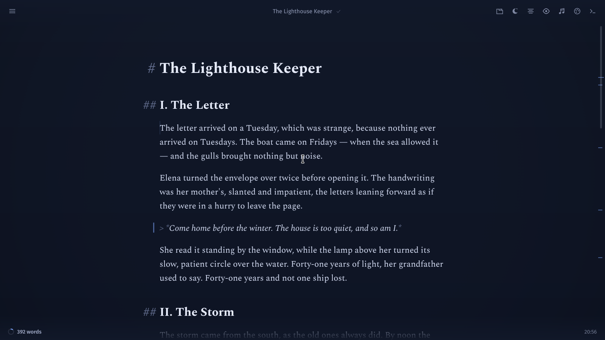

<!-- Generated by tools/readmes.pl from README.md and docs/i18n/README.fr.po — edit the .po, not this file. -->
<div align="center">

<a id="folioos--the-distraction-free-writing-os-that-boots-from-a-usb-stick"></a>

# FolioOS — le système d’écriture sans distraction qui démarre depuis une clé USB

**Transformez n’importe quel vieux portable en machine à écrire dédiée.**<br>
Pas de Windows. Pas de Linux. Pas d’internet. Pas de notifications. Juste vous et le texte.

[](https://github.com/alantaru/FolioOS/actions/workflows/build.yml)
[](https://github.com/alantaru/FolioOS/releases/latest)
[](LICENSE)
[](#hardware-compatibility)
[](#13-15-languages-and-counting)
[](docs/TRANSLATING.md)

[**⬇ Télécharger**](https://github.com/alantaru/FolioOS/releases/latest) ·
[Installer](#install-in-3-minutes) ·
[Visite](#a-tour-of-folioos) ·
[Langues](#13-15-languages-and-counting) ·
[FAQ](#faq) ·
[Compiler](#build-from-source) ·
[Contribuer](CONTRIBUTING.md)

<!-- languages -->
<sub>[English](README.md) · [Español](README.es.md) · **Français** · [Deutsch](README.de.md) · [Italiano](README.it.md) · [Português (Brasil)](README.pt-BR.md) · [Português (Portugal)](README.pt-PT.md) · [Nederlands](README.nl.md) · [Polski](README.pl.md) · [Türkçe](README.tr.md) · [Русский](README.ru.md) · [Українська](README.uk.md) · [简体中文](README.zh-CN.md) · [日本語](README.ja.md) · [한국어](README.ko.md)</sub>
<!-- /languages -->


</div>

FolioOS est un **environnement d’écriture amorçable** : un tout petit système d’exploitation qui ne fait
qu’une chose — vous laisser écrire. Branchez la clé sur presque n’importe quel PC de la dernière décennie,
démarrez dessus et, en quelques secondes, vous êtes dans un éditeur Markdown plein écran, joliment mis en
page, exactement là où vous vous étiez arrêté. Pas de navigateur, pas d’e-mail, pas de boutique
d’applications ni de Wi-Fi pour vous détourner.

Vos textes sont enregistrés en **fichiers Markdown simples sur une clé FAT32 ordinaire** : la même clé
s’ouvre sous Windows, macOS et Linux. Exportez en Word, LibreOffice, EPUB, HTML ou RTF dès que vous devez
partager.

<a id="who-is-it-for"></a>

## Pour qui ?

- **Romanciers, journalistes, étudiants et blogueurs** qui veulent un *writerdeck* — un appareil dédié à
  l’écriture sans distraction — sans acheter de nouveau matériel.
- **Participants au NaNoWriMo** et tous ceux qui font des sprints d’écriture chronométrés ou des pages du matin.
- **Les personnes qui ont un vieux portable dans un tiroir** : FolioOS lui offre une seconde vie, directement depuis
  la clé USB ou installé sur son disque, seul ou à côté du système qu’il a déjà.
- **Écoles et bibliothèques** qui ont besoin d’un poste d’écriture simple et hors ligne.
- **Auteurs soucieux de leur vie privée** : pas de réseau, pas de télémétrie, pas de cloud.

<a id="install-in-3-minutes"></a>

## Installer en 3 minutes

1. **Téléchargez** [`FolioOS.zip`](https://github.com/alantaru/FolioOS/releases/latest) depuis la dernière version.
2. **Décompressez-le à la racine d’une clé USB formatée en FAT32.** La plupart des clés jusqu’à 32 Go le sont
   déjà. Les fichiers déjà présents sont conservés. ([Comment formater en FAT32](docs/INSTALL.txt))
3. **Redémarrez le PC et ouvrez le menu de démarrage** — en général **F12** (Dell, Lenovo), **F9** (HP),
   **F8** (Asus) ou **Échap/F11** — puis choisissez l’entrée **UEFI** de la clé. Si elle n’apparaît pas,
   désactivez le *Secure Boot* dans la configuration du firmware.

<details>
<summary><b>Autres façons d’installer</b></summary>

- **Image disque :** `FolioOS-disk-image.zip` contient une image prête de 256 Mo pour
  [Rufus](https://rufus.ie) (mode DD), [balenaEtcher](https://etcher.balena.io) ou `dd`. Décompresser
  `FolioOS.zip` reste recommandé : le reste de la clé reste libre pour vos fichiers.
- **Depuis les sources sous Windows :** `.\build.ps1` puis `.\flash_usb.ps1 -DriveLetter E:` (installe ou
  met à jour une clé sans rien effacer).
- **PC sans UEFI (BIOS/Legacy uniquement) :** lancez une fois `FOLIO\TOOLS\biosboot.exe E:` sous Windows, en
  administrateur (`E:` est la clé). Il n’écrit que le code de démarrage BIOS : aucun fichier n’est touché, la
  clé reste une clé FAT32 ordinaire et le démarrage UEFI continue de fonctionner. Depuis les sources :
  `.\flash_usb.ps1 -DriveLetter E: -Bios`.
- **Tout est inclus :** `FolioOS.zip` apporte déjà 11 polices libres pour écrire et lire, ainsi que les
  polices pour le chinois, le japonais et le coréen — toutes les langues fonctionnent dès le départ.

</details>

> **Essayez sans redémarrer :** `folio_sim.exe` exécute le même code dans une fenêtre Windows, et
> `efi_host.exe` exécute le vrai binaire UEFI — voir [Compiler depuis les sources](#build-from-source).

---

<a id="a-tour-of-folioos"></a>

## Visite de FolioOS

<a id="1-start-up"></a>

### 1. Démarrage


FolioOS démarre directement depuis le firmware. L’écran d’accueil s’affiche pendant le chargement des
polices, et n’importe quelle touche le passe — vous pouvez commencer à taper tout de suite. Sa durée
(1–60 s) est réglable, ou vous pouvez le désactiver.

Au tout premier démarrage, FolioOS suit la langue de la configuration du firmware de votre PC et ouvre un
court texte de bienvenue. Ensuite, il rouvre toujours **votre dernier document à la ligne exacte où vous
étiez** — même si vous étiez en mode lecture.

<br clear="right">

<a id="2-the-writing-screen"></a>

### 2. L’écran d’écriture


La page est tout ce qu’il y a. Les barres du haut et du bas **s’effacent dès que vous tapez** et reviennent
quand vous bougez la souris. Le Markdown est rendu en direct — titres `#`, `**gras**`, `*italique*`,
`> citations`, listes et tâches `- [ ]` — tandis que le balisage reste visible et modifiable. La fine barre
de droite montre où vous êtes et marque chaque chapitre.

- **Typographie intelligente :** `--` devient un tiret cadratin, `...` des points de suspension, et les
  guillemets droits deviennent les bons guillemets *de votre langue* (« » en français, “ ” en anglais, „ “
  en allemand, 「 」 en japonais).
- **Papier ou plein écran :** écrivez sur une feuille posée sur un bureau ou sur tout l’écran ; choisissez
  la largeur de colonne (étroite, moyenne, large, extra).
- Annuler/rétablir, déplacement mot à mot, déplacer des paragraphes avec **Alt+↑/↓**, dupliquer ou supprimer
  des paragraphes, changer la casse avec **Shift+F3**, entourer une sélection de `( " * _` et revenir à votre
  dernière modification avec **Ctrl+J**.

<a id="3-focus-mode-and-zen-mode"></a>

### 3. Mode concentration et mode zen

<div align="center">


</div>

**F2** estompe tout sauf la phrase, le paragraphe ou la ligne que vous écrivez. **F3** est le *mode machine
à écrire* : la ligne en cours reste au milieu de l’écran. **F11** est le *mode zen* : aucune barre tant que
vous ne touchez pas le bord supérieur. Le **mode Hemingway** désactive l’effacement, pour avancer sans
revenir en arrière.

<a id="4-reading-mode"></a>

### 4. Mode lecture


**Ctrl+P** transforme votre Markdown en page mise en forme, comme un livre. Tournez les pages avec les
flèches, la barre d’espace ou un clic dans les marges. La barre du bas indique ce que vous avez lu et le
temps restant pour le chapitre et pour tout le texte ; le **défilement automatique** fait avancer le texte
à votre vitesse de lecture (en mots par minute) : **Entrée** ou le bouton du milieu de la souris le lance,
**+** et **−** changent la vitesse. **Échap** revient à l’écriture *au paragraphe que vous lisiez*.

<a id="5-chapters-and-outline"></a>

### 5. Chapitres et plan


Chaque titre `#` est un chapitre. **F5** ouvre le plan pour sauter n’importe où ; **Ctrl+PgUp/PgDn** passe
d’un chapitre à l’autre en écriture comme en lecture. Les longs manuscrits restent faciles à parcourir — et
l’export EPUB transforme ces chapitres en véritable table des matières de livre numérique.

<br clear="right">

<a id="6-find-and-replace"></a>

### 6. Rechercher et remplacer


**Ctrl+F** surligne chaque occurrence, les compte et remplace une ou toutes.

<a id="7-files-open-save-and-export"></a>

### 7. Fichiers : ouvrir, enregistrer et exporter

<div align="center">


</div>

**Ctrl+O** ouvre un vrai gestionnaire de fichiers : tous les lecteurs que le firmware expose, dossiers,
création, renommage et suppression. **Ctrl+Shift+S** enregistre sous un autre nom ou **exporte en DOCX, ODT,
EPUB, HTML, RTF ou TXT** — un clic sur le format. Tout le reste est automatique :

- **Enregistrement automatique** (toutes les 20 secondes par défaut) avec **écriture atomique** : une coupure
  de courant ne laisse jamais un fichier à moitié écrit.
- **Versions automatiques :** la copie précédente de chaque fichier enregistré va dans `FOLIO/VERSIONS` (les
  30 dernières par document sont conservées).
- **Récupération de brouillon** pour le texte qui n’a jamais reçu de nom.

**Sources LaTeX** (`.tex`, `.bib`, `.sty`, `.cls`) : elles s’ouvrent en texte source dans une police à
chasse fixe, avec une coloration par ligne des commandes, accolades, commentaires `%` et formules en
ligne, de vraies tabulations, et `{`, `[` et `$` qui se ferment tout seuls. Ni le style Markdown ni les
guillemets typographiques ne touchent la source, et le fichier garde ses fins de ligne (CRLF reste CRLF).
FolioOS ne compile pas LaTeX : le mode lecture et l’export sont réservés aux documents Markdown.

<a id="8-tabs-optional"></a>

### 8. Onglets (facultatifs)


Vous préférez plusieurs documents à la fois ? Activez les onglets avec la première icône en haut à droite.
**Ctrl+N** ouvre un onglet, **Ctrl+W** le ferme, **Ctrl+Tab** ou **Alt+1…9** passent de l’un à l’autre. Les
onglets — même sans titre — reviennent après un redémarrage. Désactivés, FolioOS reste une machine à écrire
paisible, un document à la fois.

<a id="9-goals-sprints-and-statistics"></a>

### 9. Objectifs, sprints et statistiques


**F10** affiche votre objectif quotidien de mots, les mots de ce document et de cette session, le temps de
lecture et votre rythme d’écriture. **F4** lance un **sprint d’écriture** chronométré (15–60 minutes) qui se
termine par une clochette douce. Les mots écrits aujourd’hui sont comptés d’un document et d’un redémarrage
à l’autre.

<br clear="right">

<a id="10-command-palette-and-shortcuts"></a>

### 10. Palette de commandes et raccourcis


**Ctrl+K** trouve n’importe quelle commande en tapant quelques lettres — dans votre langue. **F1** liste tous les raccourcis :


<a id="no-mouse-needed"></a>

#### Pas besoin de souris

Tout dans FolioOS fonctionne au clavier seul, et la souris comme le pavé tactile peuvent être complètement
désactivés (*Réglages › Système › Utiliser la souris et le pavé tactile*, **Ctrl+K › Souris** ou
`use_mouse=0` dans `CONFIG.INI`) — pratique sur les portables dont le pavé tactile fait sauter le curseur.

| Touches | Ce qu’elles font |
|---|---|
| Raccourci d’une fenêtre (F12, F5, F6, F10, Ctrl+O…) | L’ouvre avec le clavier dedans |
| **Tab** / **Shift+Tab**, **↑ ↓** | Passent d’un bouton, interrupteur, curseur ou liste à l’autre dans une fenêtre |
| **Entrée** ou **Espace** | Activent le bouton, l’interrupteur ou l’élément mis en évidence |
| **← →** | Règlent le curseur, l’option ou la valeur mis en évidence |
| **Échap** | Ferme la fenêtre et revient au texte ; sans rien d’ouvert, affiche les barres masquées |
| **Ctrl+F6** | Fait passer le clavier entre le texte et les fenêtres ouvertes |
| **Alt+M** | Menu avec les documents récents (aussi dans Ctrl+K) |
| **Alt+F7** / **Alt+F8** | Déplacent / redimensionnent la fenêtre avec les flèches (Shift = petits pas) ; Entrée valide, Échap annule |

Une mise en évidence montre quelle commande a le clavier ; elle n’apparaît que lorsque vous utilisez les
touches, rien ne change donc pour les utilisateurs de souris. Les lettres tapées dans une fenêtre latérale
(plan, musique, réglages) repartent directement dans votre texte.

<a id="11-themes-and-typography"></a>

### 11. Thèmes et typographie


**F12** ouvre les réglages d’apparence : **20 thèmes réglés à la main**, la police du texte, la taille,
l’interligne, l’espace entre paragraphes et le retrait de première ligne. Le texte est dessiné par le propre
moteur TrueType de FolioOS, avec un vrai crénage et de l’anticrénelage, net des petits écrans de netbook
jusqu’à la 4K.

<div align="center">




</div>


**Créez le vôtre :** l’éditeur de thèmes permet de choisir chacune des 16 couleurs (ou de les emprunter à
n’importe quel thème fourni), une police pour le texte et une autre pour l’interface, et de voir le résultat
en direct. Les thèmes sont de petits fichiers texte `.INI` dans `FOLIO/THEMES` — faciles à partager. Déposez
n’importe quelle police `.ttf` dans `FOLIO/FONTS` pour l’utiliser ; FolioOS est déjà livré avec Literata,
Lora, EB Garamond, iA Writer Quattro/Duo/Mono, Special Elite et d’autres.

<br clear="right">

<a id="12-music-while-you-write"></a>

### 12. De la musique pendant que vous écrivez

**F6** ouvre un petit lecteur MP3 pour les fichiers du dossier `MUSIC` de la clé (Intel HD Audio et AC'97).
**F7/F8/F9** le pilotent sans quitter la page.

<a id="13-15-languages-and-counting"></a>

### 13. 15 langues, et ce n’est qu’un début

<div align="center">


</div>

**English, Español, Français, Deutsch, Italiano, Português (Brasil), Português (Portugal), Nederlands,
Polski, Türkçe, Русский, Українська, 简体中文, 日本語, 한국어.**


Rien de ce qui concerne la langue n’est figé dans le code. Chaque traduction est un **fichier `.po` gettext**
standard dans `FOLIO/LANGUAGES` qui définit aussi ses règles de pluriel, ses guillemets, son format de date,
son séparateur décimal, son clavier par défaut et ses polices — **ajouter une langue, c’est déposer un
fichier sur la clé**. Les dispositions de clavier sont aussi des fichiers texte : US, US-International, UK,
ABNT2, Portugal, Espagne, Amérique latine, AZERTY français, QWERTZ allemand, italien, polonais, Q turc,
russe, ukrainien, coréen (saisie hangul 2 séries) et japonais (saisie romaji → kana).

Vous voulez FolioOS dans votre langue ? Lisez **[docs/TRANSLATING.md](docs/TRANSLATING.md)** — cela
fonctionne avec Poedit, Weblate, Crowdin ou n’importe quel éditeur de texte.

<br clear="right">

<a id="14-your-files-on-any-computer"></a>

### 14. Vos fichiers, sur n’importe quel ordinateur

```
Clé USB (FAT32)
├── DOCUMENTS/          vos fichiers .md et .txt, et les exports (.docx .odt .epub .html .rtf)
├── MUSIC/              vos fichiers .mp3
├── FOLIO/
│   ├── CONFIG.INI      préférences — texte brut, modifiable à la main
│   ├── FONTS/          polices .ttf (ajoutez les vôtres)
│   ├── THEMES/         vos thèmes (.INI)
│   ├── LANGUAGES/      traductions (.po)
│   ├── KEYBOARDS/      dispositions de clavier (.txt)
│   ├── VERSIONS/       versions précédentes automatiques des fichiers enregistrés
│   └── BACKUP/         tables de partitions enregistrées par l’installateur avant toute écriture
└── EFI/BOOT/           FolioOS lui-même (BOOTX64.EFI, BOOTIA32.EFI, BOOTAA64.EFI)
```

Pas de base de données, pas de partition cachée, pas de format propriétaire. Emportez la clé sur n’importe
quel ordinateur et vos textes sont là.

<a id="15-install-it-on-the-computer-beta"></a>

### 15. L’installer sur l’ordinateur (bêta)

La clé USB suffit, mais FolioOS peut aussi vivre sur le disque de l’ordinateur, pour que le portable démarre
directement sur votre texte. Ouvrez **Ctrl+K › Installer FolioOS sur cet ordinateur** (ou *Réglages › Système*) :

- **Comme seul système**, sur un disque vide ou que vous choisissez d’effacer : vous confirmez en tapant un mot.
- **À côté de Windows ou de Linux**, dans l’espace libre, sans toucher aux autres partitions. Chaque démarrage
  affiche *Appuyez sur une touche pour écrire* pendant quelques secondes, puis lance l’autre système comme
  d’habitude ; Windows est démarré par le firmware lui-même, comme toujours.
- **Pas d’espace libre ?** FolioOS peut réduire une partition NTFS, FAT32 ou exFAT sans déplacer aucune donnée.
  Il refuse ce qui n’est pas sûr (Windows en veille prolongée ou avec le démarrage rapide, un volume qui a besoin
  de `chkdsk`, BitLocker sans la clé de récupération, LUKS, LVM, volumes Apple) et explique quoi faire à la place.
  ext4 n’est jamais redimensionné : faites de la place depuis Linux (GParted) et relancez l’installateur.
- Avant toute écriture, la table de partitions (les premiers et les derniers secteurs du
  disque) est enregistrée dans `FOLIO/BACKUP` sur le support depuis lequel FolioOS a démarré, normalement la
  clé USB. Vos textes peuvent vivre sur l’ordinateur, sur la clé USB ou sur les deux.
- **Mettez à jour** depuis une clé plus récente : seuls les fichiers de FolioOS sont remplacés ; vos textes et
  les partitions restent tels quels.
- **Désinstallez** : vous pouvez d’abord faire copier vos textes sur le support depuis lequel FolioOS a démarré.
  Si l’installateur a réduit une partition pour faire de la place, elle retrouve la taille qu’elle avait, tant
  que l’espace qui la suit est encore libre ; sinon, l’espace devient libre. Si Windows est en veille prolongée
  (ou utilise le démarrage rapide), FolioOS vous demande d’abord de l’arrêter complètement et ne change rien.
- *Réglages › Système › Disques et partitions* est un petit gestionnaire de partitions : créer une partition
  FAT32, formater, réduire ou agrandir NTFS/FAT32/exFAT, supprimer.
- La 4.4 bêta est une préversion : téléchargez-la depuis
  [sa page de version](https://github.com/alantaru/FolioOS/releases/tag/v4.4.1-beta), pas depuis « latest ».

Fonctionne sur les PC UEFI et sur les PC à BIOS seul. **C’est une bêta :** elle réussit tous les tests sur des
machines émulées, avec des disques créés par Windows et par Linux, mais n’a pas encore tourné sur du vrai
matériel : faites d’abord une sauvegarde, ou utilisez un disque de rechange.

---

<a id="how-folioos-compares"></a>

## FolioOS face aux alternatives

| | FolioOS | Appareils dédiés (Freewrite, AlphaSmart, Pomera) | Applications d’écriture (iA Writer, Scrivener, modes concentration) |
|---|:---:|:---:|:---:|
| Prix | **Gratuit** | Des centaines de dollars | De gratuit à payant |
| Matériel | N’importe quel PC UEFI que vous avez déjà | Un nouvel appareil | Votre ordinateur habituel |
| Distractions à portée de main | **Aucune** — ni système, ni réseau | Aucune | À un Alt+Tab |
| Format des fichiers | Markdown simple sur FAT32 | Synchronisation/export propre à l’appareil | Variable |
| Écran et typographie | Grand écran, TrueType, thèmes | Petit écran e-ink ou LCD | Excellents |
| Fonctionne hors ligne | **Toujours** | La plupart du temps | Oui |
| Open source | **Oui (GPL-3.0)** | Non | Rarement |

<a id="hardware-compatibility"></a>

## Compatibilité matérielle

| | |
|---|---|
| **Firmware** | UEFI 2.x — 64 bits (`BOOTX64.EFI`), 32 bits (`BOOTIA32.EFI`, tablettes et netbooks Atom) ou ARM64 (`BOOTAA64.EFI` : Raspberry Pi 3/4/5 avec le firmware UEFI communautaire, portables ARM). **Les PC uniquement BIOS** (Legacy/CSM) démarrent via le pont BIOS propre à FolioOS après avoir lancé une fois `FOLIO\TOOLS\biosboot.exe`. Le Secure Boot doit être désactivé. |
| **Affichage** | Tout framebuffer UEFI GOP (RGB, BGR, masque de bits, Blt seul) ou UGA ancien ; VESA/VBE sur les PC BIOS. Résolution native, mise à l’échelle HiDPI automatique, écrans en portrait pivotés automatiquement. Quand le seul mode est en 4:3 et qu’un écran large l’étire, *Réglages › Système › Écran et pointeur* conserve les proportions (Écran, 16:9, 16:10 ou 4:3). |
| **Saisie** | Clavier via le firmware (directement en PS/2 sur les PC BIOS). Souris, pavé tactile, tablette graphique et écran tactile via le firmware — et, quand le firmware n’a pas de pilote pour eux, via les pilotes USB HID et PS/2 propres à FolioOS. |
| **Son** | Intel HD Audio et AC'97 (nécessaire uniquement pour le lecteur de musique). |
| **Disques (installateur, bêta)** | Disques SATA, NVMe, IDE et USB à secteurs de 512 octets, GPT ou MBR. NTFS, FAT32 et exFAT peuvent être réduits puis agrandis à nouveau sans déplacer de données ; BitLocker, LUKS, LVM, APFS/HFS+ et ext4 ne sont jamais redimensionnés. |
| **Non pris en charge** | Secure Boot (pour l’instant), Mac Apple Silicon. Wi-Fi et Bluetooth sont exclus volontairement. |
| **Testé sur** | 20 machines émulées à chaque version : UEFI x64, IA32 et ARM64, et PC BIOS seul démarrant depuis USB et IDE ; 8 cartes graphiques, souris PS/2 et USB, tablette USB, HD Audio et AC'97 ; FolioOS installé sur des disques SATA et IDE, double démarrage à côté de Windows (UEFI) et d’un autre système (BIOS), réduction d’un NTFS créé par Windows et conservation des proportions. Sur chacune, on vérifie l’image, le clavier, la souris, le son, l’enregistrement et l’intégrité du système de fichiers. |

Chaque démarrage écrit `FOLIO/DIAGNOSTICS.TXT` avec ce que FolioOS a trouvé. Partagez le vôtre dans un
[rapport matériel](https://github.com/alantaru/FolioOS/issues/new/choose) — même « ça marche » aide d’autres
auteurs à choisir un portable.

## FAQ

<details>
<summary><b>Va-t-il effacer mon ordinateur ou ma clé USB ?</b></summary>

Non. Lancé depuis la clé USB, FolioOS n’écrit sur le disque interne que lorsque vous le lui demandez :
enregistrer un texte sur l’un de ses volumes écrit ce fichier, et seuls l’installateur et *Disques et partitions*
modifient les partitions ; même alors, rien n’est écrit avant votre confirmation et la sauvegarde de la table de
partitions sur le support depuis lequel FolioOS a démarré. L’installer sur la clé ne fait qu’ajouter des
fichiers : ce qui s’y trouvait reste. Retirez la clé et le PC redémarre sur son système habituel.
</details>

<details>
<summary><b>Puis-je l’installer sur le portable, à côté de Windows ou de Linux ?</b></summary>

Oui, depuis la 4.4 (bêta) : **Ctrl+K › Installer FolioOS sur cet ordinateur**. Il utilise l’espace libre ou
réduit une partition NTFS, FAT32 ou exFAT sans déplacer de données, et chaque démarrage vous laisse choisir
FolioOS ou l’autre système. La désinstallation agrandit à nouveau la partition que l’installateur a réduite si l’espace qui la suit est encore libre (sinon, l’espace devient libre). Voir [L’installer sur l’ordinateur](#15-install-it-on-the-computer-beta).
</details>

<details>
<summary><b>Mes textes sont-ils en sécurité si la batterie se vide ?</b></summary>

Les enregistrements sont atomiques (le fichier est entièrement écrit avant de remplacer l’ancien),
l’enregistrement automatique s’exécute toutes les 20 secondes par défaut, le texte sans titre a un brouillon
de récupération et chaque fichier enregistré garde ses versions précédentes dans `FOLIO/VERSIONS`.
</details>

<details>
<summary><b>Puis-je aussi modifier mes fichiers sur mon ordinateur habituel ?</b></summary>

Oui. Ce sont de simples fichiers `.md` dans `DOCUMENTS` sur une clé FAT32. Ouvrez-les dans Obsidian, Typora,
VS Code, le Bloc-notes, TextEdit ou n’importe quel éditeur Markdown, puis rebranchez la clé et continuez à
écrire dans FolioOS.
</details>

<details>
<summary><b>Puis-je écrire en LaTeX ?</b></summary>

Oui. FolioOS édite les fichiers sources `.tex`, `.bib`, `.sty` et `.cls` avec coloration, dans une police
à chasse fixe et exactement tels que tapés (sans guillemets typographiques ni Markdown). Il ne les compile
pas : produisez le PDF sur un ordinateur doté d’une distribution TeX, ou envoyez les fichiers dans un
éditeur LaTeX en ligne.
</details>

<details>
<summary><b>Pourquoi mon PC n’affiche-t-il pas la clé dans le menu de démarrage ?</b></summary>

Vérifiez que la clé est en FAT32, que vous avez choisi l’entrée qui commence par « UEFI » et que le Secure
Boot est désactivé dans la configuration du firmware. Les PC plus anciens qui ne démarrent qu’en mode
BIOS/Legacy ont besoin une fois du code de démarrage BIOS : lancez `FOLIO\TOOLS\biosboot.exe E:` sous Windows
en administrateur, et la clé apparaît comme un disque USB ordinaire.
</details>

<details>
<summary><b>Est-ce que ça marche sur un Mac ?</b></summary>

Les Mac Intel peuvent démarrer sur des clés UEFI (maintenez <kbd>Option</kbd> au démarrage), mais ils n’ont
pas encore été testés — les retours sont bienvenus. Les Mac Apple Silicon ne sont pas pris en charge.
</details>

<details>
<summary><b>Puis-je écrire en chinois, en japonais ou en coréen ?</b></summary>

**Le coréen et le japonais, oui.** Choisissez le clavier *한국어 (두벌식)* ou *日本語 (ローマ字かな)* dans
*Réglages › Système* : le coréen utilise la disposition standard à 2 séries et compose les syllabes au fil de
la frappe (Retour arrière retire un jamo à la fois) ; le japonais transforme le romaji en hiragana ou
katakana (`nihongo` → にほんご). **Ctrl+Espace** bascule entre la méthode de saisie et les lettres latines.
Les polices sont fournies avec FolioOS, et la bonne se charge d’elle-même dès que le texte contient ces
écritures. La conversion en kanji et le pinyin chinois nécessitent des dictionnaires et restent au
programme. Les écritures latine, grecque et cyrillique se tapent avec les dispositions de clavier fournies.
</details>

<details>
<summary><b>Puis-je l’utiliser sans souris ?</b></summary>

Oui. Chaque fenêtre, bouton et réglage est accessible au clavier (Tab, flèches, Entrée, Espace, Échap), et
vous pouvez désactiver complètement la souris et le pavé tactile dans *Réglages › Système*. Voir
[Pas besoin de souris](#no-mouse-needed).
</details>

<details>
<summary><b>Y a-t-il un correcteur orthographique, internet ou une synchronisation cloud ?</b></summary>

Ni internet ni synchronisation, volontairement — FolioOS est fait pour rester hors ligne. Le correcteur
orthographique est au programme. Comme les fichiers sont du Markdown simple, vous pouvez les synchroniser
avec n’importe quoi une fois la clé rebranchée sur un ordinateur habituel.
</details>

<a id="build-from-source"></a>

## Compiler depuis les sources

Prérequis : Windows 10/11, PowerShell 5.1+ et le `gcc` de [MinGW-w64](https://winlibs.com) (n’importe quelle
version x86_64 récente) dans le `PATH`. Les versions ARM64 et BIOS utilisent aussi `clang` de
[LLVM](https://llvm.org) et `nasm`, et le laboratoire matériel utilise [QEMU](https://www.qemu.org) — les trois
s’installent avec `winget`.

```powershell
git clone https://github.com/alantaru/FolioOS.git
cd FolioOS
.\build.ps1                                  # UEFI x64 + IA32 + ARM64, BIOS, simulateur, paquets — et la suite de tests
.\tools\qemu-lab.ps1                         # démarre les vrais binaires sur 20 machines émulées et vérifie chacune
.\build\folio_sim.exe                        # lance FolioOS dans une fenêtre
.\build\efi_host.exe build\efi\BOOTX64.EFI   # lance le vrai binaire UEFI dans une fenêtre
.\flash_usb.ps1 -DriveLetter E:              # installe/met à jour une clé FAT32 en gardant les fichiers
.\build.ps1 -Image -ImageMB 256              # facultatif : image disque pour Rufus / Etcher / dd
.\tools\fetch-cjk-fonts.ps1                  # télécharge une fois les polices CJK (build.ps1 le lance si besoin)
.\tools\showcase.ps1                         # régénère les captures d’écran de ce README
```

La suite de tests pilote le simulateur et le vrai `BOOTX64.EFI` (dans un petit hôte UEFI) avec des frappes et
des événements de souris scriptés, prend des captures d’écran, valide chaque export (ZIP + XML), chaque
traduction (avec un contrôle négatif du validateur), six formats de framebuffer et le pilote FAT32 du pont
BIOS (des milliers d’opérations aléatoires, vérifiées octet par octet).
L’installateur et le gestionnaire de partitions s’exécutent sur des images de disque créées par Windows et par Linux,
et les résultats sont vérifiés par `chkdsk` de Windows et `fsck` de Linux (`tools/ntfs-shrink-check.ps1`, `tools/linux-run.ps1`).

<a id="macos-simulator"></a>

### Simulateur macOS

Sur un Mac, vous pouvez compiler et lancer le simulateur en natif (AppKit, Retina, Cmd sert de Ctrl pour
les raccourcis). Prérequis : les Command Line Tools de Xcode (`xcode-select --install`) — seulement
`clang`, Xcode complet n’est pas nécessaire.

```bash
./build_macos.sh                             # simulateur, « FolioOS Simulator.app » et le dossier de la clé
./build_macos.sh --test                      # idem, plus les tests scriptés du simulateur (sans fenêtre)
./build/macos/folio_sim                      # lancer FolioOS dans une fenêtre
open "build/macos/FolioOS Simulator.app"     # ou ouvrir le paquet de l’application
```

Option est l’AltGr du Mac et continue donc de taper des caractères (`@ # | [ ] { }` sur beaucoup de
dispositions) : dans le simulateur, **Option+M** ouvre le menu (Alt+M) et **Cmd+Option+1…9** changent
d’onglet (Alt+1…9).

Le script macOS ne construit que le simulateur : les binaires UEFI, les paquets, les images disque et les
tests qui lancent le vrai `BOOTX64.EFI` dans `efi_host` demandent toujours la compilation Windows
(`build.ps1`).

<a id="architecture-in-one-picture"></a>

### L’architecture en une image

```
src/core/       cœur portable (C freestanding, sans libc) : éditeur, Markdown, rastériseur TrueType,
                boîte à outils d’interface et gestionnaire de fenêtres, exports, MP3, i18n, claviers, thèmes,
                tables de partitions, vérification et redimensionnement des systèmes de fichiers, installateur et sélecteur de démarrage
src/platform/   uefi/  affichage GOP/UGA, saisie, E/S FAT, HD Audio/AC'97, pilotes USB HID et PS/2 — sur le firmware
                bios/  secteurs de démarrage + pont BIOS→UEFI (VBE, PS/2, pilote FAT32 propre) pour les PC uniquement BIOS
                win32/ simulateur utilisé pour le développement et les tests automatiques
                macos/ simulateur pour macOS (AppKit), mêmes tests scriptés
tools/          efi_host (lance BOOTX64.EFI sous Windows), outil i18n, créateur d’image disque, showcase
assets/         polices, traductions (.po), dispositions de clavier, thème d’exemple
tests/          tests de bout en bout scriptés
```

Un binaire d’environ 800 Ko gère toute la machine à travers une fine couche de plateforme. Détails dans
[docs/ARCHITECTURE.md](docs/ARCHITECTURE.md).

<a id="roadmap"></a>

## Feuille de route

FolioOS se divise en deux éditions qui partagent le même éditeur : **FolioOS**, hors ligne pour toujours, et
**FolioOS Sync**, un Linux minimal avec Wi-Fi qui synchronise vos textes. Le plan complet est dans
[ROADMAP.md](ROADMAP.md).

- [x] PC uniquement BIOS (Legacy/CSM) et ARM64 (Raspberry Pi avec firmware UEFI, portables ARM)
- [x] Saisie du coréen (hangul 2 séries) et des kana japonais (romaji → hiragana/katakana)
- [x] Installation sur le disque de l’ordinateur — comme seul système ou à côté de n’importe quel autre — avec un gestionnaire de partitions (4.4 beta)
- [ ] FolioOS Sync : Wi-Fi et synchronisation avec WebDAV, SFTP, Git, Dropbox, Google Drive, OneDrive et Syncthing
- [ ] Conversion en kanji (japonais) et saisie pinyin (chinois) (nécessitent des dictionnaires)
- [ ] Mise en forme du texte et écritures de droite à gauche (arabe, hébreu, devanagari…)
- [ ] Correcteur orthographique avec des dictionnaires compatibles Hunspell
- [ ] Prise en charge du Secure Boot (shim signé)
- [ ] Version Linux du simulateur et des outils (macOS : fait)

Votez et proposez dans les [Discussions](https://github.com/alantaru/FolioOS/discussions).

<a id="contributing"></a>

## Contribuer

Rapports de bugs, rapports matériels, traductions, dispositions de clavier, thèmes, polices, documentation
et code sont tous les bienvenus — commencez par [CONTRIBUTING.md](CONTRIBUTING.md). Respectez le
[Code de conduite](CODE_OF_CONDUCT.md) ; signalez les problèmes de sécurité en privé comme décrit dans
[SECURITY.md](SECURITY.md).

Si FolioOS vous aide à écrire, **⭐ mettez une étoile au dépôt** — cela aide d’autres auteurs à le trouver.

<a id="license"></a>

## Licence

FolioOS est un logiciel libre sous [GNU General Public License v3.0](LICENSE). Les polices fournies sont sous
SIL Open Font License ; minimp3 est sous CC0. Voir [THIRD_PARTY_NOTICES.md](THIRD_PARTY_NOTICES.md).

<sub>FolioOS · logiciel d’écriture sans distraction · environnement d’écriture sur clé USB amorçable ·
writerdeck · alternative maison au Freewrite / AlphaSmart · machine à écrire numérique pour vieux portables ·
éditeur Markdown hors ligne · application d’écriture concentrée · application UEFI écrite en C · outil
d’écriture pour romans et NaNoWriMo.</sub>
