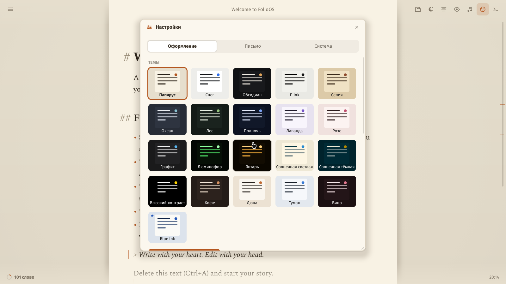

<!-- Generated by tools/readmes.pl from README.md and docs/i18n/README.it.po — edit the .po, not this file. -->
<div align="center">

<a id="folioos--the-distraction-free-writing-os-that-boots-from-a-usb-stick"></a>

# FolioOS — il sistema di scrittura senza distrazioni che si avvia da una chiavetta USB

**Trasforma qualsiasi vecchio portatile in una macchina da scrivere dedicata.**<br>
Niente Windows. Niente Linux. Niente internet. Niente notifiche. Solo tu e il testo.

[](https://github.com/alantaru/FolioOS/actions/workflows/build.yml)
[](https://github.com/alantaru/FolioOS/releases/latest)
[](LICENSE)
[](#hardware-compatibility)
[](#13-15-languages-and-counting)
[](docs/TRANSLATING.md)

[**⬇ Scarica**](https://github.com/alantaru/FolioOS/releases/latest) ·
[Installa](#install-in-3-minutes) ·
[Tour](#a-tour-of-folioos) ·
[Lingue](#13-15-languages-and-counting) ·
[Domande](#faq) ·
[Compila](#build-from-source) ·
[Contribuisci](CONTRIBUTING.md)

<!-- languages -->
<sub>[English](README.md) · [Español](README.es.md) · [Français](README.fr.md) · [Deutsch](README.de.md) · **Italiano** · [Português (Brasil)](README.pt-BR.md) · [Português (Portugal)](README.pt-PT.md) · [Nederlands](README.nl.md) · [Polski](README.pl.md) · [Türkçe](README.tr.md) · [Русский](README.ru.md) · [Українська](README.uk.md) · [简体中文](README.zh-CN.md) · [日本語](README.ja.md) · [한국어](README.ko.md)</sub>
<!-- /languages -->


</div>

FolioOS è un **ambiente di scrittura avviabile**: un sistema operativo minuscolo che fa una cosa sola —
farti scrivere. Inserisci la chiavetta in quasi qualsiasi PC dell’ultimo decennio, avvia da lì e in pochi
secondi sei in un editor Markdown a schermo intero, ben impaginato, esattamente dove ti eri fermato
l’ultima volta. Niente browser, e-mail, negozi di app o Wi-Fi a distrarti.

I tuoi testi vengono salvati come **semplici file Markdown su una normale chiavetta FAT32**, così la stessa
chiavetta si apre su Windows, macOS e Linux. Esporta in Word, LibreOffice, EPUB, HTML o RTF quando devi
condividere.

<a id="who-is-it-for"></a>

## Per chi è?

- **Romanzieri, giornalisti, studenti e blogger** che vogliono un *writerdeck* — un dispositivo dedicato alla
  scrittura senza distrazioni — senza comprare nuovo hardware.
- **Partecipanti al NaNoWriMo** e chi fa sprint di scrittura a tempo o pagine del mattino.
- **Chi ha un vecchio portatile in un cassetto**: FolioOS gli dà una seconda vita, direttamente dalla chiavetta
  USB o installato sul suo disco, da solo o accanto al sistema che ha già.
- **Scuole e biblioteche** che hanno bisogno di una postazione di scrittura semplice e offline.
- **Scrittori attenti alla privacy**: niente rete, niente telemetria, niente cloud.

<a id="install-in-3-minutes"></a>

## Installazione in 3 minuti

1. **Scarica** [`FolioOS.zip`](https://github.com/alantaru/FolioOS/releases/latest) dall’ultima versione.
2. **Estrailo nella radice di una chiavetta formattata in FAT32.** La maggior parte delle chiavette fino a
   32 GB lo è già. I file già presenti vengono conservati. ([Come formattare in FAT32](docs/INSTALL.txt))
3. **Riavvia il PC e apri il menu di avvio** — di solito **F12** (Dell, Lenovo), **F9** (HP), **F8** (Asus) o
   **Esc/F11** — e scegli la voce **UEFI** della chiavetta. Se non compare, disattiva il *Secure Boot* nella
   configurazione del firmware.

<details>
<summary><b>Altri modi di installare</b></summary>

- **Immagine disco:** `FolioOS-disk-image.zip` contiene un’immagine pronta da 256 MB per
  [Rufus](https://rufus.ie) (modalità DD), [balenaEtcher](https://etcher.balena.io) o `dd`. Resta consigliato
  estrarre `FolioOS.zip`: il resto della chiavetta rimane libero per i tuoi file.
- **Dal codice sorgente su Windows:** `.\build.ps1` e poi `.\flash_usb.ps1 -DriveLetter E:` (installa o
  aggiorna una chiavetta senza cancellare nulla).
- **PC senza UEFI (solo BIOS/Legacy):** esegui una volta `FOLIO\TOOLS\biosboot.exe E:` su Windows, come
  amministratore (`E:` è la chiavetta). Scrive solo il codice di avvio BIOS: nessun file viene toccato, la
  chiavetta resta una normale chiavetta FAT32 e l’avvio UEFI continua a funzionare. Dal sorgente:
  `.\flash_usb.ps1 -DriveLetter E: -Bios`.
- **Tutto incluso:** `FolioOS.zip` porta già 11 font liberi per scrivere e leggere e i font per cinese,
  giapponese e coreano — tutte le lingue funzionano subito.

</details>

> **Provalo senza riavviare:** `folio_sim.exe` esegue lo stesso codice in una finestra di Windows, e
> `efi_host.exe` esegue il vero binario UEFI — vedi [Compilare dal codice sorgente](#build-from-source).

---

<a id="a-tour-of-folioos"></a>

## Un giro in FolioOS

<a id="1-start-up"></a>

### 1. Avvio


FolioOS parte direttamente dal firmware. La schermata iniziale compare mentre si caricano i font, e
qualsiasi tasto la salta — puoi iniziare a scrivere subito. La sua durata (1–60 s) è configurabile, oppure
puoi disattivarla.

Al primissimo avvio FolioOS segue la lingua della configurazione del firmware del tuo PC e apre un breve
testo di benvenuto. Da lì in poi riapre sempre **il tuo ultimo documento alla riga esatta in cui eri** —
anche se eri in modalità lettura.

<br clear="right">

<a id="2-the-writing-screen"></a>

### 2. La schermata di scrittura


La pagina è tutto ciò che c’è. Le barre in alto e in basso **spariscono appena scrivi** e tornano quando
muovi il mouse. Il Markdown è mostrato dal vivo — titoli con `#`, `**grassetto**`, `*corsivo*`, `> citazioni`,
elenchi e attività `- [ ]` — mentre il markup resta visibile e modificabile. La barra sottile a destra
mostra dove sei e segna ogni capitolo.

- **Tipografia intelligente:** `--` diventa una lineetta, `...` i puntini di sospensione, e le virgolette
  dritte diventano le virgolette tipografiche giuste *per la tua lingua* (« » in italiano e francese, “ ” in
  inglese, „ “ in tedesco, 「 」 in giapponese).
- **Carta o schermo intero:** scrivi su un foglio di carta su una scrivania o su tutto lo schermo; scegli la
  larghezza della colonna (stretta, media, larga, extra).
- Annulla/ripeti, spostamento per parole, sposta i paragrafi con **Alt+↑/↓**, duplica o elimina paragrafi,
  cambia maiuscole/minuscole con **Shift+F3**, racchiudi una selezione tra `( " * _` e torna all’ultima
  modifica con **Ctrl+J**.

<a id="3-focus-mode-and-zen-mode"></a>

### 3. Modalità concentrazione e modalità zen

<div align="center">


</div>

**F2** sbiadisce tutto tranne la frase, il paragrafo o la riga che stai scrivendo. **F3** è la *modalità
macchina da scrivere*: la riga corrente resta al centro dello schermo. **F11** è la *modalità zen*: nessuna
barra finché non tocchi il bordo superiore. La **modalità Hemingway** disattiva la cancellazione, per farti
andare sempre avanti.

<a id="4-reading-mode"></a>

### 4. Modalità lettura


**Ctrl+P** trasforma il tuo Markdown in una pagina impaginata, come un libro. Volta pagina con le frecce, la
barra spaziatrice o un clic sui margini. La barra in basso mostra quanto hai letto e quanto manca per il
capitolo e per l’intero testo; lo **scorrimento automatico** muove il testo alla tua velocità di lettura (in
parole al minuto): **Invio** o il pulsante centrale del mouse lo avvia, **+** e **−** cambiano la velocità.
**Esc** torna alla scrittura *al paragrafo che stavi leggendo*.

<a id="5-chapters-and-outline"></a>

### 5. Capitoli e struttura


Ogni titolo `#` è un capitolo. **F5** apre la struttura per saltare ovunque; **Ctrl+PgSu/PgGiù** passa da un
capitolo all’altro sia in scrittura sia in lettura. I manoscritti lunghi restano facili da percorrere — e
l’esportazione EPUB trasforma quei capitoli in un vero indice da e-book.

<br clear="right">

<a id="6-find-and-replace"></a>

### 6. Trova e sostituisci


**Ctrl+F** evidenzia ogni corrispondenza, le conta e ne sostituisce una o tutte.

<a id="7-files-open-save-and-export"></a>

### 7. File: apri, salva ed esporta

<div align="center">


</div>

**Ctrl+O** apre un vero gestore di file: ogni unità che il firmware mette a disposizione, cartelle, crea,
rinomina ed elimina. **Ctrl+Shift+S** salva con un altro nome o **esporta in DOCX, ODT, EPUB, HTML, RTF o
TXT** — un clic sul formato. Tutto il resto è automatico:

- **Salvataggio automatico** (ogni 20 secondi per impostazione predefinita) con **scrittura atomica**: un
  calo di corrente non lascia mai un file a metà.
- **Versioni automatiche:** la copia precedente di ogni file salvato va in `FOLIO/VERSIONS` (si conservano le
  ultime 30 per documento).
- **Recupero delle bozze** per il testo che non ha mai avuto un nome.

**Sorgenti LaTeX** (`.tex`, `.bib`, `.sty`, `.cls`): si aprono come testo sorgente in un carattere a
spaziatura fissa, con evidenziazione per riga di comandi, graffe, commenti `%` e formule in linea,
tabulazioni vere e `{`, `[` e `$` che si chiudono da soli. Né lo stile Markdown né le virgolette
tipografiche toccano il sorgente, e il file conserva i suoi fine riga (CRLF resta CRLF). FolioOS non
compila LaTeX: la modalità lettura e l’esportazione sono per i documenti Markdown.

<a id="8-tabs-optional"></a>

### 8. Schede (opzionali)


Preferisci più documenti insieme? Attiva le schede con la prima icona in alto a destra. **Ctrl+N** apre una
scheda, **Ctrl+W** la chiude, **Ctrl+Tab** o **Alt+1…9** passano dall’una all’altra. Le schede — anche quelle
senza titolo — tornano dopo il riavvio. Disattivate, FolioOS resta una tranquilla macchina da scrivere, un
documento alla volta.

<a id="9-goals-sprints-and-statistics"></a>

### 9. Obiettivi, sprint e statistiche


**F10** mostra il tuo obiettivo giornaliero di parole, le parole di questo documento e di questa sessione,
il tempo di lettura e il tuo ritmo di scrittura. **F4** avvia uno **sprint di scrittura** a tempo (15–60
minuti) che termina con un leggero rintocco. Le parole scritte oggi vengono contate tra documenti e riavvii.

<br clear="right">

<a id="10-command-palette-and-shortcuts"></a>

### 10. Tavolozza dei comandi e scorciatoie


**Ctrl+K** trova qualsiasi comando digitando poche lettere — nella tua lingua. **F1** elenca tutte le scorciatoie:


<a id="no-mouse-needed"></a>

#### Non serve il mouse

Tutto in FolioOS funziona solo con la tastiera, e mouse e touchpad si possono disattivare del tutto
(*Impostazioni › Sistema › Usa mouse e touchpad*, **Ctrl+K › Mouse** o `use_mouse=0` in `CONFIG.INI`) —
comodo sui portatili con un touchpad che fa saltare il cursore.

| Tasti | Cosa fanno |
|---|---|
| Scorciatoia di una finestra (F12, F5, F6, F10, Ctrl+O…) | La apre con la tastiera al suo interno |
| **Tab** / **Shift+Tab**, **↑ ↓** | Passano tra pulsanti, interruttori, cursori ed elenchi di una finestra |
| **Invio** o **Spazio** | Premono il pulsante, l’interruttore o la voce evidenziata |
| **← →** | Regolano il cursore, l’opzione o il valore evidenziato |
| **Esc** | Chiude la finestra e torna al testo; se non c’è nulla di aperto, mostra le barre nascoste |
| **Ctrl+F6** | Porta la tastiera tra il testo e le finestre aperte |
| **Alt+M** | Menu con i documenti recenti (anche in Ctrl+K) |
| **Alt+F7** / **Alt+F8** | Spostano / ridimensionano la finestra con le frecce (Shift = passi piccoli); Invio conferma, Esc annulla |

Un’evidenziazione mostra quale controllo ha la tastiera; compare solo quando usi i tasti, quindi per chi usa
il mouse non cambia nulla. Le lettere digitate in una finestra laterale (struttura, musica, impostazioni)
tornano direttamente nel tuo testo.

<a id="11-themes-and-typography"></a>

### 11. Temi e tipografia


**F12** apre le impostazioni dell’aspetto: **20 temi curati a mano**, il font del testo, la dimensione,
l’interlinea, lo spazio tra paragrafi e il rientro della prima riga. Il testo è disegnato dal motore
TrueType di FolioOS, con vera crenatura e antialiasing, nitido dai piccoli schermi dei netbook fino al 4K.

<div align="center">


</div>


**Crea il tuo:** l’editor di temi ti fa scegliere ciascuno dei 16 colori (o prenderli in prestito da un tema
incluso), un font per il testo e uno per l’interfaccia, e vedere subito il risultato. I temi sono piccoli
file di testo `.INI` in `FOLIO/THEMES` — facili da condividere. Metti qualsiasi font `.ttf` in `FOLIO/FONTS`
per usarlo; FolioOS include già Literata, Lora, EB Garamond, iA Writer Quattro/Duo/Mono, Special Elite e
altri.

<br clear="right">

<a id="12-music-while-you-write"></a>

### 12. Musica mentre scrivi

**F6** apre un piccolo lettore MP3 per i file nella cartella `MUSIC` della chiavetta (Intel HD Audio e AC'97).
**F7/F8/F9** lo controllano senza lasciare la pagina.

<a id="13-15-languages-and-counting"></a>

### 13. 15 lingue, e altre in arrivo

<div align="center">



</div>

**English, Español, Français, Deutsch, Italiano, Português (Brasil), Português (Portugal), Nederlands,
Polski, Türkçe, Русский, Українська, 简体中文, 日本語, 한국어.**


Nulla che riguardi la lingua è fisso nel codice. Ogni traduzione è un **file `.po` di gettext** standard in
`FOLIO/LANGUAGES` che definisce anche le regole del plurale, le virgolette, il formato della data, il
separatore decimale, la tastiera predefinita e i font — **aggiungere una lingua significa copiare un file
sulla chiavetta**. Anche i layout di tastiera sono file di testo: US, US-Internazionale, UK, ABNT2,
Portogallo, Spagna, America Latina, AZERTY francese, QWERTZ tedesco, italiano, polacco, Q turco, russo,
ucraino, coreano (input hangul a 2 set) e giapponese (input romaji → kana).

Vuoi FolioOS nella tua lingua? Leggi **[docs/TRANSLATING.md](docs/TRANSLATING.md)** — funziona con Poedit,
Weblate, Crowdin o qualsiasi editor di testo.

<br clear="right">

<a id="14-your-files-on-any-computer"></a>

### 14. I tuoi file, su qualsiasi computer

```
Chiavetta USB (FAT32)
├── DOCUMENTS/          i tuoi file .md e .txt, e le esportazioni (.docx .odt .epub .html .rtf)
├── MUSIC/              i tuoi file .mp3
├── FOLIO/
│   ├── CONFIG.INI      preferenze — testo semplice, modificabile a mano
│   ├── FONTS/          font .ttf (aggiungi i tuoi)
│   ├── THEMES/         i tuoi temi (.INI)
│   ├── LANGUAGES/      traduzioni (.po)
│   ├── KEYBOARDS/      layout di tastiera (.txt)
│   ├── VERSIONS/       versioni precedenti automatiche dei file salvati
│   └── BACKUP/         tabelle delle partizioni salvate dall’installer prima di scrivere qualsiasi cosa
└── EFI/BOOT/           FolioOS stesso (BOOTX64.EFI, BOOTIA32.EFI, BOOTAA64.EFI)
```

Nessun database, nessuna partizione nascosta, nessun formato proprietario. Porta la chiavetta su qualsiasi
computer e i tuoi testi sono lì.

<a id="15-install-it-on-the-computer-beta"></a>

### 15. Installalo sul computer (beta)

La chiavetta USB basta, ma FolioOS può vivere anche sul disco del computer, così il portatile si avvia
direttamente nella tua scrittura. Apri **Ctrl+K › Installa FolioOS su questo computer** (o *Impostazioni › Sistema*):

- **Come unico sistema**, su un disco vuoto o che scegli di cancellare: confermi digitando una parola.
- **Accanto a Windows o Linux**, nello spazio libero, senza toccare le altre partizioni. A ogni avvio compare
  *Premi un tasto qualsiasi per scrivere* per qualche secondo, poi parte l’altro sistema come al solito;
  Windows viene avviato dal firmware stesso, come sempre.
- **Niente spazio libero?** FolioOS può ridurre una partizione NTFS, FAT32 o exFAT senza spostare alcun dato.
  Rifiuta ciò che non è sicuro (Windows in ibernazione o con l’avvio rapido, un volume che ha bisogno di
  `chkdsk`, BitLocker senza la chiave di ripristino, LUKS, LVM, volumi Apple) e spiega cosa fare invece.
  ext4 non viene mai ridimensionato: fai spazio da Linux (GParted) e riapri l’installer.
- Prima di scrivere qualsiasi cosa, la tabella delle partizioni (i primi e gli ultimi settori del disco)
  viene salvata in `FOLIO/BACKUP` sull’unità da cui è partito FolioOS, di solito la chiavetta USB. I tuoi
  testi possono stare sul computer, sulla chiavetta o su entrambi.
- **Aggiorna** da una chiavetta più recente: vengono sostituiti solo i file di FolioOS; i tuoi testi e le
  partizioni restano come sono.
- **Disinstalla**: puoi far copiare prima i tuoi testi sull’unità da cui è partito FolioOS. Se l’installer
  ha ridotto una partizione per fare spazio, quella partizione torna alla dimensione che aveva; altrimenti lo
  spazio diventa libero.
- *Impostazioni › Sistema › Dischi e partizioni* è un piccolo gestore delle partizioni: creare una partizione
  FAT32, formattare, ridurre o allargare NTFS/FAT32/exFAT, eliminare.
- La 4.4 beta è una versione preliminare: scaricala dalla
  [sua pagina di rilascio](https://github.com/alantaru/FolioOS/releases/tag/v4.4.1-beta), non da «latest».

Funziona sui PC UEFI e sui PC solo BIOS. **È una beta:** supera tutti i test su macchine emulate, con dischi
creati da Windows e da Linux, ma non è ancora stata provata su hardware reale: fai prima un backup, o usa un
disco di scorta.

---

<a id="how-folioos-compares"></a>

## FolioOS a confronto

| | FolioOS | Dispositivi dedicati (Freewrite, AlphaSmart, Pomera) | App di scrittura (iA Writer, Scrivener, modalità concentrazione) |
|---|:---:|:---:|:---:|
| Costo | **Gratis** | Centinaia di dollari | Da gratis a pagamento |
| Hardware | Qualsiasi PC UEFI che hai già | Un dispositivo nuovo | Il tuo solito computer |
| Distrazioni a portata di mano | **Nessuna** — niente sistema, niente rete | Nessuna | A un Alt+Tab di distanza |
| Formato dei file | Markdown semplice su FAT32 | Sincronizzazione/esportazione propria del dispositivo | Varia |
| Schermo e tipografia | Schermo grande, TrueType, temi | E-ink o LCD piccolo | Eccellenti |
| Funziona offline | **Sempre** | Quasi sempre | Sì |
| Open source | **Sì (GPL-3.0)** | No | Quasi mai |

<a id="hardware-compatibility"></a>

## Compatibilità hardware

| | |
|---|---|
| **Firmware** | UEFI 2.x — 64 bit (`BOOTX64.EFI`), 32 bit (`BOOTIA32.EFI`, tablet e netbook Atom) o ARM64 (`BOOTAA64.EFI`: Raspberry Pi 3/4/5 con il firmware UEFI della comunità, portatili ARM). **I PC solo BIOS** (Legacy/CSM) si avviano tramite il ponte BIOS di FolioOS dopo aver eseguito una volta `FOLIO\TOOLS\biosboot.exe`. Il Secure Boot deve essere disattivato. |
| **Schermo** | Qualsiasi framebuffer UEFI GOP (RGB, BGR, maschera di bit, solo Blt) o UGA datato; VESA/VBE sui PC BIOS. Risoluzione nativa, scala HiDPI automatica, schermi verticali ruotati in automatico. Quando l’unica modalità è 4:3 e uno schermo panoramico la allunga, *Impostazioni › Sistema › Schermo e puntatore* mantiene le proporzioni (Monitor, 16:9, 16:10 o 4:3). |
| **Input** | Tastiera tramite il firmware (direttamente via PS/2 sui PC BIOS). Mouse, touchpad, tavoletta grafica e touch screen tramite il firmware — e, quando il firmware non ha un driver per loro, tramite i driver USB HID e PS/2 di FolioOS. |
| **Audio** | Intel HD Audio e AC'97 (serve solo per il lettore musicale). |
| **Dischi (installer, beta)** | Dischi SATA, NVMe, IDE e USB con settori da 512 byte, GPT o MBR. NTFS, FAT32 ed exFAT si possono ridurre e riallargare senza spostare dati; BitLocker, LUKS, LVM, APFS/HFS+ ed ext4 non vengono mai ridimensionati. |
| **Non supportati** | Secure Boot (per ora), Mac con Apple Silicon. Wi-Fi e Bluetooth sono esclusi di proposito. |
| **Provato su** | 20 macchine emulate a ogni versione: UEFI x64, IA32 e ARM64, e PC solo BIOS che si avviano da USB e IDE; 8 schede grafiche, mouse PS/2 e USB, tavoletta USB, HD Audio e AC'97; FolioOS installato su dischi SATA e IDE, dual boot accanto a Windows (UEFI) e a un altro sistema (BIOS), riduzione di un NTFS creato da Windows e mantenimento delle proporzioni. Su ognuna si controllano immagine, tastiera, mouse, audio, salvataggio e integrità del file system. |

Ogni avvio scrive `FOLIO/DIAGNOSTICS.TXT` con ciò che FolioOS ha trovato. Condividi il tuo in una
[segnalazione hardware](https://github.com/alantaru/FolioOS/issues/new/choose) — anche «funziona e basta»
aiuta altri scrittori a scegliere un portatile.

<a id="faq"></a>

## Domande frequenti

<details>
<summary><b>Cancellerà il mio computer o la mia chiavetta?</b></summary>

No. Avviato dalla chiavetta USB, FolioOS non scrive mai sul disco interno, e installarlo sulla chiavetta aggiunge
solo file: quello che c’era resta. Togli la chiavetta e il PC riavvia il suo sistema di sempre.
Il disco viene toccato solo se apri tu l’installer o *Dischi e partizioni*, e anche allora non si scrive nulla
prima che tu confermi e che la tabella delle partizioni sia salvata sull’unità da cui è partito FolioOS.
</details>

<details>
<summary><b>Posso installarlo sul portatile, accanto a Windows o Linux?</b></summary>

Sì, dalla 4.4 (beta): **Ctrl+K › Installa FolioOS su questo computer**. Usa lo spazio libero, oppure riduce
una partizione NTFS, FAT32 o exFAT senza spostare dati, e a ogni avvio scegli FolioOS o l’altro sistema.
Disinstallando, la partizione che l’installer ha ridotto torna a crescere (altrimenti lo spazio diventa libero). Vedi [Installalo sul computer](#15-install-it-on-the-computer-beta).
</details>

<details>
<summary><b>I miei testi sono al sicuro se la batteria si scarica?</b></summary>

I salvataggi sono atomici (il file viene scritto per intero prima di sostituire il vecchio), il salvataggio
automatico avviene ogni 20 secondi per impostazione predefinita, il testo senza titolo ha una bozza di
recupero e ogni file salvato conserva le versioni precedenti in `FOLIO/VERSIONS`.
</details>

<details>
<summary><b>Posso modificare i miei file anche sul mio computer normale?</b></summary>

Sì. Sono semplici file `.md` in `DOCUMENTS` su una chiavetta FAT32. Aprili in Obsidian, Typora, VS Code,
Blocco note, TextEdit o qualsiasi editor Markdown, poi reinserisci la chiavetta e continua a scrivere in
FolioOS.
</details>

<details>
<summary><b>Posso scrivere in LaTeX?</b></summary>

Sì. FolioOS modifica i file sorgente `.tex`, `.bib`, `.sty` e `.cls` con evidenziazione, in un carattere
a spaziatura fissa ed esattamente come li scrivi (niente virgolette tipografiche né Markdown). Non li
compila: genera il PDF su un computer con una distribuzione TeX oppure carica i file in un editor LaTeX
online.
</details>

<details>
<summary><b>Perché il mio PC non mostra la chiavetta nel menu di avvio?</b></summary>

Controlla che la chiavetta sia in FAT32, di aver scelto la voce che inizia con "UEFI" e che il Secure Boot
sia disattivato nella configurazione del firmware. I PC più vecchi che si avviano solo in modalità
BIOS/Legacy hanno bisogno una volta del codice di avvio BIOS: esegui `FOLIO\TOOLS\biosboot.exe E:` su Windows
come amministratore e la chiavetta comparirà come un normale disco USB.
</details>

<details>
<summary><b>Funziona su un Mac?</b></summary>

I Mac Intel possono avviarsi da unità UEFI (tieni premuto <kbd>Option</kbd> all’accensione), ma non sono
ancora stati provati — le segnalazioni sono benvenute. I Mac con Apple Silicon non sono supportati.
</details>

<details>
<summary><b>Posso scrivere in cinese, giapponese o coreano?</b></summary>

**Coreano e giapponese, sì.** Scegli la tastiera *한국어 (두벌식)* o *日本語 (ローマ字かな)* in
*Impostazioni › Sistema*: il coreano usa il layout standard a 2 set e compone le sillabe mentre scrivi
(Backspace toglie un jamo alla volta); il giapponese trasforma il romaji in hiragana o katakana (`nihongo` →
にほんご). **Ctrl+Spazio** passa dal metodo di input alle lettere latine. I font sono inclusi in FolioOS, e
quello giusto si carica da solo ogni volta che il testo contiene queste scritture. La conversione in kanji e
il pinyin cinese richiedono dizionari e sono ancora nella roadmap. Le scritture latina, greca e cirillica si
digitano con i layout di tastiera inclusi.
</details>

<details>
<summary><b>Posso usarlo senza mouse?</b></summary>

Sì. Ogni finestra, pulsante e impostazione è raggiungibile da tastiera (Tab, frecce, Invio, Spazio, Esc), e
puoi disattivare del tutto mouse e touchpad in *Impostazioni › Sistema*. Vedi
[Non serve il mouse](#no-mouse-needed).
</details>

<details>
<summary><b>C’è il controllo ortografico, internet o la sincronizzazione cloud?</b></summary>

Niente internet né sincronizzazione, di proposito — FolioOS è pensato per funzionare offline. Il controllo
ortografico è nella roadmap. Dato che i file sono semplice Markdown, puoi sincronizzarli con qualsiasi cosa
una volta che la chiavetta torna su un computer normale.
</details>

<a id="build-from-source"></a>

## Compilare dal codice sorgente

Requisiti: Windows 10/11, PowerShell 5.1+ e il `gcc` di [MinGW-w64](https://winlibs.com) (qualsiasi build
x86_64 recente) nel `PATH`. Le versioni ARM64 e BIOS usano anche `clang` di [LLVM](https://llvm.org) e
`nasm`, e il laboratorio hardware usa [QEMU](https://www.qemu.org): tutti e tre si installano con `winget`.

```powershell
git clone https://github.com/alantaru/FolioOS.git
cd FolioOS
.\build.ps1                                  # UEFI x64 + IA32 + ARM64, BIOS, simulatore, pacchetti — e la suite di test
.\tools\qemu-lab.ps1                         # avvia i veri binari su 20 macchine emulate e le verifica una per una
.\build\folio_sim.exe                        # esegue FolioOS in una finestra
.\build\efi_host.exe build\efi\BOOTX64.EFI   # esegue il vero binario UEFI in una finestra
.\flash_usb.ps1 -DriveLetter E:              # installa/aggiorna una chiavetta FAT32 conservando i file
.\build.ps1 -Image -ImageMB 256              # opzionale: immagine disco per Rufus / Etcher / dd
.\tools\fetch-cjk-fonts.ps1                  # scarica una volta i font CJK (build.ps1 lo esegue se serve)
.\tools\showcase.ps1                         # rigenera le schermate di questo README
```

La suite di test guida il simulatore e il vero `BOOTX64.EFI` (dentro un piccolo host UEFI) con tasti ed
eventi del mouse programmati, cattura schermate e verifica ogni esportazione (ZIP + XML), ogni traduzione
(con un controllo negativo per il validatore), sei formati di framebuffer e il driver FAT32 del ponte BIOS
(migliaia di operazioni casuali, verificate byte per byte).
L’installer e il gestore delle partizioni girano su immagini di disco create da Windows e da Linux, e i risultati
sono verificati da `chkdsk` di Windows e da `fsck` di Linux (`tools/ntfs-shrink-check.ps1`, `tools/linux-run.ps1`).

<a id="macos-simulator"></a>

### Simulatore per macOS

Su un Mac puoi compilare ed eseguire il simulatore in modo nativo (AppKit, Retina, Cmd funziona come Ctrl
nelle scorciatoie). Requisiti: i Command Line Tools di Xcode (`xcode-select --install`) — basta `clang`,
non serve Xcode completo.

```bash
./build_macos.sh                             # simulatore, "FolioOS Simulator.app" e la cartella della chiavetta
./build_macos.sh --test                      # lo stesso, più i test programmati del simulatore (senza finestra)
./build/macos/folio_sim                      # avvia FolioOS in una finestra
open "build/macos/FolioOS Simulator.app"     # oppure apri il pacchetto dell’app
```

Option è l’AltGr del Mac, quindi continua a scrivere caratteri (`@ # | [ ] { }` in molti layout): nel
simulatore **Option+M** apre il menu (Alt+M) e **Cmd+Option+1…9** cambiano scheda (Alt+1…9).

Lo script per macOS compila solo il simulatore: i binari UEFI, i pacchetti, le immagini disco e i test che
eseguono il vero `BOOTX64.EFI` dentro `efi_host` richiedono ancora la build per Windows (`build.ps1`).

<a id="architecture-in-one-picture"></a>

### L’architettura in un’immagine

```
src/core/       nucleo portabile (C freestanding, senza libc): editor, Markdown, rasterizzatore TrueType,
                toolkit dell’interfaccia e gestore di finestre, esportazioni, MP3, i18n, tastiere, temi,
                tabelle delle partizioni, controllo e ridimensionamento dei file system, installer e selettore di avvio
src/platform/   uefi/  video GOP/UGA, input, I/O FAT, HD Audio/AC'97, driver USB HID e PS/2 — sul firmware
                bios/  settori di avvio + ponte BIOS→UEFI (VBE, PS/2, driver FAT32 proprio) per i PC solo BIOS
                win32/ simulatore usato per lo sviluppo e i test automatici
                macos/ simulatore per macOS (AppKit), stessi test programmati
tools/          efi_host (esegue BOOTX64.EFI su Windows), strumento i18n, creatore di immagini disco, showcase
assets/         font, traduzioni (.po), layout di tastiera, tema di esempio
tests/          test end-to-end programmati
```

Un binario di circa 800 KB controlla tutta la macchina attraverso un sottile strato di piattaforma.
Dettagli in [docs/ARCHITECTURE.md](docs/ARCHITECTURE.md).

## Roadmap

FolioOS si divide in due edizioni che condividono lo stesso editor: **FolioOS**, offline per sempre, e
**FolioOS Sync**, un Linux minimale con Wi-Fi che sincronizza i tuoi testi. Il piano completo è in
[ROADMAP.md](ROADMAP.md).

- [x] PC solo BIOS (Legacy/CSM) e ARM64 (Raspberry Pi con firmware UEFI, portatili ARM)
- [x] Input coreano (hangul a 2 set) e input kana giapponese (romaji → hiragana/katakana)
- [x] Installazione sul disco del computer — come unico sistema o accanto a qualsiasi altro — con un gestore di partizioni (4.4 beta)
- [ ] FolioOS Sync: Wi-Fi e sincronizzazione con WebDAV, SFTP, Git, Dropbox, Google Drive, OneDrive e Syncthing
- [ ] Conversione in kanji (giapponese) e input pinyin (cinese) (richiedono dizionari)
- [ ] Composizione del testo e scritture da destra a sinistra (arabo, ebraico, devanagari…)
- [ ] Controllo ortografico con dizionari compatibili con Hunspell
- [ ] Supporto al Secure Boot (shim firmato)
- [ ] Versione Linux del simulatore e degli strumenti (macOS: fatto)

Vota e proponi nelle [Discussions](https://github.com/alantaru/FolioOS/discussions).

<a id="contributing"></a>

## Contribuire

Segnalazioni di bug e di hardware, traduzioni, layout di tastiera, temi, font, documentazione e codice sono
tutti benvenuti — inizia da [CONTRIBUTING.md](CONTRIBUTING.md). Rispetta il
[Codice di condotta](CODE_OF_CONDUCT.md); segnala i problemi di sicurezza in privato come descritto in
[SECURITY.md](SECURITY.md).

Se FolioOS ti aiuta a scrivere, **⭐ metti una stella al repository** — aiuta altri scrittori a trovarlo.

<a id="license"></a>

## Licenza

FolioOS è software libero sotto la [GNU General Public License v3.0](LICENSE). I font inclusi usano la SIL
Open Font License; minimp3 è CC0. Vedi [THIRD_PARTY_NOTICES.md](THIRD_PARTY_NOTICES.md).

<sub>FolioOS · software di scrittura senza distrazioni · ambiente di scrittura su chiavetta USB avviabile ·
writerdeck · alternativa fai-da-te a Freewrite / AlphaSmart · macchina da scrivere digitale per vecchi
portatili · editor Markdown offline · app di scrittura concentrata · applicazione UEFI scritta in C ·
strumento di scrittura per romanzi e NaNoWriMo.</sub>
