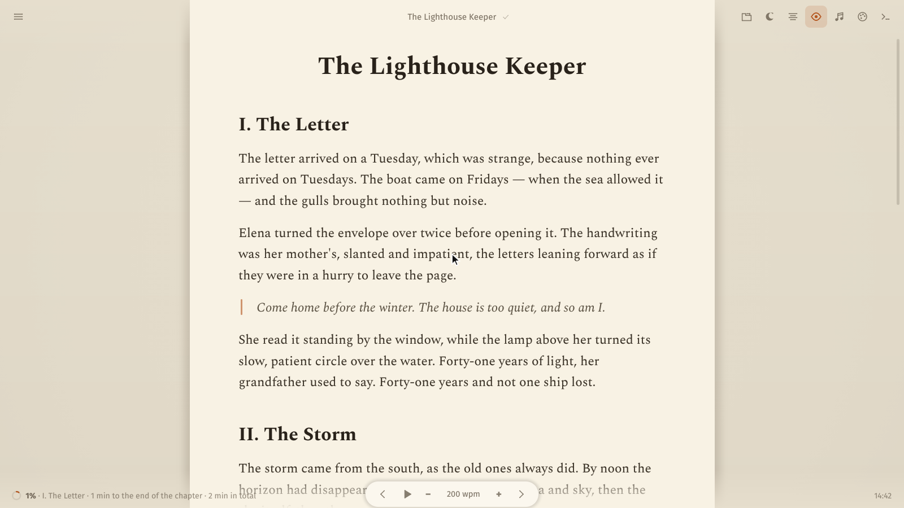

<!-- Generated by tools/readmes.pl from README.md and docs/i18n/README.ja.po — edit the .po, not this file. -->
<div align="center">

<a id="folioos--the-distraction-free-writing-os-that-boots-from-a-usb-stick"></a>

# FolioOS — USB メモリから起動する、気が散らない執筆専用システム

**どんな古いノートパソコンも、執筆専用マシンに。**<br>
Windows なし。Linux なし。インターネットなし。通知なし。あなたと文章だけ。

[](https://github.com/alantaru/FolioOS/actions/workflows/build.yml)
[](https://github.com/alantaru/FolioOS/releases/latest)
[](LICENSE)
[](#hardware-compatibility)
[](#13-15-languages-and-counting)
[](docs/TRANSLATING.md)

[**⬇ ダウンロード**](https://github.com/alantaru/FolioOS/releases/latest) ·
[インストール](#install-in-3-minutes) ·
[ツアー](#a-tour-of-folioos) ·
[言語](#13-15-languages-and-counting) ·
[よくある質問](#faq) ·
[ビルド](#build-from-source) ·
[貢献する](CONTRIBUTING.md)

<!-- languages -->
<sub>[English](README.md) · [Español](README.es.md) · [Français](README.fr.md) · [Deutsch](README.de.md) · [Italiano](README.it.md) · [Português (Brasil)](README.pt-BR.md) · [Português (Portugal)](README.pt-PT.md) · [Nederlands](README.nl.md) · [Polski](README.pl.md) · [Türkçe](README.tr.md) · [Русский](README.ru.md) · [Українська](README.uk.md) · [简体中文](README.zh-CN.md) · **日本語** · [한국어](README.ko.md)</sub>
<!-- /languages -->


</div>

FolioOS は**起動可能な執筆環境**です。たったひとつのこと——あなたに書かせること——だけをする小さなオペレーティングシステム
です。この 10 年に作られたほぼどんな PC にも USB メモリを挿して起動すれば、数秒後には全画面の美しく組版された Markdown
エディターの中、前回やめたまさにその場所にいます。気を散らすブラウザーもメールもアプリストアも Wi-Fi もありません。

書いた文章は**普通の FAT32 USB メモリ上のプレーンな Markdown ファイル**として保存されるので、同じ USB メモリを Windows、
macOS、Linux で開けます。共有が必要になったら Word、LibreOffice、EPUB、HTML、RTF に書き出せます。

<a id="who-is-it-for"></a>

## 誰のためのもの？

- **小説家、記者、学生、ブロガー**：新しいハードウェアを買わずに *writerdeck*——気が散らない執筆専用機——が欲しい人。
- **NaNoWriMo の参加者**や、時間を区切った執筆スプリントやモーニングページを書く人。
- **引き出しに古いノートPCが眠っている人**：FolioOS がそれに第二の人生を与えます。USB メモリーから
  そのまま起動するか、ディスクにインストールして、単独で、または今あるシステムと並べて使えます。
- **学校や図書館**：シンプルなオフラインの執筆端末が必要な場所。
- **プライバシーを大切にする書き手**：ネットワークもテレメトリーもクラウドもありません。

<a id="install-in-3-minutes"></a>

## 3 分でインストール

1. 最新版から [`FolioOS.zip`](https://github.com/alantaru/FolioOS/releases/latest) を**ダウンロード**します。
2. **FAT32 でフォーマットされた USB メモリのルートに展開します。** 32 GB までの USB メモリはほとんどが最初から FAT32 です。
   USB メモリにある既存のファイルは残ります。（[FAT32 でフォーマットする方法](docs/INSTALL.txt)）
3. **PC を再起動して起動メニューを開き**——通常は **F12**（Dell、Lenovo）、**F9**（HP）、**F8**（ASUS）または **Esc/F11**——
   USB メモリの **UEFI** の項目を選びます。表示されない場合は、ファームウェア設定で *Secure Boot* をオフにしてください。

<details>
<summary><b>その他のインストール方法</b></summary>

- **ディスクイメージ：** `FolioOS-disk-image.zip` には [Rufus](https://rufus.ie)（DD モード）、
  [balenaEtcher](https://etcher.balena.io)、`dd` 用の 256 MB のイメージが入っています。それでも `FolioOS.zip` を展開する方法を
  おすすめします。USB メモリの残りをあなたのファイルのために空けておけるからです。
- **Windows でソースから：** `.\build.ps1` のあとに `.\flash_usb.ps1 -DriveLetter E:`（何も消さずに USB メモリへインストール／更新します）。
- **UEFI のない PC（BIOS/Legacy のみ）：** Windows で管理者として `FOLIO\TOOLS\biosboot.exe E:` を一度実行します（`E:` は
  USB メモリ）。書き込むのは BIOS の起動コードだけで、ファイルには一切触れず、USB メモリは普通の FAT32 のまま、UEFI からの起動も
  これまでどおり使えます。ソースからは `.\flash_usb.ps1 -DriveLetter E: -Bios`。
- **すべて同梱：** `FolioOS.zip` には執筆と読書のための 11 種類のフリーフォントと、中国語・日本語・韓国語のフォントが
  最初から入っています——どの言語もすぐに使えます。

</details>

> **再起動せずに試す：** `folio_sim.exe` は同じコードを Windows のウィンドウで動かし、`efi_host.exe` は本物の UEFI
> プログラムを動かします——[ソースからビルド](#build-from-source)を参照してください。

---

<a id="a-tour-of-folioos"></a>

## FolioOS ツアー

<a id="1-start-up"></a>

### 1. 起動


FolioOS はファームウェアから直接起動します。フォントの読み込み中は起動画面が表示され、どのキーでもスキップできるので、すぐに
書き始められます。表示時間（1〜60 秒）は設定でき、オフにもできます。

最初の起動では、FolioOS は PC のファームウェア設定の言語に合わせ、短い歓迎の文章を開きます。それ以降は必ず**最後の文書を、
あなたがいたまさにその行で**開きます——閲覧モードだったとしても。

<br clear="right">

<a id="2-the-writing-screen"></a>

### 2. 執筆画面


あるのはページだけです。上下のバーは**入力を始めるとすぐに消え**、マウスを動かすと戻ってきます。Markdown はライブで表示され
——`#` の見出し、`**太字**`、`*斜体*`、`> 引用`、リスト、`- [ ]` のタスク——記号は見えたまま編集できます。右側の細い
バーは現在位置を示し、各章に印を付けます。

- **スマートな約物：** `--` はダッシュに、`...` は三点リーダーに、まっすぐな引用符は*あなたの言語に合った*引用符に変わります
  （日本語では 「 」、英語では “ ”、フランス語では « »、ドイツ語では „ “）。
- **紙または全画面：** 机の上の一枚の紙に書くことも、画面いっぱいに書くこともできます。段の幅（狭い・普通・広い・特大）も選べます。
- 元に戻す／やり直し、単語単位の移動、**Alt+↑/↓** で段落を移動、段落の複製や削除、**Shift+F3** で大文字・小文字の切り替え、
  選択範囲を `( " * _` で囲む、**Ctrl+J** で最後の編集箇所へ戻る。

<a id="3-focus-mode-and-zen-mode"></a>

### 3. フォーカスモードと禅モード

<div align="center">


</div>

**F2** は書いている文・段落・行以外をすべて薄くします。**F3** は*タイプライターモード*で、今の行が画面の中央にとどまります。
**F11** は*禅モード*で、画面の上端に触れるまでバーは一切出ません。**ヘミングウェイモード**は削除を無効にして、前に進み続けさせます。

<a id="4-reading-mode"></a>

### 4. 閲覧モード



**Ctrl+P** は Markdown を本のように組版したページに変えます。矢印キー、スペースキー、余白のクリックでページをめくれます。
下のバーには読んだ量と、章と全文を読み終えるまでの時間が表示されます。**自動スクロール**はあなたの読む速さ（1 分あたりの
語数）で文章を動かします。**Enter** かマウスの中ボタンで開始し、**+** と **−** で速さを変えます。**Esc** で、*読んでいた段落*
から執筆に戻ります。

<a id="5-chapters-and-outline"></a>

### 5. 章とアウトライン


`#` の見出しはそれぞれ章になります。**F5** でアウトラインを開いてどこへでも移動でき、**Ctrl+PgUp/PgDn** は執筆中も閲覧中も
章から章へ移動します。長い原稿でも迷いません——さらに EPUB 書き出しでは、それらの章が本物の電子書籍の目次になります。

<br clear="right">

<a id="6-find-and-replace"></a>

### 6. 検索と置換


**Ctrl+F** はすべての一致箇所を強調表示して数え、1 つまたはすべてを置き換えます。

<a id="7-files-open-save-and-export"></a>

### 7. ファイル：開く・保存・書き出し

<div align="center">


</div>

**Ctrl+O** は本格的なファイルマネージャーを開きます。ファームウェアが認識するすべてのドライブ、フォルダー、作成、名前の変更、
削除。**Ctrl+Shift+S** で別名保存するか、**DOCX、ODT、EPUB、HTML、RTF、TXT に書き出し**ます——形式をクリックするだけ。
それ以外はすべて自動です：

- **自動保存**（既定では 20 秒ごと）は**アトミックな書き込み**：停電しても半分だけのファイルが残ることはありません。
- **自動バージョン：** 保存したファイルの一つ前のコピーは `FOLIO/VERSIONS` に移ります（文書ごとに最新 30 個を保持）。
- **下書きの復元**：名前を付けていない文章のために。

**LaTeX のソース**（`.tex`、`.bib`、`.sty`、`.cls`）は等幅フォントのソースとして開き、コマンド、波かっこ、`%` コメント、
行内の数式を行ごとに色分けし、本物のタブ位置を使い、`{`、`[`、`$` は自動で閉じます。Markdown の装飾やスマート引用符が
ソースを変えることはなく、ファイルの改行コードもそのまま（CRLF は CRLF のまま）です。FolioOS は LaTeX をコンパイルしません。
読書モードと書き出しは Markdown 文書用です。

<a id="8-tabs-optional"></a>

### 8. タブ（オプション）


複数の文書を同時に開きたいですか？右上の最初のアイコンでタブをオンにします。**Ctrl+N** でタブを開き、**Ctrl+W** で閉じ、
**Ctrl+Tab** か **Alt+1…9** で切り替えます。タブは——名前のないものも——再起動後に戻ってきます。オフにすれば、FolioOS は
一度にひとつの文書だけを扱う静かなタイプライターのままです。

<a id="9-goals-sprints-and-statistics"></a>

### 9. 目標、スプリント、統計


**F10** は 1 日の語数目標、この文書とこのセッションの語数、読了時間、執筆ペースを表示します。**F4** は時間を区切った
**執筆スプリント**（15〜60 分）を開始し、やさしいベルの音で終わります。今日書いた語数は文書や再起動をまたいで数えられます。

<br clear="right">

<a id="10-command-palette-and-shortcuts"></a>

### 10. コマンドパレットとショートカット


**Ctrl+K** は数文字入力するだけでどのコマンドも見つけます——あなたの言語で。**F1** はすべてのショートカットを一覧表示します：


<a id="no-mouse-needed"></a>

#### マウスは不要

FolioOS のすべてはキーボードだけで操作でき、マウスとタッチパッドは完全にオフにできます（*設定 › システム › マウスと
タッチパッドを使う*、**Ctrl+K › マウス**、または `CONFIG.INI` の `use_mouse=0`）——タッチパッドでカーソルが飛ぶノート
パソコンで便利です。

| キー | 動作 |
|---|---|
| ウィンドウのショートカット（F12、F5、F6、F10、Ctrl+O…） | キーボードの操作対象にした状態でウィンドウを開く |
| **Tab** / **Shift+Tab**、**↑ ↓** | ウィンドウ内のボタン、スイッチ、スライダー、リストの間を移動 |
| **Enter** または**スペース** | 強調表示されたボタン、スイッチ、項目を押す |
| **← →** | 強調表示されたスライダー、選択肢、値を調整 |
| **Esc** | ウィンドウを閉じて本文に戻る。何も開いていなければ、隠れたバーを表示 |
| **Ctrl+F6** | キーボードの操作対象を本文と開いているウィンドウの間で切り替え |
| **Alt+M** | 最近の文書を含むメニュー（Ctrl+K からも） |
| **Alt+F7** / **Alt+F8** | 矢印キーでウィンドウを移動／サイズ変更（Shift = 小刻み）。Enter で確定、Esc で元に戻す |

どのコントロールがキーボードの操作対象かは強調表示で示されます。キーを使ったときにだけ現れるので、マウスを使う人には何も
変わりません。サイドのウィンドウ（アウトライン、音楽、設定）で入力した文字は、そのまま本文に戻ります。

<a id="11-themes-and-typography"></a>

### 11. テーマと組版


**F12** は外観設定を開きます。**手作業で調整した 20 種類のテーマ**、本文のフォント、サイズ、行間、段落間隔、字下げ。文章は
FolioOS 独自の TrueType エンジンが本物のカーニングとアンチエイリアスで描画し、ネットブックの小さな画面から 4K まで
くっきり表示します。

<div align="center">


</div>


**自分だけのテーマを：** テーマエディターでは 16 色をそれぞれ選び（または内蔵テーマから借り）、本文用と画面用のフォントを
選んで、その結果をすぐに確認できます。テーマは `FOLIO/THEMES` 内の小さな `.INI` テキストファイルなので、簡単に共有できます。
`.ttf` フォントを `FOLIO/FONTS` に入れればそのまま使えます。FolioOS には Literata、Lora、EB Garamond、iA Writer
Quattro/Duo/Mono、Special Elite などが最初から入っています。

<br clear="right">

<a id="12-music-while-you-write"></a>

### 12. 書きながら音楽を

**F6** は USB メモリの `MUSIC` フォルダーにあるファイル用の小さな MP3 プレーヤーを開きます（Intel HD Audio と AC'97）。
**F7/F8/F9** でページを離れずに操作できます。

<a id="13-15-languages-and-counting"></a>

### 13. 15 言語、まだまだ増加中

<div align="center">


</div>

**English, Español, Français, Deutsch, Italiano, Português (Brasil), Português (Portugal), Nederlands,
Polski, Türkçe, Русский, Українська, 简体中文, 日本語, 한국어.**


言語に関することは何ひとつコードに埋め込まれていません。翻訳はそれぞれ `FOLIO/LANGUAGES` にある標準的な **gettext の `.po`
ファイル**で、複数形の規則、引用符、日付の形式、小数点、既定のキーボード、フォントもそこで定めます——**言語を追加するには
ファイルをひとつ USB メモリに置くだけ**です。キーボード配列もテキストファイルです：US、US 国際、UK、ABNT2、ポルトガル、
スペイン、ラテンアメリカ、フランス語 AZERTY、ドイツ語 QWERTZ、イタリア語、ポーランド語、トルコ語 Q、ロシア語、
ウクライナ語、韓国語（2 ボル式ハングル入力）、日本語（ローマ字 → かな入力）。

FolioOS をあなたの言語で使いたいですか？**[docs/TRANSLATING.md](docs/TRANSLATING.md)** を読んでください——Poedit、Weblate、
Crowdin、どんなテキストエディターでも使えます。

<br clear="right">

<a id="14-your-files-on-any-computer"></a>

### 14. あなたのファイルを、どのコンピューターでも

```
USB メモリ（FAT32）
├── DOCUMENTS/          あなたの .md と .txt ファイル、書き出したファイル（.docx .odt .epub .html .rtf）
├── MUSIC/              あなたの .mp3 ファイル
├── FOLIO/
│   ├── CONFIG.INI      設定——プレーンテキストで、手で編集可能
│   ├── FONTS/          .ttf フォント（自分のものを追加できます）
│   ├── THEMES/         あなたのテーマ（.INI）
│   ├── LANGUAGES/      翻訳（.po）
│   ├── KEYBOARDS/      キーボード配列（.txt）
│   ├── VERSIONS/       保存したファイルの以前のバージョン（自動）
│   └── BACKUP/         インストーラーが書き込む前に保存したパーティションテーブル
└── EFI/BOOT/           FolioOS 本体（BOOTX64.EFI、BOOTIA32.EFI、BOOTAA64.EFI）
```

データベースも、隠しパーティションも、独自形式もありません。USB メモリをどのコンピューターに持って行っても、あなたの文章は
そこにあります。

<a id="15-install-it-on-the-computer-beta"></a>

### 15. コンピューターにインストール（ベータ版）

USB メモリーだけで十分ですが、FolioOS はコンピューター自身のディスクに置くこともでき、ノートPC を起動すると
すぐに書き始められます。**Ctrl+K › このコンピューターに FolioOS をインストール**（または *設定 › システム*）を開きます：

- **唯一のシステムとして**：空のディスク、または消去すると決めたディスクに。単語を入力して確認します。
- **Windows や Linux と並べて**：空き領域に入れ、ほかのパーティションには触れません。起動のたびに数秒間
  *何かキーを押すと書き始められます* と表示し、その後いつもどおりもう一方のシステムを起動します。
  Windows はこれまでと同じようにファームウェア自身が起動します。
- **空き領域がない？** FolioOS は NTFS、FAT32、exFAT のパーティションを、データを一切動かさずに縮小できます。
  安全でないもの（休止状態や高速スタートアップの Windows、`chkdsk` が必要なボリューム、回復キーのない
  BitLocker、LUKS、LVM、Apple のボリューム）は断り、代わりにどうすればよいかを説明します。ext4 のサイズは
  決して変更しません。Linux 側で空きを作り（GParted）、インストーラーを開き直してください。
- 何かを書き込む前に、パーティションテーブル（ディスクの先頭と末尾のセクター）を、FolioOS を起動したドライブ（通常は USB メモリー）の `FOLIO/BACKUP` に保存します。
  文章はコンピューター、USB メモリー、またはその両方に置けます。
- 新しい USB メモリーから**アップデート**：置き換わるのは FolioOS 自身のファイルだけで、文章とパーティションはそのままです。
- **アンインストール**：先に文章を FolioOS を起動したドライブにコピーできます。インストーラーが場所を空けるために
  パーティションを縮小していた場合、その後ろの領域がまだ空いていれば、そのパーティションは元のサイズに戻ります。そうでなければ領域は空きになります。
  そのパーティションを元に戻す必要があり、Windows が休止状態（または高速スタートアップを使用中）の場合、FolioOS はまず完全にシャットダウンするよう求め、何も変更しません。
- *設定 › システム › ディスクとパーティション* は小さなパーティション管理ツールです：FAT32 パーティションの
  作成、フォーマット、NTFS/FAT32/exFAT の縮小・拡大、削除。
- 4.4 ベータ版はプレリリースです。「latest」ではなく
  [そのリリースページ](https://github.com/alantaru/FolioOS/releases/tag/v4.4.1-beta)からダウンロードしてください。

UEFI の PC と BIOS のみの PC で動きます。**これはベータ版です：** Windows と Linux が作成したディスクを使い、
エミュレートしたマシンですべてのテストに合格していますが、実機ではまだ動かしていません。先にバックアップを
取るか、予備のディスクを使ってください。

---

<a id="how-folioos-compares"></a>

## FolioOS と他の選択肢の比較

| | FolioOS | 専用機（Freewrite、AlphaSmart、ポメラ） | 執筆アプリ（iA Writer、Scrivener、フォーカスモード） |
|---|:---:|:---:|:---:|
| 費用 | **無料** | 数百ドル | 無料〜有料 |
| ハードウェア | すでに持っている UEFI PC | 新しい機器 | いつものコンピューター |
| 手の届く誘惑 | **なし**——OS もネットワークもない | なし | Alt+Tab ひとつ先 |
| ファイル形式 | FAT32 上のプレーンな Markdown | 機器独自の同期／書き出し | さまざま |
| 画面と組版 | 大きな画面、TrueType、テーマ | 小さな電子ペーパーまたは液晶 | 優秀 |
| オフラインで動作 | **常に** | ほぼ | はい |
| オープンソース | **はい（GPL-3.0）** | いいえ | ほとんどいいえ |

<a id="hardware-compatibility"></a>

## ハードウェア互換性

| | |
|---|---|
| **ファームウェア** | UEFI 2.x——64 ビット（`BOOTX64.EFI`）、32 ビット（`BOOTIA32.EFI`、Atom タブレットやネットブック）または ARM64（`BOOTAA64.EFI`：コミュニティ製 UEFI ファームウェアを入れた Raspberry Pi 3/4/5、ARM ノートパソコン）。**BIOS のみの PC**（Legacy/CSM）は、`FOLIO\TOOLS\biosboot.exe` を一度実行すると FolioOS 独自の BIOS ブリッジで起動します。Secure Boot はオフにする必要があります。 |
| **画面** | あらゆる UEFI GOP フレームバッファー（RGB、BGR、ビットマスク、Blt のみ）または旧式の UGA。BIOS の PC では VESA/VBE。ネイティブ解像度、HiDPI の自動拡大、縦長の画面は自動で回転。 使えるモードが 4:3 だけでワイド画面がそれを引き伸ばす場合は、*設定 › システム › 画面とポインター* で縦横比を保てます（モニター、16:9、16:10、4:3）。 |
| **入力** | キーボードはファームウェア経由（BIOS の PC では PS/2 を直接）。マウス、タッチパッド、ペンタブレット、タッチスクリーンはファームウェア経由で、ファームウェアにドライバーがない場合は FolioOS 独自の USB HID と PS/2 のドライバーで動作。 |
| **サウンド** | Intel HD Audio と AC'97（音楽プレーヤーにのみ必要）。 |
| **ディスク（インストーラー、ベータ版）** | 512 バイトセクターの SATA、NVMe、IDE、USB ディスク、GPT または MBR。NTFS、FAT32、exFAT はデータを動かさずに縮小・再拡大できます。BitLocker、LUKS、LVM、APFS/HFS+、ext4 のサイズは決して変更しません。 |
| **非対応** | Secure Boot（現時点）、Apple シリコン搭載の Mac。Wi-Fi と Bluetooth は意図的に外しています。 |
| **テスト環境** | リリースごとに 20 台のエミュレートしたマシンで確認：UEFI x64・IA32・ARM64、USB と IDE から起動する BIOS のみの PC、8 種類のグラフィックカード、PS/2 と USB のマウス、USB タブレット、HD Audio と AC'97、SATA と IDE ディスクへのインストール、Windows（UEFI）や別のシステム（BIOS）とのデュアルブート、Windows が作成した NTFS の縮小、縦横比の維持。それぞれで画面、キーボード、マウス、音、保存、ファイルシステムの整合性を確認します。 |

起動のたびに、FolioOS は見つけたものを `FOLIO/DIAGNOSTICS.TXT` に書き込みます。
[ハードウェア報告](https://github.com/alantaru/FolioOS/issues/new/choose)で共有してください——「問題なく動いた」だけでも、
ほかの書き手のノートパソコン選びに役立ちます。

<a id="faq"></a>

## よくある質問

<details>
<summary><b>コンピューターや USB メモリの中身が消えませんか？</b></summary>

いいえ。USB メモリーから起動している間、FolioOS が内蔵ディスクに書き込むのは頼まれたときだけです。そのボリュームに
文章を保存すればそのファイルが書き込まれ、パーティションを変更するのはインストーラーと*ディスクとパーティション*だけです。
その場合も、確認してパーティションテーブルが FolioOS を起動したドライブに保存されるまではどのパーティションも変更しません（開いている文章は先にその場所に保存されます）。
USB メモリーへのインストールもファイルを追加するだけで、既存のファイルはそのまま残ります。USB メモリーを抜けば、
PC はいつものシステムで起動します。
</details>

<details>
<summary><b>ノートPC に、Windows や Linux と並べてインストールできますか？</b></summary>

はい、4.4（ベータ版）から可能です：**Ctrl+K › このコンピューターに FolioOS をインストール**。空き領域を使うか、
NTFS、FAT32、exFAT のパーティションをデータを動かさずに縮小し、起動のたびに FolioOS かもう一方のシステムを
選べます。アンインストールすると、後ろの領域がまだ空いていれば、インストーラーが縮小したパーティションが元に戻ります（そうでなければ領域は空きになります）。[コンピューターにインストール](#15-install-it-on-the-computer-beta)を参照してください。
</details>

<details>
<summary><b>バッテリーが切れても、書いたものは大丈夫ですか？</b></summary>

保存はアトミックです（新しいファイルを完全に書き終えてから古いファイルと置き換えます）。自動保存は既定で 20 秒ごとに行われ、
名前のない文章には復元用の下書きがあり、保存したファイルはそれぞれ以前のバージョンを `FOLIO/VERSIONS` に残します。
</details>

<details>
<summary><b>いつものコンピューターでもファイルを編集できますか？</b></summary>

できます。FAT32 の USB メモリの `DOCUMENTS` にあるプレーンな `.md` ファイルです。Obsidian、Typora、VS Code、メモ帳、
TextEdit などの Markdown エディターで開き、そのあと USB メモリを挿し直して FolioOS で書き続けてください。
</details>

<details>
<summary><b>LaTeX は書けますか？</b></summary>

はい。FolioOS は `.tex`、`.bib`、`.sty`、`.cls` のソースファイルを色分けつき、等幅フォントで、入力したとおりに
（スマート引用符も Markdown もなしで）編集します。コンパイルはしません。PDF は TeX ディストリビューションのある
コンピューターで作るか、ファイルをオンラインの LaTeX エディターにアップロードしてください。
</details>

<details>
<summary><b>起動メニューに USB メモリが表示されないのはなぜですか？</b></summary>

USB メモリが FAT32 であること、「UEFI」で始まる項目を選んだこと、ファームウェア設定で Secure Boot がオフになっていることを
確認してください。BIOS/Legacy モードでしか起動しない古い PC では、BIOS の起動コードを一度書き込む必要があります。Windows で管理者として
`FOLIO\TOOLS\biosboot.exe E:` を実行すると、USB メモリが普通の USB ディスクとして表示されます。
</details>

<details>
<summary><b>Mac で動きますか？</b></summary>

Intel の Mac は UEFI ドライブから起動できます（電源を入れるときに <kbd>Option</kbd> を押し続けます）が、まだ試されていません
——報告を歓迎します。Apple シリコン搭載の Mac には対応していません。
</details>

<details>
<summary><b>中国語、日本語、韓国語で書けますか？</b></summary>

**韓国語と日本語は書けます。** *設定 › システム* で *한국어 (두벌식)* か *日本語 (ローマ字かな)* のキーボードを選んでください。
韓国語は標準の 2 ボル式配列を使い、入力しながら音節を組み立てます（Backspace で字母をひとつずつ消せます）。日本語は
ローマ字をひらがなかカタカナに変えます（`nihongo` → にほんご）。**Ctrl+スペース**で入力方式とラテン文字を切り替えます。
フォントは FolioOS に同梱されており、文章にこれらの文字が含まれていれば適切なフォントが自動で読み込まれます。漢字変換と
中国語のピンインには辞書が必要で、まだロードマップ上にあります。ラテン文字、ギリシャ文字、キリル文字は付属のキーボード
配列で入力できます。
</details>

<details>
<summary><b>マウスなしで使えますか？</b></summary>

使えます。すべてのウィンドウ、ボタン、設定にキーボードで届き（Tab、矢印キー、Enter、スペース、Esc）、*設定 › システム* で
マウスとタッチパッドを完全にオフにできます。[マウスは不要](#no-mouse-needed)を参照してください。
</details>

<details>
<summary><b>スペルチェック、インターネット、クラウド同期はありますか？</b></summary>

インターネットと同期は意図的にありません——FolioOS はオフラインで使うためのものです。スペルチェックはロードマップにあります。
ファイルはプレーンな Markdown なので、USB メモリを普通のコンピューターに戻せば、好きな方法で同期できます。
</details>

<a id="build-from-source"></a>

## ソースからビルド

必要なもの：Windows 10/11、PowerShell 5.1 以上、`PATH` 上の [MinGW-w64](https://winlibs.com) の `gcc`（最近の x86_64 版なら
どれでも）。ARM64 版と BIOS 版には [LLVM](https://llvm.org) の `clang` と `nasm` も使い、ハードウェアラボには
[QEMU](https://www.qemu.org) を使います。3 つとも `winget` で入ります。

```powershell
git clone https://github.com/alantaru/FolioOS.git
cd FolioOS
.\build.ps1                                  # UEFI x64 + IA32 + ARM64、BIOS、シミュレーター、パッケージ——とテストスイート
.\tools\qemu-lab.ps1                         # 本物のバイナリを 20 台のエミュレートしたマシンで起動し、1 台ずつ確認
.\build\folio_sim.exe                        # FolioOS をウィンドウで実行
.\build\efi_host.exe build\efi\BOOTX64.EFI   # 本物の UEFI プログラムをウィンドウで実行
.\flash_usb.ps1 -DriveLetter E:              # FAT32 の USB メモリにインストール／更新（ファイルは残す）
.\build.ps1 -Image -ImageMB 256              # 任意：Rufus / Etcher / dd 用のディスクイメージ
.\tools\fetch-cjk-fonts.ps1                  # CJK フォントを一度だけダウンロード（必要なら build.ps1 が実行）
.\tools\showcase.ps1                         # この README のスクリーンショットを作り直す
```

テストスイートは、スクリプト化したキー入力とマウス操作でシミュレーターと本物の `BOOTX64.EFI`（小さな UEFI ホストの中）を
動かし、画面を撮影し、すべての書き出し（ZIP + XML）、すべての翻訳（検証器の否定対照つき）、6 種類のフレームバッファー形式、
そして BIOS ブリッジの FAT32 ドライバー（何千ものランダム操作を 1 バイトずつ照合）を検証します。インストーラーとパーティション管理は、Windows と Linux が作成したディスクイメージ上で実行し、その結果を
Windows の `chkdsk` と Linux の `fsck` で確認します（`tools/ntfs-shrink-check.ps1`、`tools/linux-run.ps1`）。

<a id="macos-simulator"></a>

### macOS 用シミュレーター

Mac ではシミュレーターをネイティブにビルドして動かせます（AppKit、Retina、ショートカットでは Cmd が Ctrl として働きます）。
必要なもの：Xcode のコマンドラインツール（`xcode-select --install`）——`clang` だけで、Xcode 本体は不要です。

```bash
./build_macos.sh                             # シミュレーター、「FolioOS Simulator.app」、USB メモリ用フォルダー
./build_macos.sh --test                      # 同じことに加えて、シミュレーターのスクリプトテスト（ウィンドウなし）
./build/macos/folio_sim                      # FolioOS をウィンドウで動かす
open "build/macos/FolioOS Simulator.app"     # またはアプリのバンドルを開く
```

Option は Mac の AltGr なので、文字の入力に使われたままです（多くの配列で `@ # | [ ] { }`）。シミュレーターでは
**Option+M** でメニュー（Alt+M）、**Cmd+Option+1…9** でタブの切り替え（Alt+1…9）です。

macOS のスクリプトが作るのはシミュレーターだけです。UEFI のバイナリ、パッケージ、ディスクイメージ、そして本物の
`BOOTX64.EFI` を `efi_host` の中で動かすテストには、引き続き Windows でのビルド（`build.ps1`）が必要です。

<a id="architecture-in-one-picture"></a>

### 1 枚でわかるアーキテクチャ

```
src/core/       移植可能なコア（フリースタンディング C、libc なし）：エディター、Markdown、TrueType ラスタライザー、
                UI ツールキットとウィンドウマネージャー、書き出し、MP3、i18n、キーボード配列、テーマ,
                パーティションテーブル、ファイルシステムの検査とサイズ変更、インストーラー、起動選択
src/platform/   uefi/  GOP/UGA 表示、入力、FAT 入出力、HD Audio/AC'97、USB HID と PS/2 のドライバー——ファームウェアの上で動作
                bios/  起動セクター + BIOS→UEFI ブリッジ（VBE、PS/2、独自の FAT32 ドライバー）——BIOS のみの PC 用
                win32/ 開発と自動テストに使うシミュレーター
                macos/ macOS 用シミュレーター（AppKit）、同じスクリプトテスト
tools/          efi_host（Windows で BOOTX64.EFI を実行）、i18n ツール、ディスクイメージ作成、showcase
assets/         フォント、翻訳（.po）、キーボード配列、テーマの例
tests/          スクリプトによるエンドツーエンドのテスト
```

約 800 KB のプログラムが、薄いプラットフォーム層を通じてマシン全体を動かします。詳しくは
[docs/ARCHITECTURE.md](docs/ARCHITECTURE.md) をご覧ください。

<a id="roadmap"></a>

## ロードマップ

FolioOS は同じエディターを共有する 2 つのエディションに分かれます。ずっとオフラインの **FolioOS** と、Wi-Fi で文章を同期する
最小限の Linux、**FolioOS Sync** です。計画の全体は [ROADMAP.md](ROADMAP.md) にあります。

- [x] BIOS のみの PC（Legacy/CSM）と ARM64（UEFI ファームウェアの Raspberry Pi、ARM ノートパソコン）
- [x] 韓国語入力（2 ボル式ハングル）と日本語のかな入力（ローマ字 → ひらがな／カタカナ）
- [x] コンピューターのディスクへのインストール——単独のシステムとして、またはほかのどのシステムとも並べて——パーティション管理ツールつき (4.4 beta)
- [ ] FolioOS Sync：Wi-Fi と、WebDAV、SFTP、Git、Dropbox、Google Drive、OneDrive、Syncthing による同期
- [ ] 日本語の漢字変換と中国語のピンイン入力（辞書が必要）
- [ ] 複雑な文字の組版と右から左に書く文字（アラビア文字、ヘブライ文字、デーヴァナーガリー…）
- [ ] Hunspell 互換の辞書によるスペルチェック
- [ ] Secure Boot 対応（署名済みの shim）
- [ ] シミュレーターとツールの Linux 版（macOS：完了）

[Discussions](https://github.com/alantaru/FolioOS/discussions) で投票や提案をどうぞ。

<a id="contributing"></a>

## 貢献

バグ報告、ハードウェア報告、翻訳、キーボード配列、テーマ、フォント、ドキュメント、コード——どれも歓迎します。まずは
[CONTRIBUTING.md](CONTRIBUTING.md) をご覧ください。[行動規範](CODE_OF_CONDUCT.md)を守り、セキュリティの問題は
[SECURITY.md](SECURITY.md) にあるとおり非公開で報告してください。

FolioOS が執筆の役に立ったら、**⭐ リポジトリにスターを付けてください**——ほかの書き手が見つけやすくなります。

<a id="license"></a>

## ライセンス

FolioOS は [GNU General Public License v3.0](LICENSE) のフリーソフトウェアです。同梱フォントは SIL Open Font License、
minimp3 は CC0 です。[THIRD_PARTY_NOTICES.md](THIRD_PARTY_NOTICES.md) を参照してください。

<sub>FolioOS · 気が散らない執筆ソフト · 起動可能な USB 執筆環境 · writerdeck · Freewrite／AlphaSmart の自作代替 ·
古いノートパソコン用のデジタルタイプライター · オフライン Markdown エディター · 集中執筆アプリ · C で書かれた UEFI
アプリケーション · 小説と NaNoWriMo のための執筆ツール。</sub>
