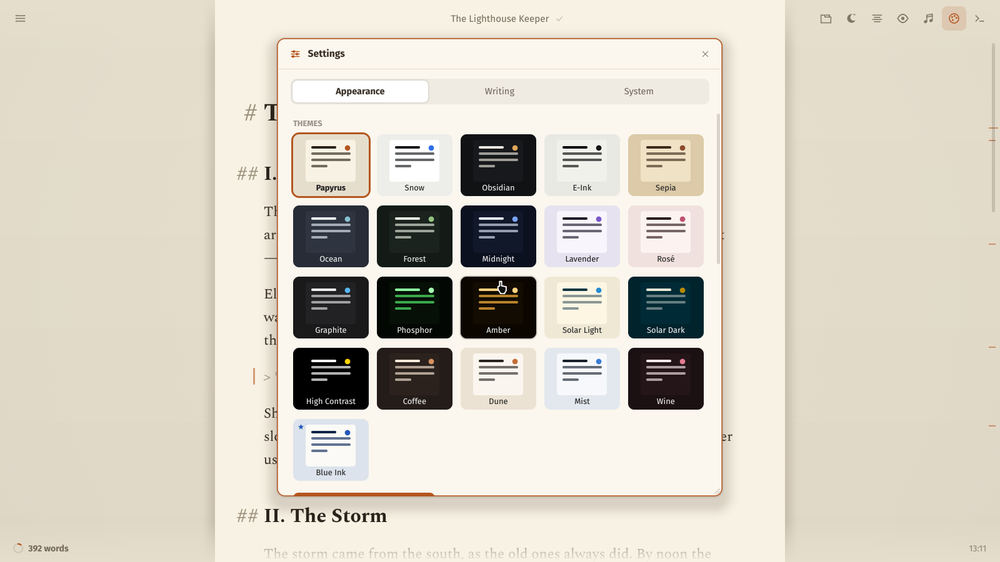

<!-- Generated by tools/readmes.pl from one template; edit the translation there, not here. -->
<div align="center">

# FolioOS

### USB 드라이브에서 바로 부팅되는, 방해 요소 없는 글쓰기 기계

**Windows 없음. Linux 없음. 인터넷 없음. 알림 없음. 오직 당신과 글뿐.**

[**다운로드**](https://github.com/alantaru/FolioOS/releases/latest) · [번역하기](docs/TRANSLATING.md) · [기여하기](CONTRIBUTING.md) · [전체 README (영어)](README.md)

<sub>[English](README.md) · [Español](README.es.md) · [Français](README.fr.md) · [Deutsch](README.de.md) · [Italiano](README.it.md) · [Português (Brasil)](README.pt-BR.md) · [Português (Portugal)](README.pt-PT.md) · [Nederlands](README.nl.md) · [Polski](README.pl.md) · [Türkçe](README.tr.md) · [Русский](README.ru.md) · [Українська](README.uk.md) · [简体中文](README.zh-CN.md) · [日本語](README.ja.md) · **한국어**</sub>


</div>

FolioOS는 거의 모든 x86 PC나 노트북을 글쓰기 전용 기계로 바꿉니다. USB 드라이브를 꽂고 부팅하면 바로 쓸 수 있습니다. 글은 어느 컴퓨터에서나 열리는 FAT32 USB 드라이브에 평범한 Markdown 파일로 저장됩니다.

## 주요 특징

- **즉시 집중:** 몇 초 만에 마지막 문서의, 멈췄던 바로 그 위치로 부팅합니다.
- **오래된 노트북이 작가의 도구로:** 64비트·32비트 UEFI PC에서 동작하며 내장 디스크에는 아무것도 설치하지 않습니다.
- **파일은 영원히 당신의 것:** FAT32 위의 `.md` 파일. 데이터베이스도, 클라우드도 없습니다.
- **원하면 마우스 없이:** 모든 기능을 키보드만으로 쓸 수 있고 (Tab, 화살표, Enter, 스페이스, Esc, Ctrl+F6), *설정 › 시스템*에서 마우스와 터치패드를 완전히 끌 수 있습니다.
- **작고 검증 가능:** libc도 커널도 없는 약 600 KB의 독립형 C 프로그램.
- **누구나 쓸 수 있게:** 15개 언어와 14개 키보드 배열. 모두 누구나 추가할 수 있는 텍스트 파일입니다.

실시간 Markdown, 집중 모드, 타자기 모드, 스프린트와 목표, 자동 스크롤 읽기 모드, **DOCX, ODT, EPUB, HTML, RTF, TXT** 내보내기, 자동 버전 저장, 20개 테마와 테마 편집기, 4K까지 지원하는 TrueType 글꼴, 선택형 탭, MP3 플레이어.

## 빠른 둘러보기

| | |
|---|---|
|  **집중 모드 (F2):** 현재 문단만 강조합니다. |  **읽기 (Ctrl+P):** 책처럼 조판하고 자동으로 스크롤합니다. |
|  **내보내기 (Ctrl+Shift+S):** DOCX, ODT, EPUB, HTML, RTF, TXT. |  **테마 (F12):** 기본 테마 20개와 나만의 테마 편집기. |
|  **명령 팔레트 (Ctrl+K):** 몇 글자만 입력하면 어떤 명령이든. |  **탭 (선택):** 다시 시작해도 돌아오는 여러 문서. |

모든 화면을 담은 전체 둘러보기는 [영어 README](README.md#a-tour-of-folioos)에 있습니다.

## 3분 만에 설치

1. [최신 버전](https://github.com/alantaru/FolioOS/releases/latest)에서 `FolioOS.zip`을 **다운로드**합니다.
2. **FAT32 USB 드라이브의 루트에 압축을 풉니다** (32 GB 이하는 거의 항상 이미 FAT32입니다. 드라이브에 있던 파일은 그대로 남습니다).
3. **USB 드라이브로 부팅:** 부팅 메뉴(F12 Dell/Lenovo · F9 HP · F8 ASUS · Esc/F11)에서 **UEFI** 항목을 고릅니다. 보이지 않으면 *Secure Boot*를 끄세요.

번역이 있으면 화면은 펌웨어 언어를 따릅니다. *설정 › 시스템 › 언어*에서 언제든 바꿀 수 있습니다. 한국어 화면에는 글꼴이 필요합니다. 먼저 `FOLIO-FONTS-CJK.zip`을 USB 드라이브 루트에 압축 해제하세요 (화면은 번역되어 있지만, 한국어 입력에는 FolioOS에 아직 없는 입력기가 필요합니다).

이전 버전으로 준비한 USB 드라이브도 그대로 동작합니다. 이름이 바뀌거나 옮겨지는 것은 없습니다.

## 소스에서 빌드

PATH에 [MinGW-w64](https://winlibs.com)의 `gcc`가 있는 Windows 10/11:

```powershell
.\build.ps1                       # UEFI x64 + IA32, 시뮬레이터, 패키지를 빌드하고 테스트를 실행
.\flash_usb.ps1 -DriveLetter E:   # 파일을 지우지 않고 FAT32 USB 드라이브에 설치/업데이트
```

## 라이선스

[GNU GPL v3.0](LICENSE) 자유 소프트웨어입니다. 글꼴은 SIL Open Font License, minimp3는 CC0입니다.

---

<sub>이 번역에서 오류를 찾으셨나요? `tools/readmes.pl`로 생성되며, 수정은 언제나 환영합니다.</sub>
