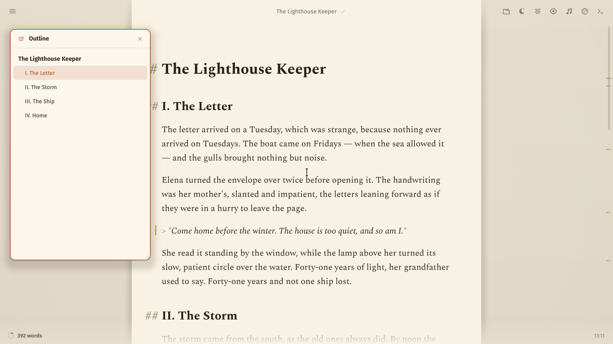

<!-- Generated by tools/readmes.pl from README.md and docs/i18n/README.ko.po — edit the .po, not this file. -->
<div align="center">

<a id="folioos--the-distraction-free-writing-os-that-boots-from-a-usb-stick"></a>

# FolioOS — USB 드라이브에서 바로 부팅되는, 방해 요소 없는 글쓰기 시스템

**어떤 낡은 노트북이든 글쓰기 전용 기계로 바꾸세요.**<br>
Windows 없음. Linux 없음. 인터넷 없음. 알림 없음. 오직 당신과 글뿐.

[](https://github.com/alantaru/FolioOS/actions/workflows/build.yml)
[](https://github.com/alantaru/FolioOS/releases/latest)
[](LICENSE)
[](#hardware-compatibility)
[](#13-15-languages-and-counting)
[](docs/TRANSLATING.md)

[**⬇ 다운로드**](https://github.com/alantaru/FolioOS/releases/latest) ·
[설치](#install-in-3-minutes) ·
[둘러보기](#a-tour-of-folioos) ·
[언어](#13-15-languages-and-counting) ·
[자주 묻는 질문](#faq) ·
[빌드](#build-from-source) ·
[기여하기](CONTRIBUTING.md)

<!-- languages -->
<sub>[English](README.md) · [Español](README.es.md) · [Français](README.fr.md) · [Deutsch](README.de.md) · [Italiano](README.it.md) · [Português (Brasil)](README.pt-BR.md) · [Português (Portugal)](README.pt-PT.md) · [Nederlands](README.nl.md) · [Polski](README.pl.md) · [Türkçe](README.tr.md) · [Русский](README.ru.md) · [Українська](README.uk.md) · [简体中文](README.zh-CN.md) · [日本語](README.ja.md) · **한국어**</sub>
<!-- /languages -->


</div>

FolioOS는 **부팅 가능한 글쓰기 환경**입니다. 단 한 가지 일, 즉 당신이 글을 쓰게 하는 일만 하는 아주 작은 운영 체제입니다.
지난 10년 사이에 나온 거의 모든 PC에 USB 드라이브를 꽂고 부팅하면, 몇 초 뒤 마지막으로 멈췄던 바로 그 자리에서 전체 화면의
아름답게 조판된 Markdown 편집기가 열립니다. 주의를 빼앗는 브라우저도, 이메일도, 앱 스토어도, Wi-Fi도 없습니다.

글은 **평범한 FAT32 USB 드라이브에 일반 Markdown 파일**로 저장되므로, 같은 USB 드라이브를 Windows, macOS, Linux에서
열 수 있습니다. 공유해야 할 때는 Word, LibreOffice, EPUB, HTML, RTF로 내보내세요.

<a id="who-is-it-for"></a>

## 누구를 위한 것인가요?

- **소설가, 기자, 학생, 블로거**: 새 하드웨어를 사지 않고 *writerdeck*, 즉 방해 요소 없는 글쓰기 전용 기기를 원하는 사람.
- **NaNoWriMo 참가자**와 시간을 정해 두고 쓰는 스프린트나 모닝 페이지를 쓰는 모든 사람.
- **서랍 속에 낡은 노트북이 있는 사람**: FolioOS는 디스크를 건드리지 않고 그 노트북에 두 번째 삶을 줍니다.
- **학교와 도서관**: 간단한 오프라인 글쓰기 자리가 필요한 곳.
- **개인 정보를 중시하는 작가**: 네트워크도, 원격 측정도, 클라우드도 없습니다.

<a id="install-in-3-minutes"></a>

## 3분 만에 설치

1. 최신 버전에서 [`FolioOS.zip`](https://github.com/alantaru/FolioOS/releases/latest)을 **다운로드**합니다.
2. **FAT32로 포맷된 USB 드라이브의 루트에 압축을 풉니다.** 32 GB 이하의 드라이브는 대부분 이미 FAT32입니다.
   드라이브에 있던 파일은 그대로 남습니다. ([FAT32로 포맷하는 방법](docs/INSTALL.txt))
3. **PC를 다시 시작하고 부팅 메뉴를 엽니다** — 보통 **F12**(Dell, Lenovo), **F9**(HP), **F8**(ASUS) 또는 **Esc/F11** —
   그리고 USB 드라이브의 **UEFI** 항목을 고릅니다. 보이지 않으면 펌웨어 설정에서 *Secure Boot*를 끄세요.

<details>
<summary><b>다른 설치 방법</b></summary>

- **디스크 이미지:** `FolioOS-disk-image.zip`에는 [Rufus](https://rufus.ie)(DD 모드),
  [balenaEtcher](https://etcher.balena.io), `dd`용 256 MB 이미지가 들어 있습니다. 그래도 `FolioOS.zip`의 압축을 푸는 방법을
  권장합니다. 드라이브의 나머지 공간을 당신의 파일을 위해 비워 둘 수 있기 때문입니다.
- **Windows에서 소스로:** `.\build.ps1`을 실행한 뒤 `.\flash_usb.ps1 -DriveLetter E:`(아무것도 지우지 않고 드라이브에
  설치하거나 업데이트합니다).
- **UEFI가 없는 PC(BIOS/Legacy 전용):** Windows에서 관리자 권한으로 `FOLIO\TOOLS\biosboot.exe E:`를 한 번 실행하세요
  (`E:`는 드라이브). BIOS 부팅 코드만 쓰기 때문에 어떤 파일도 건드리지 않고, 드라이브는 평범한 FAT32 그대로이며 UEFI 부팅도
  그대로 됩니다. 소스에서는 `.\flash_usb.ps1 -DriveLetter E: -Bios`.
- **모두 포함:** `FolioOS.zip`에는 글쓰기와 읽기를 위한 무료 글꼴 11종과 중국어, 일본어, 한국어 글꼴이 이미 들어 있습니다.
  모든 언어가 바로 작동합니다.

</details>

> **다시 시작하지 않고 써 보기:** `folio_sim.exe`는 같은 코드를 Windows 창에서 실행하고, `efi_host.exe`는 실제 UEFI
> 프로그램을 실행합니다 — [소스에서 빌드](#build-from-source)를 참고하세요.

---

<a id="a-tour-of-folioos"></a>

## FolioOS 둘러보기

<a id="1-start-up"></a>

### 1. 시작


FolioOS는 펌웨어에서 바로 시작합니다. 글꼴을 불러오는 동안 시작 화면이 보이고, 아무 키나 누르면 건너뜁니다. 바로 입력을
시작할 수 있습니다. 표시 시간(1–60초)은 설정할 수 있고, 끌 수도 있습니다.

맨 처음 부팅할 때 FolioOS는 PC 펌웨어 설정의 언어를 따르고 짧은 환영 글을 엽니다. 그 뒤로는 언제나 **마지막 문서를 당신이
있던 바로 그 줄에서** 다시 엽니다. 읽기 모드에 있었더라도 마찬가지입니다.

<br clear="right">

<a id="2-the-writing-screen"></a>

### 2. 글쓰기 화면


페이지가 전부입니다. 위아래 막대는 **입력을 시작하자마자 사라지고** 마우스를 움직이면 돌아옵니다. Markdown은 실시간으로
표시됩니다 — `#` 제목, `**굵게**`, `*기울임*`, `> 인용`, 목록과 `- [ ]` 할 일 — 그러면서도 기호는 보이고 편집할 수
있습니다. 오른쪽의 가는 막대는 현재 위치를 보여 주고 각 장을 표시합니다.

- **똑똑한 문장 부호:** `--`는 긴 줄표로, `...`는 말줄임표로, 곧은 따옴표는 *당신의 언어에 맞는* 둥근 따옴표로 바뀝니다
  (한국어와 영어는 “ ”, 프랑스어는 « », 독일어는 „ “, 일본어는 「 」).
- **종이 또는 전체 화면:** 책상 위 종이 한 장에 쓰거나 화면 전체에 쓰세요. 단 너비(좁게, 보통, 넓게, 아주 넓게)도 고를 수 있습니다.
- 실행 취소/다시 실행, 단어 단위 이동, **Alt+↑/↓**로 문단 이동, 문단 복제와 삭제, **Shift+F3**로 대소문자 전환,
  선택한 부분을 `( " * _`로 감싸기, **Ctrl+J**로 마지막 편집 위치로 돌아가기.

<a id="3-focus-mode-and-zen-mode"></a>

### 3. 집중 모드와 젠 모드

<div align="center">


</div>

**F2**는 지금 쓰는 문장, 문단 또는 줄을 빼고 모두 흐리게 합니다. **F3**는 *타자기 모드*로, 현재 줄이 화면 가운데에 머뭅니다.
**F11**은 *젠 모드*로, 화면 위쪽 가장자리에 닿기 전까지 막대가 전혀 나타나지 않습니다. **헤밍웨이 모드**는 지우기를 막아
계속 앞으로 나아가게 합니다.

<a id="4-reading-mode"></a>

### 4. 읽기 모드


**Ctrl+P**는 Markdown을 책처럼 조판한 페이지로 바꿉니다. 화살표 키, 스페이스 바, 여백 클릭으로 페이지를 넘깁니다. 아래 막대는
얼마나 읽었는지, 장과 전체 글을 다 읽는 데 얼마나 걸릴지 보여 줍니다. **자동 스크롤**은 당신의 읽기 속도(분당 단어 수)로
글을 움직입니다. **Enter** 또는 마우스 가운데 버튼으로 시작하고, **+**와 **−**로 속도를 바꿉니다. **Esc**를 누르면
*읽던 문단에서* 글쓰기로 돌아갑니다.

<a id="5-chapters-and-outline"></a>

### 5. 장과 개요



`#` 제목 하나하나가 장입니다. **F5**는 개요를 열어 어디로든 이동하게 하고, **Ctrl+PgUp/PgDn**은 글쓰기와 읽기 모드 모두에서
장 사이를 오갑니다. 긴 원고도 쉽게 오갈 수 있습니다. EPUB 내보내기는 이 장들을 제대로 된 전자책 목차로 바꿔 줍니다.

<br clear="right">

<a id="6-find-and-replace"></a>

### 6. 찾기와 바꾸기


**Ctrl+F**는 일치하는 부분을 모두 강조하고, 개수를 세고, 하나 또는 전부를 바꿉니다.

<a id="7-files-open-save-and-export"></a>

### 7. 파일: 열기, 저장, 내보내기

<div align="center">


</div>

**Ctrl+O**는 제대로 된 파일 관리자를 엽니다. 펌웨어가 보여 주는 모든 드라이브, 폴더, 만들기, 이름 바꾸기, 삭제가 있습니다.
**Ctrl+Shift+S**는 다른 이름으로 저장하거나 **DOCX, ODT, EPUB, HTML, RTF, TXT로 내보냅니다**. 형식을 한 번 클릭하면 됩니다.
나머지는 모두 자동입니다.

- **자동 저장**(기본 20초마다)은 **원자적 쓰기**를 사용합니다. 전원이 끊겨도 반쯤 쓰인 파일이 남지 않습니다.
- **자동 버전:** 저장한 각 파일의 이전 사본이 `FOLIO/VERSIONS`로 갑니다(문서마다 최근 30개를 보관).
- **초안 복구**: 이름을 한 번도 붙이지 않은 글을 위해.

**LaTeX 소스**(`.tex`, `.bib`, `.sty`, `.cls`)는 고정폭 글꼴의 일반 소스로 열리며, 명령, 중괄호, `%` 주석, 줄 안의 수식을
줄 단위로 강조하고, 진짜 탭 위치를 쓰며, `{`, `[`, `$`는 저절로 닫힙니다. Markdown 서식이나 둥근 따옴표가 소스를 바꾸지
않고, 파일의 줄바꿈도 그대로 유지됩니다(CRLF는 CRLF 그대로). FolioOS는 LaTeX를 컴파일하지 않습니다. 읽기 모드와
내보내기는 Markdown 문서용입니다.

<a id="8-tabs-optional"></a>

### 8. 탭(선택)


여러 문서를 한꺼번에 열고 싶나요? 오른쪽 위의 첫 번째 아이콘으로 탭을 켜세요. **Ctrl+N**은 탭을 열고, **Ctrl+W**는 닫고,
**Ctrl+Tab** 또는 **Alt+1…9**는 전환합니다. 탭은 이름이 없는 것까지 다시 시작한 뒤에도 돌아옵니다. 끄면 FolioOS는 한 번에
한 문서만 다루는 조용한 타자기로 남습니다.

<a id="9-goals-sprints-and-statistics"></a>

### 9. 목표, 스프린트, 통계


**F10**은 하루 단어 목표, 이 문서와 이번 세션의 단어 수, 읽는 시간, 글쓰기 속도를 보여 줍니다. **F4**는 시간을 정한
**글쓰기 스프린트**(15–60분)를 시작하며, 끝나면 부드러운 종소리가 납니다. 오늘 쓴 단어는 문서와 재시작을 넘나들며 집계됩니다.

<br clear="right">

<a id="10-command-palette-and-shortcuts"></a>

### 10. 명령 팔레트와 단축키


**Ctrl+K**는 몇 글자만 입력하면 어떤 명령이든 찾아 줍니다 — 당신의 언어로. **F1**은 모든 단축키를 보여 줍니다.


<a id="no-mouse-needed"></a>

#### 마우스가 필요 없습니다

FolioOS의 모든 기능은 키보드만으로 쓸 수 있고, 마우스와 터치패드를 완전히 끌 수도 있습니다(*설정 › 시스템 › 마우스와
터치패드 사용*, **Ctrl+K › 마우스**, 또는 `CONFIG.INI`의 `use_mouse=0`). 터치패드 때문에 커서가 튀는 노트북에서 편리합니다.

| 키 | 하는 일 |
|---|---|
| 창의 단축키(F12, F5, F6, F10, Ctrl+O…) | 키보드가 그 창을 조작하도록 하며 창을 엽니다 |
| **Tab** / **Shift+Tab**, **↑ ↓** | 창 안의 버튼, 스위치, 슬라이더, 목록 사이를 이동합니다 |
| **Enter** 또는 **스페이스** | 강조된 버튼, 스위치, 항목을 누릅니다 |
| **← →** | 강조된 슬라이더, 옵션, 값을 조절합니다 |
| **Esc** | 창을 닫고 본문으로 돌아갑니다. 열린 것이 없으면 숨은 막대를 보여 줍니다 |
| **Ctrl+F6** | 키보드를 본문과 열린 창 사이로 옮깁니다 |
| **Alt+M** | 최근 문서가 있는 메뉴(Ctrl+K에서도) |
| **Alt+F7** / **Alt+F8** | 화살표로 창을 이동 / 크기 조절(Shift = 작은 단위). Enter는 확인, Esc는 되돌리기 |

어느 컨트롤이 키보드를 받고 있는지는 강조 표시로 보여 줍니다. 키를 쓸 때만 나타나므로 마우스를 쓰는 사람에게는 달라지는 것이
없습니다. 옆 창(개요, 음악, 설정)에서 입력한 글자는 곧바로 본문으로 돌아갑니다.

<a id="11-themes-and-typography"></a>

### 11. 테마와 조판


**F12**는 모양 설정을 엽니다. **손으로 다듬은 테마 20개**, 본문 글꼴, 크기, 줄 간격, 문단 간격, 첫 줄 들여쓰기가 있습니다.
글자는 FolioOS 자체의 TrueType 엔진이 진짜 커닝과 안티앨리어싱으로 그려, 작은 넷북 화면부터 4K까지 선명합니다.

<div align="center">


</div>


**나만의 테마 만들기:** 테마 편집기에서 16가지 색을 하나씩 고르고(또는 기본 테마에서 빌려 오고), 본문용과 화면용 글꼴을 각각
골라 결과를 바로 확인할 수 있습니다. 테마는 `FOLIO/THEMES`에 있는 작은 `.INI` 텍스트 파일이라 공유하기 쉽습니다. `.ttf`
글꼴을 `FOLIO/FONTS`에 넣으면 바로 쓸 수 있고, FolioOS에는 Literata, Lora, EB Garamond, iA Writer Quattro/Duo/Mono,
Special Elite 등이 이미 들어 있습니다.

<br clear="right">

<a id="12-music-while-you-write"></a>

### 12. 쓰면서 듣는 음악

**F6**은 드라이브의 `MUSIC` 폴더에 있는 파일을 위한 작은 MP3 플레이어를 엽니다(Intel HD Audio와 AC'97). **F7/F8/F9**로
페이지를 떠나지 않고 조작할 수 있습니다.

<a id="13-15-languages-and-counting"></a>

### 13. 15개 언어, 계속 늘어나는 중

<div align="center">


</div>

**English, Español, Français, Deutsch, Italiano, Português (Brasil), Português (Portugal), Nederlands,
Polski, Türkçe, Русский, Українська, 简体中文, 日本語, 한국어.**


언어와 관련된 것은 무엇 하나 코드에 고정되어 있지 않습니다. 번역은 각각 `FOLIO/LANGUAGES`에 있는 표준 **gettext `.po`
파일**이며, 복수형 규칙, 따옴표, 날짜 형식, 소수점 기호, 기본 키보드와 글꼴도 그 파일이 정합니다. **언어를 추가하려면 USB
드라이브에 파일 하나만 넣으면 됩니다.** 키보드 배열도 텍스트 파일입니다: US, US 국제, UK, ABNT2, 포르투갈, 스페인,
라틴 아메리카, 프랑스어 AZERTY, 독일어 QWERTZ, 이탈리아어, 폴란드어, 터키어 Q, 러시아어, 우크라이나어, 한국어(두벌식 한글
입력), 일본어(로마자 → 가나 입력).

FolioOS를 당신의 언어로 쓰고 싶나요? **[docs/TRANSLATING.md](docs/TRANSLATING.md)**를 읽어 보세요. Poedit, Weblate, Crowdin
또는 어떤 텍스트 편집기로도 작업할 수 있습니다.

<br clear="right">

<a id="14-your-files-on-any-computer"></a>

### 14. 당신의 파일을, 어느 컴퓨터에서나

```
USB 드라이브(FAT32)
├── DOCUMENTS/          당신의 .md와 .txt 파일, 그리고 내보낸 파일(.docx .odt .epub .html .rtf)
├── MUSIC/              당신의 .mp3 파일
├── FOLIO/
│   ├── CONFIG.INI      환경 설정 — 일반 텍스트, 손으로 편집 가능
│   ├── FONTS/          .ttf 글꼴(직접 추가 가능)
│   ├── THEMES/         당신의 테마(.INI)
│   ├── LANGUAGES/      번역(.po)
│   ├── KEYBOARDS/      키보드 배열(.txt)
│   └── VERSIONS/       저장한 파일의 자동 이전 버전
└── EFI/BOOT/           FolioOS 자체(BOOTX64.EFI, BOOTIA32.EFI)
```

데이터베이스도, 숨은 파티션도, 독점 형식도 없습니다. USB 드라이브를 어느 컴퓨터에 가져가든 당신의 글이 그대로 있습니다.

---

<a id="how-folioos-compares"></a>

## FolioOS 비교

| | FolioOS | 전용 기기(Freewrite, AlphaSmart, Pomera) | 글쓰기 앱(iA Writer, Scrivener, 집중 모드) |
|---|:---:|:---:|:---:|
| 비용 | **무료** | 수백 달러 | 무료부터 유료까지 |
| 하드웨어 | 이미 가진 UEFI PC 아무거나 | 새 기기 | 평소 쓰는 컴퓨터 |
| 손닿는 곳의 방해 요소 | **없음** — 운영 체제도, 네트워크도 없음 | 없음 | Alt+Tab 한 번 거리 |
| 파일 형식 | FAT32의 일반 Markdown | 기기 고유의 동기화/내보내기 | 제각각 |
| 화면과 조판 | 큰 화면, TrueType, 테마 | 작은 전자 잉크 또는 LCD | 훌륭함 |
| 오프라인 작동 | **항상** | 대부분 | 예 |
| 오픈 소스 | **예(GPL-3.0)** | 아니요 | 대부분 아니요 |

<a id="hardware-compatibility"></a>

## 하드웨어 호환성

| | |
|---|---|
| **펌웨어** | UEFI 2.x — 64비트(`BOOTX64.EFI`), 32비트(`BOOTIA32.EFI`, Atom 태블릿과 넷북) 또는 ARM64(`BOOTAA64.EFI`: 커뮤니티 UEFI 펌웨어를 올린 Raspberry Pi 3/4/5, ARM 노트북). **BIOS만 있는 PC**(Legacy/CSM)는 `FOLIO\TOOLS\biosboot.exe`를 한 번 실행하면 FolioOS 자체 BIOS 브리지로 부팅합니다. Secure Boot는 꺼져 있어야 합니다. |
| **화면** | 모든 UEFI GOP 프레임 버퍼(RGB, BGR, 비트 마스크, Blt 전용) 또는 구형 UGA, BIOS PC에서는 VESA/VBE. 기본 해상도, 자동 HiDPI 배율, 세로 화면은 자동 회전. |
| **입력** | 키보드는 펌웨어를 통해(BIOS PC에서는 PS/2로 직접). 마우스, 터치패드, 펜 태블릿, 터치스크린은 펌웨어를 통해, 펌웨어에 드라이버가 없으면 FolioOS 자체 USB HID 및 PS/2 드라이버로. |
| **소리** | Intel HD Audio와 AC'97(음악 플레이어에만 필요). |
| **지원하지 않음** | Secure Boot(현재), Apple Silicon Mac. Wi-Fi와 블루투스는 일부러 넣지 않았습니다. |
| **테스트 환경** | 릴리스마다 에뮬레이션한 기계 13대: UEFI x64, IA32, ARM64, 그리고 USB와 IDE로 부팅하는 BIOS 전용 PC. 그래픽 카드 8종, PS/2와 USB 마우스, USB 태블릿, HD Audio와 AC'97. 각각 화면, 키보드, 마우스, 소리, 저장, 파일 시스템 무결성을 확인합니다. |

부팅할 때마다 FolioOS는 찾아낸 것을 `FOLIO/DIAGNOSTICS.TXT`에 기록합니다.
[하드웨어 보고](https://github.com/alantaru/FolioOS/issues/new/choose)에 당신의 파일을 공유해 주세요. "그냥 잘 된다"는
보고도 다른 작가들이 노트북을 고르는 데 도움이 됩니다.

<a id="faq"></a>

## 자주 묻는 질문

<details>
<summary><b>컴퓨터나 USB 드라이브의 내용이 지워지나요?</b></summary>

아니요. FolioOS는 내장 디스크를 절대 건드리지 않고, 설치는 USB 드라이브에 파일을 더할 뿐입니다. 원래 있던 것은 그대로
남습니다. 드라이브를 뽑으면 PC는 평소의 시스템으로 다시 부팅합니다.
</details>

<details>
<summary><b>배터리가 다 되어도 쓴 글은 안전한가요?</b></summary>

저장은 원자적입니다(새 파일을 완전히 쓴 다음에 옛 파일을 바꿉니다). 자동 저장은 기본으로 20초마다 실행되고, 이름 없는 글에는
복구용 초안이 있으며, 저장한 파일은 모두 이전 버전을 `FOLIO/VERSIONS`에 보관합니다.
</details>

<details>
<summary><b>평소 쓰는 컴퓨터에서도 파일을 편집할 수 있나요?</b></summary>

네. FAT32 USB 드라이브의 `DOCUMENTS`에 있는 일반 `.md` 파일입니다. Obsidian, Typora, VS Code, 메모장, TextEdit 등 어떤
Markdown 편집기로든 열고, 드라이브를 다시 꽂아 FolioOS에서 계속 쓰세요.
</details>

<details>
<summary><b>LaTeX로 쓸 수 있나요?</b></summary>

네. FolioOS는 `.tex`, `.bib`, `.sty`, `.cls` 소스 파일을 강조 표시와 함께 고정폭 글꼴로, 입력한 그대로(둥근 따옴표나
Markdown 없이) 편집합니다. 컴파일은 하지 않습니다. PDF는 TeX 배포판이 있는 컴퓨터에서 만들거나 파일을 온라인 LaTeX
편집기에 올리세요.
</details>

<details>
<summary><b>부팅 메뉴에 USB 드라이브가 보이지 않는 이유는 무엇인가요?</b></summary>

드라이브가 FAT32인지, "UEFI"로 시작하는 항목을 골랐는지, 펌웨어 설정에서 Secure Boot가 꺼져 있는지 확인하세요. BIOS/Legacy
모드로만 부팅되는 오래된 PC에는 BIOS 부팅 코드가 한 번 필요합니다. Windows에서 관리자 권한으로 `FOLIO\TOOLS\biosboot.exe E:`를
실행하면 드라이브가 평범한 USB 디스크로 나타납니다.
</details>

<details>
<summary><b>Mac에서도 되나요?</b></summary>

Intel Mac은 UEFI 드라이브로 부팅할 수 있지만(켤 때 <kbd>Option</kbd>을 누르고 있으세요) 아직 시험해 보지 않았습니다.
보고를 환영합니다. Apple Silicon Mac은 지원하지 않습니다.
</details>

<details>
<summary><b>중국어, 일본어, 한국어로 쓸 수 있나요?</b></summary>

**한국어와 일본어는 됩니다.** *설정 › 시스템*에서 *한국어 (두벌식)* 또는 *日本語 (ローマ字かな)* 키보드를 고르세요. 한국어는
표준 두벌식 배열을 쓰며 입력하는 대로 음절을 조합합니다(Backspace는 자모를 하나씩 지웁니다). 일본어는 로마자를 히라가나나
가타카나로 바꿉니다(`nihongo` → にほんご). **Ctrl+스페이스**로 입력기와 로마자를 전환합니다. 글꼴은 FolioOS에 함께 들어
있으며, 글에 이런 문자가 들어 있으면 알맞은 글꼴이 저절로 불러와집니다. 한자 변환과 중국어 병음 입력은 사전이 필요해 아직
로드맵에 있습니다. 라틴, 그리스, 키릴 문자는 함께 들어 있는 키보드 배열로 입력합니다.
</details>

<details>
<summary><b>마우스 없이 쓸 수 있나요?</b></summary>

네. 모든 창, 버튼, 설정에 키보드로 닿을 수 있고(Tab, 화살표, Enter, 스페이스, Esc), *설정 › 시스템*에서 마우스와 터치패드를
완전히 끌 수 있습니다. [마우스가 필요 없습니다](#no-mouse-needed)를 참고하세요.
</details>

<details>
<summary><b>맞춤법 검사, 인터넷, 클라우드 동기화가 있나요?</b></summary>

인터넷과 동기화는 일부러 없습니다. FolioOS는 오프라인으로 쓰도록 만들어졌습니다. 맞춤법 검사는 로드맵에 있습니다. 파일이
일반 Markdown이므로, 드라이브를 평소 컴퓨터에 다시 꽂으면 무엇으로든 동기화할 수 있습니다.
</details>

<a id="build-from-source"></a>

## 소스에서 빌드

필요한 것: Windows 10/11, PowerShell 5.1 이상, `PATH`에 있는 [MinGW-w64](https://winlibs.com) `gcc`(최근 x86_64 빌드면
아무거나). ARM64와 BIOS 버전은 [LLVM](https://llvm.org) `clang`과 `nasm`도 쓰고, 하드웨어 실험실은
[QEMU](https://www.qemu.org)를 씁니다. 셋 다 `winget`으로 설치됩니다.

```powershell
git clone https://github.com/alantaru/FolioOS.git
cd FolioOS
.\build.ps1                                  # UEFI x64 + IA32 + ARM64, BIOS, 시뮬레이터, 패키지 — 그리고 테스트 모음
.\tools\qemu-lab.ps1                         # 실제 바이너리를 에뮬레이션한 기계 13대에서 부팅하고 하나씩 확인
.\build\folio_sim.exe                        # FolioOS를 창에서 실행
.\build\efi_host.exe build\efi\BOOTX64.EFI   # 실제 UEFI 프로그램을 창에서 실행
.\flash_usb.ps1 -DriveLetter E:              # FAT32 USB 드라이브에 설치/업데이트, 파일은 유지
.\build.ps1 -Image -ImageMB 256              # 선택: Rufus / Etcher / dd용 디스크 이미지
.\tools\fetch-cjk-fonts.ps1                  # CJK 글꼴을 한 번 다운로드(필요하면 build.ps1이 실행)
.\tools\showcase.ps1                         # 이 README의 스크린샷을 다시 생성
```

테스트 모음은 스크립트로 만든 키 입력과 마우스 이벤트로 시뮬레이터와 실제 `BOOTX64.EFI`(작은 UEFI 호스트 안에서)를
움직이고, 화면을 캡처하며, 모든 내보내기(ZIP + XML), 모든 번역(검증기에 대한 음성 대조 포함), 여섯 가지 프레임 버퍼 형식,
BIOS 브리지의 FAT32 드라이버(무작위 작업 수천 번을 바이트 단위로 대조)를 검증합니다.

<a id="macos-simulator"></a>

### macOS 시뮬레이터

Mac에서는 시뮬레이터를 네이티브로 빌드하고 실행할 수 있습니다(AppKit, Retina, 단축키에서 Cmd가 Ctrl처럼 동작). 필요한 것:
Xcode 명령줄 도구(`xcode-select --install`) — `clang`만 있으면 되고 Xcode 전체는 필요 없습니다.

```bash
./build_macos.sh                             # 시뮬레이터, "FolioOS Simulator.app", 드라이브 폴더
./build_macos.sh --test                      # 위와 같고, 시뮬레이터의 스크립트 테스트도 실행(창 없이)
./build/macos/folio_sim                      # FolioOS를 창에서 실행
open "build/macos/FolioOS Simulator.app"     # 또는 앱 번들 열기
```

Option은 Mac의 AltGr라서 계속 문자를 입력합니다(많은 배열에서 `@ # | [ ] { }`). 시뮬레이터에서는 **Option+M**이
메뉴(Alt+M)를 열고 **Cmd+Option+1…9**가 탭을 바꿉니다(Alt+1…9).

macOS 스크립트는 시뮬레이터만 빌드합니다. UEFI 바이너리, 패키지, 디스크 이미지, 그리고 `efi_host` 안에서 실제
`BOOTX64.EFI`를 실행하는 테스트에는 여전히 Windows 빌드(`build.ps1`)가 필요합니다.

<a id="architecture-in-one-picture"></a>

### 그림 한 장으로 보는 구조

```
src/core/       이식 가능한 핵심(독립형 C, libc 없음): 편집기, Markdown, TrueType 래스터라이저,
                UI 툴킷과 창 관리자, 내보내기, MP3, i18n, 키보드 배열, 테마
src/platform/   uefi/  GOP/UGA 화면, 입력, FAT 입출력, HD Audio/AC'97, USB HID 및 PS/2 드라이버 — 펌웨어 위에서 동작
                bios/  부트 섹터 + BIOS→UEFI 브리지(VBE, PS/2, 자체 FAT32 드라이버) — BIOS 전용 PC용
                win32/ 개발과 자동 테스트에 쓰는 시뮬레이터
                macos/ macOS용 시뮬레이터(AppKit), 같은 스크립트 테스트
tools/          efi_host(Windows에서 BOOTX64.EFI 실행), i18n 도구, 디스크 이미지 생성기, showcase
assets/         글꼴, 번역(.po), 키보드 배열, 예제 테마
tests/          스크립트로 작성한 종단 간 테스트
```

약 600 KB의 프로그램이 얇은 플랫폼 계층을 통해 기계 전체를 다룹니다. 자세한 내용은
[docs/ARCHITECTURE.md](docs/ARCHITECTURE.md)를 보세요.

<a id="roadmap"></a>

## 로드맵

FolioOS는 같은 편집기를 공유하는 두 가지 에디션으로 나뉩니다. 영원히 오프라인인 **FolioOS**와, Wi-Fi로 글을 동기화하는
최소한의 Linux인 **FolioOS Sync**입니다. 전체 계획은 [ROADMAP.md](ROADMAP.md)에 있습니다.

- [x] BIOS 전용 PC(Legacy/CSM)와 ARM64(UEFI 펌웨어의 Raspberry Pi, ARM 노트북)
- [x] 한국어 입력(두벌식 한글)과 일본어 가나 입력(로마자 → 히라가나/가타카나)
- [ ] 컴퓨터 디스크에 설치 — 단독 시스템으로 또는 다른 어떤 시스템과도 함께 — 파티션 관리자 포함
- [ ] FolioOS Sync: Wi-Fi와 WebDAV, SFTP, Git, Dropbox, Google Drive, OneDrive, Syncthing 동기화
- [ ] 일본어 한자 변환과 중국어 병음 입력(사전 필요)
- [ ] 복잡한 문자 조판과 오른쪽에서 왼쪽으로 쓰는 문자(아랍 문자, 히브리 문자, 데바나가리…)
- [ ] Hunspell 호환 사전을 쓰는 맞춤법 검사
- [ ] Secure Boot 지원(서명된 shim)
- [ ] 시뮬레이터와 도구의 Linux 버전(macOS: 완료)

[Discussions](https://github.com/alantaru/FolioOS/discussions)에서 투표하고 제안해 주세요.

<a id="contributing"></a>

## 기여하기

버그 보고, 하드웨어 보고, 번역, 키보드 배열, 테마, 글꼴, 문서, 코드 모두 환영합니다. [CONTRIBUTING.md](CONTRIBUTING.md)부터
시작하세요. [행동 강령](CODE_OF_CONDUCT.md)을 지켜 주시고, 보안 문제는 [SECURITY.md](SECURITY.md)에 적힌 대로 비공개로
알려 주세요.

FolioOS가 글쓰기에 도움이 된다면 **⭐ 저장소에 별을 눌러 주세요**. 다른 작가들이 찾는 데 도움이 됩니다.

<a id="license"></a>

## 라이선스

FolioOS는 [GNU General Public License v3.0](LICENSE)을 따르는 자유 소프트웨어입니다. 함께 들어 있는 글꼴은 SIL Open Font
License, minimp3는 CC0입니다. [THIRD_PARTY_NOTICES.md](THIRD_PARTY_NOTICES.md)를 참고하세요.

<sub>FolioOS · 방해 없는 글쓰기 소프트웨어 · 부팅 가능한 USB 글쓰기 환경 · writerdeck · Freewrite / AlphaSmart의 DIY 대안 ·
낡은 노트북을 위한 디지털 타자기 · 오프라인 Markdown 편집기 · 집중 글쓰기 앱 · C로 작성한 UEFI 애플리케이션 · 소설과
NaNoWriMo를 위한 글쓰기 도구.</sub>
