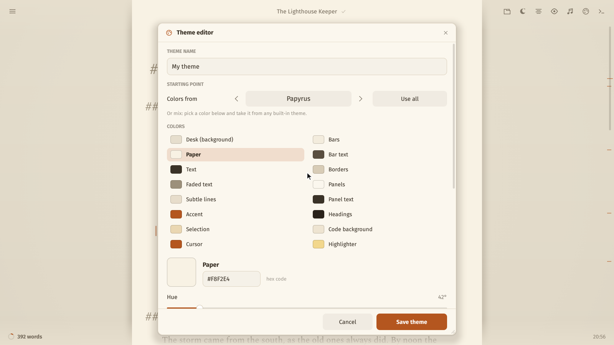

<div align="center">

# FolioOS — the distraction-free writing OS that boots from a USB stick

**Turn any old laptop into a dedicated writing machine.**<br>
No Windows. No Linux. No internet. No notifications. Just you and the text.

[](https://github.com/alantaru/FolioOS/actions/workflows/build.yml)
[](https://github.com/alantaru/FolioOS/releases/latest)
[](LICENSE)
[](#hardware-compatibility)
[](#13-15-languages-and-counting)
[](docs/TRANSLATING.md)

[**⬇ Download**](https://github.com/alantaru/FolioOS/releases/latest) ·
[Install](#install-in-3-minutes) ·
[Tour](#a-tour-of-folioos) ·
[Languages](#13-15-languages-and-counting) ·
[FAQ](#faq) ·
[Build](#build-from-source) ·
[Contribute](CONTRIBUTING.md)

<!-- languages -->
<sub>**English** · [Español](README.es.md) · [Français](README.fr.md) · [Deutsch](README.de.md) · [Italiano](README.it.md) · [Português (Brasil)](README.pt-BR.md) · [Português (Portugal)](README.pt-PT.md) · [Nederlands](README.nl.md) · [Polski](README.pl.md) · [Türkçe](README.tr.md) · [Русский](README.ru.md) · [Українська](README.uk.md) · [简体中文](README.zh-CN.md) · [日本語](README.ja.md) · [한국어](README.ko.md)</sub>
<!-- /languages -->


</div>

FolioOS is a **bootable writing environment**: a tiny operating system that does one thing — let you
write. Plug the USB drive into almost any PC made in the last decade, boot from it, and within seconds
you are in a full-screen, beautifully typeset Markdown editor, exactly where you stopped last time.
There is no browser, no email, no app store and no Wi-Fi to pull you away.

Your writing is saved as **plain Markdown files on an ordinary FAT32 drive**, so the same USB stick
opens on Windows, macOS and Linux. Export to Word, LibreOffice, EPUB, HTML or RTF whenever you need to
share.

## Who is it for?

- **Novelists, journalists, students and bloggers** who want a *writerdeck* — a dedicated distraction-free
  writing device — without buying new hardware.
- **NaNoWriMo participants** and anyone doing timed writing sprints or morning pages.
- **People with an old laptop in a drawer**: FolioOS gives it a second life — straight from the USB drive,
  or installed on its disk, alone or next to the system it already has.
- **Schools and libraries** that need a simple, offline writing station.
- **Privacy-minded writers**: no network stack, no telemetry, no cloud.

## Install in 3 minutes

1. **Download** [`FolioOS.zip`](https://github.com/alantaru/FolioOS/releases/latest) from the latest release.
2. **Unzip it at the root of a USB drive formatted as FAT32.** Most drives up to 32 GB already are.
   Files already on the drive are kept. ([How to format as FAT32](docs/INSTALL.txt))
3. **Restart the PC and open the boot menu** — usually **F12** (Dell, Lenovo), **F9** (HP), **F8** (Asus) or
   **Esc/F11** — and choose the drive's **UEFI** entry. If it does not appear, turn off *Secure Boot* in
   the firmware setup.

<details>
<summary><b>Other ways to install</b></summary>

- **Disk image:** `FolioOS-disk-image.zip` contains a ready 256 MB image for
  [Rufus](https://rufus.ie) (DD mode), [balenaEtcher](https://etcher.balena.io) or `dd`. Unzipping
  `FolioOS.zip` is still recommended: it keeps the rest of the drive free for your files.
- **From source on Windows:** `.\build.ps1` then `.\flash_usb.ps1 -DriveLetter E:` (installs or updates a
  drive without deleting anything).
- **PCs without UEFI (BIOS/Legacy only):** run `FOLIO\TOOLS\biosboot.exe E:` once on Windows, as
  administrator (`E:` is the drive). It only writes the BIOS boot code: no file is touched, the drive stays
  an ordinary FAT32 drive and the UEFI boot keeps working. From source: `.\flash_usb.ps1 -DriveLetter E: -Bios`.
- **Everything is included:** `FolioOS.zip` already brings 11 free fonts for writing and reading and the
  fonts for Chinese, Japanese and Korean — every language works out of the box.

</details>

> **Try it without rebooting:** `folio_sim.exe` runs the same code in a Windows window, and `efi_host.exe`
> runs the real UEFI binary — see [Build from source](#build-from-source).

---

## A tour of FolioOS

### 1. Start up


FolioOS starts straight from the firmware. The splash screen shows while fonts load, and any key skips it
— you can start typing immediately. Its duration (1–60 s) is configurable, or you can turn it off.

On the very first boot FolioOS follows the language of your PC's firmware setup and opens a short welcome
text. After that it always reopens **your last document at the exact line you were on** — even if you
were in reading mode.

<br clear="right">

### 2. The writing screen


The page is all there is. The top and bottom bars **fade away as soon as you type** and come back when you
move the mouse. Markdown is rendered live — `#` headings, `**bold**`, `*italic*`, `> quotes`, lists and
`- [ ]` tasks — while the markup stays visible and editable. The thin bar on the right shows where you are
and marks every chapter.

- **Smart typography:** `--` becomes an em dash, `...` an ellipsis, and straight quotes become the right
  curly quotes *for your language* (“ ” in English, « » in French, „ “ in German, 「 」 in Japanese).
- **Paper or full screen:** write on a sheet of paper on a desk, or across the whole screen; choose the
  column width (narrow, medium, wide, extra).
- Undo/redo, word-level navigation, move paragraphs with **Alt+↑/↓**, duplicate or delete paragraphs,
  cycle case with **Shift+F3**, wrap a selection in `( " * _`, and jump back to your last edit with **Ctrl+J**.

### 3. Focus mode and zen mode

<div align="center">


</div>

**F2** dims everything except the sentence, paragraph or line you are writing. **F3** is *typewriter mode*:
the current line stays in the middle of the screen. **F11** is *zen mode*: no bars at all until you touch
the top edge. **Hemingway mode** disables deleting, to keep you moving forward.

### 4. Reading mode


**Ctrl+P** turns your Markdown into a typeset page, like a book. Turn pages with the arrow keys, the space
bar or a click on the margins. The bottom bar shows how much you have read and how long the chapter and
the whole text will take; **auto-scroll** moves the text at your reading speed (in words per minute):
**Enter** or the middle mouse button starts it, **+** and **−** change the speed. **Esc** goes back to writing *at the paragraph you
were reading*.

### 5. Chapters and outline


Every `#` heading is a chapter. **F5** opens the outline to jump anywhere; **Ctrl+PgUp/PgDn** moves
between chapters in both writing and reading mode. Long manuscripts stay easy to navigate — and the EPUB
export turns those chapters into a proper e-book table of contents.

<br clear="right">

### 6. Find and replace


**Ctrl+F** highlights every match, counts them, and replaces one or all.

### 7. Files: open, save and export

<div align="center">


</div>

**Ctrl+O** opens a real file manager: every drive the firmware exposes, folders, create, rename and delete.
**Ctrl+Shift+S** saves under another name or **exports to DOCX, ODT, EPUB, HTML, RTF or TXT** — one click
on the format. Everything else is automatic:

- **Autosave** (every 20 seconds by default) with **atomic writes**: a power cut never leaves half a file.
- **Automatic versions:** the previous copy of every saved file goes to `FOLIO/VERSIONS` (the last 30 per
  document are kept).
- **Draft recovery** for text that was never named.

**LaTeX sources** (`.tex`, `.bib`, `.sty`, `.cls`) open as plain source in a monospaced font, with
per-line highlighting of commands, braces, `%` comments and inline math, real tab stops, and `{`, `[`
and `$` that close themselves. No Markdown styling or smart quotes touch the source, and the file keeps
its line endings (CRLF stays CRLF). FolioOS does not compile LaTeX: reading mode and export are for
Markdown documents.

### 8. Tabs (optional)


Prefer several documents at once? Turn on tabs with the first icon on the top right. **Ctrl+N** opens a
tab, **Ctrl+W** closes, **Ctrl+Tab** or **Alt+1…9** switch. Tabs — even untitled ones — come back after a
reboot. Turned off, FolioOS stays a calm one-document-at-a-time typewriter.

### 9. Goals, sprints and statistics


**F10** shows your daily word goal, the words in this document and session, reading time and your writing
pace. **F4** starts a timed **writing sprint** (15–60 minutes) that ends with a gentle bell. Words written
today are counted across documents and reboots.

<br clear="right">

### 10. Command palette and shortcuts


**Ctrl+K** finds any command by typing a few letters — in your language. **F1** lists every shortcut:


#### No mouse needed

Everything in FolioOS works from the keyboard alone, and the mouse and touchpad can be switched off
completely (*Settings › System › Use the mouse and touchpad*, **Ctrl+K › Mouse**, or `use_mouse=0` in
`CONFIG.INI`) — handy on laptops with a jumpy touchpad.

| Keys | What they do |
|---|---|
| Shortcut of a window (F12, F5, F6, F10, Ctrl+O…) | Opens it with the keyboard inside it |
| **Tab** / **Shift+Tab**, **↑ ↓** | Move between the buttons, switches, sliders and lists of a window |
| **Enter** or **Space** | Press the highlighted button, switch or item |
| **← →** | Adjust the highlighted slider, option or value |
| **Esc** | Close the window and go back to the text; with nothing open, show the hidden bars |
| **Ctrl+F6** | Move the keyboard between the text and the open windows |
| **Alt+M** | Menu with the recent documents (also in Ctrl+K) |
| **Alt+F7** / **Alt+F8** | Move / resize the window with the arrows (Shift = small steps), Enter confirms, Esc undoes |

A highlight shows which control has the keyboard; it only appears once you use the keys, so nothing
changes for mouse users. Typing letters in a side window (outline, music, settings) sends them straight
back to your text.

### 11. Themes and typography


**F12** opens the appearance settings: **20 hand-tuned themes**, the text font, size, line spacing,
paragraph spacing and first-line indent. Text is drawn by FolioOS's own TrueType engine with real kerning
and anti-aliasing, crisp from small netbook screens to 4K.

<div align="center">


</div>



**Make your own:** the theme editor lets you pick each of the 16 colors (or borrow them from any built-in
theme), choose a font for the text and another for the interface, and see the result live. Themes are small
`.INI` text files in `FOLIO/THEMES` — easy to share. Drop any `.ttf` font into `FOLIO/FONTS` to use it; FolioOS
already comes with Literata, Lora, EB Garamond, iA Writer Quattro/Duo/Mono, Special Elite and more.

<br clear="right">

### 12. Music while you write

**F6** opens a small MP3 player for the files in the drive's `MUSIC` folder (Intel HD Audio and AC'97).
**F7/F8/F9** control it without leaving the page.

### 13. 15 languages and counting

<div align="center">


</div>

**English, Español, Français, Deutsch, Italiano, Português (Brasil), Português (Portugal), Nederlands,
Polski, Türkçe, Русский, Українська, 简体中文, 日本語, 한국어.**


Nothing about language is hard-coded. Each translation is a standard **gettext `.po` file** in
`FOLIO/LANGUAGES` that also defines its plural rules, smart quotes, date format, decimal separator,
default keyboard and fonts — **adding a language is dropping a file on the drive**. Keyboard layouts are
plain-text files too: US, US-International, UK, ABNT2, Portugal, Spain, Latin America, French AZERTY,
German QWERTZ, Italian, Polish, Turkish Q, Russian, Ukrainian, Korean (2-set Hangul input) and Japanese
(romaji → kana input).

Want FolioOS in your language? Read **[docs/TRANSLATING.md](docs/TRANSLATING.md)** — it works with Poedit,
Weblate, Crowdin or any text editor.

<br clear="right">

### 14. Your files, on any computer

```
USB drive (FAT32)
├── DOCUMENTS/          your .md and .txt files, and exports (.docx .odt .epub .html .rtf)
├── MUSIC/              your .mp3 files
├── FOLIO/
│   ├── CONFIG.INI      preferences — plain text, editable by hand
│   ├── FONTS/          .ttf fonts (add your own)
│   ├── THEMES/         your themes (.INI)
│   ├── LANGUAGES/      translations (.po)
│   ├── KEYBOARDS/      keyboard layouts (.txt)
│   ├── VERSIONS/       automatic previous versions of saved files
│   └── BACKUP/         partition tables saved by the installer before it writes anything
└── EFI/BOOT/           FolioOS itself (BOOTX64.EFI, BOOTIA32.EFI, BOOTAA64.EFI)
```

No database, no hidden partition, no proprietary format. Take the stick to any computer and your writing
is right there.

### 15. Install it on the computer (beta)

The USB drive is enough, but FolioOS can also live on the computer's own disk, so the laptop starts
straight into your writing. Open **Ctrl+K › Install FolioOS on this computer** (or *Settings › System*):

- **As the only system**, on an empty disk or one you choose to erase — you confirm by typing a word.
- **Next to Windows or Linux**, in free space, without touching the other partitions. Each start shows
  *Press any key to write* for a few seconds and then starts the other system as usual; Windows is started
  by the firmware itself, the same way as always.
- **No free space?** FolioOS can shrink an NTFS, FAT32 or exFAT partition without moving any data. It
  refuses what is not safe — hibernated Windows or Fast Startup, a volume that needs `chkdsk`, BitLocker
  without the recovery key, LUKS, LVM, Apple volumes — and explains what to do instead. ext4 is never
  resized: make room from Linux (GParted) and run the installer again.
- Before any partition changes, the partition table (the first and last sectors of the disk) is saved to
  `FOLIO/BACKUP` on the drive FolioOS started from — normally the USB drive. Your texts can live on the
  computer, on the USB drive, or on both.
- **Update** from a newer USB drive: only FolioOS's own files are replaced; your texts and the partitions
  stay as they are.
- **Uninstall**: you can have your texts copied to the drive FolioOS started from first. If the installer
  shrank a partition to make room, that partition grows back to the size it had, as long as the space
  after it is still free; otherwise the space becomes free. If that partition has to grow back and the Windows on
  it is hibernated (or uses Fast Startup), FolioOS asks you to shut it down fully first and changes no partition.
- *Settings › System › Disks and partitions* is a small partition manager: create a FAT32 partition,
  format, shrink or grow NTFS/FAT32/exFAT, delete.
- The 4.4 beta is a pre-release: download it from
  [its release page](https://github.com/alantaru/FolioOS/releases/tag/v4.4.1-beta), not from "latest".

Works on UEFI PCs and on PCs with BIOS only. **This is a beta:** it passes every test on emulated
machines, with disks made by Windows and by Linux, but has not run on real hardware yet — back up first,
or use a spare disk.

---

## How FolioOS compares

| | FolioOS | Dedicated devices (Freewrite, AlphaSmart, Pomera) | Writing apps (iA Writer, Scrivener, focus modes) |
|---|:---:|:---:|:---:|
| Cost | **Free** | Hundreds of dollars | Free to paid |
| Hardware | Any UEFI PC you already own | A new device | Your regular computer |
| Distractions within reach | **None** — no OS, no network | None | One Alt+Tab away |
| File format | Plain Markdown on FAT32 | Device-specific sync/export | Varies |
| Screen and typography | Full-size screen, TrueType, themes | Small e-ink or LCD | Excellent |
| Works offline | **Always** | Mostly | Yes |
| Open source | **Yes (GPL-3.0)** | No | Mostly no |

## Hardware compatibility

| | |
|---|---|
| **Firmware** | UEFI 2.x — 64-bit (`BOOTX64.EFI`), 32-bit (`BOOTIA32.EFI`, Atom tablets and netbooks) or ARM64 (`BOOTAA64.EFI`: Raspberry Pi 3/4/5 with the community UEFI firmware, ARM laptops). **PCs with BIOS only** (Legacy/CSM) start through FolioOS's own BIOS bridge after running `FOLIO\TOOLS\biosboot.exe` once. Secure Boot must be off. |
| **Display** | Any UEFI GOP framebuffer (RGB, BGR, bit-mask, Blt-only) or legacy UGA; VESA/VBE on BIOS PCs. Native resolution, automatic HiDPI scaling, portrait panels rotated automatically. When the only mode is 4:3 and a widescreen stretches it, *Settings › System › Display and pointer* keeps the proportions (Monitor, 16:9, 16:10 or 4:3). |
| **Input** | Keyboard through the firmware (directly over PS/2 on BIOS PCs). Mouse, touchpad, pen tablet and touch screen through the firmware — and, when the firmware has no driver for them, through FolioOS's own USB HID and PS/2 drivers. |
| **Sound** | Intel HD Audio and AC'97 (only needed for the music player). |
| **Disks (installer, beta)** | SATA, NVMe, IDE and USB disks with 512-byte sectors, GPT or MBR. NTFS, FAT32 and exFAT can be shrunk and grown back without moving data; BitLocker, LUKS, LVM, APFS/HFS+ and ext4 are never resized. |
| **Not supported** | Secure Boot (for now), Apple Silicon Macs. Wi-Fi and Bluetooth are left out by design. |
| **Tested on** | 20 emulated machines on every release: UEFI x64, IA32 and ARM64, and BIOS-only PCs booting from USB and IDE; 8 graphics cards, PS/2 and USB mice, USB tablet, HD Audio and AC'97; FolioOS installed on SATA and IDE disks, dual boot next to Windows (UEFI) and another system (BIOS), shrinking an NTFS made by Windows, and keep proportions. Each one is checked for picture, keyboard, mouse, sound, saving and file-system integrity. |

Every boot writes `FOLIO/DIAGNOSTICS.TXT` with what FolioOS found. Please share yours in a
[hardware report](https://github.com/alantaru/FolioOS/issues/new/choose) — even "it just works" helps other
writers pick a laptop.

## FAQ

<details>
<summary><b>Will it erase my computer or my USB drive?</b></summary>

No. Running from the USB drive, FolioOS writes to the internal disk only when you ask it to: saving a text
on one of its volumes writes that file, and only the installer and *Disks and partitions* change
partitions — even then, no partition changes before you confirm and the partition table is saved to the
drive FolioOS started from (your open texts are saved first, where they are). Installing it on the USB drive only adds files — what is already there
stays. Take the drive out and the PC boots its usual system again.
</details>

<details>
<summary><b>Can I install it on the laptop, next to Windows or Linux?</b></summary>

Yes, since 4.4 (beta): **Ctrl+K › Install FolioOS on this computer**. It uses free space, or shrinks an
NTFS, FAT32 or exFAT partition without moving data, and each start lets you pick FolioOS or the other
system. Uninstalling grows back a partition the installer shrank, when the space after it is still free (otherwise the space becomes free). See [Install it on the computer](#15-install-it-on-the-computer-beta).
</details>

<details>
<summary><b>Is my writing safe if the battery dies?</b></summary>

Saves are atomic (the file is written completely before it replaces the old one), autosave runs every
20 seconds by default, untitled text has a recovery draft, and every saved file keeps its previous
versions in `FOLIO/VERSIONS`.
</details>

<details>
<summary><b>Can I edit my files on my normal computer too?</b></summary>

Yes. They are plain `.md` files in `DOCUMENTS` on a FAT32 drive. Open them in Obsidian, Typora, VS Code,
Notepad, TextEdit or any Markdown editor, then plug the drive back in and keep writing in FolioOS.
</details>

<details>
<summary><b>Can I write LaTeX?</b></summary>

Yes. FolioOS edits `.tex`, `.bib`, `.sty` and `.cls` source files with highlighting, in a monospaced
font and exactly as typed (no smart quotes or Markdown). It does not compile them: build the PDF on a
computer with a TeX distribution, or upload the files to an online LaTeX editor.
</details>

<details>
<summary><b>Why does my PC not show the USB drive in the boot menu?</b></summary>

Check that the drive is FAT32, that you picked the entry starting with "UEFI", and that Secure Boot is
disabled in the firmware setup. Older PCs that only boot in BIOS/Legacy mode need the BIOS boot code once:
run `FOLIO\TOOLS\biosboot.exe E:` on Windows as administrator, and the drive shows up as an ordinary USB disk.
</details>

<details>
<summary><b>Does it work on a Mac?</b></summary>

Intel Macs can boot UEFI drives (hold <kbd>Option</kbd> at startup), but they have not been tested yet —
reports are welcome. Apple Silicon Macs are not supported.
</details>

<details>
<summary><b>Can I type in Chinese, Japanese or Korean?</b></summary>

**Korean and Japanese, yes.** Choose the *한국어 (두벌식)* or *日本語 (ローマ字かな)* keyboard in
*Settings › System*: Korean uses the standard 2-set layout and builds the syllables as you type
(Backspace removes one jamo at a time); Japanese turns romaji into hiragana or katakana (`nihongo` →
にほんご). **Ctrl+Space** switches between the input method and Latin letters. The fonts
come with FolioOS, and the right one loads by itself whenever the text contains these scripts.
Kanji conversion and Chinese pinyin need dictionaries and are still on the roadmap. Latin, Greek and
Cyrillic scripts are typed with the included keyboard layouts.
</details>

<details>
<summary><b>Can I use it without a mouse?</b></summary>

Yes. Every window, button and setting is reachable from the keyboard (Tab, arrows, Enter, Space, Esc),
and you can switch the mouse and touchpad off entirely in *Settings › System*. See
[No mouse needed](#no-mouse-needed).
</details>

<details>
<summary><b>Is there spell checking, internet or cloud sync?</b></summary>

No internet or sync, by design — FolioOS is meant to be offline. Spell checking is on the roadmap. Because
the files are plain Markdown, you can sync them with anything once the drive is back in a regular computer.
</details>

## Build from source

Requirements: Windows 10/11, PowerShell 5.1+, and [MinGW-w64](https://winlibs.com) `gcc` (any recent x86_64
build) on `PATH`. The ARM64 and BIOS builds also use [LLVM](https://llvm.org) `clang` and `nasm`, and the
hardware lab uses [QEMU](https://www.qemu.org) — all three install with `winget`.

```powershell
git clone https://github.com/alantaru/FolioOS.git
cd FolioOS
.\build.ps1                                  # UEFI x64 + IA32 + ARM64, BIOS, simulator, packages — and the test suite
.\tools\qemu-lab.ps1                         # boot the real binaries on 20 emulated machines and check each one
.\build\folio_sim.exe                        # run FolioOS in a window
.\build\efi_host.exe build\efi\BOOTX64.EFI   # run the real UEFI binary in a window
.\flash_usb.ps1 -DriveLetter E:              # install/update a FAT32 USB drive, keeping user files
.\build.ps1 -Image -ImageMB 256              # optional: raw disk image for Rufus / Etcher / dd
.\tools\fetch-cjk-fonts.ps1                  # downloads the CJK fonts once (build.ps1 runs it when needed)
.\tools\showcase.ps1                         # regenerate the screenshots in this README
```

The test suite drives the simulator and the real `BOOTX64.EFI` (inside a small UEFI host) with scripted
keystrokes and mouse events, captures screenshots, validates every export (ZIP + XML), every translation
(with a negative control for the validator), six framebuffer formats and the FAT32 driver of the BIOS
bridge (thousands of random operations, checked byte by byte). The installer and the partition manager
run on disk images made by Windows and by Linux, and the results are checked by Windows' `chkdsk` and
Linux's `fsck` (`tools/ntfs-shrink-check.ps1`, `tools/linux-run.ps1`).

### macOS simulator

On a Mac you can build and run the simulator natively (AppKit, Retina, Cmd works as Ctrl for shortcuts).
Requirements: the Xcode Command Line Tools (`xcode-select --install`) — just `clang`, full Xcode is not needed.

```bash
./build_macos.sh                             # simulator, "FolioOS Simulator.app" and the drive folder
./build_macos.sh --test                      # same, plus the scripted simulator tests (headless)
./build/macos/folio_sim                      # run FolioOS in a window
open "build/macos/FolioOS Simulator.app"     # or launch the app bundle
```

Option is the Mac's AltGr, so it keeps typing characters (`@ # | [ ] { }` on many layouts): in the
simulator **Option+M** opens the menu (Alt+M) and **Cmd+Option+1…9** switch tabs (Alt+1…9).

The macOS script builds only the simulator: the UEFI binaries, packages, disk images and the tests
that run the real `BOOTX64.EFI` inside `efi_host` still need the Windows build (`build.ps1`).

### Architecture in one picture

```
src/core/       portable core (freestanding C, no libc): editor, Markdown, TrueType rasterizer,
                UI toolkit and window manager, exports, MP3, i18n, keyboard layouts, themes,
                partition tables, file-system checks and resizing, installer and boot chooser
src/platform/   uefi/  GOP/UGA video, input, FAT I/O, HD Audio/AC'97, USB HID and PS/2 drivers — on the firmware
                bios/  boot sectors + BIOS-to-UEFI bridge (VBE, PS/2, own FAT32 driver) for BIOS-only PCs
                win32/ simulator used for development and automated tests
                macos/ simulator for macOS (AppKit), same scripted tests
tools/          efi_host (runs BOOTX64.EFI on Windows), i18n tool, disk image builder, showcase
assets/         fonts, translations (.po), keyboard layouts, example theme
tests/          scripted end-to-end tests
```

A ~800 KB binary owns the whole machine through a thin platform layer. Details in
[docs/ARCHITECTURE.md](docs/ARCHITECTURE.md).

## Roadmap

FolioOS is splitting into two editions that share the same editor: **FolioOS**, offline forever, and
**FolioOS Sync**, a minimal Linux with Wi-Fi that syncs your texts. The full plan is in
[ROADMAP.md](ROADMAP.md).

- [x] PCs with BIOS only (Legacy/CSM) and ARM64 (Raspberry Pi with UEFI firmware, ARM laptops)
- [x] Korean input (2-set Hangul) and Japanese kana input (romaji → hiragana/katakana)
- [x] Install on the computer's disk — as the only system or next to any other — with a partition manager (4.4 beta)
- [ ] FolioOS Sync: Wi-Fi and sync with WebDAV, SFTP, Git, Dropbox, Google Drive, OneDrive and Syncthing
- [ ] Japanese kanji conversion and Chinese pinyin input (need dictionaries)
- [ ] Text shaping and right-to-left scripts (Arabic, Hebrew, Devanagari…)
- [ ] Spell checking with Hunspell-compatible dictionaries
- [ ] Secure Boot support (signed shim)
- [ ] Linux build of the simulator and tools (macOS: done)

Vote and suggest in [Discussions](https://github.com/alantaru/FolioOS/discussions).

## Contributing

Bug reports, hardware reports, translations, keyboard layouts, themes, fonts, documentation and code are
all welcome — start with [CONTRIBUTING.md](CONTRIBUTING.md). Please follow the
[Code of Conduct](CODE_OF_CONDUCT.md); report security issues privately as described in
[SECURITY.md](SECURITY.md).

If FolioOS helps you write, **⭐ star the repository** — it helps other writers find it.

## License

FolioOS is free software under the [GNU General Public License v3.0](LICENSE). Bundled fonts use the SIL
Open Font License; minimp3 is CC0. See [THIRD_PARTY_NOTICES.md](THIRD_PARTY_NOTICES.md).

<sub>FolioOS · distraction-free writing software · bootable USB writing environment · writerdeck · DIY
Freewrite / AlphaSmart alternative · digital typewriter for old laptops · offline Markdown editor ·
focus writing app · UEFI application written in C · novel and NaNoWriMo writing tool.</sub>
