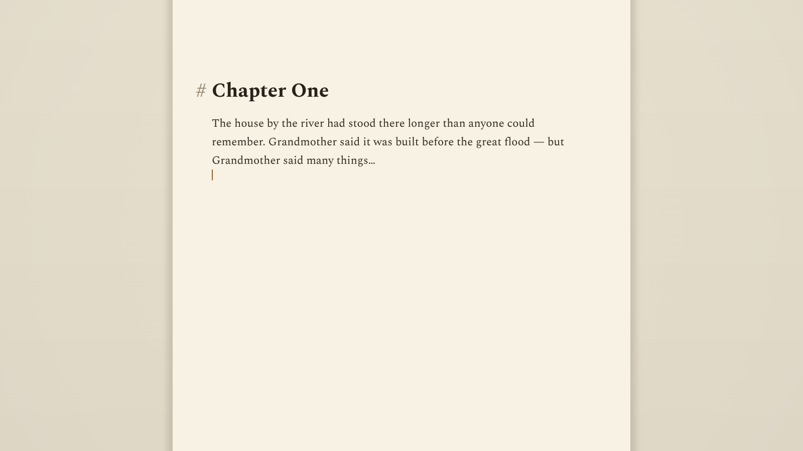
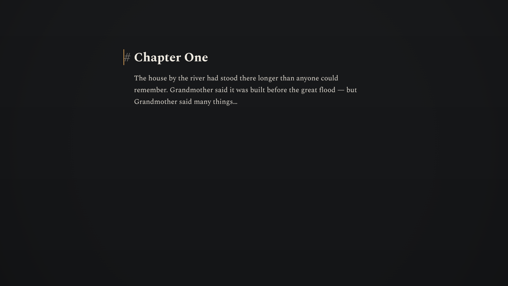

<div align="center">

# FolioOS

### A distraction-free writing machine that boots from a USB stick

**No Windows. No Linux. No internet. No notifications. Just you and the text.**

FolioOS turns almost any x86 PC or laptop into a dedicated digital typewriter — a
"writerdeck" — in seconds: plug in the USB drive, boot, write. Your work stays in plain
Markdown files on an ordinary FAT32 drive that opens on every computer.

[](https://github.com/alantaru/FolioOS/actions/workflows/build.yml)
[](LICENSE)
[](#hardware)
[](#languages)
[](docs/TRANSLATING.md)
[](CONTRIBUTING.md)

[**Download**](https://github.com/alantaru/FolioOS/releases/latest) ·
[Install](#install-in-3-minutes) ·
[Features](#features) ·
[Languages](#languages) ·
[Build](#build-from-source) ·
[Contribute](CONTRIBUTING.md) ·
[Português](README.pt-BR.md)



</div>

---

## Why FolioOS?

Writing apps live inside operating systems built for distraction. Dedicated writing devices
(Freewrite, AlphaSmart, Pomera) solve that — at the price of new hardware. FolioOS takes the
other road: it **is** the operating system. It boots straight from UEFI firmware into a
full-screen, beautifully typeset editor, with nothing else running on the machine.

- **Instant focus** — boots in seconds into your last document, exactly where you stopped.
- **Your old laptop becomes a writer's tool** — runs on 64-bit and 32-bit UEFI PCs, from
  netbooks to 4K desktops, without installing anything on the internal disk.
- **Your files, forever** — plain `.md` text on plain FAT32. No database, no cloud, no lock-in.
- **Tiny and auditable** — a ~600 KB freestanding C binary: no libc, no kernel, no browser engine.
- **Universal** — 15 interface languages, 14 keyboard layouts, all as text files anyone can add.

## Features

| Writing | Reading & export | Comfort |
|---|---|---|
| Live Markdown (headings, bold, lists, quotes, tasks) | Reading mode with book-like pagination | 20 hand-tuned themes + theme editor |
| Focus mode: sentence, paragraph or line | Auto-scroll at your reading pace | Real TrueType rendering with kerning, up to 4K |
| Typewriter scrolling | Chapter outline (`#`), jump between chapters | Paper sheet or full-screen layout |
| Smart typography (— “ ” …) per language | Export to **DOCX, ODT, EPUB, HTML, RTF, TXT** | Add any `.ttf` font; 11-family font pack |
| Writing sprints, daily goals, word counts | Automatic versions of every saved file | MP3 player for background music |
| Hemingway mode (no deleting) | Restores the session after every reboot | Tabs, Sublime Text style (optional) |
| Command palette (Ctrl+K), full keyboard control | File manager: drives, folders, rename, delete | Mouse, touchpad, touch screen, rotation |

<div align="center">


</div>

## Install in 3 minutes

1. **Download** `FolioOS.zip` from the [latest release](https://github.com/alantaru/FolioOS/releases/latest).
2. **Unzip it at the root of a FAT32 USB drive.** Most drives up to 32 GB already are FAT32;
   files already on the drive are kept. ([Formatting help](docs/INSTALL.txt))
3. **Boot from the drive:** open the boot menu (F12 Dell/Lenovo · F9 HP · F8 Asus ·
   Esc/F11 others) and pick its **UEFI** entry. If it is not listed, disable *Secure Boot*.

The drive stays a normal USB drive: your writing is in `DOCUMENTS\`, readable on Windows,
macOS and Linux. Optional packs: `FOLIO-FONTS-EXTRA.zip` (11 writing fonts) and
`FOLIO-FONTS-CJK.zip` (Chinese, Japanese and Korean interface).

> **Try it without rebooting:** `build\folio_sim.exe` runs the same code in a Windows window,
> and `build\efi_host.exe build\efi\BOOTX64.EFI` runs the real UEFI binary.

## Languages

FolioOS speaks **English, Español, Français, Deutsch, Italiano, Português (Brasil),
Português (Portugal), Nederlands, Polski, Türkçe, Русский, Українська, 简体中文, 日本語 and 한국어**.
On first boot it follows the language of your firmware setup.

Nothing about language is hard-coded: every translation is a standard **gettext `.po`** file
in `FOLIO/LANGUAGES` — with its own plural rules, smart quotes, date format, decimal
separator, default keyboard and fonts. **Adding a language is dropping a file on the
drive.** Keyboard layouts are plain-text files in `FOLIO/KEYBOARDS`.

<div align="center">


</div>

Help translate: [**docs/TRANSLATING.md**](docs/TRANSLATING.md) — works with Poedit, Weblate,
Crowdin or any text editor, and a validator catches broken placeholders before they ship.

## Hardware

| | |
|---|---|
| **Firmware** | UEFI 2.x, 64-bit (`BOOTX64.EFI`) or 32-bit (`BOOTIA32.EFI`, Atom tablets/netbooks). Secure Boot must be off. |
| **Display** | Any UEFI GOP framebuffer (RGB, BGR, bit-mask, Blt-only) or legacy UGA; native resolution, HiDPI scaling, portrait panels rotated automatically. |
| **Input** | UEFI keyboard; USB/PS/2 mouse, touchpad and touch screen via the firmware's pointer protocols. |
| **Sound** | Intel HD Audio and AC'97 (optional, for the MP3 player). |
| **Storage** | The boot USB drive (FAT32) plus any other FAT volume the firmware exposes. |
| **Not supported (yet)** | BIOS/CSM-only machines, Secure Boot, Wi-Fi/Bluetooth (by design), right-to-left scripts. |

Something not working? FolioOS writes `FOLIO\DIAGNOSTICS.TXT` on every start — attach it to a
[bug report](https://github.com/alantaru/FolioOS/issues/new/choose).

## Build from source

Requirements: Windows 10/11 with [MinGW-w64](https://winlibs.com) `gcc` on `PATH` (any recent
x86_64 build) and PowerShell 5.1+. No other dependencies.

```powershell
git clone https://github.com/alantaru/FolioOS.git
cd FolioOS
.\build.ps1                       # builds UEFI x64 + IA32, simulator, packages, runs all tests
.\flash_usb.ps1 -DriveLetter E:   # installs/updates a FAT32 USB drive, keeping user files
.\build.ps1 -Image                # optional: raw disk image for Rufus / Etcher / dd
.\tools\fetch-cjk-fonts.ps1       # optional: fonts for the CJK font pack
```

The test suite drives the simulator and the real `BOOTX64.EFI` (inside a small UEFI host)
with scripted keystrokes and mouse events, captures screenshots, checks exported files and
validates every translation.

## Architecture

```
src/core/       portable core: editor, Markdown, TrueType rasterizer, UI toolkit, window manager,
                export (DOCX/ODT/EPUB/…), MP3 player, i18n (gettext), keyboard layouts, themes
src/platform/   uefi/  firmware backend: GOP/UGA video, input, FAT I/O, HD Audio/AC'97
                win32/ simulator backend used for development and automated tests
tools/          efi_host (runs BOOTX64.EFI on Windows), i18n tool, disk image builder
assets/         fonts, translations (.po), keyboard layouts, example theme
tests/          scripted end-to-end tests
```

The core is freestanding C (no libc): a ~600 KB binary that owns the whole machine through a
thin platform abstraction layer. More in [docs/ARCHITECTURE.md](docs/ARCHITECTURE.md).

## Roadmap

- [ ] Input methods for Chinese, Japanese and Korean text (the interface is already translated)
- [ ] Text shaping and right-to-left layout (Arabic, Hebrew, Devanagari…)
- [ ] Spell checking with Hunspell-compatible dictionaries
- [ ] Secure Boot (signed shim)
- [ ] Linux build of the simulator and tools

Ideas and votes: [Discussions](https://github.com/alantaru/FolioOS/discussions).

## Contributing

Bug reports, translations, keyboard layouts, themes, fonts and code are all welcome — see
[CONTRIBUTING.md](CONTRIBUTING.md) and our [Code of Conduct](CODE_OF_CONDUCT.md).
Security issues: [SECURITY.md](SECURITY.md).

## License

FolioOS is free software under the [GNU General Public License v3.0](LICENSE).
Bundled fonts use the SIL Open Font License; minimp3 is CC0. Details in
[THIRD_PARTY_NOTICES.md](THIRD_PARTY_NOTICES.md).

<sub>Keywords: distraction-free writing · bootable USB writing environment · writerdeck ·
digital typewriter · focus writing app · Markdown editor · offline writing · UEFI application ·
bare-metal C · Freewrite / AlphaSmart alternative · novel writing · NaNoWriMo.</sub>
