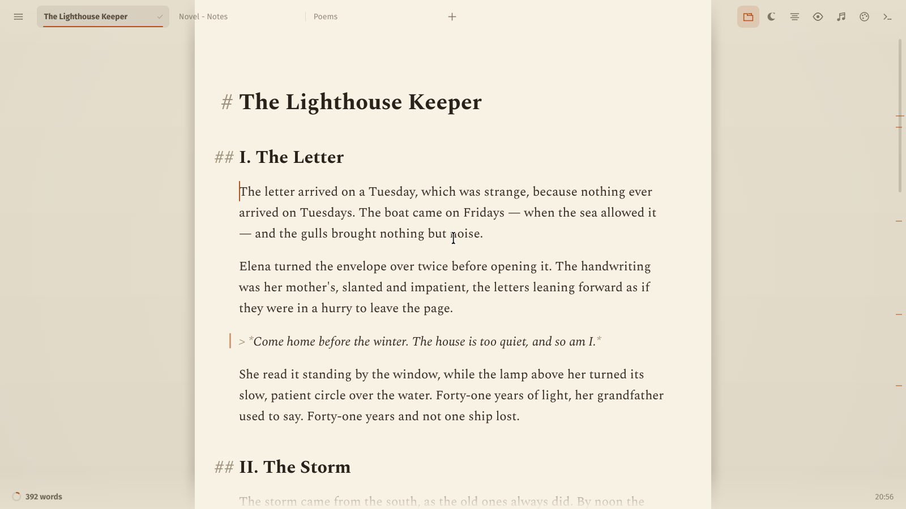
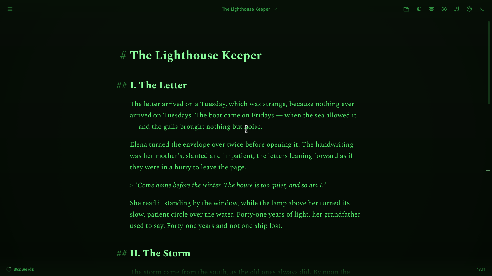

<!-- Generated by tools/readmes.pl from README.md and docs/i18n/README.pl.po — edit the .po, not this file. -->
<div align="center">

<a id="folioos--the-distraction-free-writing-os-that-boots-from-a-usb-stick"></a>

# FolioOS — system do pisania bez rozpraszaczy, uruchamiany z pendrive’a

**Zamień każdego starego laptopa w maszynę wyłącznie do pisania.**<br>
Bez Windows. Bez Linuksa. Bez internetu. Bez powiadomień. Tylko ty i tekst.

[](https://github.com/alantaru/FolioOS/actions/workflows/build.yml)
[](https://github.com/alantaru/FolioOS/releases/latest)
[](LICENSE)
[](#hardware-compatibility)
[](#13-15-languages-and-counting)
[](docs/TRANSLATING.md)

[**⬇ Pobierz**](https://github.com/alantaru/FolioOS/releases/latest) ·
[Instalacja](#install-in-3-minutes) ·
[Wycieczka](#a-tour-of-folioos) ·
[Języki](#13-15-languages-and-counting) ·
[Pytania](#faq) ·
[Kompilacja](#build-from-source) ·
[Współtwórz](CONTRIBUTING.md)

<!-- languages -->
<sub>[English](README.md) · [Español](README.es.md) · [Français](README.fr.md) · [Deutsch](README.de.md) · [Italiano](README.it.md) · [Português (Brasil)](README.pt-BR.md) · [Português (Portugal)](README.pt-PT.md) · [Nederlands](README.nl.md) · **Polski** · [Türkçe](README.tr.md) · [Русский](README.ru.md) · [Українська](README.uk.md) · [简体中文](README.zh-CN.md) · [日本語](README.ja.md) · [한국어](README.ko.md)</sub>
<!-- /languages -->


</div>

FolioOS to **uruchamiane środowisko do pisania**: malutki system operacyjny, który robi jedną rzecz — pozwala
ci pisać. Podłącz pendrive do niemal dowolnego komputera z ostatniej dekady, uruchom z niego i po kilku
sekundach jesteś w pełnoekranowym, pięknie złożonym edytorze Markdown, dokładnie tam, gdzie skończyłeś
ostatnio. Nie ma przeglądarki, poczty, sklepu z aplikacjami ani Wi-Fi, które by cię odciągały.

Twoje teksty są zapisywane jako **zwykłe pliki Markdown na zwyczajnym pendrivie FAT32**, więc ten sam
pendrive otworzysz w Windows, macOS i Linuksie. Eksportuj do Worda, LibreOffice, EPUB, HTML lub RTF, gdy
tylko musisz coś udostępnić.

<a id="who-is-it-for"></a>

## Dla kogo?

- **Powieściopisarzy, dziennikarzy, studentów i blogerów**, którzy chcą mieć *writerdeck* — urządzenie
  wyłącznie do pisania bez rozpraszaczy — bez kupowania nowego sprzętu.
- **Uczestników NaNoWriMo** i każdego, kto robi sprinty pisarskie na czas lub poranne strony.
- **Osoby ze starym laptopem w szufladzie**: FolioOS daje mu drugie życie – prosto z pendrive’a albo
  zainstalowany na jego dysku, sam lub obok systemu, który już na nim jest.
- **Szkół i bibliotek**, które potrzebują prostego stanowiska do pisania offline.
- **Pisarzy dbających o prywatność**: bez sieci, bez telemetrii, bez chmury.

<a id="install-in-3-minutes"></a>

## Instalacja w 3 minuty

1. **Pobierz** [`FolioOS.zip`](https://github.com/alantaru/FolioOS/releases/latest) z najnowszej wersji.
2. **Rozpakuj go do katalogu głównego pendrive’a sformatowanego w FAT32.** Większość pendrive’ów do 32 GB już
   taka jest. Pliki na pendrivie zostają. ([Jak sformatować w FAT32](docs/INSTALL.txt))
3. **Uruchom ponownie komputer i otwórz menu rozruchu** — zwykle **F12** (Dell, Lenovo), **F9** (HP), **F8**
   (Asus) lub **Esc/F11** — i wybierz pozycję **UEFI** pendrive’a. Jeśli jej nie ma, wyłącz *Secure Boot* w
   ustawieniach firmware’u.

<details>
<summary><b>Inne sposoby instalacji</b></summary>

- **Obraz dysku:** `FolioOS-disk-image.zip` zawiera gotowy obraz 256 MB dla
  [Rufusa](https://rufus.ie) (tryb DD), [balenaEtchera](https://etcher.balena.io) lub `dd`. Zalecane pozostaje
  rozpakowanie `FolioOS.zip`: reszta pendrive’a zostaje wolna na twoje pliki.
- **Ze źródeł w Windows:** `.\build.ps1`, a potem `.\flash_usb.ps1 -DriveLetter E:` (instaluje lub aktualizuje
  pendrive bez usuwania czegokolwiek).
- **Komputery bez UEFI (tylko BIOS/Legacy):** uruchom raz w Windows, jako administrator,
  `FOLIO\TOOLS\biosboot.exe E:` (`E:` to pendrive). Zapisuje tylko kod rozruchowy BIOS: żaden plik nie jest
  ruszany, pendrive pozostaje zwykłym FAT32, a rozruch UEFI działa dalej. Ze źródeł:
  `.\flash_usb.ps1 -DriveLetter E: -Bios`.
- **Wszystko w zestawie:** `FolioOS.zip` zawiera już 11 wolnych czcionek do pisania i czytania oraz czcionki
  do chińskiego, japońskiego i koreańskiego — każdy język działa od razu.

</details>

> **Wypróbuj bez restartu:** `folio_sim.exe` uruchamia ten sam kod w oknie Windows, a `efi_host.exe`
> uruchamia prawdziwy program UEFI — zobacz [Kompilacja ze źródeł](#build-from-source).

---

<a id="a-tour-of-folioos"></a>

## Wycieczka po FolioOS

<a id="1-start-up"></a>

### 1. Uruchamianie


FolioOS startuje prosto z firmware’u. Ekran powitalny widać, gdy ładują się czcionki, a dowolny klawisz go
pomija — możesz od razu zacząć pisać. Czas jego wyświetlania (1–60 s) można ustawić albo całkiem go wyłączyć.

Przy pierwszym uruchomieniu FolioOS dostosowuje się do języka ustawień firmware’u twojego komputera i otwiera
krótki tekst powitalny. Potem zawsze otwiera **twój ostatni dokument dokładnie w wierszu, w którym byłeś** —
nawet jeśli byłeś w trybie czytania.

<br clear="right">

<a id="2-the-writing-screen"></a>

### 2. Ekran pisania


Strona to wszystko, co jest. Górny i dolny pasek **znikają, gdy tylko zaczniesz pisać**, i wracają, gdy
poruszysz myszą. Markdown jest wyświetlany na żywo — nagłówki `#`, `**pogrubienie**`, `*kursywa*`,
`> cytaty`, listy i zadania `- [ ]` — a znaczniki pozostają widoczne i edytowalne. Cienki pasek po prawej
pokazuje, gdzie jesteś, i zaznacza każdy rozdział.

- **Inteligentna typografia:** `--` zmienia się w pauzę, `...` w wielokropek, a proste cudzysłowy w
  właściwe cudzysłowy drukarskie *twojego języka* („ ” po polsku, “ ” po angielsku, « » po francusku,
  「 」 po japońsku).
- **Papier lub pełny ekran:** pisz na kartce leżącej na biurku albo na całym ekranie; wybierz szerokość
  kolumny (wąska, średnia, szeroka, bardzo szeroka).
- Cofnij/ponów, poruszanie się po słowach, przenoszenie akapitów **Alt+↑/↓**, duplikowanie i usuwanie
  akapitów, zmiana wielkości liter **Shift+F3**, otaczanie zaznaczenia znakami `( " * _` i powrót do ostatniej
  zmiany **Ctrl+J**.

<a id="3-focus-mode-and-zen-mode"></a>

### 3. Tryb skupienia i tryb zen

<div align="center">


</div>

**F2** przygasza wszystko oprócz zdania, akapitu lub wiersza, który piszesz. **F3** to *tryb maszyny do
pisania*: bieżący wiersz zostaje na środku ekranu. **F11** to *tryb zen*: żadnych pasków, dopóki nie dotkniesz
górnej krawędzi. **Tryb Hemingwaya** wyłącza usuwanie, żebyś cały czas szedł do przodu.

<a id="4-reading-mode"></a>

### 4. Tryb czytania


**Ctrl+P** zamienia twój Markdown w złożoną stronę, jak w książce. Przewracaj strony strzałkami, spacją albo
kliknięciem na marginesie. Dolny pasek pokazuje, ile już przeczytałeś i ile zostało do końca rozdziału i
całego tekstu; **automatyczne przewijanie** przesuwa tekst w twoim tempie czytania (w słowach na minutę):
**Enter** lub środkowy przycisk myszy je uruchamia, **+** i **−** zmieniają tempo. **Esc** wraca do pisania
*w akapicie, który czytałeś*.

<a id="5-chapters-and-outline"></a>

### 5. Rozdziały i konspekt


Każdy nagłówek `#` to rozdział. **F5** otwiera konspekt, żeby skoczyć gdziekolwiek; **Ctrl+PgUp/PgDn**
przechodzi między rozdziałami zarówno podczas pisania, jak i czytania. Długie rękopisy pozostają łatwe w
nawigacji — a eksport do EPUB zamienia te rozdziały w prawdziwy spis treści e-booka.

<br clear="right">

<a id="6-find-and-replace"></a>

### 6. Znajdź i zamień


**Ctrl+F** wyróżnia każde wystąpienie, liczy je i zamienia jedno lub wszystkie.

<a id="7-files-open-save-and-export"></a>

### 7. Pliki: otwieranie, zapisywanie i eksport

<div align="center">


</div>

**Ctrl+O** otwiera prawdziwy menedżer plików: wszystkie dyski widoczne dla firmware’u, foldery, tworzenie,
zmiana nazwy i usuwanie. **Ctrl+Shift+S** zapisuje pod inną nazwą albo **eksportuje do DOCX, ODT, EPUB, HTML,
RTF lub TXT** — jedno kliknięcie w format. Cała reszta dzieje się sama:

- **Automatyczny zapis** (domyślnie co 20 sekund) z **zapisem atomowym**: zanik prądu nigdy nie zostawi
  połowy pliku.
- **Automatyczne wersje:** poprzednia kopia każdego zapisanego pliku trafia do `FOLIO/VERSIONS` (zachowywanych
  jest ostatnich 30 na dokument).
- **Odzyskiwanie szkiców** dla tekstu, który nigdy nie dostał nazwy.

**Źródła LaTeX** (`.tex`, `.bib`, `.sty`, `.cls`) otwierają się jako zwykły kod źródłowy w czcionce o
stałej szerokości, z podświetlaniem w obrębie wiersza poleceń, nawiasów klamrowych, komentarzy `%` i
wzorów w tekście, prawdziwymi tabulatorami oraz `{`, `[` i `$`, które same się zamykają. Ani styl
Markdown, ani cudzysłowy typograficzne nie zmieniają źródła, a plik zachowuje swoje końce wierszy (CRLF
pozostaje CRLF). FolioOS nie kompiluje LaTeX-a: tryb czytania i eksport są dla dokumentów Markdown.

<a id="8-tabs-optional"></a>

### 8. Karty (opcjonalnie)



Wolisz kilka dokumentów naraz? Włącz karty pierwszą ikoną w prawym górnym rogu. **Ctrl+N** otwiera kartę,
**Ctrl+W** ją zamyka, **Ctrl+Tab** lub **Alt+1…9** przełączają. Karty — nawet bez nazwy — wracają po
ponownym uruchomieniu. Gdy są wyłączone, FolioOS pozostaje spokojną maszyną do pisania, jeden dokument
naraz.

<a id="9-goals-sprints-and-statistics"></a>

### 9. Cele, sprinty i statystyki


**F10** pokazuje twój dzienny cel słów, słowa w tym dokumencie i tej sesji, czas czytania i tempo pisania.
**F4** uruchamia mierzony czasem **sprint pisarski** (15–60 minut), który kończy się delikatnym dzwonkiem.
Słowa napisane dzisiaj liczą się w różnych dokumentach i po ponownych uruchomieniach.

<br clear="right">

<a id="10-command-palette-and-shortcuts"></a>

### 10. Paleta poleceń i skróty


**Ctrl+K** znajduje każde polecenie po wpisaniu kilku liter — w twoim języku. **F1** wyświetla wszystkie skróty:


<a id="no-mouse-needed"></a>

#### Mysz niepotrzebna

Wszystko w FolioOS działa z samej klawiatury, a mysz i touchpad można całkiem wyłączyć
(*Ustawienia › System › Używaj myszy i touchpada*, **Ctrl+K › Mysz** lub `use_mouse=0` w `CONFIG.INI`) —
przydatne w laptopach, których touchpad przeskakuje kursorem.

| Klawisze | Co robią |
|---|---|
| Skrót okna (F12, F5, F6, F10, Ctrl+O…) | Otwiera je z klawiaturą w środku |
| **Tab** / **Shift+Tab**, **↑ ↓** | Przechodzą między przyciskami, przełącznikami, suwakami i listami okna |
| **Enter** lub **Spacja** | Naciskają wyróżniony przycisk, przełącznik lub element |
| **← →** | Regulują wyróżniony suwak, opcję lub wartość |
| **Esc** | Zamyka okno i wraca do tekstu; gdy nic nie jest otwarte, pokazuje ukryte paski |
| **Ctrl+F6** | Przenosi klawiaturę między tekstem a otwartymi oknami |
| **Alt+M** | Menu z ostatnimi dokumentami (także w Ctrl+K) |
| **Alt+F7** / **Alt+F8** | Przesuwają / zmieniają rozmiar okna strzałkami (Shift = małe kroki); Enter zatwierdza, Esc cofa |

Wyróżnienie pokazuje, który element ma klawiaturę; pojawia się dopiero, gdy używasz klawiszy, więc dla
użytkowników myszy nic się nie zmienia. Litery wpisane w oknie bocznym (konspekt, muzyka, ustawienia) trafiają
prosto z powrotem do twojego tekstu.

<a id="11-themes-and-typography"></a>

### 11. Motywy i typografia


**F12** otwiera ustawienia wyglądu: **20 ręcznie dopracowanych motywów**, czcionkę tekstu, rozmiar, interlinię,
odstępy między akapitami i wcięcie pierwszego wiersza. Tekst rysuje własny silnik TrueType FolioOS z
prawdziwym kerningiem i wygładzaniem — wyraźny od małych ekranów netbooków po 4K.

<div align="center">



</div>


**Stwórz własny:** edytor motywów pozwala wybrać każdy z 16 kolorów (albo pożyczyć je z dowolnego
wbudowanego motywu), czcionkę dla tekstu i drugą dla interfejsu, i od razu zobaczyć efekt. Motywy to małe
pliki tekstowe `.INI` w `FOLIO/THEMES` — łatwe do udostępniania. Wrzuć dowolną czcionkę `.ttf` do
`FOLIO/FONTS`, żeby jej używać; FolioOS ma już Literatę, Lorę, EB Garamond, iA Writer Quattro/Duo/Mono,
Special Elite i inne.

<br clear="right">

<a id="12-music-while-you-write"></a>

### 12. Muzyka do pisania

**F6** otwiera mały odtwarzacz MP3 dla plików z folderu `MUSIC` na pendrivie (Intel HD Audio i AC'97).
**F7/F8/F9** sterują nim bez opuszczania strony.

<a id="13-15-languages-and-counting"></a>

### 13. 15 języków i ciągle przybywa

<div align="center">


</div>

**English, Español, Français, Deutsch, Italiano, Português (Brasil), Português (Portugal), Nederlands,
Polski, Türkçe, Русский, Українська, 简体中文, 日本語, 한국어.**


Nic, co dotyczy języka, nie jest zaszyte w kodzie. Każde tłumaczenie to standardowy **plik `.po` gettext** w
`FOLIO/LANGUAGES`, który określa też reguły liczby mnogiej, cudzysłowy, format daty, separator dziesiętny,
domyślną klawiaturę i czcionki — **dodanie języka to wrzucenie pliku na pendrive**. Układy klawiatury to
także pliki tekstowe: US, US-International, UK, ABNT2, Portugalia, Hiszpania, Ameryka Łacińska, francuski
AZERTY, niemiecki QWERTZ, włoski, polski, turecki Q, rosyjski, ukraiński, koreański (wprowadzanie hangul w
układzie 2-zestawowym) i japoński (wprowadzanie romaji → kana).

Chcesz FolioOS w swoim języku? Przeczytaj **[docs/TRANSLATING.md](docs/TRANSLATING.md)** — działa z Poedit,
Weblate, Crowdin lub dowolnym edytorem tekstu.

<br clear="right">

<a id="14-your-files-on-any-computer"></a>

### 14. Twoje pliki na każdym komputerze

```
Pendrive (FAT32)
├── DOCUMENTS/          twoje pliki .md i .txt oraz eksporty (.docx .odt .epub .html .rtf)
├── MUSIC/              twoje pliki .mp3
├── FOLIO/
│   ├── CONFIG.INI      ustawienia — zwykły tekst, do edycji ręcznej
│   ├── FONTS/          czcionki .ttf (dodaj własne)
│   ├── THEMES/         twoje motywy (.INI)
│   ├── LANGUAGES/      tłumaczenia (.po)
│   ├── KEYBOARDS/      układy klawiatury (.txt)
│   ├── VERSIONS/       automatyczne poprzednie wersje zapisanych plików
│   └── BACKUP/         tablice partycji zapisane przez instalator, zanim cokolwiek zapisze
└── EFI/BOOT/           sam FolioOS (BOOTX64.EFI, BOOTIA32.EFI, BOOTAA64.EFI)
```

Bez bazy danych, bez ukrytej partycji, bez zamkniętego formatu. Zanieś pendrive do dowolnego komputera, a
twoje teksty tam są.

<a id="15-install-it-on-the-computer-beta"></a>

### 15. Zainstaluj na komputerze (beta)

Pendrive wystarczy, ale FolioOS może też zamieszkać na dysku samego komputera, tak żeby laptop od razu
uruchamiał się w twoim tekście. Otwórz **Ctrl+K › Zainstaluj FolioOS na tym komputerze** (lub *Ustawienia › System*):

- **Jako jedyny system**, na pustym dysku albo takim, który postanowisz wyczyścić – potwierdzasz, wpisując słowo.
- **Obok Windows albo Linuksa**, w wolnym miejscu, bez dotykania pozostałych partycji. Przy każdym starcie przez
  kilka sekund widać *Naciśnij dowolny klawisz, aby pisać*, a potem jak zwykle uruchamia się drugi system;
  Windows uruchamia sam firmware, tak jak zawsze.
- **Brak wolnego miejsca?** FolioOS potrafi zmniejszyć partycję NTFS, FAT32 lub exFAT bez przenoszenia danych.
  Odmawia tego, co nie jest bezpieczne (Windows w hibernacji lub z szybkim uruchamianiem, wolumin wymagający
  `chkdsk`, BitLocker bez klucza odzyskiwania, LUKS, LVM, woluminy Apple) i wyjaśnia, co zrobić zamiast tego.
  ext4 nigdy nie zmienia rozmiaru: zrób miejsce z poziomu Linuksa (GParted) i uruchom instalator ponownie.
- Zanim cokolwiek zostanie zapisane, tablica partycji (pierwsze i ostatnie sektory dysku) trafia do
  `FOLIO/BACKUP` na nośniku, z którego uruchomił się FolioOS – zwykle na pendrivie. Twoje teksty mogą być na
  komputerze, na pendrivie albo w obu miejscach.
- **Aktualizuj** z nowszego pendrive’a: wymieniane są tylko pliki samego FolioOS; twoje teksty i partycje
  zostają bez zmian.
- **Odinstaluj**: najpierw możesz skopiować swoje teksty na nośnik, z którego uruchomił się FolioOS. Jeśli
  instalator zmniejszył partycję, żeby zrobić miejsce, wraca ona do swojego poprzedniego rozmiaru, o ile
  miejsce za nią jest nadal wolne; w przeciwnym razie miejsce staje się wolne. Jeśli ta partycja ma się powiększyć, a Windows jest
  w hibernacji (lub używa szybkiego uruchamiania), FolioOS prosi, by najpierw całkowicie go wyłączyć, i niczego nie zmienia.
- *Ustawienia › System › Dyski i partycje* to mały menedżer partycji: utworzenie partycji FAT32, formatowanie,
  zmniejszanie lub powiększanie NTFS/FAT32/exFAT, usuwanie.
- 4.4 beta to wersja przedpremierowa: pobierz ją ze
  [strony wydania](https://github.com/alantaru/FolioOS/releases/tag/v4.4.1-beta), nie z „latest”.

Działa na komputerach z UEFI i na komputerach tylko z BIOS-em. **To wersja beta:** przechodzi wszystkie testy
na emulowanych maszynach, z dyskami utworzonymi przez Windows i przez Linuksa, ale nie działała jeszcze na
prawdziwym sprzęcie – najpierw zrób kopię zapasową albo użyj zapasowego dysku.

---

<a id="how-folioos-compares"></a>

## Jak wypada FolioOS na tle innych

| | FolioOS | Dedykowane urządzenia (Freewrite, AlphaSmart, Pomera) | Aplikacje do pisania (iA Writer, Scrivener, tryby skupienia) |
|---|:---:|:---:|:---:|
| Koszt | **Za darmo** | Setki dolarów | Od darmowych po płatne |
| Sprzęt | Dowolny komputer UEFI, który już masz | Nowe urządzenie | Twój zwykły komputer |
| Rozpraszacze w zasięgu ręki | **Żadne** — bez systemu, bez sieci | Żadne | Jedno Alt+Tab dalej |
| Format plików | Zwykły Markdown na FAT32 | Własna synchronizacja/eksport urządzenia | Różnie |
| Ekran i typografia | Duży ekran, TrueType, motywy | Mały ekran e-ink lub LCD | Doskonałe |
| Działa offline | **Zawsze** | Zwykle | Tak |
| Otwarte źródła | **Tak (GPL-3.0)** | Nie | Zwykle nie |

<a id="hardware-compatibility"></a>

## Zgodność sprzętowa

| | |
|---|---|
| **Firmware** | UEFI 2.x — 64-bitowy (`BOOTX64.EFI`), 32-bitowy (`BOOTIA32.EFI`, tablety i netbooki z Atomem) lub ARM64 (`BOOTAA64.EFI`: Raspberry Pi 3/4/5 ze społecznościowym firmware’em UEFI, laptopy ARM). **Komputery tylko z BIOS** (Legacy/CSM) uruchamiają się przez własny most BIOS FolioOS po jednorazowym uruchomieniu `FOLIO\TOOLS\biosboot.exe`. Secure Boot musi być wyłączony. |
| **Obraz** | Dowolny framebuffer UEFI GOP (RGB, BGR, maska bitowa, tylko Blt) lub starszy UGA; VESA/VBE na komputerach z BIOS. Natywna rozdzielczość, automatyczne skalowanie HiDPI, pionowe ekrany obracane automatycznie. Gdy jedynym trybem jest 4:3, a ekran panoramiczny go rozciąga, *Ustawienia › System › Ekran i wskaźnik* zachowuje proporcje (Monitor, 16:9, 16:10 lub 4:3). |
| **Wejście** | Klawiatura przez firmware (na komputerach z BIOS bezpośrednio przez PS/2). Mysz, touchpad, tablet graficzny i ekran dotykowy przez firmware — a gdy firmware nie ma dla nich sterownika, przez własne sterowniki USB HID i PS/2 FolioOS. |
| **Dźwięk** | Intel HD Audio i AC'97 (potrzebne tylko do odtwarzacza muzyki). |
| **Dyski (instalator, beta)** | Dyski SATA, NVMe, IDE i USB z sektorami 512-bajtowymi, GPT lub MBR. NTFS, FAT32 i exFAT można zmniejszyć i z powrotem powiększyć bez przenoszenia danych; BitLocker, LUKS, LVM, APFS/HFS+ i ext4 nigdy nie zmieniają rozmiaru. |
| **Nieobsługiwane** | Secure Boot (na razie), Maki z Apple Silicon. Wi-Fi i Bluetooth zostały celowo pominięte. |
| **Testowane na** | 20 emulowanych maszyn przy każdym wydaniu: UEFI x64, IA32 i ARM64 oraz komputery tylko z BIOS-em uruchamiane z USB i IDE; 8 kart graficznych, myszy PS/2 i USB, tablet USB, HD Audio i AC'97; FolioOS zainstalowany na dyskach SATA i IDE, dual boot obok Windows (UEFI) i innego systemu (BIOS), zmniejszanie NTFS utworzonego przez Windows i zachowanie proporcji. Na każdej sprawdzane są obraz, klawiatura, mysz, dźwięk, zapisywanie i spójność systemu plików. |

Każde uruchomienie zapisuje `FOLIO/DIAGNOSTICS.TXT` z tym, co znalazł FolioOS. Podziel się swoim w
[zgłoszeniu sprzętowym](https://github.com/alantaru/FolioOS/issues/new/choose) — nawet „po prostu działa”
pomaga innym piszącym wybrać laptopa.

<a id="faq"></a>

## Najczęstsze pytania

<details>
<summary><b>Czy wyczyści mój komputer albo pendrive?</b></summary>

Nie. Uruchomiony z pendrive’a FolioOS zapisuje na wewnętrznym dysku tylko wtedy, gdy o to poprosisz: zapisanie
tekstu na jednym z jego woluminów zapisuje ten plik, a partycje zmieniają tylko instalator i *Dyski i partycje*;
nawet wtedy żadna partycja się nie zmienia, zanim potwierdzisz i zanim tablica partycji zostanie zapisana na
nośniku, z którego uruchomił się FolioOS (otwarte teksty są najpierw zapisywane tam, gdzie są). Instalacja na pendrivie tylko dodaje pliki – to, co już na nim było, zostaje.
Wyjmij pendrive, a komputer znów uruchomi swój zwykły system.
</details>

<details>
<summary><b>Czy mogę zainstalować go na laptopie, obok Windows albo Linuksa?</b></summary>

Tak, od wersji 4.4 (beta): **Ctrl+K › Zainstaluj FolioOS na tym komputerze**. Używa wolnego miejsca albo
zmniejsza partycję NTFS, FAT32 lub exFAT bez przenoszenia danych, a przy każdym starcie wybierasz FolioOS
albo drugi system. Odinstalowanie powiększa z powrotem partycję zmniejszoną przez instalator, jeśli miejsce za nią jest nadal wolne (w przeciwnym razie miejsce staje się wolne). Zobacz [Zainstaluj na komputerze](#15-install-it-on-the-computer-beta).
</details>

<details>
<summary><b>Czy moje teksty są bezpieczne, gdy wyczerpie się bateria?</b></summary>

Zapisy są atomowe (plik jest zapisywany w całości, zanim zastąpi stary), automatyczny zapis działa domyślnie
co 20 sekund, tekst bez nazwy ma szkic do odzyskania, a każdy zapisany plik przechowuje poprzednie wersje w
`FOLIO/VERSIONS`.
</details>

<details>
<summary><b>Czy mogę edytować pliki także na zwykłym komputerze?</b></summary>

Tak. To zwykłe pliki `.md` w folderze `DOCUMENTS` na pendrivie FAT32. Otwórz je w Obsidianie, Typorze,
VS Code, Notatniku, TextEdit lub dowolnym edytorze Markdown, potem podłącz pendrive z powrotem i pisz dalej
w FolioOS.
</details>

<details>
<summary><b>Czy mogę pisać w LaTeX-u?</b></summary>

Tak. FolioOS edytuje pliki źródłowe `.tex`, `.bib`, `.sty` i `.cls` z podświetlaniem, czcionką o stałej
szerokości i dokładnie tak, jak je wpisujesz (bez cudzysłowów typograficznych i Markdownu). Nie kompiluje
ich: zbuduj PDF na komputerze z dystrybucją TeX-a albo wgraj pliki do edytora LaTeX online.
</details>

<details>
<summary><b>Dlaczego mój komputer nie pokazuje pendrive’a w menu rozruchu?</b></summary>

Sprawdź, czy pendrive jest w FAT32, czy wybrałeś pozycję zaczynającą się od „UEFI” i czy Secure Boot jest
wyłączony w ustawieniach firmware’u. Starsze komputery, które uruchamiają się tylko w trybie BIOS/Legacy,
potrzebują raz kodu rozruchowego BIOS: uruchom w Windows jako administrator `FOLIO\TOOLS\biosboot.exe E:`,
a pendrive pojawi się jako zwykły dysk USB.
</details>

<details>
<summary><b>Czy działa na Macu?</b></summary>

Maki z procesorem Intel potrafią uruchomić się z nośnika UEFI (przytrzymaj <kbd>Option</kbd> przy
włączaniu), ale nie zostały jeszcze przetestowane — zgłoszenia są mile widziane. Maki z Apple Silicon nie są
obsługiwane.
</details>

<details>
<summary><b>Czy mogę pisać po chińsku, japońsku lub koreańsku?</b></summary>

**Po koreańsku i japońsku — tak.** Wybierz klawiaturę *한국어 (두벌식)* lub *日本語 (ローマ字かな)* w
*Ustawienia › System*: koreański używa standardowego układu 2-zestawowego i składa sylaby podczas pisania
(Backspace usuwa po jednym jamo); japoński zamienia romaji na hiraganę lub katakanę (`nihongo` → にほんご).
**Ctrl+Spacja** przełącza między metodą wprowadzania a literami łacińskimi. Czcionki są dołączone do
FolioOS, a właściwa ładuje się sama, gdy tekst zawiera te pisma. Konwersja na kanji i chiński pinyin
wymagają słowników i wciąż są w planach. Pismo łacińskie, greckie i cyrylicę wpisuje się dołączonymi
układami klawiatury.
</details>

<details>
<summary><b>Czy mogę go używać bez myszy?</b></summary>

Tak. Każde okno, przycisk i ustawienie jest dostępne z klawiatury (Tab, strzałki, Enter, Spacja, Esc), a mysz
i touchpad możesz całkiem wyłączyć w *Ustawienia › System*. Zobacz
[Mysz niepotrzebna](#no-mouse-needed).
</details>

<details>
<summary><b>Czy jest sprawdzanie pisowni, internet albo synchronizacja w chmurze?</b></summary>

Internetu i synchronizacji celowo nie ma — FolioOS ma działać offline. Sprawdzanie pisowni jest w planach.
Ponieważ pliki to zwykły Markdown, możesz je synchronizować czymkolwiek, gdy pendrive wróci do zwykłego
komputera.
</details>

<a id="build-from-source"></a>

## Kompilacja ze źródeł

Wymagania: Windows 10/11, PowerShell 5.1+ i `gcc` z [MinGW-w64](https://winlibs.com) (dowolna świeża wersja
x86_64) w `PATH`. Wersje ARM64 i BIOS używają też `clang` z [LLVM](https://llvm.org) i `nasm`, a laboratorium
sprzętowe — [QEMU](https://www.qemu.org); wszystkie trzy zainstalujesz przez `winget`.

```powershell
git clone https://github.com/alantaru/FolioOS.git
cd FolioOS
.\build.ps1                                  # UEFI x64 + IA32 + ARM64, BIOS, symulator, pakiety — i zestaw testów
.\tools\qemu-lab.ps1                         # uruchamia prawdziwe binaria na 20 emulowanych maszynach i sprawdza każdą
.\build\folio_sim.exe                        # uruchamia FolioOS w oknie
.\build\efi_host.exe build\efi\BOOTX64.EFI   # uruchamia prawdziwy program UEFI w oknie
.\flash_usb.ps1 -DriveLetter E:              # instaluje/aktualizuje pendrive FAT32, zachowując pliki
.\build.ps1 -Image -ImageMB 256              # opcjonalnie: obraz dysku dla Rufusa / Etchera / dd
.\tools\fetch-cjk-fonts.ps1                  # pobiera raz czcionki CJK (build.ps1 uruchamia to w razie potrzeby)
.\tools\showcase.ps1                         # odtwarza zrzuty ekranu z tego README
```

Zestaw testów steruje symulatorem i prawdziwym `BOOTX64.EFI` (w małym hoście UEFI) za pomocą zaprogramowanych
naciśnięć klawiszy i zdarzeń myszy, robi zrzuty ekranu i sprawdza każdy eksport (ZIP + XML), każde
tłumaczenie (z kontrolą negatywną walidatora), sześć formatów framebuffera i sterownik FAT32 mostu BIOS
(tysiące losowych operacji sprawdzanych bajt po bajcie).
Instalator i menedżer partycji działają na obrazach dysków utworzonych przez Windows i przez Linuksa, a wyniki
sprawdzają `chkdsk` z Windows i `fsck` z Linuksa (`tools/ntfs-shrink-check.ps1`, `tools/linux-run.ps1`).

<a id="macos-simulator"></a>

### Symulator dla macOS

Na Macu możesz zbudować i uruchomić symulator natywnie (AppKit, Retina, Cmd działa w skrótach jak Ctrl).
Wymagania: Command Line Tools z Xcode (`xcode-select --install`) — wystarczy `clang`, pełny Xcode nie jest
potrzebny.

```bash
./build_macos.sh                             # symulator, "FolioOS Simulator.app" i folder pendrive’a
./build_macos.sh --test                      # to samo plus zaprogramowane testy symulatora (bez okna)
./build/macos/folio_sim                      # uruchamia FolioOS w oknie
open "build/macos/FolioOS Simulator.app"     # albo otwiera pakiet aplikacji
```

Option to AltGr Maca, więc dalej wpisuje znaki (`@ # | [ ] { }` w wielu układach): w symulatorze
**Option+M** otwiera menu (Alt+M), a **Cmd+Option+1…9** przełączają karty (Alt+1…9).

Skrypt dla macOS buduje tylko symulator: binaria UEFI, pakiety, obrazy dysków i testy uruchamiające
prawdziwy `BOOTX64.EFI` w `efi_host` nadal wymagają kompilacji w Windows (`build.ps1`).

<a id="architecture-in-one-picture"></a>

### Architektura na jednym obrazku

```
src/core/       przenośny rdzeń (C freestanding, bez libc): edytor, Markdown, rasteryzator TrueType,
                zestaw interfejsu i menedżer okien, eksporty, MP3, i18n, klawiatury, motywy,
                tablice partycji, sprawdzanie i zmiana rozmiaru systemów plików, instalator i wybór systemu przy starcie
src/platform/   uefi/  obraz GOP/UGA, wejście, we/wy FAT, HD Audio/AC'97, sterowniki USB HID i PS/2 — na firmware’ze
                bios/  sektory rozruchowe + most BIOS→UEFI (VBE, PS/2, własny sterownik FAT32) dla komputerów tylko z BIOS
                win32/ symulator do tworzenia i testów automatycznych
                macos/ symulator dla macOS (AppKit), te same zaprogramowane testy
tools/          efi_host (uruchamia BOOTX64.EFI w Windows), narzędzie i18n, kreator obrazu dysku, showcase
assets/         czcionki, tłumaczenia (.po), układy klawiatury, przykładowy motyw
tests/          zaprogramowane testy od początku do końca
```

Program o rozmiarze ~800 KB zarządza całym komputerem przez cienką warstwę platformy. Szczegóły w
[docs/ARCHITECTURE.md](docs/ARCHITECTURE.md).

<a id="roadmap"></a>

## Plany

FolioOS dzieli się na dwie edycje z tym samym edytorem: **FolioOS**, na zawsze offline, oraz
**FolioOS Sync**, minimalny Linux z Wi-Fi, który synchronizuje twoje teksty. Pełny plan jest w
[ROADMAP.md](ROADMAP.md).

- [x] Komputery tylko z BIOS (Legacy/CSM) i ARM64 (Raspberry Pi z firmware’em UEFI, laptopy ARM)
- [x] Wprowadzanie koreańskie (hangul 2-zestawowy) i japońskie kana (romaji → hiragana/katakana)
- [x] Instalacja na dysku komputera — jako jedyny system lub obok dowolnego innego — z menedżerem partycji (4.4 beta)
- [ ] FolioOS Sync: Wi-Fi i synchronizacja z WebDAV, SFTP, Git, Dropbox, Google Drive, OneDrive i Syncthing
- [ ] Konwersja na kanji (japoński) i wprowadzanie pinyin (chiński) (wymagają słowników)
- [ ] Kształtowanie tekstu i pisma od prawej do lewej (arabski, hebrajski, dewanagari…)
- [ ] Sprawdzanie pisowni ze słownikami zgodnymi z Hunspellem
- [ ] Obsługa Secure Boot (podpisany shim)
- [ ] Wersja symulatora i narzędzi na Linuksa (macOS: gotowe)

Głosuj i proponuj w [Discussions](https://github.com/alantaru/FolioOS/discussions).

<a id="contributing"></a>

## Współtworzenie

Zgłoszenia błędów i sprzętu, tłumaczenia, układy klawiatury, motywy, czcionki, dokumentacja i kod — wszystko
jest mile widziane; zacznij od [CONTRIBUTING.md](CONTRIBUTING.md). Przestrzegaj
[Kodeksu postępowania](CODE_OF_CONDUCT.md); problemy z bezpieczeństwem zgłaszaj prywatnie, jak opisano w
[SECURITY.md](SECURITY.md).

Jeśli FolioOS pomaga ci pisać, **⭐ daj repozytorium gwiazdkę** — to pomaga innym piszącym je znaleźć.

<a id="license"></a>

## Licencja

FolioOS to wolne oprogramowanie na licencji [GNU General Public License v3.0](LICENSE). Dołączone czcionki są
na licencji SIL Open Font License; minimp3 na CC0. Zobacz [THIRD_PARTY_NOTICES.md](THIRD_PARTY_NOTICES.md).

<sub>FolioOS · program do pisania bez rozpraszaczy · środowisko do pisania na bootowalnym pendrivie ·
writerdeck · domowa alternatywa dla Freewrite / AlphaSmart · cyfrowa maszyna do pisania dla starych
laptopów · edytor Markdown offline · aplikacja do skupionego pisania · aplikacja UEFI napisana w C ·
narzędzie do pisania powieści i NaNoWriMo.</sub>
