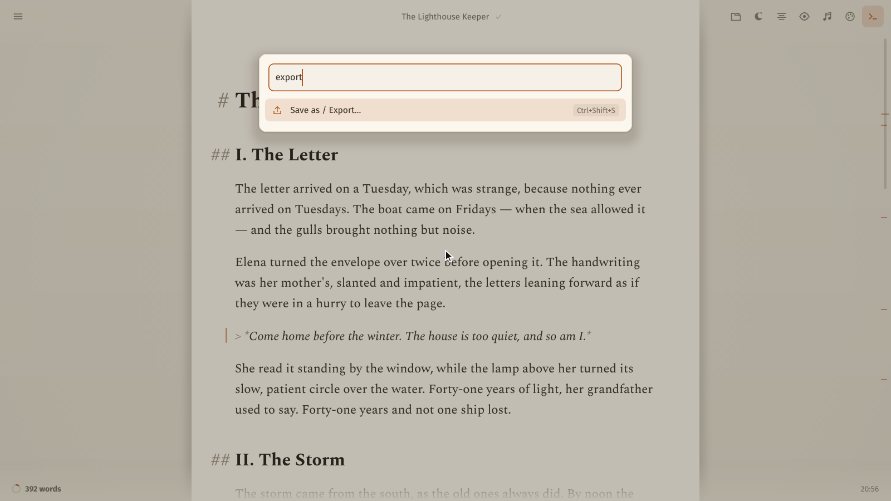

<!-- Generated by tools/readmes.pl from one template; edit the translation there, not here. -->
<div align="center">

# FolioOS

### Uma máquina de escrever sem distrações que arranca diretamente de uma pen USB

**Sem Windows. Sem Linux. Sem internet. Sem notificações. Só você e o texto.**

[**Transferir**](https://github.com/alantaru/FolioOS/releases/latest) · [Traduzir](docs/TRANSLATING.md) · [Contribuir](CONTRIBUTING.md) · [README completo (inglês)](README.md)

<sub>[English](README.md) · [Español](README.es.md) · [Français](README.fr.md) · [Deutsch](README.de.md) · [Italiano](README.it.md) · [Português (Brasil)](README.pt-BR.md) · **Português (Portugal)** · [Nederlands](README.nl.md) · [Polski](README.pl.md) · [Türkçe](README.tr.md) · [Русский](README.ru.md) · [Українська](README.uk.md) · [简体中文](README.zh-CN.md) · [日本語](README.ja.md) · [한국어](README.ko.md)</sub>


</div>

O FolioOS transforma quase qualquer PC ou portátil x86 numa máquina de escrever digital dedicada: ligue a pen, arranque e escreva. Os seus textos ficam em ficheiros Markdown comuns, numa pen FAT32 que abre em qualquer computador.

## Destaques

- **Foco imediato:** arranca em segundos no último documento, exatamente onde parou.
- **Um portátil antigo torna-se ferramenta de escritor:** funciona em PCs UEFI de 64 e 32 bits, sem instalar nada no disco interno.
- **Os seus ficheiros para sempre:** `.md` em FAT32, sem base de dados, sem nuvem.
- **Sem rato, se quiser:** tudo funciona só com o teclado (Tab, setas, Enter, Espaço, Esc, Ctrl+F6), e o rato e o touchpad podem ser desligados em *Definições › Sistema*.
- **Pequeno e auditável:** um binário de ~600 KB em C freestanding, sem libc nem kernel.
- **Universal:** 15 idiomas e 14 teclados, todos em ficheiros de texto que qualquer pessoa pode acrescentar.

Escrita com Markdown ao vivo, modo foco, máquina de escrever, sprints e metas, modo de leitura com deslocamento automático, exportação para **DOCX, ODT, EPUB, HTML, RTF e TXT**, versões automáticas, 20 temas e editor de temas, tipos de letra TrueType até 4K, separadores opcionais e leitor de MP3.

## Visita rápida

| | |
|---|---|
|  **Modo foco (F2):** só o parágrafo atual em destaque. |  **Leitura (Ctrl+P):** o texto paginado como um livro, com deslocamento automático. |
|  **Exportar (Ctrl+Shift+S):** DOCX, ODT, EPUB, HTML, RTF, TXT. |  **Temas (F12):** 20 prontos e um editor para criar os seus. |
|  **Paleta (Ctrl+K):** qualquer comando escrevendo poucas letras. |  **Separadores (opcional):** vários documentos, que voltam após reiniciar. |

A visita completa, com todos os ecrãs, está no [README em inglês](README.md#a-tour-of-folioos).

## Instalar em 3 minutos

1. **Transfira** o `FolioOS.zip` da [versão mais recente](https://github.com/alantaru/FolioOS/releases/latest).
2. **Descompacte na raiz de uma pen FAT32** (até 32 GB quase sempre já é FAT32; o que já estiver na pen é mantido).
3. **Arranque a partir da pen:** menu de arranque (F12 Dell/Lenovo · F9 HP · F8 Asus · Esc/F11) e escolha a opção **UEFI**. Se não aparecer, desative o *Secure Boot*.

A interface segue o idioma do firmware quando existe tradução; mude quando quiser em *Definições › Sistema › Idioma*.

Pens preparadas por versões anteriores continuam a funcionar como antes; nada é mudado de nome nem movido.

## Compilar

Windows 10/11 com o `gcc` do [MinGW-w64](https://winlibs.com) no PATH:

```powershell
.\build.ps1                       # compila UEFI x64 + IA32, o simulador e os pacotes, e corre os testes
.\flash_usb.ps1 -DriveLetter E:   # instala/atualiza uma pen FAT32 sem apagar ficheiros
```

## Licença

Software livre sob a [GNU GPL v3.0](LICENSE). Tipos de letra sob a SIL Open Font License; minimp3 em CC0.

---

<sub>Encontrou um erro nesta tradução? É gerada por `tools/readmes.pl` — as correções são bem-vindas.</sub>
