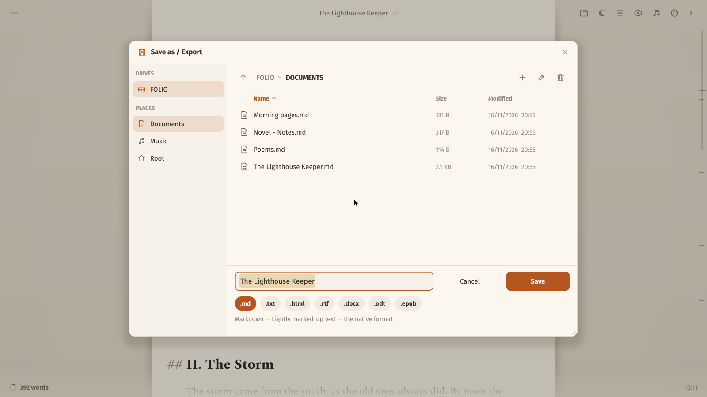

<!-- Generated by tools/readmes.pl from one template; edit the translation there, not here. -->
<div align="center">

# FolioOS

### Пишущая машинка без отвлечений, которая загружается прямо с флешки

**Без Windows. Без Linux. Без интернета. Без уведомлений. Только вы и текст.**

[**Скачать**](https://github.com/alantaru/FolioOS/releases/latest) · [Перевести](docs/TRANSLATING.md) · [Участвовать](CONTRIBUTING.md) · [Полный README (английский)](README.md)

<sub>[English](README.md) · [Español](README.es.md) · [Français](README.fr.md) · [Deutsch](README.de.md) · [Italiano](README.it.md) · [Português (Brasil)](README.pt-BR.md) · [Português (Portugal)](README.pt-PT.md) · [Nederlands](README.nl.md) · [Polski](README.pl.md) · [Türkçe](README.tr.md) · **Русский** · [Українська](README.uk.md) · [简体中文](README.zh-CN.md) · [日本語](README.ja.md) · [한국어](README.ko.md)</sub>


</div>

FolioOS превращает почти любой ПК или ноутбук x86 в машину только для письма: вставьте флешку, загрузитесь и пишите. Тексты хранятся как обычные файлы Markdown на флешке FAT32, которая открывается на любом компьютере.

## Главное

- **Сразу к делу:** загружается за секунды в последний документ, ровно там, где вы остановились.
- **Старый ноутбук становится инструментом писателя:** работает на 64- и 32-битных ПК с UEFI и ничего не устанавливает на внутренний диск.
- **Ваши файлы навсегда:** `.md` на FAT32, без базы данных и без облака.
- **Можно без мыши:** всё работает только с клавиатуры (Tab, стрелки, Enter, Пробел, Esc, Ctrl+F6), а мышь и тачпад можно полностью отключить в *Настройки › Система*.
- **Маленький и проверяемый:** программа ~600 КБ на автономном C, без libc и без ядра.
- **Универсальный:** 15 языков и 14 раскладок — всё в текстовых файлах, которые может дополнить любой.

Markdown в реальном времени, режим фокуса, режим пишущей машинки, спринты и цели, режим чтения с автопрокруткой, экспорт в **DOCX, ODT, EPUB, HTML, RTF и TXT**, автоматические версии, 20 тем и редактор тем, шрифты TrueType вплоть до 4K, необязательные вкладки и MP3-плеер.

## Короткая экскурсия

| | |
|---|---|
|  **Режим фокуса (F2):** выделен только текущий абзац. |  **Чтение (Ctrl+P):** текст свёрстан как книга, с автопрокруткой. |
|  **Экспорт (Ctrl+Shift+S):** DOCX, ODT, EPUB, HTML, RTF, TXT. |  **Темы (F12):** 20 готовых и редактор для своих. |
|  **Палитра команд (Ctrl+K):** любая команда по нескольким буквам. |  **Вкладки (по желанию):** несколько документов, которые возвращаются после перезагрузки. |

Полная экскурсия со всеми экранами — в [README на английском](README.md#a-tour-of-folioos).

## Установка за 3 минуты

1. **Скачайте** `FolioOS.zip` из [последней версии](https://github.com/alantaru/FolioOS/releases/latest).
2. **Распакуйте в корень флешки FAT32** (флешки до 32 ГБ почти всегда уже в FAT32; всё, что на ней было, сохранится).
3. **Загрузитесь с флешки:** меню загрузки (F12 Dell/Lenovo · F9 HP · F8 Asus · Esc/F11), выберите пункт **UEFI**. Если его нет, отключите *Secure Boot*.

Интерфейс следует языку прошивки, если для него есть перевод; сменить язык можно в любой момент в *Настройки › Система › Язык*.

Флешки, подготовленные прежними версиями, работают как раньше; ничего не переименовывается и не перемещается.

## Сборка

Windows 10/11 с `gcc` из [MinGW-w64](https://winlibs.com) в PATH:

```powershell
.\build.ps1                       # собирает UEFI x64 + IA32, симулятор и пакеты и запускает тесты
.\flash_usb.ps1 -DriveLetter E:   # устанавливает/обновляет флешку FAT32, не удаляя файлы
```

## Лицензия

Свободное ПО под [GNU GPL v3.0](LICENSE). Шрифты — под SIL Open Font License; minimp3 — CC0.

---

<sub>Нашли ошибку в этом переводе? Он создаётся `tools/readmes.pl` — исправления приветствуются.</sub>
