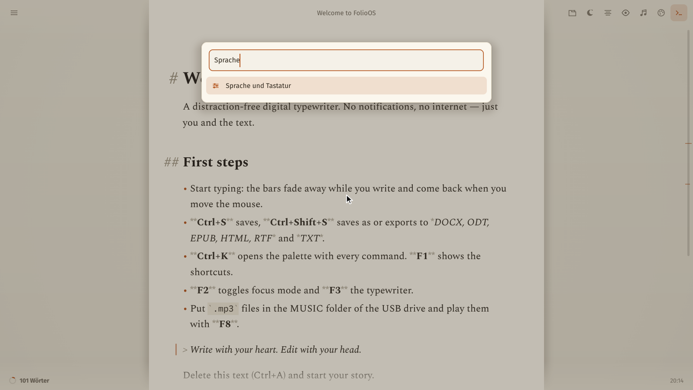

<!-- Generated by tools/readmes.pl from README.md and docs/i18n/README.ru.po — edit the .po, not this file. -->
<div align="center">

<a id="folioos--the-distraction-free-writing-os-that-boots-from-a-usb-stick"></a>

# FolioOS — система для письма без отвлечений, которая загружается с флешки

**Превратите любой старый ноутбук в машину только для письма.**<br>
Без Windows. Без Linux. Без интернета. Без уведомлений. Только вы и текст.

[](https://github.com/alantaru/FolioOS/actions/workflows/build.yml)
[](https://github.com/alantaru/FolioOS/releases/latest)
[](LICENSE)
[](#hardware-compatibility)
[](#13-15-languages-and-counting)
[](docs/TRANSLATING.md)

[**⬇ Скачать**](https://github.com/alantaru/FolioOS/releases/latest) ·
[Установка](#install-in-3-minutes) ·
[Обзор](#a-tour-of-folioos) ·
[Языки](#13-15-languages-and-counting) ·
[Вопросы](#faq) ·
[Сборка](#build-from-source) ·
[Участие](CONTRIBUTING.md)

<!-- languages -->
<sub>[English](README.md) · [Español](README.es.md) · [Français](README.fr.md) · [Deutsch](README.de.md) · [Italiano](README.it.md) · [Português (Brasil)](README.pt-BR.md) · [Português (Portugal)](README.pt-PT.md) · [Nederlands](README.nl.md) · [Polski](README.pl.md) · [Türkçe](README.tr.md) · **Русский** · [Українська](README.uk.md) · [简体中文](README.zh-CN.md) · [日本語](README.ja.md) · [한국어](README.ko.md)</sub>
<!-- /languages -->


</div>

FolioOS — это **загрузочная среда для письма**: крошечная операционная система, которая делает только одно —
даёт вам писать. Вставьте флешку почти в любой ПК последнего десятилетия, загрузитесь с неё, и через
несколько секунд вы окажетесь в полноэкранном, красиво свёрстанном редакторе Markdown — ровно там, где
остановились в прошлый раз. Нет браузера, почты, магазина приложений и Wi-Fi, которые могли бы отвлечь.

Ваши тексты сохраняются как **обычные файлы Markdown на обычной флешке FAT32**, поэтому та же флешка
открывается в Windows, macOS и Linux. Экспортируйте в Word, LibreOffice, EPUB, HTML или RTF, когда нужно
поделиться.

<a id="who-is-it-for"></a>

## Для кого это?

- **Писатели, журналисты, студенты и блогеры**, которым нужен *writerdeck* — отдельное устройство для
  письма без отвлечений — без покупки нового железа.
- **Участники NaNoWriMo** и все, кто пишет на время спринтами или ведёт утренние страницы.
- **Тем, у кого в ящике лежит старый ноутбук**: FolioOS даёт ему вторую жизнь — прямо с флешки или
  установленным на его диск, отдельно или рядом с уже имеющейся системой.
- **Школы и библиотеки**, которым нужно простое рабочее место для письма без сети.
- **Авторы, которые ценят приватность**: никакой сети, телеметрии и облака.

<a id="install-in-3-minutes"></a>

## Установка за 3 минуты

1. **Скачайте** [`FolioOS.zip`](https://github.com/alantaru/FolioOS/releases/latest) из последней версии.
2. **Распакуйте его в корень флешки, отформатированной в FAT32.** Большинство флешек до 32 ГБ уже такие.
   Файлы, которые уже есть на флешке, сохраняются. ([Как отформатировать в FAT32](docs/INSTALL.txt))
3. **Перезагрузите ПК и откройте меню загрузки** — обычно **F12** (Dell, Lenovo), **F9** (HP), **F8** (Asus)
   или **Esc/F11** — и выберите пункт **UEFI** для флешки. Если его нет, отключите *Secure Boot* в
   настройках прошивки.

<details>
<summary><b>Другие способы установки</b></summary>

- **Образ диска:** в `FolioOS-disk-image.zip` лежит готовый образ на 256 МБ для
  [Rufus](https://rufus.ie) (режим DD), [balenaEtcher](https://etcher.balena.io) или `dd`. Но рекомендуется
  всё же распаковать `FolioOS.zip`: остальная часть флешки останется свободной для ваших файлов.
- **Из исходников в Windows:** `.\build.ps1`, затем `.\flash_usb.ps1 -DriveLetter E:` (устанавливает или
  обновляет флешку, ничего не удаляя).
- **ПК без UEFI (только BIOS/Legacy):** один раз запустите в Windows от имени администратора
  `FOLIO\TOOLS\biosboot.exe E:` (`E:` — это флешка). Он записывает только загрузочный код BIOS: ни один файл
  не затрагивается, флешка остаётся обычной FAT32, а загрузка через UEFI продолжает работать. Из исходников:
  `.\flash_usb.ps1 -DriveLetter E: -Bios`.
- **Всё включено:** в `FolioOS.zip` уже есть 11 свободных шрифтов для письма и чтения и шрифты для
  китайского, японского и корейского — любой язык работает сразу.

</details>

> **Попробуйте без перезагрузки:** `folio_sim.exe` запускает тот же код в окне Windows, а `efi_host.exe` —
> настоящий UEFI-файл; см. [Сборка из исходников](#build-from-source).

---

<a id="a-tour-of-folioos"></a>

## Обзор FolioOS

<a id="1-start-up"></a>

### 1. Запуск


FolioOS запускается прямо из прошивки. Заставка видна, пока загружаются шрифты, и любая клавиша её
пропускает — можно сразу начинать печатать. Её длительность (1–60 с) настраивается, или её можно отключить.

При самом первом запуске FolioOS берёт язык из настроек прошивки вашего ПК и открывает короткий
приветственный текст. Потом он всегда открывает **ваш последний документ точно на той строке, где вы
остановились**, — даже если вы были в режиме чтения.

<br clear="right">

<a id="2-the-writing-screen"></a>

### 2. Экран письма


Страница — это всё, что есть. Верхняя и нижняя панели **исчезают, как только вы начинаете печатать**, и
возвращаются, когда вы двигаете мышью. Markdown отображается на лету — заголовки `#`, `**жирный**`,
`*курсив*`, `> цитаты`, списки и задачи `- [ ]`, — а разметка остаётся видимой и редактируемой. Тонкая
полоса справа показывает, где вы находитесь, и отмечает каждую главу.

- **Умная типографика:** `--` превращается в тире, `...` — в многоточие, а прямые кавычки — в правильные
  кавычки *вашего языка* (« » в русском и французском, “ ” в английском, „ “ в немецком, 「 」 в японском).
- **Бумага или весь экран:** пишите на листе бумаги на столе или во весь экран; выбирайте ширину колонки
  (узкая, средняя, широкая, очень широкая).
- Отмена/повтор, переход по словам, перемещение абзацев **Alt+↑/↓**, дублирование и удаление абзацев, смена
  регистра **Shift+F3**, обрамление выделения символами `( " * _` и возврат к последней правке **Ctrl+J**.

<a id="3-focus-mode-and-zen-mode"></a>

### 3. Режим фокуса и режим дзен

<div align="center">


</div>

**F2** приглушает всё, кроме предложения, абзаца или строки, которую вы пишете. **F3** — *режим пишущей
машинки*: текущая строка остаётся посередине экрана. **F11** — *режим дзен*: никаких панелей, пока вы не
коснётесь верхнего края. **Режим Хемингуэя** запрещает удаление, чтобы вы двигались только вперёд.

<a id="4-reading-mode"></a>

### 4. Режим чтения


**Ctrl+P** превращает ваш Markdown в свёрстанную страницу, как в книге. Листайте стрелками, пробелом или
щелчком по полям. Нижняя панель показывает, сколько вы прочитали и сколько осталось до конца главы и всего
текста; **автопрокрутка** двигает текст со скоростью вашего чтения (в словах в минуту): **Enter** или
средняя кнопка мыши запускает её, **+** и **−** меняют скорость. **Esc** возвращает к письму *на тот абзац,
который вы читали*.

<a id="5-chapters-and-outline"></a>

### 5. Главы и оглавление


Каждый заголовок `#` — это глава. **F5** открывает оглавление, чтобы перейти куда угодно;
**Ctrl+PgUp/PgDn** переходит между главами и при письме, и при чтении. По длинным рукописям по-прежнему легко
перемещаться — а экспорт в EPUB превращает эти главы в настоящее оглавление электронной книги.

<br clear="right">

<a id="6-find-and-replace"></a>

### 6. Поиск и замена


**Ctrl+F** подсвечивает все совпадения, считает их и заменяет одно или все.

<a id="7-files-open-save-and-export"></a>

### 7. Файлы: открытие, сохранение и экспорт

<div align="center">


</div>

**Ctrl+O** открывает настоящий файловый менеджер: все диски, которые видит прошивка, папки, создание,
переименование и удаление. **Ctrl+Shift+S** сохраняет под другим именем или **экспортирует в DOCX, ODT,
EPUB, HTML, RTF или TXT** — одним щелчком по формату. Всё остальное происходит автоматически:

- **Автосохранение** (по умолчанию каждые 20 секунд) с **атомарной записью**: отключение питания никогда не
  оставит полфайла.
- **Автоматические версии:** предыдущая копия каждого сохранённого файла попадает в `FOLIO/VERSIONS`
  (хранятся последние 30 для каждого документа).
- **Восстановление черновика** для текста, которому так и не дали имя.

**Исходники LaTeX** (`.tex`, `.bib`, `.sty`, `.cls`) открываются как обычный исходный текст моноширинным
шрифтом, с построчной подсветкой команд, фигурных скобок, комментариев `%` и формул в строке, настоящими
табуляциями и самозакрывающимися `{`, `[` и `$`. Ни оформление Markdown, ни типографские кавычки не
трогают исходник, а файл сохраняет свои концы строк (CRLF остаётся CRLF). FolioOS не компилирует LaTeX:
режим чтения и экспорт — для документов Markdown.

<a id="8-tabs-optional"></a>

### 8. Вкладки (по желанию)


Хотите несколько документов сразу? Включите вкладки первым значком справа вверху. **Ctrl+N** открывает
вкладку, **Ctrl+W** закрывает, **Ctrl+Tab** или **Alt+1…9** переключают. Вкладки — даже безымянные —
возвращаются после перезагрузки. Если их выключить, FolioOS остаётся спокойной пишущей машинкой: один
документ за раз.

<a id="9-goals-sprints-and-statistics"></a>

### 9. Цели, спринты и статистика


**F10** показывает вашу дневную цель по словам, количество слов в этом документе и в этой сессии, время
чтения и темп письма. **F4** запускает **писательский спринт** на время (15–60 минут), который заканчивается
мягким звонком. Слова, написанные сегодня, считаются по всем документам и перезагрузкам.

<br clear="right">

<a id="10-command-palette-and-shortcuts"></a>

### 10. Палитра команд и сочетания клавиш


**Ctrl+K** находит любую команду по нескольким буквам — на вашем языке. **F1** показывает все сочетания клавиш:


<a id="no-mouse-needed"></a>

#### Мышь не нужна

Всё в FolioOS работает только с клавиатуры, а мышь и тачпад можно отключить полностью
(*Настройки › Система › Использовать мышь и тачпад*, **Ctrl+K › Мышь** или `use_mouse=0` в `CONFIG.INI`) —
удобно на ноутбуках, где тачпад сбивает курсор.

| Клавиши | Что делают |
|---|---|
| Сочетание окна (F12, F5, F6, F10, Ctrl+O…) | Открывает его, сразу передавая ему клавиатуру |
| **Tab** / **Shift+Tab**, **↑ ↓** | Переходят между кнопками, переключателями, ползунками и списками окна |
| **Enter** или **Пробел** | Нажимают выделенную кнопку, переключатель или пункт |
| **← →** | Меняют выделенный ползунок, параметр или значение |
| **Esc** | Закрывает окно и возвращает к тексту; если ничего не открыто, показывает скрытые панели |
| **Ctrl+F6** | Переносит клавиатуру между текстом и открытыми окнами |
| **Alt+M** | Меню с недавними документами (также в Ctrl+K) |
| **Alt+F7** / **Alt+F8** | Перемещают / меняют размер окна стрелками (Shift — мелкий шаг); Enter подтверждает, Esc отменяет |

Подсветка показывает, у какого элемента клавиатура; она появляется только когда вы пользуетесь клавишами,
поэтому для тех, кто работает мышью, ничего не меняется. Буквы, набранные в боковом окне (оглавление,
музыка, настройки), сразу уходят обратно в ваш текст.

<a id="11-themes-and-typography"></a>

### 11. Темы и типографика


**F12** открывает настройки оформления: **20 тем, настроенных вручную**, шрифт текста, размер, межстрочный
интервал, интервал между абзацами и абзацный отступ. Текст рисует собственный движок TrueType FolioOS с
настоящим кернингом и сглаживанием — чётко от маленьких экранов нетбуков до 4K.

<div align="center">


</div>


**Создайте свою:** редактор тем позволяет выбрать каждый из 16 цветов (или позаимствовать их у любой
встроенной темы), шрифт для текста и отдельный шрифт для интерфейса и сразу видеть результат. Темы — это
небольшие текстовые файлы `.INI` в `FOLIO/THEMES`, ими легко делиться. Положите любой шрифт `.ttf` в
`FOLIO/FONTS`, чтобы им пользоваться; FolioOS уже содержит Literata, Lora, EB Garamond, iA Writer
Quattro/Duo/Mono, Special Elite и другие.

<br clear="right">

<a id="12-music-while-you-write"></a>

### 12. Музыка во время письма

**F6** открывает маленький MP3-плеер для файлов из папки `MUSIC` на флешке (Intel HD Audio и AC'97).
**F7/F8/F9** управляют им, не покидая страницы.

<a id="13-15-languages-and-counting"></a>

### 13. 15 языков — и это не предел

<div align="center">



</div>

**English, Español, Français, Deutsch, Italiano, Português (Brasil), Português (Portugal), Nederlands,
Polski, Türkçe, Русский, Українська, 简体中文, 日本語, 한국어.**


Ничего, что касается языка, не зашито в код. Каждый перевод — это стандартный **файл `.po` gettext** в
`FOLIO/LANGUAGES`, который также задаёт правила множественного числа, кавычки, формат даты, десятичный
разделитель, раскладку по умолчанию и шрифты, — **добавить язык значит положить файл на флешку**. Раскладки
клавиатуры — тоже текстовые файлы: US, US-International, UK, ABNT2, Португалия, Испания, Латинская Америка,
французская AZERTY, немецкая QWERTZ, итальянская, польская, турецкая Q, русская, украинская, корейская (ввод
хангыля, двухнаборная) и японская (ввод ромадзи → кана).

Хотите FolioOS на своём языке? Прочитайте **[docs/TRANSLATING.md](docs/TRANSLATING.md)** — подойдут Poedit,
Weblate, Crowdin или любой текстовый редактор.

<br clear="right">

<a id="14-your-files-on-any-computer"></a>

### 14. Ваши файлы — на любом компьютере

```
Флешка (FAT32)
├── DOCUMENTS/          ваши файлы .md и .txt, а также экспорт (.docx .odt .epub .html .rtf)
├── MUSIC/              ваши файлы .mp3
├── FOLIO/
│   ├── CONFIG.INI      настройки — обычный текст, можно править вручную
│   ├── FONTS/          шрифты .ttf (добавляйте свои)
│   ├── THEMES/         ваши темы (.INI)
│   ├── LANGUAGES/      переводы (.po)
│   ├── KEYBOARDS/      раскладки клавиатуры (.txt)
│   ├── VERSIONS/       автоматические предыдущие версии сохранённых файлов
│   └── BACKUP/         таблицы разделов, сохранённые установщиком перед любой записью
└── EFI/BOOT/           сам FolioOS (BOOTX64.EFI, BOOTIA32.EFI, BOOTAA64.EFI)
```

Никакой базы данных, скрытого раздела или закрытого формата. Возьмите флешку к любому компьютеру — ваши
тексты на месте.

<a id="15-install-it-on-the-computer-beta"></a>

### 15. Установка на компьютер (бета)

Флешки достаточно, но FolioOS может жить и на диске самого компьютера, чтобы ноутбук сразу загружался в ваш
текст. Откройте **Ctrl+K › Установить FolioOS на этот компьютер** (или *Настройки › Система*):

- **Как единственная система** — на пустой диск или на тот, который вы решили стереть: вы подтверждаете это,
  набрав слово.
- **Рядом с Windows или Linux** — в свободном месте, не трогая другие разделы. При каждом запуске несколько
  секунд показывается *Нажмите любую клавишу, чтобы писать*, затем как обычно запускается другая система;
  Windows запускает сама прошивка, как всегда.
- **Нет свободного места?** FolioOS может уменьшить раздел NTFS, FAT32 или exFAT, не перемещая данных.
  Он отказывается от небезопасного (Windows в гибернации или с быстрым запуском, том, которому нужен `chkdsk`,
  BitLocker без ключа восстановления, LUKS, LVM, тома Apple) и объясняет, что сделать вместо этого.
  Размер ext4 никогда не меняется: освободите место из Linux (GParted) и снова откройте установщик.
- Перед любой записью таблица разделов (первые и последние секторы диска) сохраняется в
  `FOLIO/BACKUP` на флешке.
  Ваши тексты могут храниться на компьютере, на флешке или и там, и там.
- **Обновление** с более новой флешки или **удаление**: сначала тексты копируются на флешку, а другой раздел
  снова увеличивается до прежнего размера.
- *Настройки › Система › Диски и разделы* — небольшой менеджер разделов: создать раздел FAT32, отформатировать,
  уменьшить или увеличить NTFS/FAT32/exFAT, удалить.

Работает на ПК с UEFI и на ПК только с BIOS. **Это бета-версия:** она проходит все тесты на эмулируемых
машинах с дисками, созданными Windows и Linux, но ещё не запускалась на реальном железе — сначала сделайте
резервную копию или используйте запасной диск.

---

<a id="how-folioos-compares"></a>

## FolioOS в сравнении

| | FolioOS | Отдельные устройства (Freewrite, AlphaSmart, Pomera) | Приложения для письма (iA Writer, Scrivener, режимы фокуса) |
|---|:---:|:---:|:---:|
| Цена | **Бесплатно** | Сотни долларов | От бесплатных до платных |
| Железо | Любой ПК с UEFI, который у вас уже есть | Новое устройство | Ваш обычный компьютер |
| Отвлечения под рукой | **Никаких** — ни ОС, ни сети | Никаких | На расстоянии одного Alt+Tab |
| Формат файлов | Обычный Markdown на FAT32 | Собственная синхронизация/экспорт устройства | По-разному |
| Экран и типографика | Большой экран, TrueType, темы | Маленький e-ink или ЖК | Отличные |
| Работает без сети | **Всегда** | Почти всегда | Да |
| Открытый код | **Да (GPL-3.0)** | Нет | Чаще всего нет |

<a id="hardware-compatibility"></a>

## Совместимость с оборудованием

| | |
|---|---|
| **Прошивка** | UEFI 2.x — 64-битная (`BOOTX64.EFI`), 32-битная (`BOOTIA32.EFI`, планшеты и нетбуки на Atom) или ARM64 (`BOOTAA64.EFI`: Raspberry Pi 3/4/5 с UEFI-прошивкой от сообщества, ноутбуки на ARM). **ПК только с BIOS** (Legacy/CSM) загружаются через собственный BIOS-мост FolioOS после однократного запуска `FOLIO\TOOLS\biosboot.exe`. Secure Boot должен быть выключен. |
| **Экран** | Любой фреймбуфер UEFI GOP (RGB, BGR, битовая маска, только Blt) или старый UGA; VESA/VBE на ПК с BIOS. Родное разрешение, автоматическое масштабирование HiDPI, вертикальные экраны поворачиваются автоматически. Когда единственный режим — 4:3, а широкий экран его растягивает, *Настройки › Система › Экран и указатель* сохраняют пропорции (Монитор, 16:9, 16:10 или 4:3). |
| **Ввод** | Клавиатура через прошивку (на ПК с BIOS — напрямую через PS/2). Мышь, тачпад, графический планшет и сенсорный экран через прошивку, а если у прошивки нет для них драйвера — через собственные драйверы USB HID и PS/2 FolioOS. |
| **Звук** | Intel HD Audio и AC'97 (нужны только для музыкального плеера). |
| **Диски (установщик, бета)** | Диски SATA, NVMe, IDE и USB с секторами по 512 байт, GPT или MBR. NTFS, FAT32 и exFAT можно уменьшить и снова увеличить без перемещения данных; размер BitLocker, LUKS, LVM, APFS/HFS+ и ext4 никогда не меняется. |
| **Не поддерживается** | Secure Boot (пока), Mac на Apple Silicon. Wi-Fi и Bluetooth исключены намеренно. |
| **Проверено на** | 20 эмулируемых машин в каждом выпуске: UEFI x64, IA32 и ARM64, а также ПК только с BIOS, загружающиеся с USB и IDE; 8 видеокарт, мыши PS/2 и USB, USB-планшет, HD Audio и AC'97; FolioOS, установленная на диски SATA и IDE, двойная загрузка рядом с Windows (UEFI) и другой системой (BIOS), уменьшение NTFS, созданного Windows, и сохранение пропорций. На каждой проверяются изображение, клавиатура, мышь, звук, сохранение и целостность файловой системы. |

При каждой загрузке FolioOS записывает в `FOLIO/DIAGNOSTICS.TXT`, что он нашёл. Поделитесь своим файлом в
[отчёте об оборудовании](https://github.com/alantaru/FolioOS/issues/new/choose) — даже «просто работает»
помогает другим авторам выбрать ноутбук.

<a id="faq"></a>

## Частые вопросы

<details>
<summary><b>Он сотрёт мой компьютер или флешку?</b></summary>

Нет. При запуске с флешки FolioOS никогда ничего не записывает на внутренний диск, а установка на флешку
только добавляет файлы — то, что там уже было, остаётся. Выньте флешку, и ПК снова загрузит привычную систему.
Диск затрагивается, только если вы сами откроете установщик, и даже тогда ничего не записывается, пока вы
не подтвердите и таблица разделов не будет сохранена на флешку.
</details>

<details>
<summary><b>Можно ли установить её на ноутбук рядом с Windows или Linux?</b></summary>

Да, начиная с 4.4 (бета): **Ctrl+K › Установить FolioOS на этот компьютер**. Она использует свободное место
или уменьшает раздел NTFS, FAT32 или exFAT без перемещения данных, а при каждом запуске вы выбираете FolioOS
или другую систему. При удалении место возвращается. См. [Установка на компьютер](#15-install-it-on-the-computer-beta).
</details>

<details>
<summary><b>Мои тексты в безопасности, если сядет батарея?</b></summary>

Сохранение атомарное (файл записывается целиком, прежде чем заменить старый), автосохранение по умолчанию
срабатывает каждые 20 секунд, у безымянного текста есть черновик для восстановления, а каждый сохранённый
файл хранит предыдущие версии в `FOLIO/VERSIONS`.
</details>

<details>
<summary><b>Можно ли редактировать файлы и на обычном компьютере?</b></summary>

Да. Это обычные файлы `.md` в папке `DOCUMENTS` на флешке FAT32. Открывайте их в Obsidian, Typora, VS Code,
Блокноте, TextEdit или любом редакторе Markdown, а потом вставьте флешку обратно и продолжайте писать в
FolioOS.
</details>

<details>
<summary><b>Можно ли писать на LaTeX?</b></summary>

Да. FolioOS редактирует исходные файлы `.tex`, `.bib`, `.sty` и `.cls` с подсветкой, моноширинным
шрифтом и ровно так, как вы набираете (без типографских кавычек и Markdown). Компилировать их он не
умеет: соберите PDF на компьютере с дистрибутивом TeX или загрузите файлы в онлайн-редактор LaTeX.
</details>

<details>
<summary><b>Почему мой ПК не показывает флешку в меню загрузки?</b></summary>

Проверьте, что флешка в FAT32, что вы выбрали пункт, начинающийся с «UEFI», и что Secure Boot отключён в
настройках прошивки. Старым ПК, которые загружаются только в режиме BIOS/Legacy, один раз нужен загрузочный
код BIOS: запустите в Windows от имени администратора `FOLIO\TOOLS\biosboot.exe E:`, и флешка появится как
обычный USB-диск.
</details>

<details>
<summary><b>Работает ли он на Mac?</b></summary>

Mac на Intel умеют загружаться с UEFI-накопителей (удерживайте <kbd>Option</kbd> при включении), но они ещё
не проверялись — отчёты приветствуются. Mac на Apple Silicon не поддерживаются.
</details>

<details>
<summary><b>Можно ли писать по-китайски, по-японски или по-корейски?</b></summary>

**По-корейски и по-японски — да.** Выберите раскладку *한국어 (두벌식)* или *日本語 (ローマ字かな)* в
*Настройки › Система*: корейская использует стандартную двухнаборную раскладку и собирает слоги по мере
набора (Backspace удаляет по одной чамо); японская превращает ромадзи в хирагану или катакану (`nihongo` →
にほんご). **Ctrl+Пробел** переключает между методом ввода и латинскими буквами. Шрифты входят в FolioOS,
и нужный загружается сам, как только в тексте появятся эти письменности. Преобразование в кандзи и
китайский пиньинь требуют словарей и пока в планах. Латиница, греческий алфавит и кириллица набираются с
помощью встроенных раскладок.
</details>

<details>
<summary><b>Можно ли пользоваться без мыши?</b></summary>

Да. Любое окно, кнопка и настройка доступны с клавиатуры (Tab, стрелки, Enter, Пробел, Esc), а мышь и тачпад
можно полностью отключить в *Настройки › Система*. См. [Мышь не нужна](#no-mouse-needed).
</details>

<details>
<summary><b>Есть ли проверка орфографии, интернет или синхронизация с облаком?</b></summary>

Интернета и синхронизации нет — намеренно: FolioOS задуман для работы без сети. Проверка орфографии есть в
планах. Поскольку файлы — обычный Markdown, вы можете синхронизировать их чем угодно, когда флешка снова
окажется в обычном компьютере.
</details>

<a id="build-from-source"></a>

## Сборка из исходников

Требования: Windows 10/11, PowerShell 5.1+ и `gcc` из [MinGW-w64](https://winlibs.com) (любая свежая сборка
x86_64) в `PATH`. Для версий ARM64 и BIOS нужны также `clang` из [LLVM](https://llvm.org) и `nasm`, а для
аппаратной лаборатории — [QEMU](https://www.qemu.org); все три ставятся через `winget`.

```powershell
git clone https://github.com/alantaru/FolioOS.git
cd FolioOS
.\build.ps1                                  # UEFI x64 + IA32 + ARM64, BIOS, симулятор, пакеты — и набор тестов
.\tools\qemu-lab.ps1                         # запустить настоящие бинарники на 20 эмулируемых машинах и проверить каждую
.\build\folio_sim.exe                        # запустить FolioOS в окне
.\build\efi_host.exe build\efi\BOOTX64.EFI   # запустить настоящий UEFI-файл в окне
.\flash_usb.ps1 -DriveLetter E:              # установить/обновить флешку FAT32, сохранив файлы
.\build.ps1 -Image -ImageMB 256              # по желанию: образ диска для Rufus / Etcher / dd
.\tools\fetch-cjk-fonts.ps1                  # один раз скачать шрифты CJK (build.ps1 делает это сам при необходимости)
.\tools\showcase.ps1                         # заново сделать снимки экрана для этого README
```

Набор тестов управляет симулятором и настоящим `BOOTX64.EFI` (внутри небольшого UEFI-хоста) с помощью
заскриптованных нажатий клавиш и событий мыши, делает снимки экрана и проверяет каждый экспорт (ZIP + XML),
каждый перевод (с отрицательным контролем валидатора), шесть форматов фреймбуфера и драйвер FAT32 из
BIOS-моста (тысячи случайных операций с побайтовой проверкой).
Установщик и менеджер разделов работают на образах дисков, созданных Windows и Linux, а результаты проверяют
`chkdsk` из Windows и `fsck` из Linux (`tools/ntfs-shrink-check.ps1`, `tools/linux-run.ps1`).

<a id="macos-simulator"></a>

### Симулятор для macOS

На Mac симулятор можно собрать и запустить нативно (AppKit, Retina, Cmd в сочетаниях клавиш работает как
Ctrl). Требования: Command Line Tools для Xcode (`xcode-select --install`) — нужен только `clang`, полный
Xcode не требуется.

```bash
./build_macos.sh                             # симулятор, «FolioOS Simulator.app» и папка флешки
./build_macos.sh --test                      # то же самое плюс заскриптованные тесты симулятора (без окна)
./build/macos/folio_sim                      # запустить FolioOS в окне
open "build/macos/FolioOS Simulator.app"     # или открыть пакет приложения
```

Option — это AltGr на Mac, поэтому она продолжает печатать символы (`@ # | [ ] { }` во многих
раскладках): в симуляторе **Option+M** открывает меню (Alt+M), а **Cmd+Option+1…9** переключают вкладки
(Alt+1…9).

Скрипт для macOS собирает только симулятор: бинарники UEFI, пакеты, образы дисков и тесты, запускающие
настоящий `BOOTX64.EFI` внутри `efi_host`, по-прежнему требуют сборки в Windows (`build.ps1`).

<a id="architecture-in-one-picture"></a>

### Архитектура на одной картинке

```
src/core/       переносимое ядро (автономный C, без libc): редактор, Markdown, растеризатор TrueType,
                набор элементов интерфейса и оконный менеджер, экспорт, MP3, i18n, раскладки, темы,
                таблицы разделов, проверка и изменение размера файловых систем, установщик и выбор системы при запуске
src/platform/   uefi/  вывод GOP/UGA, ввод, ввод-вывод FAT, HD Audio/AC'97, драйверы USB HID и PS/2 — поверх прошивки
                bios/  загрузочные секторы + мост BIOS→UEFI (VBE, PS/2, свой драйвер FAT32) для ПК только с BIOS
                win32/ симулятор для разработки и автоматических тестов
                macos/ симулятор для macOS (AppKit), те же заскриптованные тесты
tools/          efi_host (запускает BOOTX64.EFI в Windows), инструмент i18n, сборщик образа диска, showcase
assets/         шрифты, переводы (.po), раскладки клавиатуры, пример темы
tests/          сквозные тесты по сценариям
```

Программа размером ~800 КБ управляет всей машиной через тонкий платформенный слой. Подробности — в
[docs/ARCHITECTURE.md](docs/ARCHITECTURE.md).

<a id="roadmap"></a>

## Планы

FolioOS делится на две редакции с одним и тем же редактором: **FolioOS**, навсегда без интернета, и
**FolioOS Sync** — минимальный Linux с Wi-Fi, который синхронизирует ваши тексты. Полный план — в
[ROADMAP.md](ROADMAP.md).

- [x] ПК только с BIOS (Legacy/CSM) и ARM64 (Raspberry Pi с UEFI-прошивкой, ноутбуки на ARM)
- [x] Корейский ввод (двухнаборный хангыль) и японский ввод каны (ромадзи → хирагана/катакана)
- [x] Установка на диск компьютера — единственной системой или рядом с любой другой — с менеджером разделов (4.4 beta)
- [ ] FolioOS Sync: Wi-Fi и синхронизация с WebDAV, SFTP, Git, Dropbox, Google Drive, OneDrive и Syncthing
- [ ] Преобразование в кандзи (японский) и ввод пиньинем (китайский) (нужны словари)
- [ ] Сложная отрисовка текста и письменности справа налево (арабская, иврит, деванагари…)
- [ ] Проверка орфографии со словарями, совместимыми с Hunspell
- [ ] Поддержка Secure Boot (подписанный shim)
- [ ] Версия симулятора и инструментов для Linux (macOS: готово)

Голосуйте и предлагайте в [Discussions](https://github.com/alantaru/FolioOS/discussions).

<a id="contributing"></a>

## Участие в проекте

Сообщения об ошибках и об оборудовании, переводы, раскладки клавиатуры, темы, шрифты, документация и код —
всё приветствуется; начните с [CONTRIBUTING.md](CONTRIBUTING.md). Соблюдайте
[Кодекс поведения](CODE_OF_CONDUCT.md); о проблемах безопасности сообщайте приватно, как описано в
[SECURITY.md](SECURITY.md).

Если FolioOS помогает вам писать, **⭐ поставьте репозиторию звезду** — так его найдут другие авторы.

<a id="license"></a>

## Лицензия

FolioOS — свободное ПО под [GNU General Public License v3.0](LICENSE). Встроенные шрифты распространяются по
SIL Open Font License; minimp3 — CC0. См. [THIRD_PARTY_NOTICES.md](THIRD_PARTY_NOTICES.md).

<sub>FolioOS · программа для письма без отвлечений · загрузочная среда для письма на флешке · writerdeck ·
самодельная альтернатива Freewrite / AlphaSmart · цифровая пишущая машинка для старых ноутбуков · офлайн
редактор Markdown · приложение для сосредоточенного письма · UEFI-приложение на C · инструмент для романов
и NaNoWriMo.</sub>
