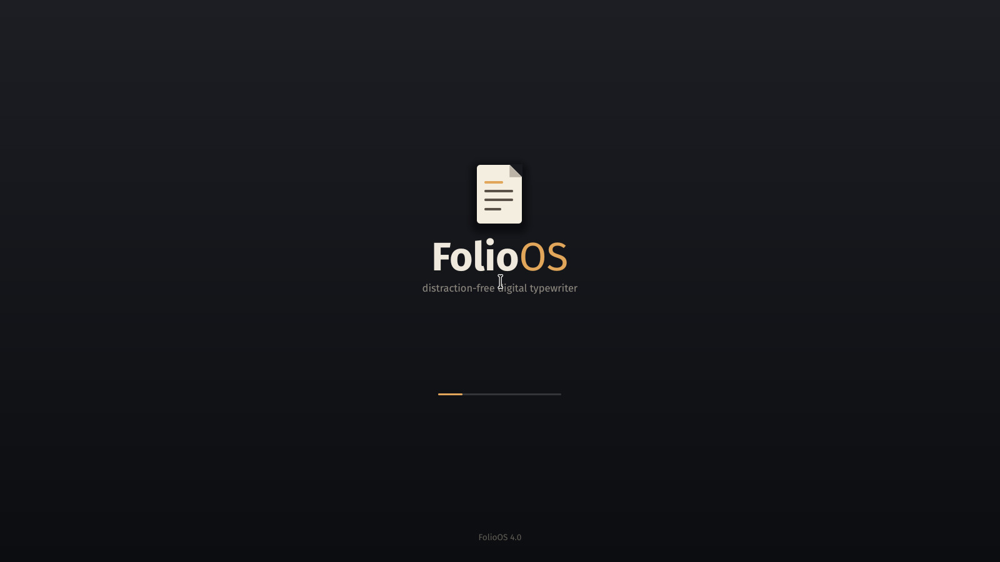
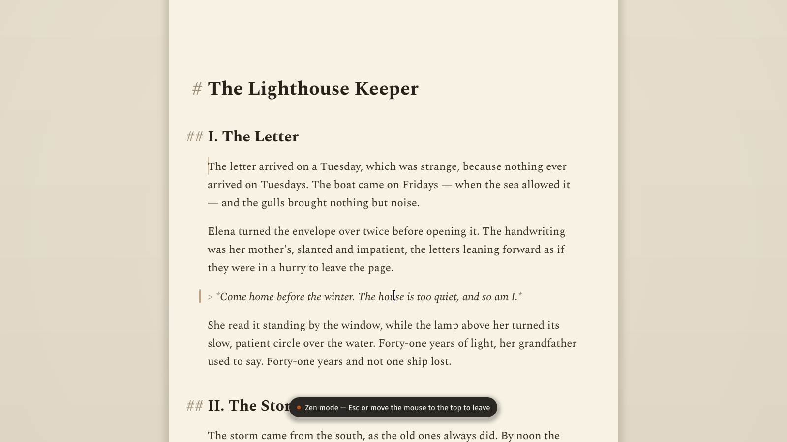
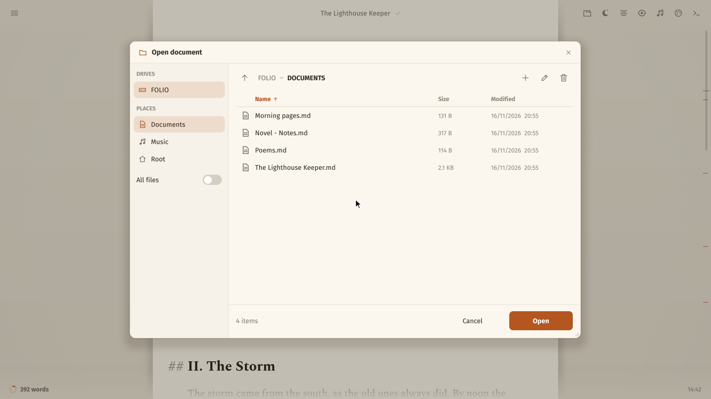

<!-- Generated by tools/readmes.pl from README.md and docs/i18n/README.tr.po — edit the .po, not this file. -->
<div align="center">

<a id="folioos--the-distraction-free-writing-os-that-boots-from-a-usb-stick"></a>

# FolioOS — USB bellekten açılan, dikkat dağıtmayan yazı sistemi

**Herhangi bir eski dizüstüyü yalnızca yazmaya ayrılmış bir makineye dönüştürün.**<br>
Windows yok. Linux yok. İnternet yok. Bildirim yok. Yalnızca siz ve metin.

[](https://github.com/alantaru/FolioOS/actions/workflows/build.yml)
[](https://github.com/alantaru/FolioOS/releases/latest)
[](LICENSE)
[](#hardware-compatibility)
[](#13-15-languages-and-counting)
[](docs/TRANSLATING.md)

[**⬇ İndir**](https://github.com/alantaru/FolioOS/releases/latest) ·
[Kurulum](#install-in-3-minutes) ·
[Tur](#a-tour-of-folioos) ·
[Diller](#13-15-languages-and-counting) ·
[SSS](#faq) ·
[Derleme](#build-from-source) ·
[Katkı](CONTRIBUTING.md)

<!-- languages -->
<sub>[English](README.md) · [Español](README.es.md) · [Français](README.fr.md) · [Deutsch](README.de.md) · [Italiano](README.it.md) · [Português (Brasil)](README.pt-BR.md) · [Português (Portugal)](README.pt-PT.md) · [Nederlands](README.nl.md) · [Polski](README.pl.md) · **Türkçe** · [Русский](README.ru.md) · [Українська](README.uk.md) · [简体中文](README.zh-CN.md) · [日本語](README.ja.md) · [한국어](README.ko.md)</sub>
<!-- /languages -->


</div>

FolioOS, **önyüklenebilir bir yazı ortamıdır**: tek bir iş yapan minicik bir işletim sistemi — yazmanıza
izin vermek. USB belleği son on yılda üretilmiş neredeyse her bilgisayara takın, ondan başlatın; birkaç
saniye içinde tam ekran, özenle dizilmiş bir Markdown düzenleyicisinde, tam da kaldığınız yerde olursunuz.
Sizi metinden uzaklaştıracak tarayıcı, e-posta, uygulama mağazası ya da Wi-Fi yoktur.

Yazdıklarınız **sıradan bir FAT32 USB bellekte düz Markdown dosyaları** olarak kaydedilir; aynı bellek
Windows, macOS ve Linux’ta açılır. Paylaşmanız gerektiğinde Word, LibreOffice, EPUB, HTML veya RTF olarak
dışa aktarın.

<a id="who-is-it-for"></a>

## Kimler için?

- **Romancılar, gazeteciler, öğrenciler ve blog yazarları**: yeni donanım almadan bir *writerdeck* —
  dikkat dağıtmayan, yalnızca yazmaya ayrılmış bir cihaz — isteyenler.
- **NaNoWriMo katılımcıları** ve süreli yazma sprintleri ya da sabah sayfaları yazan herkes.
- **Çekmecesinde eski bir dizüstü olanlar**: FolioOS ona diskine dokunmadan ikinci bir hayat verir.
- **Okullar ve kütüphaneler**: basit, çevrimdışı bir yazı istasyonu arayanlar.
- **Gizliliğe önem veren yazarlar**: ağ yok, telemetri yok, bulut yok.

<a id="install-in-3-minutes"></a>

## 3 dakikada kurulum

1. `FolioOS.zip` dosyasını [son sürümden](https://github.com/alantaru/FolioOS/releases/latest) **indirin**.
2. **FAT32 olarak biçimlendirilmiş bir USB belleğin kök dizinine çıkarın.** 32 GB’a kadar belleklerin çoğu
   zaten öyledir. Bellekteki dosyalar korunur. ([FAT32 olarak nasıl biçimlendirilir](docs/INSTALL.txt))
3. **Bilgisayarı yeniden başlatıp önyükleme menüsünü açın** — genellikle **F12** (Dell, Lenovo), **F9** (HP),
   **F8** (Asus) veya **Esc/F11** — ve belleğin **UEFI** girişini seçin. Görünmüyorsa donanım yazılımı
   ayarlarından *Secure Boot*’u kapatın.

<details>
<summary><b>Diğer kurulum yolları</b></summary>

- **Disk görüntüsü:** `FolioOS-disk-image.zip`, [Rufus](https://rufus.ie) (DD modu),
  [balenaEtcher](https://etcher.balena.io) veya `dd` için hazır 256 MB’lık bir görüntü içerir. Yine de
  `FolioOS.zip` dosyasını çıkarmak önerilir: belleğin geri kalanı dosyalarınıza boş kalır.
- **Windows’ta kaynak koddan:** `.\build.ps1`, ardından `.\flash_usb.ps1 -DriveLetter E:` (hiçbir şey
  silmeden bir belleğe kurar veya günceller).
- **Her şey dahil:** `FolioOS.zip`, yazmak ve okumak için 11 özgür yazı tipini ve Çince, Japonca ve Korece
  yazı tiplerini zaten içerir — her dil hemen çalışır.

</details>

> **Yeniden başlatmadan deneyin:** `folio_sim.exe` aynı kodu bir Windows penceresinde çalıştırır,
> `efi_host.exe` ise gerçek UEFI programını çalıştırır — bkz. [Kaynak koddan derleme](#build-from-source).

---

<a id="a-tour-of-folioos"></a>

## FolioOS turu

<a id="1-start-up"></a>

### 1. Açılış



FolioOS doğrudan donanım yazılımından başlar. Yazı tipleri yüklenirken açılış ekranı görünür ve herhangi
bir tuş onu geçer — hemen yazmaya başlayabilirsiniz. Süresi (1–60 sn) ayarlanabilir ya da tamamen
kapatılabilir.

İlk açılışta FolioOS, bilgisayarınızın donanım yazılımı ayarlarındaki dili izler ve kısa bir karşılama
metni açar. Sonrasında her zaman **son belgenizi tam olarak kaldığınız satırda** açar — okuma modunda
olsanız bile.

<br clear="right">

<a id="2-the-writing-screen"></a>

### 2. Yazı ekranı


Sayfa, var olan her şeydir. Üst ve alt çubuklar **yazmaya başladığınız anda kaybolur** ve fareyi
oynattığınızda geri gelir. Markdown canlı olarak gösterilir — `#` başlıklar, `**kalın**`, `*italik*`,
`> alıntılar`, listeler ve `- [ ]` görevler — işaretler ise görünür ve düzenlenebilir kalır. Sağdaki ince
çubuk nerede olduğunuzu gösterir ve her bölümü işaretler.

- **Akıllı tipografi:** `--` uzun tireye, `...` üç noktaya, düz tırnaklar da *dilinize uygun* kıvrık
  tırnaklara dönüşür (Türkçede ve İngilizcede “ ”, Fransızcada « », Almancada „ “, Japoncada 「 」).
- **Kâğıt veya tam ekran:** masadaki bir kâğıda ya da tüm ekrana yazın; sütun genişliğini seçin (dar, orta,
  geniş, ekstra).
- Geri al/yinele, kelime kelime gezinme, **Alt+↑/↓** ile paragraf taşıma, paragraf çoğaltma veya silme,
  **Shift+F3** ile büyük/küçük harf değiştirme, bir seçimi `( " * _` ile sarma ve **Ctrl+J** ile son
  düzenlemeye dönme.

<a id="3-focus-mode-and-zen-mode"></a>

### 3. Odak modu ve zen modu

<div align="center">


</div>

**F2**, yazdığınız cümle, paragraf veya satır dışındaki her şeyi soldurur. **F3** *daktilo modudur*: geçerli
satır ekranın ortasında kalır. **F11** *zen modudur*: üst kenara dokunana kadar hiç çubuk yoktur.
**Hemingway modu** silmeyi kapatır, böylece hep ileri gidersiniz.

<a id="4-reading-mode"></a>

### 4. Okuma modu


**Ctrl+P**, Markdown’unuzu bir kitap gibi dizilmiş bir sayfaya dönüştürür. Sayfaları ok tuşlarıyla, boşluk
çubuğuyla veya kenar boşluklarına tıklayarak çevirin. Alt çubuk ne kadarını okuduğunuzu ve bölümün ve tüm
metnin ne kadar süreceğini gösterir; **otomatik kaydırma** metni okuma hızınızda (dakikada kelime) ilerletir:
**Enter** veya farenin orta tuşu başlatır, **+** ve **−** hızı değiştirir. **Esc**, *okuduğunuz paragrafta*
yazmaya döner.

<a id="5-chapters-and-outline"></a>

### 5. Bölümler ve ana hat


Her `#` başlığı bir bölümdür. **F5** her yere atlamak için ana hattı açar; **Ctrl+PgUp/PgDn** hem yazarken
hem okurken bölümler arasında geçer. Uzun el yazmalarında gezinmek kolay kalır — EPUB dışa aktarımı da bu
bölümleri gerçek bir e-kitap içindekiler tablosuna dönüştürür.

<br clear="right">

<a id="6-find-and-replace"></a>

### 6. Bul ve değiştir


**Ctrl+F** her eşleşmeyi vurgular, sayar ve birini ya da tümünü değiştirir.

<a id="7-files-open-save-and-export"></a>

### 7. Dosyalar: aç, kaydet ve dışa aktar

<div align="center">


</div>

**Ctrl+O** gerçek bir dosya yöneticisi açar: donanım yazılımının gösterdiği tüm sürücüler, klasörler,
oluşturma, yeniden adlandırma ve silme. **Ctrl+Shift+S** başka bir adla kaydeder ya da **DOCX, ODT, EPUB,
HTML, RTF veya TXT olarak dışa aktarır** — biçime tek tıklama. Gerisi otomatiktir:

- **Otomatik kaydetme** (varsayılan olarak 20 saniyede bir) ve **atomik yazma**: elektrik kesintisi asla
  yarım bir dosya bırakmaz.
- **Otomatik sürümler:** kaydedilen her dosyanın önceki kopyası `FOLIO/VERSIONS` klasörüne gider (her belge
  için son 30 tanesi saklanır).
- **Taslak kurtarma**: hiç ad verilmemiş metinler için.

<a id="8-tabs-optional"></a>

### 8. Sekmeler (isteğe bağlı)


Aynı anda birden çok belge mi istiyorsunuz? Sağ üstteki ilk simgeyle sekmeleri açın. **Ctrl+N** bir sekme
açar, **Ctrl+W** kapatır, **Ctrl+Tab** veya **Alt+1…9** geçiş yapar. Sekmeler — adsız olanlar bile — yeniden
başlattıktan sonra geri gelir. Kapalıyken FolioOS, her seferinde tek belgeyle çalışan sakin bir daktilo
olarak kalır.

<a id="9-goals-sprints-and-statistics"></a>

### 9. Hedefler, sprintler ve istatistikler


**F10** günlük kelime hedefinizi, bu belgedeki ve bu oturumdaki kelimeleri, okuma süresini ve yazma
hızınızı gösterir. **F4**, yumuşak bir zil sesiyle biten süreli bir **yazma sprinti** (15–60 dakika)
başlatır. Bugün yazılan kelimeler belgeler ve yeniden başlatmalar boyunca sayılır.

<br clear="right">

<a id="10-command-palette-and-shortcuts"></a>

### 10. Komut paleti ve kısayollar


**Ctrl+K**, birkaç harf yazarak her komutu bulur — sizin dilinizde. **F1** tüm kısayolları listeler:


<a id="no-mouse-needed"></a>

#### Fareye gerek yok

FolioOS’taki her şey yalnızca klavyeyle çalışır; fare ve dokunmatik yüzey tamamen kapatılabilir
(*Ayarlar › Sistem › Fareyi ve dokunmatik yüzeyi kullan*, **Ctrl+K › Fare** veya `CONFIG.INI` içinde
`use_mouse=0`) — dokunmatik yüzeyi imleci zıplatan dizüstülerde işe yarar.

| Tuşlar | Ne yaparlar |
|---|---|
| Bir pencerenin kısayolu (F12, F5, F6, F10, Ctrl+O…) | Pencereyi klavye içindeyken açar |
| **Tab** / **Shift+Tab**, **↑ ↓** | Bir penceredeki düğmeler, anahtarlar, kaydırıcılar ve listeler arasında gezinir |
| **Enter** veya **Boşluk** | Vurgulanan düğmeye, anahtara veya öğeye basar |
| **← →** | Vurgulanan kaydırıcıyı, seçeneği veya değeri ayarlar |
| **Esc** | Pencereyi kapatıp metne döner; hiçbir şey açık değilse gizli çubukları gösterir |
| **Ctrl+F6** | Klavyeyi metin ile açık pencereler arasında taşır |
| **Alt+M** | Son belgeleri içeren menü (Ctrl+K içinde de) |
| **Alt+F7** / **Alt+F8** | Pencereyi oklarla taşır / boyutlandırır (Shift = küçük adımlar); Enter onaylar, Esc geri alır |

Klavyenin hangi denetimde olduğunu bir vurgu gösterir; yalnızca tuşları kullandığınızda görünür, böylece
fare kullananlar için hiçbir şey değişmez. Bir yan pencerede (ana hat, müzik, ayarlar) yazılan harfler
doğrudan metninize geri gider.

<a id="11-themes-and-typography"></a>

### 11. Temalar ve tipografi


**F12** görünüm ayarlarını açar: **elle ayarlanmış 20 tema**, metin yazı tipi, boyut, satır aralığı,
paragraf aralığı ve ilk satır girintisi. Metin, FolioOS’un kendi TrueType motoru tarafından gerçek kerning
ve kenar yumuşatmayla çizilir — küçük netbook ekranlarından 4K’ya kadar keskin.

<div align="center">


</div>


**Kendinizinkini yapın:** tema düzenleyici 16 rengin her birini seçmenize (ya da yerleşik herhangi bir
temadan ödünç almanıza), metin için bir, arayüz için başka bir yazı tipi seçmenize ve sonucu canlı
görmenize olanak tanır. Temalar `FOLIO/THEMES` içindeki küçük `.INI` metin dosyalarıdır — paylaşması
kolaydır. Kullanmak için herhangi bir `.ttf` yazı tipini `FOLIO/FONTS` klasörüne koyun; FolioOS zaten
Literata, Lora, EB Garamond, iA Writer Quattro/Duo/Mono, Special Elite ve daha fazlasıyla gelir.

<br clear="right">

<a id="12-music-while-you-write"></a>

### 12. Yazarken müzik

**F6**, belleğin `MUSIC` klasöründeki dosyalar için küçük bir MP3 çalar açar (Intel HD Audio ve AC'97).
**F7/F8/F9** onu sayfadan ayrılmadan denetler.

<a id="13-15-languages-and-counting"></a>

### 13. 15 dil ve artıyor

<div align="center">


</div>

**English, Español, Français, Deutsch, Italiano, Português (Brasil), Português (Portugal), Nederlands,
Polski, Türkçe, Русский, Українська, 简体中文, 日本語, 한국어.**


Dille ilgili hiçbir şey koda gömülü değildir. Her çeviri, `FOLIO/LANGUAGES` içinde standart bir **gettext
`.po` dosyasıdır**; çoğul kurallarını, tırnak işaretlerini, tarih biçimini, ondalık ayırıcıyı, varsayılan
klavyeyi ve yazı tiplerini de o tanımlar — **bir dil eklemek, belleğe bir dosya koymaktır**. Klavye
düzenleri de metin dosyalarıdır: US, US-International, UK, ABNT2, Portekiz, İspanya, Latin Amerika, Fransız
AZERTY, Alman QWERTZ, İtalyanca, Lehçe, Türkçe Q, Rusça, Ukraynaca, Korece (2 setli Hangıl girişi) ve
Japonca (romaji → kana girişi).

FolioOS’u kendi dilinizde mi istiyorsunuz? **[docs/TRANSLATING.md](docs/TRANSLATING.md)** belgesini okuyun —
Poedit, Weblate, Crowdin veya herhangi bir metin düzenleyiciyle çalışır.

<br clear="right">

<a id="14-your-files-on-any-computer"></a>

### 14. Dosyalarınız, her bilgisayarda

```
USB bellek (FAT32)
├── DOCUMENTS/          .md ve .txt dosyalarınız ve dışa aktarımlar (.docx .odt .epub .html .rtf)
├── MUSIC/              .mp3 dosyalarınız
├── FOLIO/
│   ├── CONFIG.INI      tercihler — düz metin, elle düzenlenebilir
│   ├── FONTS/          .ttf yazı tipleri (kendinizinkileri ekleyin)
│   ├── THEMES/         temalarınız (.INI)
│   ├── LANGUAGES/      çeviriler (.po)
│   ├── KEYBOARDS/      klavye düzenleri (.txt)
│   └── VERSIONS/       kaydedilen dosyaların otomatik önceki sürümleri
└── EFI/BOOT/           FolioOS’un kendisi (BOOTX64.EFI, BOOTIA32.EFI)
```

Veritabanı yok, gizli bölüm yok, kapalı biçim yok. Belleği herhangi bir bilgisayara götürün; yazdıklarınız
oradadır.

---

<a id="how-folioos-compares"></a>

## FolioOS’un karşılaştırması

| | FolioOS | Özel cihazlar (Freewrite, AlphaSmart, Pomera) | Yazı uygulamaları (iA Writer, Scrivener, odak modları) |
|---|:---:|:---:|:---:|
| Maliyet | **Ücretsiz** | Yüzlerce dolar | Ücretsizden ücretliye |
| Donanım | Zaten sahip olduğunuz herhangi bir UEFI bilgisayar | Yeni bir cihaz | Her zamanki bilgisayarınız |
| Erişilebilir dikkat dağıtıcılar | **Hiç** — işletim sistemi yok, ağ yok | Hiç | Bir Alt+Tab uzağınızda |
| Dosya biçimi | FAT32 üzerinde düz Markdown | Cihaza özgü eşitleme/dışa aktarma | Değişir |
| Ekran ve tipografi | Büyük ekran, TrueType, temalar | Küçük e-mürekkep veya LCD | Mükemmel |
| Çevrimdışı çalışır | **Her zaman** | Çoğunlukla | Evet |
| Açık kaynak | **Evet (GPL-3.0)** | Hayır | Çoğunlukla hayır |

<a id="hardware-compatibility"></a>

## Donanım uyumluluğu

| | |
|---|---|
| **Donanım yazılımı** | UEFI 2.x — 64 bit (`BOOTX64.EFI`) veya 32 bit (`BOOTIA32.EFI`, Atom tabletler ve netbook’lar). Secure Boot kapalı olmalıdır. Yaklaşık 2012 ve sonrasındaki bilgisayar ve dizüstülerin çoğu. |
| **Ekran** | Herhangi bir UEFI GOP framebuffer (RGB, BGR, bit maskesi, yalnızca Blt) veya eski UGA. Doğal çözünürlük, otomatik HiDPI ölçekleme, dikey ekranlar otomatik döndürülür. |
| **Giriş** | Klavye donanım yazılımı üzerinden; USB/PS/2 fare, dokunmatik yüzey ve dokunmatik ekran donanım yazılımının işaretçi protokolleri üzerinden. |
| **Ses** | Intel HD Audio ve AC'97 (yalnızca müzik çalar için gerekir). |
| **Desteklenmeyenler** | Yalnızca BIOS/CSM bilgisayarlar, Secure Boot (şimdilik), Apple Silicon Mac’ler. Wi-Fi ve Bluetooth bilerek dışarıda bırakılmıştır. |

Her açılış, FolioOS’un bulduklarını `FOLIO/DIAGNOSTICS.TXT` dosyasına yazar. Kendinizinkini bir
[donanım raporunda](https://github.com/alantaru/FolioOS/issues/new/choose) paylaşın — "sorunsuz çalışıyor"
bile diğer yazarların dizüstü seçmesine yardımcı olur.

<a id="faq"></a>

## Sık sorulan sorular

<details>
<summary><b>Bilgisayarımı ya da USB belleğimi siler mi?</b></summary>

Hayır. FolioOS dahili diske asla dokunmaz; kurulum belleğe yalnızca dosya ekler — orada olanlar kalır.
Belleği çıkarın, bilgisayar yine her zamanki sistemini başlatır.
</details>

<details>
<summary><b>Pil biterse yazdıklarım güvende mi?</b></summary>

Kaydetmeler atomiktir (dosya, eskisinin yerine geçmeden önce tamamen yazılır), otomatik kaydetme varsayılan
olarak 20 saniyede bir çalışır, adsız metnin bir kurtarma taslağı vardır ve kaydedilen her dosya önceki
sürümlerini `FOLIO/VERSIONS` içinde saklar.
</details>

<details>
<summary><b>Dosyalarımı normal bilgisayarımda da düzenleyebilir miyim?</b></summary>

Evet. Bunlar FAT32 bir bellekte `DOCUMENTS` içindeki düz `.md` dosyalarıdır. Obsidian, Typora, VS Code,
Not Defteri, TextEdit veya herhangi bir Markdown düzenleyicide açın; sonra belleği yeniden takıp FolioOS’ta
yazmaya devam edin.
</details>

<details>
<summary><b>Bilgisayarım USB belleği neden önyükleme menüsünde göstermiyor?</b></summary>

Belleğin FAT32 olduğunu, "UEFI" ile başlayan girişi seçtiğinizi ve donanım yazılımı ayarlarında Secure
Boot’un kapalı olduğunu kontrol edin. Yalnızca BIOS/CSM modunda açılan çok eski bilgisayarlar desteklenmez.
</details>

<details>
<summary><b>Mac’te çalışır mı?</b></summary>

Intel Mac’ler UEFI sürücülerden açılabilir (açılışta <kbd>Option</kbd> tuşunu basılı tutun) ama henüz test
edilmediler — raporlar memnuniyetle karşılanır. Apple Silicon Mac’ler desteklenmez.
</details>

<details>
<summary><b>Çince, Japonca veya Korece yazabilir miyim?</b></summary>

**Korece ve Japonca, evet.** *Ayarlar › Sistem* içinden *한국어 (두벌식)* veya *日本語 (ローマ字かな)*
klavyesini seçin: Korece standart 2 setli düzeni kullanır ve siz yazdıkça heceleri kurar (Backspace her
seferinde bir jamo siler); Japonca, romajiyi hiragana veya katakanaya çevirir (`nihongo` → にほんご).
**Ctrl+Boşluk**, giriş yöntemi ile Latin harfleri arasında geçiş yapar. Yazı tipleri FolioOS ile gelir ve
metin bu yazıları içerdiğinde doğru olan kendiliğinden yüklenir. Kanji dönüşümü ve Çince pinyin sözlük
gerektirir ve hâlâ yol haritasındadır. Latin, Yunan ve Kiril alfabeleri birlikte gelen klavye düzenleriyle
yazılır.
</details>

<details>
<summary><b>Fare olmadan kullanabilir miyim?</b></summary>

Evet. Her pencere, düğme ve ayara klavyeyle ulaşılır (Tab, oklar, Enter, Boşluk, Esc); fareyi ve
dokunmatik yüzeyi *Ayarlar › Sistem* içinden tamamen kapatabilirsiniz. Bkz.
[Fareye gerek yok](#no-mouse-needed).
</details>

<details>
<summary><b>Yazım denetimi, internet veya bulut eşitlemesi var mı?</b></summary>

İnternet ve eşitleme yok, bilerek — FolioOS çevrimdışı olmak için tasarlandı. Yazım denetimi yol
haritasında. Dosyalar düz Markdown olduğundan, bellek normal bir bilgisayara döndüğünde onları istediğiniz
her şeyle eşitleyebilirsiniz.
</details>

<a id="build-from-source"></a>

## Kaynak koddan derleme

Gereksinimler: Windows 10/11, PowerShell 5.1+ ve `PATH` üzerinde [MinGW-w64](https://winlibs.com) `gcc`
(herhangi bir güncel x86_64 sürümü). Başka bir şey gerekmez.

```powershell
git clone https://github.com/alantaru/FolioOS.git
cd FolioOS
.\build.ps1                                  # UEFI x64 + IA32, simülatör, paketler — ve tüm testler
.\build\folio_sim.exe                        # FolioOS’u bir pencerede çalıştırır
.\build\efi_host.exe build\efi\BOOTX64.EFI   # gerçek UEFI programını bir pencerede çalıştırır
.\flash_usb.ps1 -DriveLetter E:              # FAT32 belleğe kurar/günceller, dosyalar korunur
.\build.ps1 -Image -ImageMB 256              # isteğe bağlı: Rufus / Etcher / dd için disk görüntüsü
.\tools\fetch-cjk-fonts.ps1                  # CJK yazı tiplerini bir kez indirir (build.ps1 gerektiğinde çalıştırır)
.\tools\showcase.ps1                         # bu README’deki ekran görüntülerini yeniden üretir
```

Test paketi, simülatörü ve gerçek `BOOTX64.EFI` dosyasını (küçük bir UEFI barındırıcısı içinde) betikli
tuş vuruşları ve fare olaylarıyla yönetir, ekran görüntüleri alır, her dışa aktarımı (ZIP + XML), her
çeviriyi (doğrulayıcı için negatif bir denetimle) ve altı framebuffer biçimini doğrular.

<a id="architecture-in-one-picture"></a>

### Tek resimde mimari

```
src/core/       taşınabilir çekirdek (freestanding C, libc yok): düzenleyici, Markdown, TrueType taramacı,
                arayüz araç takımı ve pencere yöneticisi, dışa aktarma, MP3, i18n, klavyeler, temalar
src/platform/   uefi/  GOP/UGA görüntü, giriş, FAT G/Ç, HD Audio/AC'97 — doğrudan donanım yazılımı üzerinde
                win32/ geliştirme ve otomatik testler için simülatör
tools/          efi_host (BOOTX64.EFI’yi Windows’ta çalıştırır), i18n aracı, disk görüntüsü oluşturucu, showcase
assets/         yazı tipleri, çeviriler (.po), klavye düzenleri, örnek tema
tests/          betikli uçtan uca testler
```

~600 KB’lık bir program, ince bir platform katmanı aracılığıyla tüm makineyi yönetir. Ayrıntılar
[docs/ARCHITECTURE.md](docs/ARCHITECTURE.md) belgesinde.

<a id="roadmap"></a>

## Yol haritası

- [x] Korece giriş (2 setli Hangıl) ve Japonca kana girişi (romaji → hiragana/katakana)
- [ ] Japonca kanji dönüşümü ve Çince pinyin girişi (sözlük gerektirir)
- [ ] Metin biçimlendirme ve sağdan sola yazılar (Arapça, İbranice, Devanagari…)
- [ ] Hunspell uyumlu sözlüklerle yazım denetimi
- [ ] Secure Boot desteği (imzalı shim)
- [ ] Simülatör ve araçların Linux ve macOS sürümleri

[Discussions](https://github.com/alantaru/FolioOS/discussions) bölümünde oy verin ve öneride bulunun.

<a id="contributing"></a>

## Katkıda bulunma

Hata raporları, donanım raporları, çeviriler, klavye düzenleri, temalar, yazı tipleri, belgeler ve kod —
hepsi memnuniyetle karşılanır; [CONTRIBUTING.md](CONTRIBUTING.md) ile başlayın. Lütfen
[Davranış Kuralları](CODE_OF_CONDUCT.md)’na uyun; güvenlik sorunlarını [SECURITY.md](SECURITY.md) içinde
anlatıldığı gibi gizlice bildirin.

FolioOS yazmanıza yardım ediyorsa **⭐ depoya yıldız verin** — diğer yazarların onu bulmasına yardımcı olur.

<a id="license"></a>

## Lisans

FolioOS, [GNU General Public License v3.0](LICENSE) altında özgür yazılımdır. Birlikte gelen yazı tipleri SIL
Open Font License, minimp3 ise CC0 kapsamındadır. Bkz. [THIRD_PARTY_NOTICES.md](THIRD_PARTY_NOTICES.md).

<sub>FolioOS · dikkat dağıtmayan yazı yazılımı · önyüklenebilir USB yazı ortamı · writerdeck · Freewrite /
AlphaSmart’a kendin yap alternatifi · eski dizüstüler için dijital daktilo · çevrimdışı Markdown
düzenleyici · odaklı yazma uygulaması · C ile yazılmış UEFI uygulaması · roman ve NaNoWriMo yazma
aracı.</sub>
