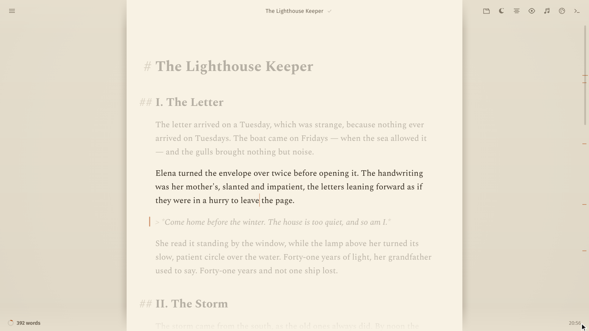
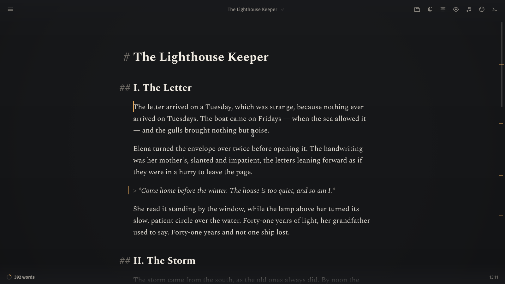
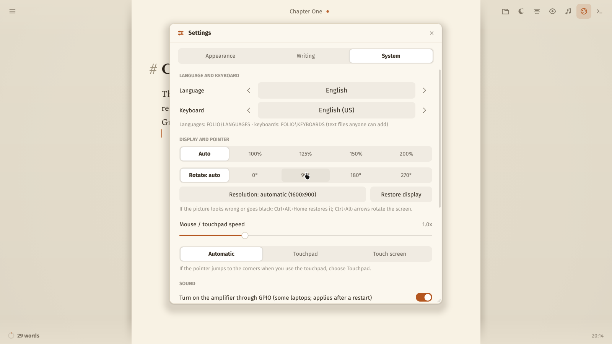

<!-- Generated by tools/readmes.pl from README.md and docs/i18n/README.uk.po — edit the .po, not this file. -->
<div align="center">

<a id="folioos--the-distraction-free-writing-os-that-boots-from-a-usb-stick"></a>

# FolioOS — система для письма без відволікань, що завантажується з флешки

**Перетворіть будь-який старий ноутбук на машину лише для письма.**<br>
Без Windows. Без Linux. Без інтернету. Без сповіщень. Лише ви і текст.

[](https://github.com/alantaru/FolioOS/actions/workflows/build.yml)
[](https://github.com/alantaru/FolioOS/releases/latest)
[](LICENSE)
[](#hardware-compatibility)
[](#13-15-languages-and-counting)
[](docs/TRANSLATING.md)

[**⬇ Завантажити**](https://github.com/alantaru/FolioOS/releases/latest) ·
[Встановлення](#install-in-3-minutes) ·
[Огляд](#a-tour-of-folioos) ·
[Мови](#13-15-languages-and-counting) ·
[Питання](#faq) ·
[Збирання](#build-from-source) ·
[Долучитися](CONTRIBUTING.md)

<!-- languages -->
<sub>[English](README.md) · [Español](README.es.md) · [Français](README.fr.md) · [Deutsch](README.de.md) · [Italiano](README.it.md) · [Português (Brasil)](README.pt-BR.md) · [Português (Portugal)](README.pt-PT.md) · [Nederlands](README.nl.md) · [Polski](README.pl.md) · [Türkçe](README.tr.md) · [Русский](README.ru.md) · **Українська** · [简体中文](README.zh-CN.md) · [日本語](README.ja.md) · [한국어](README.ko.md)</sub>
<!-- /languages -->


</div>

FolioOS — це **завантажувальне середовище для письма**: крихітна операційна система, яка робить лише одне —
дає вам писати. Вставте флешку майже в будь-який ПК останнього десятиліття, завантажтеся з неї, і за кілька
секунд ви опинитеся в повноекранному, гарно зверстаному редакторі Markdown — саме там, де зупинилися
минулого разу. Немає браузера, пошти, крамниці застосунків чи Wi-Fi, які б вас відволікали.

Ваші тексти зберігаються як **звичайні файли Markdown на звичайній флешці FAT32**, тож та сама флешка
відкривається у Windows, macOS і Linux. Експортуйте у Word, LibreOffice, EPUB, HTML або RTF, коли треба
поділитися.

<a id="who-is-it-for"></a>

## Для кого це?

- **Письменники, журналісти, студенти й блогери**, яким потрібен *writerdeck* — окремий пристрій для письма
  без відволікань — без купівлі нового обладнання.
- **Учасники NaNoWriMo** і всі, хто пише спринтами на час або веде ранкові сторінки.
- **Тим, у кого в шухляді лежить старий ноутбук**: FolioOS дає йому друге життя — просто з флешки або
  встановленим на його диск, окремо чи поряд із системою, яка вже є.
- **Школи й бібліотеки**, яким потрібне просте робоче місце для письма без мережі.
- **Автори, що цінують приватність**: жодної мережі, телеметрії чи хмари.

<a id="install-in-3-minutes"></a>

## Встановлення за 3 хвилини

1. **Завантажте** [`FolioOS.zip`](https://github.com/alantaru/FolioOS/releases/latest) з останньої версії.
2. **Розпакуйте його в корінь флешки, відформатованої у FAT32.** Більшість флешок до 32 ГБ уже такі.
   Файли, які вже є на флешці, зберігаються. ([Як відформатувати у FAT32](docs/INSTALL.txt))
3. **Перезавантажте ПК і відкрийте меню завантаження** — зазвичай **F12** (Dell, Lenovo), **F9** (HP), **F8**
   (Asus) або **Esc/F11** — і виберіть пункт **UEFI** для флешки. Якщо його немає, вимкніть *Secure Boot* у
   налаштуваннях мікропрограми.

<details>
<summary><b>Інші способи встановлення</b></summary>

- **Образ диска:** у `FolioOS-disk-image.zip` є готовий образ на 256 МБ для [Rufus](https://rufus.ie)
  (режим DD), [balenaEtcher](https://etcher.balena.io) або `dd`. Але краще все ж розпакувати `FolioOS.zip`:
  решта флешки залишиться вільною для ваших файлів.
- **З вихідного коду у Windows:** `.\build.ps1`, потім `.\flash_usb.ps1 -DriveLetter E:` (встановлює або
  оновлює флешку, нічого не видаляючи).
- **ПК без UEFI (лише BIOS/Legacy):** один раз запустіть у Windows від імені адміністратора
  `FOLIO\TOOLS\biosboot.exe E:` (`E:` — це флешка). Він записує лише завантажувальний код BIOS: жоден файл не
  змінюється, флешка лишається звичайною FAT32, а завантаження через UEFI працює й далі. З вихідного коду:
  `.\flash_usb.ps1 -DriveLetter E: -Bios`.
- **Усе включено:** у `FolioOS.zip` уже є 11 вільних шрифтів для письма й читання та шрифти для китайської,
  японської й корейської — будь-яка мова працює одразу.

</details>

> **Спробуйте без перезавантаження:** `folio_sim.exe` запускає той самий код у вікні Windows, а
> `efi_host.exe` — справжній UEFI-файл; див. [Збирання з вихідного коду](#build-from-source).

---

<a id="a-tour-of-folioos"></a>

## Огляд FolioOS

<a id="1-start-up"></a>

### 1. Запуск


FolioOS запускається просто з мікропрограми. Заставку видно, поки завантажуються шрифти, і будь-яка клавіша
її пропускає — можна одразу починати друкувати. Її тривалість (1–60 с) налаштовується, або її можна
вимкнути.

Під час найпершого запуску FolioOS бере мову з налаштувань мікропрограми вашого ПК і відкриває короткий
привітальний текст. Далі він завжди відкриває **ваш останній документ саме на тому рядку, де ви
зупинилися**, — навіть якщо ви були в режимі читання.

<br clear="right">

<a id="2-the-writing-screen"></a>

### 2. Екран письма


Сторінка — це все, що є. Верхня й нижня панелі **зникають, щойно ви починаєте друкувати**, і повертаються,
коли ви рухаєте мишею. Markdown відображається наживо — заголовки `#`, `**жирний**`, `*курсив*`, `> цитати`,
списки й завдання `- [ ]`, — а розмітка лишається видимою й редагованою. Тонка смуга праворуч показує, де ви
є, і позначає кожен розділ.

- **Розумна типографіка:** `--` стає тире, `...` — трикрапкою, а прямі лапки — правильними лапками *вашої
  мови* (« » в українській і французькій, “ ” в англійській, „ “ в німецькій, 「 」 в японській).
- **Папір або весь екран:** пишіть на аркуші паперу на столі або на весь екран; вибирайте ширину колонки
  (вузька, середня, широка, дуже широка).
- Скасування/повтор, перехід по словах, переміщення абзаців **Alt+↑/↓**, дублювання й видалення абзаців,
  зміна регістру **Shift+F3**, обрамлення виділення символами `( " * _` і повернення до останньої правки
  **Ctrl+J**.

<a id="3-focus-mode-and-zen-mode"></a>

### 3. Режим фокусу й режим дзен

<div align="center">


</div>

**F2** приглушує все, крім речення, абзацу чи рядка, який ви пишете. **F3** — *режим друкарської машинки*:
поточний рядок лишається посередині екрана. **F11** — *режим дзен*: жодних панелей, доки ви не торкнетеся
верхнього краю. **Режим Гемінґвея** забороняє видалення, щоб ви рухалися лише вперед.

<a id="4-reading-mode"></a>

### 4. Режим читання


**Ctrl+P** перетворює ваш Markdown на зверстану сторінку, як у книжці. Гортайте стрілками, пробілом або
клацанням по полях. Нижня панель показує, скільки ви прочитали і скільки лишилося до кінця розділу й
усього тексту; **автопрокручування** рухає текст зі швидкістю вашого читання (у словах на хвилину): **Enter**
або середня кнопка миші запускає його, **+** і **−** змінюють швидкість. **Esc** повертає до письма *на той
абзац, який ви читали*.

<a id="5-chapters-and-outline"></a>

### 5. Розділи й зміст


Кожен заголовок `#` — це розділ. **F5** відкриває зміст, щоб перейти будь-куди; **Ctrl+PgUp/PgDn** переходить
між розділами і під час письма, і під час читання. Довгими рукописами так само легко пересуватися — а
експорт в EPUB перетворює ці розділи на справжній зміст електронної книжки.

<br clear="right">

<a id="6-find-and-replace"></a>

### 6. Пошук і заміна


**Ctrl+F** підсвічує всі збіги, рахує їх і замінює один або всі.

<a id="7-files-open-save-and-export"></a>

### 7. Файли: відкриття, збереження й експорт

<div align="center">


</div>

**Ctrl+O** відкриває справжній файловий менеджер: усі диски, які бачить мікропрограма, теки, створення,
перейменування й видалення. **Ctrl+Shift+S** зберігає під іншою назвою або **експортує в DOCX, ODT, EPUB,
HTML, RTF чи TXT** — одним клацанням по формату. Усе інше відбувається автоматично:

- **Автозбереження** (типово кожні 20 секунд) з **атомарним записом**: вимкнення живлення ніколи не залишить
  пів файла.
- **Автоматичні версії:** попередня копія кожного збереженого файла потрапляє до `FOLIO/VERSIONS`
  (зберігаються останні 30 для кожного документа).
- **Відновлення чернетки** для тексту, якому так і не дали назву.

**Сирці LaTeX** (`.tex`, `.bib`, `.sty`, `.cls`) відкриваються як звичайний вихідний текст моноширинним
шрифтом, із порядковим підсвічуванням команд, фігурних дужок, коментарів `%` і формул у рядку, справжніми
табуляціями та самозакривними `{`, `[` і `$`. Ні оформлення Markdown, ні типографські лапки не змінюють
вихідний текст, а файл зберігає свої кінці рядків (CRLF лишається CRLF). FolioOS не компілює LaTeX:
режим читання й експорт — для документів Markdown.

<a id="8-tabs-optional"></a>

### 8. Вкладки (за бажанням)


Хочете кілька документів одночасно? Увімкніть вкладки першим значком праворуч угорі. **Ctrl+N** відкриває
вкладку, **Ctrl+W** закриває, **Ctrl+Tab** або **Alt+1…9** перемикають. Вкладки — навіть без назви —
повертаються після перезавантаження. Якщо їх вимкнути, FolioOS лишається спокійною друкарською машинкою:
один документ за раз.

<a id="9-goals-sprints-and-statistics"></a>

### 9. Цілі, спринти й статистика


**F10** показує вашу денну мету за словами, кількість слів у цьому документі й у цій сесії, час читання й
темп письма. **F4** запускає **письменницький спринт** на час (15–60 хвилин), який закінчується м’яким
дзвоником. Слова, написані сьогодні, рахуються в усіх документах і після перезавантажень.

<br clear="right">

<a id="10-command-palette-and-shortcuts"></a>

### 10. Палітра команд і сполучення клавіш


**Ctrl+K** знаходить будь-яку команду за кількома літерами — вашою мовою. **F1** показує всі сполучення клавіш:


<a id="no-mouse-needed"></a>

#### Миша не потрібна

Усе у FolioOS працює лише з клавіатури, а мишу й тачпад можна повністю вимкнути
(*Налаштування › Система › Використовувати мишу й тачпад*, **Ctrl+K › Миша** або `use_mouse=0` у
`CONFIG.INI`) — зручно на ноутбуках, де тачпад збиває курсор.

| Клавіші | Що роблять |
|---|---|
| Сполучення вікна (F12, F5, F6, F10, Ctrl+O…) | Відкриває його, одразу передаючи йому клавіатуру |
| **Tab** / **Shift+Tab**, **↑ ↓** | Переходять між кнопками, перемикачами, повзунками й списками вікна |
| **Enter** або **Пробіл** | Натискають виділену кнопку, перемикач чи пункт |
| **← →** | Змінюють виділений повзунок, параметр чи значення |
| **Esc** | Закриває вікно й повертає до тексту; якщо нічого не відкрито, показує приховані панелі |
| **Ctrl+F6** | Переносить клавіатуру між текстом і відкритими вікнами |
| **Alt+M** | Меню з нещодавніми документами (також у Ctrl+K) |
| **Alt+F7** / **Alt+F8** | Переміщують / змінюють розмір вікна стрілками (Shift — дрібний крок); Enter підтверджує, Esc скасовує |

Підсвічування показує, в якого елемента клавіатура; воно з’являється лише тоді, коли ви користуєтеся
клавішами, тож для тих, хто працює мишею, нічого не змінюється. Літери, набрані в бічному вікні (зміст,
музика, налаштування), одразу повертаються у ваш текст.

<a id="11-themes-and-typography"></a>

### 11. Теми й типографіка


**F12** відкриває налаштування вигляду: **20 тем, налаштованих уручну**, шрифт тексту, розмір, міжрядковий
інтервал, інтервал між абзацами й абзацний відступ. Текст малює власний рушій TrueType FolioOS зі
справжнім кернінгом і згладжуванням — чітко від маленьких екранів нетбуків до 4K.

<div align="center">



</div>


**Створіть свою:** редактор тем дає змогу вибрати кожен із 16 кольорів (або позичити їх у будь-якої
вбудованої теми), шрифт для тексту й окремий шрифт для інтерфейсу та одразу бачити результат. Теми — це
невеликі текстові файли `.INI` у `FOLIO/THEMES`, ними легко ділитися. Покладіть будь-який шрифт `.ttf` у
`FOLIO/FONTS`, щоб ним користуватися; FolioOS уже містить Literata, Lora, EB Garamond, iA Writer
Quattro/Duo/Mono, Special Elite та інші.

<br clear="right">

<a id="12-music-while-you-write"></a>

### 12. Музика під час письма

**F6** відкриває маленький MP3-програвач для файлів із теки `MUSIC` на флешці (Intel HD Audio і AC'97).
**F7/F8/F9** керують ним, не залишаючи сторінки.

<a id="13-15-languages-and-counting"></a>

### 13. 15 мов — і це не межа

<div align="center">


</div>

**English, Español, Français, Deutsch, Italiano, Português (Brasil), Português (Portugal), Nederlands,
Polski, Türkçe, Русский, Українська, 简体中文, 日本語, 한국어.**



Нічого, що стосується мови, не вшито в код. Кожен переклад — це стандартний **файл `.po` gettext** у
`FOLIO/LANGUAGES`, який також задає правила множини, лапки, формат дати, десятковий роздільник, типову
розкладку й шрифти, — **додати мову означає покласти файл на флешку**. Розкладки клавіатури — теж текстові
файли: US, US-International, UK, ABNT2, Португалія, Іспанія, Латинська Америка, французька AZERTY, німецька
QWERTZ, італійська, польська, турецька Q, російська, українська, корейська (введення хангиля, двонаборна) і
японська (введення ромадзі → кана).

Хочете FolioOS своєю мовою? Прочитайте **[docs/TRANSLATING.md](docs/TRANSLATING.md)** — підійдуть Poedit,
Weblate, Crowdin або будь-який текстовий редактор.

<br clear="right">

<a id="14-your-files-on-any-computer"></a>

### 14. Ваші файли — на будь-якому комп’ютері

```
Флешка (FAT32)
├── DOCUMENTS/          ваші файли .md і .txt, а також експорт (.docx .odt .epub .html .rtf)
├── MUSIC/              ваші файли .mp3
├── FOLIO/
│   ├── CONFIG.INI      налаштування — звичайний текст, можна редагувати вручну
│   ├── FONTS/          шрифти .ttf (додавайте свої)
│   ├── THEMES/         ваші теми (.INI)
│   ├── LANGUAGES/      переклади (.po)
│   ├── KEYBOARDS/      розкладки клавіатури (.txt)
│   ├── VERSIONS/       автоматичні попередні версії збережених файлів
│   └── BACKUP/         таблиці розділів, які встановлювач зберігає перед будь-яким записом
└── EFI/BOOT/           сам FolioOS (BOOTX64.EFI, BOOTIA32.EFI, BOOTAA64.EFI)
```

Жодної бази даних, прихованого розділу чи закритого формату. Візьміть флешку до будь-якого комп’ютера —
ваші тексти на місці.

<a id="15-install-it-on-the-computer-beta"></a>

### 15. Встановлення на комп’ютер (бета)

Флешки досить, але FolioOS може жити й на диску самого комп’ютера, щоб ноутбук одразу запускався у ваш
текст. Відкрийте **Ctrl+K › Встановити FolioOS на цей комп’ютер** (або *Налаштування › Система*):

- **Як єдина система** — на порожній диск або на той, який ви вирішили стерти: ви підтверджуєте це, набравши
  слово.
- **Поряд із Windows або Linux** — у вільному місці, не торкаючись інших розділів. Під час кожного запуску кілька
  секунд показується *Натисніть будь-яку клавішу, щоб писати*, потім як завжди запускається інша система;
  Windows запускає сама прошивка, як завжди.
- **Немає вільного місця?** FolioOS може зменшити розділ NTFS, FAT32 або exFAT, не переміщуючи даних.
  Він відмовляється від небезпечного (Windows у режимі глибокого сну або зі швидким запуском, том, якому
  потрібен `chkdsk`, BitLocker без ключа відновлення, LUKS, LVM, томи Apple) і пояснює, що зробити натомість.
  Розмір ext4 ніколи не змінюється: звільніть місце з Linux (GParted) і знову відкрийте встановлювач.
- Перед будь-яким записом таблиця розділів (перші та останні сектори диска) зберігається в
  `FOLIO/BACKUP` на тому носії, з якого запущено FolioOS, — зазвичай на флешці.
  Ваші тексти можуть зберігатися на комп’ютері, на флешці або і там, і там.
- **Оновлення** з новішої флешки: замінюються лише файли самої FolioOS; ваші тексти й розділи залишаються
  як є.
- **Видалення**: спочатку можна скопіювати тексти на носій, з якого запущено FolioOS. Якщо встановлювач
  зменшував розділ, щоб звільнити місце, цей розділ знову збільшується до попереднього розміру, якщо місце
  після нього досі вільне; інакше місце стає вільним. Якщо цей розділ треба збільшити, а Windows у режимі
  гібернації (або використовує швидкий запуск), FolioOS попросить спершу повністю її вимкнути й нічого не змінить.
- *Налаштування › Система › Диски й розділи* — невеликий менеджер розділів: створити розділ FAT32,
  відформатувати, зменшити або збільшити NTFS/FAT32/exFAT, видалити.
- 4.4 beta — попередня версія: завантажте її
  [зі сторінки релізу](https://github.com/alantaru/FolioOS/releases/tag/v4.4.1-beta), а не через «latest».

Працює на ПК з UEFI та на ПК лише з BIOS. **Це бета-версія:** вона проходить усі тести на емульованих
машинах із дисками, створеними Windows і Linux, але ще не запускалася на справжньому обладнанні — спершу
зробіть резервну копію або скористайтеся запасним диском.

---

<a id="how-folioos-compares"></a>

## FolioOS у порівнянні

| | FolioOS | Окремі пристрої (Freewrite, AlphaSmart, Pomera) | Застосунки для письма (iA Writer, Scrivener, режими фокусу) |
|---|:---:|:---:|:---:|
| Ціна | **Безкоштовно** | Сотні доларів | Від безкоштовних до платних |
| Обладнання | Будь-який ПК з UEFI, який у вас уже є | Новий пристрій | Ваш звичайний комп’ютер |
| Відволікання під рукою | **Жодних** — ні ОС, ні мережі | Жодних | На відстані одного Alt+Tab |
| Формат файлів | Звичайний Markdown на FAT32 | Власна синхронізація/експорт пристрою | По-різному |
| Екран і типографіка | Великий екран, TrueType, теми | Маленький e-ink або РК | Чудові |
| Працює без мережі | **Завжди** | Майже завжди | Так |
| Відкритий код | **Так (GPL-3.0)** | Ні | Здебільшого ні |

<a id="hardware-compatibility"></a>

## Сумісність з обладнанням

| | |
|---|---|
| **Мікропрограма** | UEFI 2.x — 64-бітна (`BOOTX64.EFI`), 32-бітна (`BOOTIA32.EFI`, планшети й нетбуки на Atom) або ARM64 (`BOOTAA64.EFI`: Raspberry Pi 3/4/5 з UEFI-мікропрограмою від спільноти, ноутбуки на ARM). **ПК лише з BIOS** (Legacy/CSM) завантажуються через власний BIOS-міст FolioOS після одноразового запуску `FOLIO\TOOLS\biosboot.exe`. Secure Boot має бути вимкнено. |
| **Екран** | Будь-який фреймбуфер UEFI GOP (RGB, BGR, бітова маска, лише Blt) або старий UGA; VESA/VBE на ПК з BIOS. Рідна роздільна здатність, автоматичне масштабування HiDPI, вертикальні екрани повертаються автоматично. Коли єдиний режим — 4:3, а широкий екран його розтягує, *Налаштування › Система › Екран і вказівник* зберігають пропорції (Монітор, 16:9, 16:10 або 4:3). |
| **Введення** | Клавіатура через мікропрограму (на ПК з BIOS — напряму через PS/2). Миша, тачпад, графічний планшет і сенсорний екран через мікропрограму, а якщо мікропрограма не має для них драйвера, — через власні драйвери USB HID і PS/2 FolioOS. |
| **Звук** | Intel HD Audio і AC'97 (потрібні лише для музичного програвача). |
| **Диски (встановлювач, бета)** | Диски SATA, NVMe, IDE і USB із секторами по 512 байт, GPT або MBR. NTFS, FAT32 і exFAT можна зменшити й знову збільшити без переміщення даних; розмір BitLocker, LUKS, LVM, APFS/HFS+ і ext4 ніколи не змінюється. |
| **Не підтримується** | Secure Boot (поки що), Mac на Apple Silicon. Wi-Fi і Bluetooth виключено навмисно. |
| **Перевірено на** | 20 емульованих машин у кожному випуску: UEFI x64, IA32 і ARM64, а також ПК лише з BIOS, що завантажуються з USB та IDE; 8 відеокарт, миші PS/2 і USB, USB-планшет, HD Audio і AC'97; FolioOS, встановлена на диски SATA та IDE, подвійне завантаження поряд із Windows (UEFI) та іншою системою (BIOS), зменшення NTFS, створеного Windows, і збереження пропорцій. На кожній перевіряються зображення, клавіатура, миша, звук, збереження та цілісність файлової системи. |

Під час кожного завантаження FolioOS записує до `FOLIO/DIAGNOSTICS.TXT`, що він знайшов. Поділіться своїм
файлом у [звіті про обладнання](https://github.com/alantaru/FolioOS/issues/new/choose) — навіть «просто
працює» допомагає іншим авторам вибрати ноутбук.

<a id="faq"></a>

## Часті запитання

<details>
<summary><b>Він зітре мій комп’ютер або флешку?</b></summary>

Ні. Під час запуску з флешки FolioOS записує на внутрішній диск лише на ваше прохання: збереження тексту на
одному з його томів записує цей файл, а розділи змінюють лише встановлювач і *Диски й розділи*; навіть тоді
жоден розділ не змінюється, доки ви не підтвердите і таблицю розділів не буде збережено на носій, з якого
запущено FolioOS (відкриті тексти спершу зберігаються там, де вони є). Встановлення на флешку лише додає файли — те, що там уже було, залишається. Вийміть флешку, і ПК знову
завантажить звичну систему.
</details>

<details>
<summary><b>Чи можна встановити її на ноутбук поряд із Windows або Linux?</b></summary>

Так, починаючи з 4.4 (бета): **Ctrl+K › Встановити FolioOS на цей комп’ютер**. Вона використовує вільне місце
або зменшує розділ NTFS, FAT32 чи exFAT без переміщення даних, а під час кожного запуску ви обираєте FolioOS
або іншу систему. Після видалення розділ, зменшений встановлювачем, знову збільшується, якщо місце після нього досі вільне (інакше місце стає вільним). Див. [Встановлення на комп’ютер](#15-install-it-on-the-computer-beta).
</details>

<details>
<summary><b>Мої тексти в безпеці, якщо сяде батарея?</b></summary>

Збереження атомарне (файл записується повністю, перш ніж замінити старий), автозбереження типово
спрацьовує кожні 20 секунд, безіменний текст має чернетку для відновлення, а кожен збережений файл
зберігає попередні версії у `FOLIO/VERSIONS`.
</details>

<details>
<summary><b>Чи можна редагувати файли й на звичайному комп’ютері?</b></summary>

Так. Це звичайні файли `.md` у теці `DOCUMENTS` на флешці FAT32. Відкривайте їх в Obsidian, Typora, VS Code,
Блокноті, TextEdit або будь-якому редакторі Markdown, а потім вставте флешку назад і пишіть далі у FolioOS.
</details>

<details>
<summary><b>Чи можна писати в LaTeX?</b></summary>

Так. FolioOS редагує вихідні файли `.tex`, `.bib`, `.sty` і `.cls` із підсвічуванням, моноширинним
шрифтом і точно так, як ви набираєте (без типографських лапок і Markdown). Компілювати їх він не вміє:
зберіть PDF на комп’ютері з дистрибутивом TeX або завантажте файли в онлайн-редактор LaTeX.
</details>

<details>
<summary><b>Чому мій ПК не показує флешку в меню завантаження?</b></summary>

Перевірте, що флешка у FAT32, що ви вибрали пункт, який починається з «UEFI», і що Secure Boot вимкнено в
налаштуваннях мікропрограми. Старішим ПК, які завантажуються лише в режимі BIOS/Legacy, один раз потрібен
завантажувальний код BIOS: запустіть у Windows від імені адміністратора `FOLIO\TOOLS\biosboot.exe E:`, і
флешка з’явиться як звичайний USB-диск.
</details>

<details>
<summary><b>Чи працює він на Mac?</b></summary>

Mac на Intel уміють завантажуватися з UEFI-накопичувачів (утримуйте <kbd>Option</kbd> під час увімкнення),
але їх ще не перевіряли — звіти вітаються. Mac на Apple Silicon не підтримуються.
</details>

<details>
<summary><b>Чи можна писати китайською, японською або корейською?</b></summary>

**Корейською і японською — так.** Виберіть розкладку *한국어 (두벌식)* або *日本語 (ローマ字かな)* у
*Налаштування › Система*: корейська використовує стандартну двонаборну розкладку й складає склади під час
набору (Backspace видаляє по одному чамо); японська перетворює ромадзі на хіраґану або катакану
(`nihongo` → にほんご). **Ctrl+Пробіл** перемикає між методом введення й латинськими літерами. Шрифти
входять до FolioOS, і потрібний завантажується сам, щойно в тексті з’являться ці писемності. Перетворення на
кандзі й китайський піньїнь потребують словників і поки що в планах. Латиницю, грецьку абетку й кирилицю
набирають за допомогою вбудованих розкладок.
</details>

<details>
<summary><b>Чи можна користуватися без миші?</b></summary>

Так. Будь-яке вікно, кнопка й налаштування доступні з клавіатури (Tab, стрілки, Enter, Пробіл, Esc), а мишу
й тачпад можна повністю вимкнути в *Налаштування › Система*. Див. [Миша не потрібна](#no-mouse-needed).
</details>

<details>
<summary><b>Чи є перевірка правопису, інтернет або синхронізація з хмарою?</b></summary>

Інтернету й синхронізації немає — навмисно: FolioOS задуманий для роботи без мережі. Перевірка правопису є
в планах. Оскільки файли — звичайний Markdown, ви можете синхронізувати їх будь-чим, коли флешка знову
опиниться у звичайному комп’ютері.
</details>

<a id="build-from-source"></a>

## Збирання з вихідного коду

Вимоги: Windows 10/11, PowerShell 5.1+ і `gcc` з [MinGW-w64](https://winlibs.com) (будь-яке свіже збирання
x86_64) у `PATH`. Для версій ARM64 і BIOS потрібні також `clang` з [LLVM](https://llvm.org) і `nasm`, а для
апаратної лабораторії — [QEMU](https://www.qemu.org); усі три встановлюються через `winget`.

```powershell
git clone https://github.com/alantaru/FolioOS.git
cd FolioOS
.\build.ps1                                  # UEFI x64 + IA32 + ARM64, BIOS, симулятор, пакети — і набір тестів
.\tools\qemu-lab.ps1                         # запустити справжні бінарні файли на 20 емульованих машинах і перевірити кожну
.\build\folio_sim.exe                        # запустити FolioOS у вікні
.\build\efi_host.exe build\efi\BOOTX64.EFI   # запустити справжній UEFI-файл у вікні
.\flash_usb.ps1 -DriveLetter E:              # встановити/оновити флешку FAT32, зберігши файли
.\build.ps1 -Image -ImageMB 256              # за бажанням: образ диска для Rufus / Etcher / dd
.\tools\fetch-cjk-fonts.ps1                  # один раз завантажити шрифти CJK (build.ps1 робить це сам за потреби)
.\tools\showcase.ps1                         # заново зробити знімки екрана для цього README
```

Набір тестів керує симулятором і справжнім `BOOTX64.EFI` (всередині невеликого UEFI-хоста) за допомогою
заскриптованих натискань клавіш і подій миші, робить знімки екрана й перевіряє кожен експорт (ZIP + XML),
кожен переклад (з негативним контролем валідатора), шість форматів фреймбуфера та драйвер FAT32 з
BIOS-моста (тисячі випадкових операцій із побайтовою перевіркою).
Встановлювач і менеджер розділів працюють на образах дисків, створених Windows і Linux, а результати перевіряють
`chkdsk` із Windows і `fsck` із Linux (`tools/ntfs-shrink-check.ps1`, `tools/linux-run.ps1`).

<a id="macos-simulator"></a>

### Симулятор для macOS

На Mac симулятор можна зібрати й запустити нативно (AppKit, Retina, Cmd у сполученнях клавіш працює як
Ctrl). Вимоги: Command Line Tools для Xcode (`xcode-select --install`) — потрібен лише `clang`, повний
Xcode не потрібен.

```bash
./build_macos.sh                             # симулятор, «FolioOS Simulator.app» і тека флешки
./build_macos.sh --test                      # те саме плюс заскриптовані тести симулятора (без вікна)
./build/macos/folio_sim                      # запустити FolioOS у вікні
open "build/macos/FolioOS Simulator.app"     # або відкрити пакет застосунку
```

Option — це AltGr на Mac, тож вона й далі друкує символи (`@ # | [ ] { }` у багатьох розкладках): у
симуляторі **Option+M** відкриває меню (Alt+M), а **Cmd+Option+1…9** перемикають вкладки (Alt+1…9).

Скрипт для macOS збирає лише симулятор: бінарні файли UEFI, пакети, образи дисків і тести, що запускають
справжній `BOOTX64.EFI` всередині `efi_host`, і далі потребують збирання у Windows (`build.ps1`).

<a id="architecture-in-one-picture"></a>

### Архітектура на одному малюнку

```
src/core/       переносне ядро (автономний C, без libc): редактор, Markdown, растеризатор TrueType,
                набір елементів інтерфейсу й віконний менеджер, експорт, MP3, i18n, розкладки, теми,
                таблиці розділів, перевірка і зміна розміру файлових систем, встановлювач і вибір системи під час запуску
src/platform/   uefi/  виведення GOP/UGA, введення, введення-виведення FAT, HD Audio/AC'97, драйвери USB HID і PS/2 — поверх мікропрограми
                bios/  завантажувальні сектори + міст BIOS→UEFI (VBE, PS/2, власний драйвер FAT32) для ПК лише з BIOS
                win32/ симулятор для розробки й автоматичних тестів
                macos/ симулятор для macOS (AppKit), ті самі заскриптовані тести
tools/          efi_host (запускає BOOTX64.EFI у Windows), інструмент i18n, збирач образу диска, showcase
assets/         шрифти, переклади (.po), розкладки клавіатури, приклад теми
tests/          наскрізні тести за сценаріями
```

Програма розміром ~800 КБ керує всією машиною через тонкий платформний шар. Подробиці — в
[docs/ARCHITECTURE.md](docs/ARCHITECTURE.md).

<a id="roadmap"></a>

## Плани

FolioOS ділиться на дві редакції з тим самим редактором: **FolioOS**, назавжди без інтернету, і
**FolioOS Sync** — мінімальний Linux із Wi-Fi, який синхронізує ваші тексти. Повний план — у
[ROADMAP.md](ROADMAP.md).

- [x] ПК лише з BIOS (Legacy/CSM) і ARM64 (Raspberry Pi з UEFI-мікропрограмою, ноутбуки на ARM)
- [x] Корейське введення (двонаборний хангиль) і японське введення кани (ромадзі → хіраґана/катакана)
- [x] Встановлення на диск комп’ютера — єдиною системою або поряд із будь-якою іншою — з менеджером розділів (4.4 beta)
- [ ] FolioOS Sync: Wi-Fi і синхронізація з WebDAV, SFTP, Git, Dropbox, Google Drive, OneDrive і Syncthing
- [ ] Перетворення на кандзі (японська) і введення піньїнем (китайська) (потрібні словники)
- [ ] Складне відображення тексту й писемності справа наліво (арабська, іврит, деванаґарі…)
- [ ] Перевірка правопису зі словниками, сумісними з Hunspell
- [ ] Підтримка Secure Boot (підписаний shim)
- [ ] Версія симулятора та інструментів для Linux (macOS: готово)

Голосуйте й пропонуйте в [Discussions](https://github.com/alantaru/FolioOS/discussions).

<a id="contributing"></a>

## Участь у проєкті

Повідомлення про помилки й обладнання, переклади, розкладки клавіатури, теми, шрифти, документація й код —
усе вітається; почніть із [CONTRIBUTING.md](CONTRIBUTING.md). Дотримуйтеся
[Кодексу поведінки](CODE_OF_CONDUCT.md); про проблеми безпеки повідомляйте приватно, як описано в
[SECURITY.md](SECURITY.md).

Якщо FolioOS допомагає вам писати, **⭐ поставте репозиторію зірку** — так його знайдуть інші автори.

<a id="license"></a>

## Ліцензія

FolioOS — вільне ПЗ за [GNU General Public License v3.0](LICENSE). Вбудовані шрифти поширюються за SIL Open
Font License; minimp3 — CC0. Див. [THIRD_PARTY_NOTICES.md](THIRD_PARTY_NOTICES.md).

<sub>FolioOS · програма для письма без відволікань · завантажувальне середовище для письма на флешці ·
writerdeck · саморобна альтернатива Freewrite / AlphaSmart · цифрова друкарська машинка для старих
ноутбуків · офлайн-редактор Markdown · застосунок для зосередженого письма · UEFI-застосунок на C ·
інструмент для романів і NaNoWriMo.</sub>
