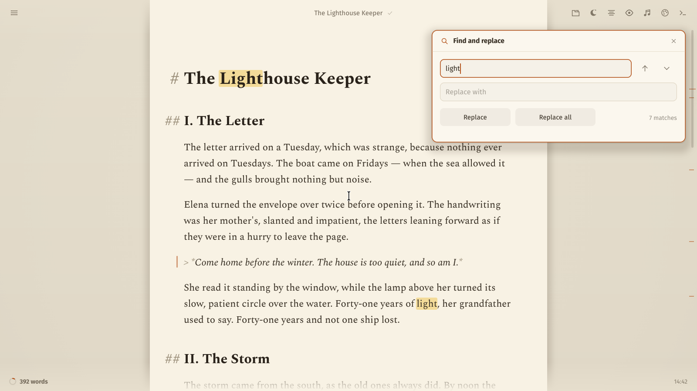

<!-- Generated by tools/readmes.pl from README.md and docs/i18n/README.zh-CN.po — edit the .po, not this file. -->
<div align="center">

<a id="folioos--the-distraction-free-writing-os-that-boots-from-a-usb-stick"></a>

# FolioOS — 从 U 盘直接启动、毫无干扰的写作系统

**把任何一台旧笔记本变成专用的写作机。**<br>
没有 Windows。没有 Linux。没有网络。没有通知。只有你和文字。

[](https://github.com/alantaru/FolioOS/actions/workflows/build.yml)
[](https://github.com/alantaru/FolioOS/releases/latest)
[](LICENSE)
[](#hardware-compatibility)
[](#13-15-languages-and-counting)
[](docs/TRANSLATING.md)

[**⬇ 下载**](https://github.com/alantaru/FolioOS/releases/latest) ·
[安装](#install-in-3-minutes) ·
[浏览](#a-tour-of-folioos) ·
[语言](#13-15-languages-and-counting) ·
[常见问题](#faq) ·
[构建](#build-from-source) ·
[参与贡献](CONTRIBUTING.md)

<!-- languages -->
<sub>[English](README.md) · [Español](README.es.md) · [Français](README.fr.md) · [Deutsch](README.de.md) · [Italiano](README.it.md) · [Português (Brasil)](README.pt-BR.md) · [Português (Portugal)](README.pt-PT.md) · [Nederlands](README.nl.md) · [Polski](README.pl.md) · [Türkçe](README.tr.md) · [Русский](README.ru.md) · [Українська](README.uk.md) · **简体中文** · [日本語](README.ja.md) · [한국어](README.ko.md)</sub>
<!-- /languages -->


</div>

FolioOS 是一个**可启动的写作环境**：一个只做一件事的小小操作系统——让你写作。把 U 盘插进过去十年里几乎任何一台电脑，
从它启动，几秒钟后你就进入一个全屏、排版精美的 Markdown 编辑器，正好停在你上次离开的地方。没有浏览器、邮件、应用商店，
也没有 Wi-Fi 来分散你的注意力。

你的文字以**普通的 Markdown 文件保存在一个普通的 FAT32 U 盘上**，所以同一个 U 盘在 Windows、macOS 和 Linux 上都能打开。
需要分享时，可导出为 Word、LibreOffice、EPUB、HTML 或 RTF。

<a id="who-is-it-for"></a>

## 适合谁？

- **小说家、记者、学生和博主**：想要一台 *writerdeck*——一台专用的无干扰写作设备——又不想购买新硬件。
- **NaNoWriMo 参与者**，以及所有进行限时写作冲刺或写晨间日记的人。
- **抽屉里有台旧笔记本的人**：FolioOS 让它重获新生，而且不碰它的硬盘。
- **学校和图书馆**：需要一个简单的离线写作工位。
- **重视隐私的写作者**：没有网络、没有遥测、没有云。

<a id="install-in-3-minutes"></a>

## 3 分钟安装

1. 从最新版本**下载** [`FolioOS.zip`](https://github.com/alantaru/FolioOS/releases/latest)。
2. **解压到一个 FAT32 格式 U 盘的根目录。** 大多数 32 GB 以下的 U 盘本来就是 FAT32。U 盘上已有的文件会保留。
   （[如何格式化为 FAT32](docs/INSTALL.txt)）
3. **重启电脑并打开启动菜单**——通常是 **F12**（Dell、联想）、**F9**（惠普）、**F8**（华硕）或 **Esc/F11**——
   然后选择 U 盘的 **UEFI** 选项。如果没有出现，请在固件设置中关闭 *Secure Boot*。

<details>
<summary><b>其他安装方式</b></summary>

- **磁盘镜像：** `FolioOS-disk-image.zip` 包含一个现成的 256 MB 镜像，可用于 [Rufus](https://rufus.ie)（DD 模式）、
  [balenaEtcher](https://etcher.balena.io) 或 `dd`。仍然推荐解压 `FolioOS.zip`：U 盘的其余空间可以留给你的文件。
- **在 Windows 上从源码构建：** 先运行 `.\build.ps1`，再运行 `.\flash_usb.ps1 -DriveLetter E:`（安装或更新 U 盘，不删除任何东西）。
- **一切都已包含：** `FolioOS.zip` 已附带 11 款适合写作和阅读的免费字体，以及中文、日文和韩文字体——所有语言开箱即用。

</details>

> **不重启也能试用：** `folio_sim.exe` 在 Windows 窗口中运行同样的代码，`efi_host.exe` 则运行真正的 UEFI 程序——
> 参见[从源码构建](#build-from-source)。

---

<a id="a-tour-of-folioos"></a>

## FolioOS 浏览

<a id="1-start-up"></a>

### 1. 启动


FolioOS 直接从固件启动。字体加载期间会显示启动画面，按任意键即可跳过——你可以马上开始输入。启动画面的时长（1–60 秒）可以设置，
也可以关闭。

第一次启动时，FolioOS 会跟随电脑固件设置的语言，并打开一段简短的欢迎文字。此后，它总是重新打开**你最后的文档，并停在你
所在的那一行**——即使你当时在阅读模式中。

<br clear="right">

<a id="2-the-writing-screen"></a>

### 2. 写作界面


页面就是全部。顶部和底部的工具栏**一开始输入就会淡出**，移动鼠标时又会回来。Markdown 实时呈现——`#` 标题、`**粗体**`、
`*斜体*`、`> 引文`、列表和 `- [ ]` 任务——而标记依然可见、可编辑。右侧细细的滚动条显示你所在的位置，并标出每一章。

- **智能排版：** `--` 变成破折号，`...` 变成省略号，直引号会变成*适合你的语言*的弯引号（中文和英文用 “ ”，法文用 « »，
  德文用 „ “，日文用 「 」）。
- **纸张或全屏：** 在桌面上的一张纸上写，或者铺满整个屏幕；可选择栏宽（窄、中、宽、特宽）。
- 撤销/重做、按词移动、用 **Alt+↑/↓** 移动段落、复制或删除段落、用 **Shift+F3** 切换大小写、用 `( " * _` 包住选中内容，
  以及用 **Ctrl+J** 跳回上次编辑的位置。

<a id="3-focus-mode-and-zen-mode"></a>

### 3. 专注模式与禅模式

<div align="center">


</div>

**F2** 会淡化除你正在写的句子、段落或行之外的一切。**F3** 是*打字机模式*：当前行始终停在屏幕中央。**F11** 是*禅模式*：
在你触碰屏幕上边缘之前，不显示任何工具栏。**海明威模式**会禁用删除，让你一直向前写。

<a id="4-reading-mode"></a>

### 4. 阅读模式


**Ctrl+P** 把你的 Markdown 变成像书一样排版的页面。用方向键、空格键或点击页边距翻页。底部栏显示你已读了多少，以及读完本章
和全文还需多久；**自动滚动**按你的阅读速度（每分钟字数）移动文字：**Enter** 或鼠标中键启动，**+** 和 **−** 调整速度。
**Esc** 回到写作，*停在你正在读的那个段落*。

<a id="5-chapters-and-outline"></a>

### 5. 章节与大纲


每个 `#` 标题就是一章。**F5** 打开大纲，可跳到任意位置；**Ctrl+PgUp/PgDn** 在写作和阅读模式中都能在章节间切换。长篇手稿依然
易于浏览——EPUB 导出还会把这些章节变成真正的电子书目录。

<br clear="right">

<a id="6-find-and-replace"></a>

### 6. 查找与替换



**Ctrl+F** 高亮所有匹配项、统计数量，并替换一个或全部。

<a id="7-files-open-save-and-export"></a>

### 7. 文件：打开、保存和导出

<div align="center">


</div>

**Ctrl+O** 打开一个真正的文件管理器：固件提供的所有驱动器、文件夹，以及新建、重命名和删除。**Ctrl+Shift+S** 可以另存为，
或**导出为 DOCX、ODT、EPUB、HTML、RTF 或 TXT**——点一下格式即可。其余一切都是自动的：

- **自动保存**（默认每 20 秒一次），采用**原子写入**：断电也绝不会留下半个文件。
- **自动版本：** 每个已保存文件的上一个版本会存入 `FOLIO/VERSIONS`（每个文档保留最近 30 个）。
- **草稿恢复**：用于从未命名的文字。

<a id="8-tabs-optional"></a>

### 8. 标签页（可选）


想同时打开多个文档？用右上角的第一个图标开启标签页。**Ctrl+N** 新建标签页，**Ctrl+W** 关闭，**Ctrl+Tab** 或 **Alt+1…9**
切换。标签页——包括未命名的——在重启后都会恢复。关闭标签页时，FolioOS 依然是一台安静的、一次只写一个文档的打字机。

<a id="9-goals-sprints-and-statistics"></a>

### 9. 目标、冲刺和统计


**F10** 显示你的每日字数目标、本文档和本次会话的字数、阅读时间以及你的写作速度。**F4** 开始一次限时的**写作冲刺**
（15–60 分钟），结束时会响起轻柔的铃声。今天写下的字数会跨文档、跨重启累计。

<br clear="right">

<a id="10-command-palette-and-shortcuts"></a>

### 10. 命令面板和快捷键


**Ctrl+K** 只需输入几个字母就能找到任何命令——用你的语言。**F1** 列出所有快捷键：


<a id="no-mouse-needed"></a>

#### 无需鼠标

FolioOS 的一切都可以只用键盘完成，还可以彻底关闭鼠标和触摸板（*设置 › 系统 › 使用鼠标和触摸板*、**Ctrl+K › 鼠标**，
或在 `CONFIG.INI` 中设置 `use_mouse=0`）——对于触摸板会让光标乱跳的笔记本很方便。

| 按键 | 作用 |
|---|---|
| 窗口的快捷键（F12、F5、F6、F10、Ctrl+O…） | 打开该窗口，并让键盘直接作用于它 |
| **Tab** / **Shift+Tab**、**↑ ↓** | 在窗口内的按钮、开关、滑块和列表之间移动 |
| **Enter** 或**空格** | 按下高亮的按钮、开关或项目 |
| **← →** | 调整高亮的滑块、选项或数值 |
| **Esc** | 关闭窗口并回到文本；没有打开任何窗口时，显示隐藏的工具栏 |
| **Ctrl+F6** | 让键盘在文本和打开的窗口之间切换 |
| **Alt+M** | 带有最近文档的菜单（也可在 Ctrl+K 中找到） |
| **Alt+F7** / **Alt+F8** | 用方向键移动 / 调整窗口大小（Shift = 小步）；Enter 确认，Esc 撤销 |

高亮框会显示键盘当前所在的控件；只有在你使用按键时才会出现，所以对用鼠标的人来说一切照旧。在侧边窗口（大纲、音乐、设置）中
输入的字母会直接回到你的文本中。

<a id="11-themes-and-typography"></a>

### 11. 主题与排版


**F12** 打开外观设置：**20 款精心调校的主题**、正文字体、字号、行距、段距和首行缩进。文字由 FolioOS 自己的 TrueType 引擎
绘制，具备真正的字距调整和抗锯齿，从上网本的小屏幕到 4K 都清晰锐利。

<div align="center">


</div>


**打造你自己的主题：** 主题编辑器可以让你挑选 16 种颜色中的每一种（或从任何内置主题借用），为正文和界面各选一种字体，并实时看到
效果。主题是 `FOLIO/THEMES` 中的小型 `.INI` 文本文件——便于分享。把任何 `.ttf` 字体放进 `FOLIO/FONTS` 即可使用；FolioOS
已附带 Literata、Lora、EB Garamond、iA Writer Quattro/Duo/Mono、Special Elite 等字体。

<br clear="right">

<a id="12-music-while-you-write"></a>

### 12. 边写边听音乐

**F6** 打开一个小巧的 MP3 播放器，播放 U 盘 `MUSIC` 文件夹中的文件（Intel HD Audio 和 AC'97）。**F7/F8/F9** 可在不离开页面的
情况下控制它。

<a id="13-15-languages-and-counting"></a>

### 13. 15 种语言，还在增加

<div align="center">


</div>

**English, Español, Français, Deutsch, Italiano, Português (Brasil), Português (Portugal), Nederlands,
Polski, Türkçe, Русский, Українська, 简体中文, 日本語, 한국어.**


与语言有关的一切都没有写死在代码里。每种翻译都是 `FOLIO/LANGUAGES` 中一个标准的 **gettext `.po` 文件**，它还定义了复数规则、
引号、日期格式、小数点、默认键盘和字体——**添加一种语言就是往 U 盘里放一个文件**。键盘布局同样是文本文件：US、US 国际、英国、
ABNT2、葡萄牙、西班牙、拉丁美洲、法语 AZERTY、德语 QWERTZ、意大利语、波兰语、土耳其语 Q、俄语、乌克兰语、韩语（两套式
韩文输入）和日语（罗马字 → 假名输入）。

想要 FolioOS 说你的语言？请阅读 **[docs/TRANSLATING.md](docs/TRANSLATING.md)**——可使用 Poedit、Weblate、Crowdin 或任何文本编辑器。

<br clear="right">

<a id="14-your-files-on-any-computer"></a>

### 14. 你的文件，在任何电脑上

```
U 盘（FAT32）
├── DOCUMENTS/          你的 .md 和 .txt 文件，以及导出的文件（.docx .odt .epub .html .rtf）
├── MUSIC/              你的 .mp3 文件
├── FOLIO/
│   ├── CONFIG.INI      偏好设置——纯文本，可手动编辑
│   ├── FONTS/          .ttf 字体（可添加你自己的）
│   ├── THEMES/         你的主题（.INI）
│   ├── LANGUAGES/      翻译（.po）
│   ├── KEYBOARDS/      键盘布局（.txt）
│   └── VERSIONS/       已保存文件的自动历史版本
└── EFI/BOOT/           FolioOS 本身（BOOTX64.EFI、BOOTIA32.EFI）
```

没有数据库，没有隐藏分区，没有专有格式。把 U 盘带到任何一台电脑上，你写的东西都在那里。

---

<a id="how-folioos-compares"></a>

## FolioOS 与其他方案的比较

| | FolioOS | 专用设备（Freewrite、AlphaSmart、Pomera） | 写作应用（iA Writer、Scrivener、专注模式） |
|---|:---:|:---:|:---:|
| 价格 | **免费** | 数百美元 | 免费到付费不等 |
| 硬件 | 你已有的任何 UEFI 电脑 | 一台新设备 | 你平常用的电脑 |
| 触手可及的干扰 | **没有**——没有操作系统，没有网络 | 没有 | 一个 Alt+Tab 之遥 |
| 文件格式 | FAT32 上的普通 Markdown | 设备专用的同步/导出 | 各不相同 |
| 屏幕与排版 | 大屏幕、TrueType、主题 | 小尺寸墨水屏或液晶屏 | 出色 |
| 离线可用 | **始终** | 大多可以 | 是 |
| 开源 | **是（GPL-3.0）** | 否 | 大多不是 |

<a id="hardware-compatibility"></a>

## 硬件兼容性

| | |
|---|---|
| **固件** | UEFI 2.x——64 位（`BOOTX64.EFI`）或 32 位（`BOOTIA32.EFI`，Atom 平板和上网本）。必须关闭 Secure Boot。大约 2012 年以后的大多数电脑和笔记本。 |
| **显示** | 任何 UEFI GOP 帧缓冲（RGB、BGR、位掩码、仅 Blt）或旧式 UGA。原生分辨率，自动 HiDPI 缩放，竖屏自动旋转。 |
| **输入** | 键盘通过固件；USB/PS/2 鼠标、触摸板和触摸屏通过固件的指针协议。 |
| **声音** | Intel HD Audio 和 AC'97（仅音乐播放器需要）。 |
| **不支持** | 仅支持 BIOS/CSM 的电脑、Secure Boot（暂时）、Apple Silicon Mac。Wi-Fi 和蓝牙是刻意不支持的。 |

每次启动时，FolioOS 都会把它发现的硬件写入 `FOLIO/DIAGNOSTICS.TXT`。欢迎在[硬件报告](https://github.com/alantaru/FolioOS/issues/new/choose)
中分享你的文件——哪怕只是“一切正常”，也能帮助其他写作者挑选笔记本。

<a id="faq"></a>

## 常见问题

<details>
<summary><b>它会清空我的电脑或 U 盘吗？</b></summary>

不会。FolioOS 从不触碰内置硬盘，安装它也只是往 U 盘里添加文件——原有的东西都会保留。拔掉 U 盘，电脑又会启动它平常的系统。
</details>

<details>
<summary><b>电池耗尽时，我写的东西安全吗？</b></summary>

保存是原子性的（新文件完整写入后才替换旧文件），自动保存默认每 20 秒运行一次，未命名的文字有恢复草稿，每个已保存的文件都会在
`FOLIO/VERSIONS` 中保留以前的版本。
</details>

<details>
<summary><b>我也能在平常用的电脑上编辑这些文件吗？</b></summary>

可以。它们是 FAT32 U 盘 `DOCUMENTS` 文件夹中的普通 `.md` 文件。用 Obsidian、Typora、VS Code、记事本、TextEdit 或任何
Markdown 编辑器打开，然后把 U 盘插回去，继续在 FolioOS 中写作。
</details>

<details>
<summary><b>为什么我的电脑在启动菜单里看不到 U 盘？</b></summary>

请确认 U 盘是 FAT32 格式、你选择的是以 “UEFI” 开头的选项，并且固件设置中已关闭 Secure Boot。只能以 BIOS/CSM 模式启动的
非常老的电脑不受支持。
</details>

<details>
<summary><b>能在 Mac 上运行吗？</b></summary>

Intel Mac 可以从 UEFI 驱动器启动（开机时按住 <kbd>Option</kbd>），但尚未经过测试——欢迎反馈。Apple Silicon Mac 不受支持。
</details>

<details>
<summary><b>可以用中文、日文或韩文写作吗？</b></summary>

**韩文和日文可以。** 在*设置 › 系统*中选择 *한국어 (두벌식)* 或 *日本語 (ローマ字かな)* 键盘：韩文使用标准的两套式布局，
边输入边组成音节（退格键每次删除一个字母）；日文把罗马字转换成平假名或片假名（`nihongo` → にほんご）。**Ctrl+空格**
在输入法和拉丁字母之间切换。字体已随 FolioOS 附带——只要文本中出现这些文字，合适的字体就会自动加载。日文汉字转换和中文拼音
需要词典，仍在路线图上。拉丁文、希腊文和西里尔文可用自带的键盘布局输入。
</details>

<details>
<summary><b>可以不用鼠标吗？</b></summary>

可以。每个窗口、按钮和设置都能用键盘操作（Tab、方向键、Enter、空格、Esc），你还可以在*设置 › 系统*中彻底关闭鼠标和触摸板。
参见[无需鼠标](#no-mouse-needed)。
</details>

<details>
<summary><b>有拼写检查、网络或云同步吗？</b></summary>

没有网络和同步，这是刻意的——FolioOS 本就是为离线使用而设计。拼写检查在路线图上。由于文件是普通的 Markdown，当 U 盘回到
普通电脑时，你可以用任何工具同步它们。
</details>

<a id="build-from-source"></a>

## 从源码构建

要求：Windows 10/11、PowerShell 5.1+，以及 `PATH` 中的 [MinGW-w64](https://winlibs.com) `gcc`（任何较新的 x86_64 版本）。
除此之外别无所需。

```powershell
git clone https://github.com/alantaru/FolioOS.git
cd FolioOS
.\build.ps1                                  # UEFI x64 + IA32、模拟器、发行包——以及全部测试
.\build\folio_sim.exe                        # 在窗口中运行 FolioOS
.\build\efi_host.exe build\efi\BOOTX64.EFI   # 在窗口中运行真正的 UEFI 程序
.\flash_usb.ps1 -DriveLetter E:              # 安装/更新 FAT32 U 盘，保留用户文件
.\build.ps1 -Image -ImageMB 256              # 可选：为 Rufus / Etcher / dd 生成磁盘镜像
.\tools\fetch-cjk-fonts.ps1                  # 下载一次中日韩字体（需要时 build.ps1 会自动运行）
.\tools\showcase.ps1                         # 重新生成本 README 的截图
```

测试套件用脚本化的按键和鼠标事件驱动模拟器和真正的 `BOOTX64.EFI`（运行在一个小型 UEFI 宿主中），截取屏幕，并验证每一种导出
（ZIP + XML）、每一种翻译（并对校验器做反向检查）以及六种帧缓冲格式。

<a id="architecture-in-one-picture"></a>

### 一图看懂架构

```
src/core/       可移植核心（独立 C，无 libc）：编辑器、Markdown、TrueType 光栅化器、
                界面工具包和窗口管理器、导出、MP3、i18n、键盘布局、主题
src/platform/   uefi/  GOP/UGA 显示、输入、FAT 读写、HD Audio/AC'97——直接运行在固件之上
                win32/ 用于开发和自动测试的模拟器
tools/          efi_host（在 Windows 上运行 BOOTX64.EFI）、i18n 工具、磁盘镜像生成器、showcase
assets/         字体、翻译（.po）、键盘布局、示例主题
tests/          脚本化的端到端测试
```

一个约 600 KB 的程序通过一层很薄的平台层掌控整台机器。详见 [docs/ARCHITECTURE.md](docs/ARCHITECTURE.md)。

<a id="roadmap"></a>

## 路线图

- [x] 韩文输入（两套式韩文）和日文假名输入（罗马字 → 平假名/片假名）
- [ ] 日文汉字转换和中文拼音输入（需要词典）
- [ ] 复杂文字排版和从右到左的文字（阿拉伯文、希伯来文、天城文…）
- [ ] 使用 Hunspell 兼容词典的拼写检查
- [ ] Secure Boot 支持（已签名的 shim）
- [ ] 模拟器和工具的 Linux 与 macOS 版本

欢迎在 [Discussions](https://github.com/alantaru/FolioOS/discussions) 中投票和提出建议。

<a id="contributing"></a>

## 参与贡献

错误报告、硬件报告、翻译、键盘布局、主题、字体、文档和代码都非常欢迎——请从 [CONTRIBUTING.md](CONTRIBUTING.md) 开始。请遵守
[行为准则](CODE_OF_CONDUCT.md)；安全问题请按 [SECURITY.md](SECURITY.md) 中的说明私下报告。

如果 FolioOS 帮助了你的写作，**⭐ 请为仓库点个星**——这能帮助其他写作者找到它。

<a id="license"></a>

## 许可证

FolioOS 是基于 [GNU General Public License v3.0](LICENSE) 的自由软件。附带的字体采用 SIL Open Font License；minimp3 为 CC0。
参见 [THIRD_PARTY_NOTICES.md](THIRD_PARTY_NOTICES.md)。

<sub>FolioOS · 无干扰写作软件 · 可启动 U 盘写作环境 · writerdeck · Freewrite / AlphaSmart 的 DIY 替代品 · 旧笔记本的数字打字机 ·
离线 Markdown 编辑器 · 专注写作应用 · 用 C 编写的 UEFI 应用 · 小说与 NaNoWriMo 写作工具。</sub>
